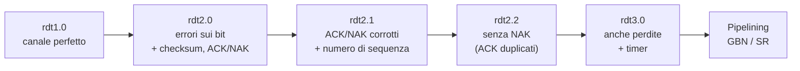
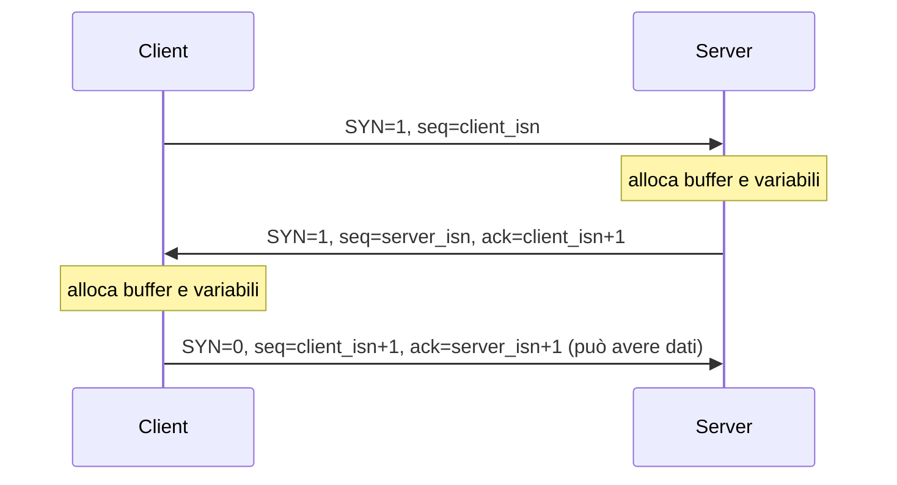
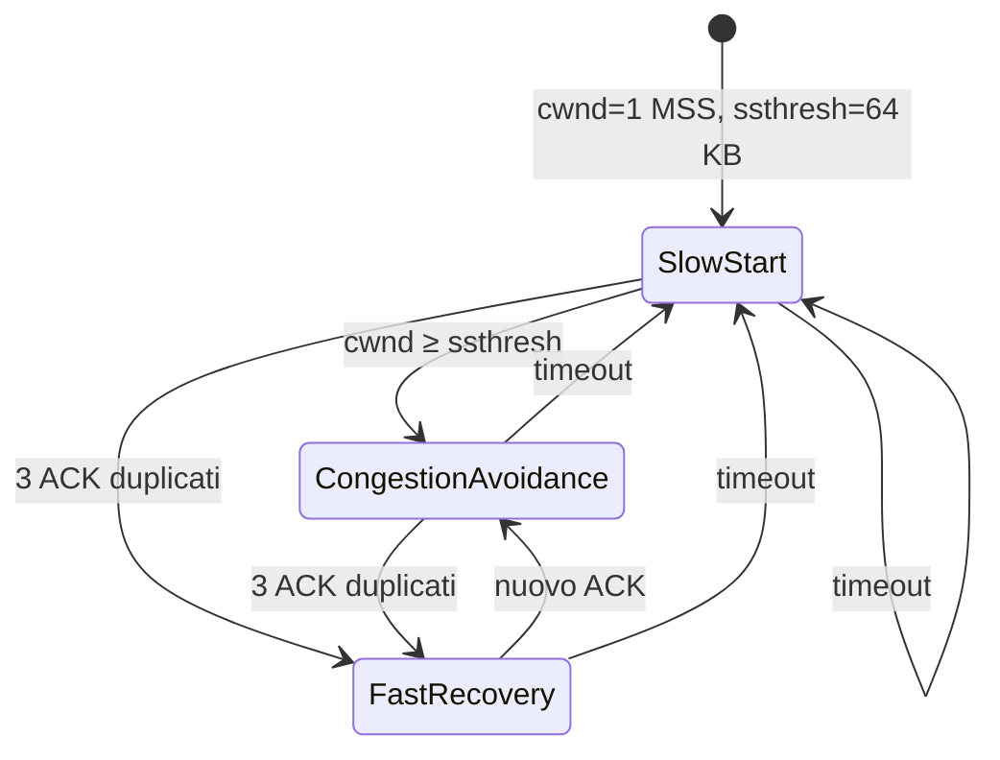

# Livello di trasporto

> [!abstract] Di cosa parla questo capitolo
> Il livello di trasporto sta tra l'applicazione ([[02 - TLC - Livello di applicazione|Capitolo 2]]) e la rete (Capitoli 4–5) e ha un compito preciso: **estendere il servizio di consegna "da host a host" del livello di rete a un servizio "da processo a processo"** per le applicazioni.
> Il capitolo alterna **principi** e **protocolli reali**:
> 1. relazione tra trasporto e rete, **multiplexing/demultiplexing**, **UDP**;
> 2. il problema centrale del networking: **come comunicare in modo affidabile su un canale che perde e altera i dati** (protocolli `rdt`, Go-Back-N, ripetizione selettiva);
> 3. come questi principi vengono applicati in **TCP**: connessione, segmento, RTT e timeout, trasferimento affidabile, controllo di flusso, gestione della connessione;
> 4. il secondo grande problema, il **controllo di congestione**: prima i principi, poi l'algoritmo di TCP (slow start, congestion avoidance, fast recovery, AIMD, fairness, ECN).
>
> Nel capitolo 2 si è visto **cosa** offrono TCP e UDP; qui si vede **come** lo fanno.
> Mappa del corso: [[MOC - Telecomunicazioni]].

> [!info] Fonte
> Kurose, Ross, *Reti di calcolatori e Internet*, 7ª ed., Capitolo 3 (pp. 175–267). Le pagine citate sono quelle **del libro**: per il PDF aggiungi 27.

---

## 3.1 Introduzione e servizi a livello di trasporto

Un protocollo a livello di trasporto fornisce una **comunicazione logica** tra processi applicativi su host diversi.

> [!important] Comunicazione logica
> Dal punto di vista dell'applicazione è **come se** gli host che eseguono i processi fossero **direttamente connessi**. In realtà possono trovarsi agli antipodi del pianeta, separati da molti router e collegamenti diversi. I processi usano la comunicazione logica per scambiarsi messaggi **senza preoccuparsi dell'infrastruttura fisica**.

![[TLC-p204-1.png]]

La figura riprende la rete del [[01 - TLC - Reti di calcolatori e Internet#1.2 Ai confini della rete|Capitolo 1]] e collega con la freccia "Trasporto logico end-to-end" **due sistemi periferici**: una rete domestica e un server nella rete aziendale. Solo questi due hanno la pila completa, con il livello **Trasporto** evidenziato. I router intermedi hanno solo i livelli Rete, Collegamento e Fisico.

- I protocolli di trasporto sono implementati **nei sistemi periferici, non nei router**.
- **Lato mittente** il trasporto spezza, se serve, i messaggi dell'applicazione in parti più piccole e aggiunge a ciascuna un'intestazione: ottiene così i **segmenti** (*transport-layer segment*). Poi passa il segmento al livello di rete, che lo incapsula in un **datagramma** (vedi [[Incapsulamento]]).
- I router agiscono **solo sui campi del datagramma** e non esaminano il segmento al suo interno.
- **Lato ricevente** il livello di rete estrae il segmento e lo passa al trasporto, che lo elabora e consegna i dati all'applicazione.
- Internet ha **due** protocolli di trasporto: **TCP** e **UDP** (vedi [[Servizi di Trasporto per le Applicazioni]]).

_(libro, pp. 176–177)_

### Relazione tra i livelli di trasporto e di rete

> [!important] La distinzione
> - Il livello di **trasporto** offre comunicazione logica tra **processi**.
> - Il livello di **rete** offre comunicazione logica tra **host**.

> [!example] L'analogia dei due condomini
> Un condominio a Milano e uno a Roma, con una dozzina di ragazzi ciascuno: sono cugini e si scrivono ogni settimana, 144 lettere in tutto. **Andrea** a Milano e **Anna** a Roma raccolgono la posta dei fratelli, la imbucano e distribuiscono quella in arrivo.
>
> | Analogia | Rete |
> | --- | --- |
> | lettere nelle buste | messaggi dell'applicazione |
> | cugini | processi |
> | condomini | host (sistemi periferici) |
> | Anna e Andrea | protocollo di trasporto |
> | servizio postale (con i postini) | protocollo di rete |
>
> - Il servizio postale trasporta la posta **da casa a casa**, non da persona a persona: è il livello di rete. Anna e Andrea la consegnano **alla persona giusta**: è il livello di trasporto.
> - Anna e Andrea lavorano **solo a casa** e non partecipano allo smistamento negli uffici postali, come i protocolli di trasporto, che stanno **solo nei sistemi periferici**.
> - Se in vacanza li sostituiscono Susanna ed Enrico, più giovani e distratti, che a volte perdono lettere, il servizio offerto è **diverso**: una rete può offrire **più protocolli di trasporto**, ognuno con un proprio modello di servizio.
> - Se le poste non garantiscono un tempo massimo di consegna, Anna e Andrea non possono garantirlo ai cugini. Allo stesso modo il trasporto è **vincolato** dal servizio di rete: se la rete non garantisce ritardo o banda, non può garantirli neanche il trasporto.

Ci sono però servizi che il trasporto **può offrire anche se la rete non li offre**:
- il **trasferimento affidabile**, anche se la rete perde, altera o duplica i pacchetti;
- la **riservatezza**, con la crittografia, anche se la rete non la garantisce (Capitolo 8).

_(libro, pp. 176–179)_

### Panoramica del livello di trasporto di Internet

Internet mette a disposizione delle applicazioni:
- **UDP** (*User Datagram Protocol*): servizio **non affidabile e non orientato alla connessione**;
- **TCP** (*Transmission Control Protocol*): servizio **affidabile e orientato alla connessione**.

> [!note] Terminologia
> Nel libro il pacchetto di trasporto si chiama **segmento**, sia per TCP sia per UDP. Gli RFC chiamano spesso "datagramma" il pacchetto UDP, ma qui il termine **datagramma** è riservato al pacchetto del livello di rete.

**Premessa sul livello di rete.** Il protocollo di rete di Internet è **IP** (*Internet Protocol*):
- fornisce comunicazione logica **tra host**;
- il suo modello di servizio è **best effort** ("massimo sforzo"): fa del suo meglio per consegnare i segmenti, **ma non offre garanzie**;
- non garantisce la consegna, né l'ordine, né l'integrità dei dati: è un **servizio non affidabile**;
- ogni host ha almeno un **indirizzo IP** (vedi [[Protocollo IP]]).

**Cosa aggiungono UDP e TCP:**
- il compito minimo è passare dalla consegna **host-to-host** alla consegna **process-to-process**: è il **multiplexing/demultiplexing**;
- entrambi offrono un **controllo di integrità** (rilevamento di errori) tramite campi nell'intestazione;
- **UDP offre solo questi due servizi** ed è quindi non affidabile come IP;
- **TCP** offre in più:
  - **trasferimento dati affidabile**, con controllo di flusso, numeri di sequenza, acknowledgment e timer: trasforma il servizio non affidabile di IP in un servizio affidabile tra processi;
  - **controllo di congestione**, un servizio offerto **a Internet nel suo complesso**: impedisce che le connessioni TCP intasino collegamenti e router, ripartendo la banda equamente. Il traffico UDP **non è regolato**.

_(libro, pp. 179–180)_

---

## 3.2 Multiplexing e demultiplexing

Vedi [[Multiplexing e Demultiplexing]].

Il problema è come trasformare il servizio **host-to-host** del livello di rete in un servizio **process-to-process**.

**Esempio.** Sul tuo computer girano contemporaneamente due sessioni Telnet, una FTP e una HTTP. Quando arrivano dati dal livello di rete, il trasporto deve consegnarli al **processo giusto** tra questi quattro.

Un processo può gestire una o più **socket** (vedi [[Socket]]). Il trasporto **non consegna i dati direttamente al processo**, ma alla **socket**, che fa da intermediario. Ogni socket ha un **identificatore univoco**, il cui formato dipende dal tipo (UDP o TCP).

![[TLC-p208-1.png]]

Nella figura tre host si scambiano dati. L'host centrale ha due processi, $P_1$ e $P_2$, ognuno con la sua socket (il rettangolo grigio). Il suo livello di trasporto deve smistare i segmenti in arrivo verso $P_1$ o $P_2$ e raccogliere i dati in uscita da entrambi.

- **Demultiplexing**: consegnare i dati di un segmento di trasporto **alla socket giusta**, usando i campi dell'intestazione.
- **Multiplexing**: raccogliere i dati dalle diverse socket dell'host di origine, incapsularli con un'intestazione e passarli al livello di rete.

Nell'analogia dei condomini, **Anna fa multiplexing** quando raccoglie le lettere e le imbuca, e **Andrea fa demultiplexing** quando legge il nome sulla busta e consegna la lettera al cugino giusto.

Per funzionare servono:
1. socket con **identificatori univoci**;
2. segmenti con campi che indicano la socket di destinazione: il **numero di porta di origine** e il **numero di porta di destinazione**.

![[TLC-p209-1.png]]

La figura mostra la struttura generica di un segmento: su una riga di 32 bit ci sono **porta di origine** e **porta di destinazione** (16 bit ciascuna), poi altri campi dell'intestazione e infine i dati dell'applicazione.

- I numeri di porta sono di **16 bit**, da **0 a 65535**.
- Le porte da **0 a 1023** sono **porte note** (*well-known port number*), riservate a protocolli noti come HTTP (80) e FTP (21). L'elenco è su `www.iana.org` (RFC 3232).
- Una nuova applicazione deve scegliere il proprio numero di porta.

_(libro, pp. 180–182)_

### Multiplexing e demultiplexing non orientati alla connessione (UDP)

Una socket UDP creata con

```python
clientSocket = socket(AF_INET, SOCK_DGRAM)
```

riceve **automaticamente** un numero di porta libero tra 1024 e 65535. Con `bind()` le si può assegnare una porta precisa:

```python
clientSocket.bind(('', 19157))
```

Di solito il **lato client** lascia la porta al sistema operativo, mentre il **lato server** ne fissa una specifica, quella del "protocollo noto" se ce n'è uno.

**Esempio.** Un processo sull'host A con porta UDP 19157 invia dati a un processo sull'host B con porta 46428:
1. il trasporto di A crea un segmento con porta di origine 19157 e porta di destinazione 46428 e lo passa al livello di rete;
2. IP fa un tentativo **best effort** di consegnarlo a B;
3. il trasporto di B guarda la **porta di destinazione** (46428) e consegna il segmento alla socket corrispondente.

> [!important] Identificatore di una socket UDP
> Una socket UDP è identificata dalla coppia **(IP di destinazione, porta di destinazione)**.
> Due segmenti con **IP o porte di origine diversi** ma **stessa destinazione** finiscono nella **stessa socket**.

**A cosa serve la porta di origine?** È parte dell'**indirizzo di ritorno**: quando B risponde ad A, la porta di destinazione della risposta è la porta di origine della richiesta.

![[TLC-p211-1.png]]

La figura mostra l'**inversione delle porte**:
- il segmento da A a B ha porta di origine 19157 e porta di destinazione 46428;
- la risposta da B ad A ha porta di origine 46428 e porta di destinazione 19157.

È quello che fa `UDPServer.py` del [[02 - TLC - Livello di applicazione#Programmazione delle socket con UDP|Capitolo 2]]: `recvfrom()` estrae l'indirizzo del client, che il server usa come destinazione della risposta.

_(libro, pp. 182–184)_

### Multiplexing e demultiplexing orientati alla connessione (TCP)

> [!important] Identificatore di una socket TCP
> Una socket TCP è identificata da **quattro valori**: (IP di origine, porta di origine, IP di destinazione, porta di destinazione).
> A differenza di UDP, due segmenti TCP con **IP o porta di origine diversi** vengono diretti a **due socket diverse**, anche se la destinazione è la stessa. L'eccezione sono i segmenti con la richiesta di connessione.

Riprendendo l'esempio TCP del [[02 - TLC - Livello di applicazione#Programmazione delle socket con TCP|Capitolo 2]]:
1. il server ha una **socket di benvenuto** in ascolto sulla porta 12000;
2. il client crea una socket e chiama `clientSocket.connect((serverName, 12000))`, che invia un segmento di **richiesta di connessione**: porta di destinazione 12000, uno speciale bit di richiesta di connessione posto a 1 e una porta di origine scelta dal client;
3. il sistema operativo del server trova il processo in attesa sulla porta 12000, che crea una nuova socket con `connectionSocket, addr = serverSocket.accept()`;
4. la nuova **socket di connessione** è identificata dai **quattro valori** del segmento di richiesta. Tutti i segmenti successivi con quei quattro valori finiscono in questa socket.

![[TLC-p212-1.png]]

La figura mostra **due client che usano la stessa porta di destinazione (80)** verso lo stesso web server B:
- l'host **C** apre **due** connessioni HTTP, con porte di origine 7532 e 26145 ("invia 2 pacchetti", annotazione rossa);
- l'host **A** apre una connessione, sempre con porta di origine **26145**.

Come dice l'annotazione, questo **non è un problema**: le due connessioni con porta 26145 hanno **IP di origine diversi** (A e C), quindi la quadrupla è diversa. Il server fa demultiplexing verso tre processi HTTP distinti.

**Web server e TCP.** Un web server su porta 80 riceve **tutti** i segmenti con porta di destinazione 80, sia quelli di connessione sia quelli con le richieste HTTP, e li distingue tramite IP e porta di origine.
- Non c'è sempre **corrispondenza uno a uno** tra socket e processi: i web server ad alte prestazioni usano **un solo processo** e creano un **thread** e una socket di connessione per ogni client.
- Con **HTTP persistente** si usa la stessa socket per tutta la connessione. Con **HTTP non persistente** si crea e si chiude una socket per ogni richiesta/risposta, il che può pesare sulle prestazioni del server (vedi [[Connessioni Persistenti e Non Persistenti]]).

> [!tip] Box 3.1 — Il controllo delle porte (port scanning)
> Una porta aperta corrisponde a un'applicazione in esecuzione: utile per gli amministratori, ma anche per gli **attaccanti**. Se su un host gira un'applicazione vulnerabile, come SQL Server con il buffer overflow sfruttato dal worm Slammer sulla porta UDP 1434, l'host è un bersaglio.
> I **port scanner** come **nmap** provano le porte in sequenza: con TCP cercano quelle che accettano connessioni, con UDP quelle che rispondono. Vedi [[Nmap scan types]] e [[#Gestione della connessione TCP|più avanti]] per come nmap usa i segmenti SYN. _(p. 186)_

_(libro, pp. 184–187)_

---

## 3.3 Trasporto non orientato alla connessione: UDP

Vedi [[Protocollo UDP]].

Se si progettasse un protocollo di trasporto "vuoto", che passa i messaggi direttamente alla rete, mancherebbe almeno il multiplexing/demultiplexing. **UDP** (RFC 768) fa praticamente **il minimo indispensabile**:
- aggiunge le **porte** di origine e destinazione e altri due piccoli campi;
- passa il segmento al livello di rete, che lo incapsula in un datagramma IP e fa un tentativo best effort;
- a destinazione usa la porta per consegnarlo al processo giusto.

Non c'è **handshaking**: per questo UDP è **non orientato alla connessione**.

**Esempio: il DNS.** L'applicazione DNS crea una query e la passa a UDP. UDP aggiunge l'intestazione senza handshaking e la passa al livello di rete. Se la risposta non arriva, l'applicazione riprova con un altro server oppure segnala l'errore.

### Perché scegliere UDP invece di TCP

TCP è affidabile, quindi perché usare UDP? Ci sono quattro motivi:

| Motivo | Spiegazione |
| --- | --- |
| **Controllo più fine su cosa e quando inviare** | UDP impacchetta e spedisce **subito**. TCP ha il controllo di congestione, che può **ritardare** l'invio, e ritrasmette finché non riceve conferma, qualunque sia il tempo necessario. Le applicazioni in tempo reale vogliono una velocità minima e tollerano qualche perdita; se serve, possono implementare funzioni extra **nell'applicazione** |
| **Nessuna connessione** | niente handshake a tre vie e quindi **niente ritardo iniziale**. È il motivo principale per cui il **DNS** usa UDP. **QUIC** (usato da Chrome) usa UDP e implementa l'affidabilità a livello applicativo |
| **Nessuno stato di connessione** | TCP mantiene buffer, parametri di congestione e numeri di sequenza e di ACK. UDP no, quindi un server UDP può gestire **molti più client** |
| **Intestazione più piccola** | **8 byte** per UDP contro **20** per TCP |

**Applicazioni e protocolli di trasporto** (Figura 3.6 del libro):

| Applicazione | Protocollo applicativo | Trasporto |
| --- | --- | --- |
| Posta elettronica | SMTP | TCP |
| Accesso a terminali remoti | Telnet | TCP |
| Web | HTTP | TCP |
| Trasferimento file | FTP | TCP |
| Server di file remoti | NFS | generalmente UDP |
| Dati multimediali in streaming | generalmente proprietario | UDP o TCP |
| Telefonia su Internet | generalmente proprietario | UDP o TCP |
| Gestione di rete | SNMP | generalmente UDP |
| Traduzione di nomi | DNS | generalmente UDP |

- **SNMP** usa UDP perché la gestione della rete serve proprio quando la rete è **sotto stress**, cioè quando il trasferimento affidabile con controllo di congestione è difficile.
- Le applicazioni **multimediali** tollerano piccole perdite e reagiscono male al controllo di congestione di TCP, quindi spesso usano UDP. TCP però è sempre più usato per lo streaming, anche perché **alcune organizzazioni bloccano UDP** per sicurezza.

> [!warning] UDP e congestione: un tema controverso
> UDP non ha controllo di congestione. Se tutti facessero streaming ad alto bit rate su UDP, i router sarebbero sovraccarichi e pochi pacchetti arriverebbero a destinazione. Inoltre le perdite causate da UDP **schiaccerebbero le sessioni TCP**, che rallentano davanti alla congestione. Per questo si studiano meccanismi che obblighino anche UDP a un controllo di congestione adattivo (vedi [[#Fairness e UDP]]).

Le applicazioni **possono** ottenere affidabilità anche con UDP, se la implementano esse stesse con notifiche e ritrasmissioni. È però un compito **non banale**.

_(libro, pp. 187–190)_

### Struttura dei segmenti UDP

![[TLC-p218-1.png]]

L'intestazione UDP (RFC 768) ha solo **quattro campi da 2 byte** ciascuno:
- **porta di origine** e **porta di destinazione**, per il demultiplexing;
- **lunghezza**: il numero di byte del segmento, intestazione più dati. Serve perché la lunghezza dei dati varia da un segmento all'altro;
- **checksum**: per rilevare errori. In realtà è calcolato anche su alcuni campi dell'intestazione IP, ma qui si ignora questo dettaglio.

Seguono i **dati dell'applicazione**: per il DNS una query o una risposta, per lo streaming audio i campioni.

_(libro, p. 191)_

### Checksum UDP

Vedi [[Checksum Internet]].

Il checksum serve a capire se i bit del segmento sono stati **alterati** durante il trasferimento, da disturbi sui collegamenti o mentre erano in memoria in un router.

**Calcolo lato mittente:**
1. si sommano tutte le **parole da 16 bit** del segmento, e l'eventuale **riporto finale** viene sommato al bit meno significativo (*wraparound*);
2. si fa il **complemento a 1** del risultato, cioè si invertono tutti i bit;
3. il risultato va nel campo checksum.

> [!example] Esempio del libro (pp. 191–192)
> Tre parole di 16 bit:
> ```text
>   0110011001100000
>   0101010101010101
>   1000111100001100
> ```
> Somma delle prime due:
> ```text
>   0110011001100000
> + 0101010101010101
> = 1011101110110101
> ```
> Sommando la terza c'è un **riporto** (il risultato avrebbe 17 bit), che viene **riportato in fondo e sommato**:
> ```text
>   1011101110110101
> + 1000111100001100
> = 0100101011000010   (dopo aver sommato il riporto al bit meno significativo)
> ```
> Complemento a 1: **checksum = `1011010100111101`**.
>
> **In ricezione** si sommano le tre parole **e** il checksum. Se non ci sono errori il risultato è `1111111111111111`; se c'è anche un solo `0`, è stato introdotto almeno un errore. (Conti ricontrollati: tornano.)

**Perché UDP ha un checksum, visto che molti protocolli di collegamento (come Ethernet) controllano già gli errori?**
- Non è garantito che **tutti** i collegamenti tra origine e destinazione controllino gli errori.
- Anche se i collegamenti fossero perfetti, un errore può essere introdotto **mentre il segmento è nella memoria di un router**.

Quindi, se si vuole rilevare gli errori, il controllo va fatto **end-to-end** a livello di trasporto. È un esempio del **principio end-to-end** (Saltzer 1984):

> [!quote] Dal libro — Principio end-to-end (p. 192)
> Le funzionalità posizionate ai livelli inferiori possono diventare ridondanti o di scarso valore se confrontate con le stesse funzionalità offerte dai livelli superiori.

UDP **rileva** gli errori ma **non li corregge**: alcune implementazioni scartano il segmento danneggiato, altre lo passano all'applicazione con un avvertimento.

_(libro, pp. 191–192)_

---

## 3.4 Principi del trasferimento dati affidabile

Vedi [[Trasferimento Dati Affidabile]].

Il trasferimento dati affidabile non è un problema solo del trasporto: si presenta anche al livello di **collegamento** e di **applicazione**. È uno dei problemi più importanti del networking e qui viene studiato **in generale**.

![[TLC-p220-1.png]]

- **(a) Servizio offerto**: i livelli superiori vedono un **canale affidabile**, in cui nessun bit viene corrotto o perso e tutto arriva **in ordine**. È il modello di servizio che TCP offre alle applicazioni.
- **(b) Implementazione del servizio**: sotto il protocollo di trasferimento affidabile c'è un **canale inaffidabile**. Le annotazioni a mano spiegano le interfacce:
  - `rdt_send()` ("reliable data transfer") è chiamata **dall'applicazione** sopra;
  - `udt_send()` ("unreliable data transfer") invia sul canale inaffidabile;
  - `rdt_rcv()` è chiamata quando un pacchetto arriva dal canale;
  - `deliver_data()` **consegna** i dati al livello superiore.

Il compito di un **protocollo di trasferimento dati affidabile** è realizzare questa astrazione anche se il livello "sotto" non è affidabile. TCP, per esempio, è affidabile anche se si appoggia a IP, che non lo è.

Assunzioni e terminologia:
- si usa la parola generica **pacchetto** invece di segmento, perché la teoria vale per tutte le reti;
- si studia solo il **trasferimento unidirezionale**, da mittente a ricevente. Quello bidirezionale (full-duplex) non è più difficile, solo più noioso da descrivere. Anche nel caso unidirezionale, però, **entrambi i lati inviano pacchetti**: dati in un verso, pacchetti di controllo nell'altro, sempre con `udt_send()`;
- per ora si assume che il canale **non riordini** i pacchetti.

_(libro, pp. 193–194)_

### Costruzione di un protocollo di trasferimento dati affidabile

Il libro costruisce il protocollo per passi, con canali sempre più realistici. I protocolli sono descritti con **macchine a stati finiti** (FSM, *finite-state machine*): un automa per il mittente e uno per il ricevente.

> [!note] Come si leggono le FSM del libro
> - Le **frecce** sono le transizioni tra stati.
> - **Sopra** la linea orizzontale c'è l'**evento** che causa la transizione, **sotto** le **azioni** eseguite (annotazione a mano: "evento che causa la transizione / effetto").
> - $\Lambda$ indica la **mancanza** di un evento o di un'azione.
> - La **freccia tratteggiata** indica lo **stato iniziale**.



#### rdt1.0 — canale perfettamente affidabile

Il "caso banale": il canale sottostante **non corrompe e non perde** nulla.

![[TLC-p222-1.png]]

- **(a) Mittente**: un solo stato, "Attesa di chiamata dall'alto". All'evento `rdt_send(data)` crea il pacchetto con `make_pkt(data)` e lo invia con `udt_send(packet)`.
- **(b) Ricevente**: un solo stato, "Attesa di chiamata dal basso". All'evento `rdt_rcv(packet)` estrae i dati con `extract(packet, data)` e li consegna con `deliver_data(data)`.

Le FSM sono **separate** per mittente e ricevente e hanno un solo stato, quindi ogni transizione torna allo stesso stato. Non serve feedback, perché nulla può andare storto, e si assume che il ricevente sia veloce quanto il mittente.

_(libro, pp. 194–196)_

#### rdt2.0 — canale con errori sui bit

Ora i bit di un pacchetto **possono essere corrotti**: succede nei componenti fisici durante trasmissione, propagazione o nei buffer. Si assume ancora che i pacchetti arrivino tutti e in ordine.

Analogia del **messaggio dettato al telefono**: chi ascolta dice "OK" dopo ogni frase capita e "Per favore, ripeti" quando non capisce.
- "OK" = **acknowledgment positivo** (**ACK**);
- "Ripeti" = **acknowledgment negativo** (**NAK**).

I protocolli basati su ritrasmissioni si chiamano **ARQ** (*Automatic Repeat reQuest*) e richiedono tre funzionalità:
1. **rilevamento dell'errore**: bit extra, come il [[#Checksum UDP|checksum]];
2. **feedback del destinatario**: ACK e NAK, in teoria anche di un solo bit (0 = NAK, 1 = ACK);
3. **ritrasmissione** dei pacchetti ricevuti con errori.

![[TLC-p224-1.png]]

- **Mittente (a)**, due stati:
  - "Attesa di chiamata dall'alto": con `rdt_send(data)` crea `sndpkt = make_pkt(data, checksum)`, lo invia e passa in "Attesa di ACK o NAK";
  - in attesa: se riceve un **NAK** (`isNAK`) **ritrasmette** `sndpkt` e resta nello stato; se riceve un **ACK** (`isACK`) torna ad attendere dati dall'alto.
- **Ricevente (b)**, uno stato:
  - pacchetto **corrotto** (`corrupt`, annotazione "corrotto") → invia **NAK**;
  - pacchetto **non corrotto** (`notcorrupt`, annotazione "non corrotto") → estrae, consegna e invia **ACK**.

> [!important] Stop-and-wait
> Mentre aspetta ACK o NAK, il mittente **non può** accettare nuovi dati dall'alto: `rdt_send()` non può avvenire. Non invia nuovi dati finché non è sicuro che il ricevente abbia ricevuto bene il pacchetto corrente. Per questo protocolli come rdt2.0 si chiamano **stop-and-wait**.

**Il difetto di rdt2.0**: non considera che **anche ACK e NAK possono essere corrotti**. Se il mittente riceve un ACK/NAK illeggibile, non sa se il ricevente ha preso bene i dati. Le possibili soluzioni sono tre:
1. introdurre un nuovo pacchetto "Che cosa hai detto?". Ma se anche questo si corrompe? Il ricevente risponderebbe "Che cos'hai detto *tu*?" e si finisce "sulle sabbie mobili";
2. aggiungere abbastanza bit di checksum da **correggere** gli errori, oltre a rilevarli. Funziona per un canale che danneggia ma **non perde** pacchetti;
3. il mittente **ritrasmette** comunque quando riceve un ACK/NAK alterato. Il problema è che così si introducono **pacchetti duplicati**, e il ricevente non sa se il pacchetto in arrivo contiene dati nuovi o è una ritrasmissione.

**Soluzione** (usata da quasi tutti i protocolli, TCP compreso): aggiungere un **numero di sequenza** al pacchetto dati. Il ricevente controlla il numero per capire se è una ritrasmissione. Per uno stop-and-wait basta **1 bit** (0 o 1): se il numero è uguale a quello del pacchetto precedente è una ritrasmissione, altrimenti è un pacchetto nuovo.

_(libro, pp. 196–199)_

#### rdt2.1 — numeri di sequenza

![[TLC-p226-1.png]]

Il **mittente rdt2.1** ha **il doppio degli stati** di rdt2.0: "Attesa di chiamata 0 dall'alto", "Attesa di ACK o NAK 0", "Attesa di chiamata 1 dall'alto", "Attesa di ACK o NAK 1". Gli stati per i pacchetti 0 sono **speculari** a quelli per i pacchetti 1:
- invia `make_pkt(0, data, checksum)`;
- se riceve un pacchetto corrotto o un NAK ritrasmette;
- se riceve un ACK non corrotto passa ad attendere il pacchetto 1.

![[TLC-p227-1.png]]

Il **ricevente rdt2.1** ha due stati, "Attesa di chiamata 0 dal basso" e "1 dal basso":
- pacchetto **corrotto** → NAK;
- pacchetto con il **numero atteso** (`has_seq0` nello stato 0) → consegna, ACK e cambio di stato;
- pacchetto **non corrotto con il numero sbagliato** (`has_seq1` mentre attende 0) → è un **duplicato**, perché il mittente non ha ricevuto l'ACK precedente. Il ricevente **rimanda l'ACK** senza consegnare.

Dato che il canale non perde pacchetti, ACK e NAK non devono indicare a quale pacchetto si riferiscono: il mittente sa che si riferiscono all'ultimo inviato.

_(libro, pp. 199–200)_

#### rdt2.2 — senza NAK

Lo stesso effetto del NAK si ottiene inviando un **ACK per l'ultimo pacchetto ricevuto correttamente**. Se il mittente riceve **due ACK per lo stesso pacchetto** (**ACK duplicati**), capisce che il pacchetto successivo non è arrivato bene.

![[TLC-p228-1.png]]

**Mittente rdt2.2**: nello stato "Attesa di ACK 0", se riceve un pacchetto corrotto **o** `isACK(rcvpkt, 1)` (un ACK per il pacchetto *sbagliato*) ritrasmette; se riceve `isACK(rcvpkt, 0)` va avanti.

![[TLC-p228-2.png]]

**Ricevente rdt2.2**: se il pacchetto è corrotto o ha il numero sbagliato, invia `make_pkt(ACK, 1, checksum)`, cioè l'ACK dell'**ultimo pacchetto buono**. Se il pacchetto è corretto invia `ACK, 0`.

La differenza rispetto a rdt2.1 è che il **ricevente deve includere nell'ACK il numero di sequenza** del pacchetto confermato, e il mittente deve controllarlo.

_(libro, pp. 200–201)_

#### rdt3.0 — canale con perdite ed errori

Ora il canale può anche **smarrire** i pacchetti, cosa frequente nelle reti reali. Restano due problemi: come **rilevare** la perdita e cosa fare. Checksum, numeri di sequenza, ACK e ritrasmissioni bastano per il secondo; per il primo serve un nuovo meccanismo.

**Il mittente si fa carico di rilevare le perdite**: se dopo un certo tempo non riceve risposta, ritrasmette.

**Quanto aspettare?** Almeno un RTT più il tempo di elaborazione al ricevente, ma il caso peggiore è difficile da stimare. Si sceglie quindi un valore "giudizioso", dopo il quale la perdita è **probabile**, anche se non certa.
- Se il pacchetto è solo **in ritardo**, la ritrasmissione crea un **duplicato**, che però rdt2.2 sa già gestire con i numeri di sequenza.
- Dal punto di vista del mittente la ritrasmissione "**risolve ogni problema**": in tutti i casi (pacchetto perso, ACK perso, ritardo) l'azione è la stessa.

Serve un **contatore** (*countdown timer*). Il mittente deve:
1. **avviarlo** a ogni invio, sia del primo pacchetto sia di una ritrasmissione;
2. **rispondere** all'interrupt di timeout;
3. **fermarlo**.

![[TLC-p230-1.png]]

FSM del **mittente rdt3.0**, con quattro stati come rdt2.2:
- l'invio è seguito da `start_timer`;
- un **timeout** provoca `udt_send(sndpkt)` + `start_timer`, cioè la ritrasmissione;
- un ACK corretto provoca `stop_timer`;
- pacchetti corrotti o ACK sbagliati vengono **ignorati** ($\Lambda$): sarà il timeout a far ritrasmettere;
- negli stati "Attesa di chiamata" i pacchetti in arrivo (`rdt_rcv`) vengono ignorati.

Poiché i numeri di sequenza alternano tra 0 e 1, rdt3.0 è detto **protocollo ad alternanza di bit**.

![[TLC-p231-1.png]]

I quattro scenari di rdt3.0 (il tempo scorre verso il basso):
- **(a) Senza perdite**: pkt0 → ACK0 → pkt1 → ACK1 → pkt0…
- **(b) Perdita di pacchetto**: pkt1 si perde, scade il timeout, il mittente rimanda pkt1 e il ricevente risponde ACK1.
- **(c) Perdita di ACK**: ACK1 si perde, scade il timeout, il mittente rimanda pkt1. Il ricevente **rileva il duplicato** e rimanda ACK1.
- **(d) Timeout prematuro**: ACK1 è solo **in ritardo**, quindi il mittente rimanda pkt1. Il ricevente rileva il duplicato e rimanda ACK1. Il mittente riceve due ACK1: il primo lo fa avanzare, il secondo viene ignorato ("do nothing").

> [!summary] Gli ingredienti
> **Checksum, numeri di sequenza, timer, ACK e NAK** sono tutti essenziali per il funzionamento del protocollo.

_(libro, pp. 200–203)_

### Protocolli per il trasferimento dati affidabile con pipeline

Vedi [[Protocolli con Pipeline]].

rdt3.0 è **corretto**, ma ha **prestazioni pessime** perché è stop-and-wait.

**Esempio.** Due host sulle coste opposte degli USA:
- RTT ≈ 30 ms;
- canale a $R = 1$ Gbps;
- pacchetti di $L = 1000$ byte = 8000 bit.

$$d_{\text{trasm}} = \frac{L}{R} = \frac{8000 \text{ bit}}{10^9 \text{ bit/s}} = 8\ \mu s$$

![[TLC-p232-1.png]]

- **(a) Stop-and-wait**: un solo pacchetto alla volta attraversa il continente.
- **(b) Pipeline**: molti pacchetti dati in volo insieme e molti ACK nel verso opposto.

![[TLC-p233-1.png]]

**(a) Funzionamento stop-and-wait.**
- L'ultimo bit del pacchetto parte a $t = L/R = 8\ \mu s$.
- L'ultimo bit arriva a $t = RTT/2 + L/R = 15{,}008$ ms.
- L'ACK torna a $t = RTT + L/R = 30{,}008$ ms.

In 30,008 ms il mittente ha trasmesso solo per 0,008 ms. L'**utilizzo** del mittente, cioè la frazione di tempo in cui è occupato a trasmettere, è:

$$U_{\text{mittente}} = \frac{L/R}{RTT + L/R} = \frac{0{,}008}{30{,}008} = 0{,}00027$$

Il mittente è attivo per **2,7 centesimi dell'1%** del tempo. Invia 1000 byte ogni 30,008 ms, cioè un throughput effettivo di **267 kbps** su un collegamento da 1 Gbps. Ed è una stima ottimistica, perché ignora elaborazione e accodamento.

**(b) Funzionamento con pipelining.** Il mittente invia **più pacchetti senza attendere gli ACK**. Con 3 pacchetti l'utilizzo **triplica**: $3 \times 0{,}008 / 30{,}008 \approx 0{,}0008$. La tecnica si chiama **pipelining**, da *pipe*, "tubo": i pacchetti in transito riempiono una tubatura.

Conseguenze del pipelining:
- l'intervallo dei **numeri di sequenza** deve crescere, perché ogni pacchetto in transito ha un numero univoco;
- mittente e ricevente devono avere dei **buffer**: il mittente per i pacchetti trasmessi ma non ancora confermati, a volte il ricevente per quelli ricevuti correttamente;
- quanti numeri e quanto buffer servono dipende da come si gestiscono gli errori. Gli approcci sono due: **Go-Back-N** e **ripetizione selettiva** (*selective repeat*).

_(libro, pp. 203–207)_

### Go-Back-N (GBN)

Vedi [[Go-Back-N]].

Il mittente può avere **al massimo $N$ pacchetti** trasmessi e non ancora confermati nella pipeline.

![[TLC-p234-1.png]]

La **visione del mittente** sui numeri di sequenza, con `base` = il numero del pacchetto più vecchio non ancora confermato e `nextseqnum` = il più piccolo numero non ancora usato:

| Intervallo | Significato |
| --- | --- |
| $[0,\ base-1]$ | già trasmessi **e confermati** |
| $[base,\ nextseqnum-1]$ | inviati, **non ancora confermati** |
| $[nextseqnum,\ base+N-1]$ | **utilizzabili** per pacchetti da inviare subito |
| $\ge base+N$ | **non utilizzabili** finché `base` non avanza |

- La finestra di dimensione $N$ **scorre** lungo lo spazio dei numeri di sequenza. Per questo $N$ si chiama **ampiezza della finestra** (*window size*) e GBN è un **protocollo a finestra scorrevole** (*sliding-window protocol*).
- Perché limitare $N$? Una delle ragioni è il controllo di flusso (vedi [[#Controllo di flusso]]), un'altra il controllo di congestione.
- Con un campo di $k$ bit i numeri di sequenza vanno da $0$ a $2^k - 1$ e tutta l'aritmetica è **modulo $2^k$**: dopo $2^k - 1$ viene $0$. TCP ha un campo da 32 bit e numera i **byte**, non i pacchetti.

![[TLC-p236-1.png]]

**FSM estesa del mittente GBN** (con variabili e condizioni, come un linguaggio di programmazione). Inizializzazione: `base = 1`, `nextseqnum = 1`. Il mittente risponde a **tre eventi**:
1. **Invocazione dall'alto** (`rdt_send`): se `nextseqnum < base+N` crea e invia il pacchetto, avvia il timer se `base == nextseqnum` e incrementa `nextseqnum`. Altrimenti la finestra è piena e i dati vengono rifiutati (`refuse_data`). In pratica i dati vengono messi in un buffer o si usa un semaforo.
2. **Ricezione di un ACK**: `base = getacknum(rcvpkt) + 1`. L'ACK di GBN è un **acknowledgment cumulativo**: l'ACK con numero $n$ conferma **tutti** i pacchetti fino a $n$ compreso. Se `base == nextseqnum` ferma il timer, altrimenti lo riavvia.
3. **Timeout**: ritrasmette **tutti** i pacchetti inviati e non confermati, da `base` a `nextseqnum-1`. Da qui il nome *Go-Back-N*. C'è **un solo timer**, per il pacchetto più vecchio non confermato.

![[TLC-p236-2.png]]

**FSM del ricevente GBN**, con la variabile `expectedseqnum`:
- se il pacchetto è corretto e ha il numero atteso, lo consegna, invia l'ACK di `expectedseqnum` e lo incrementa;
- in **tutti gli altri casi** (`default`) **scarta** il pacchetto e rimanda l'ACK dell'ultimo pacchetto ricevuto in ordine.

> [!note] Perché scartare i pacchetti fuori ordine?
> Il ricevente deve consegnare i dati **in ordine**. Se aspetta $n$ e arriva $n+1$, dovrebbe tenerlo in un buffer. Ma con GBN, se $n$ è perso, verranno ritrasmessi **sia $n$ sia $n+1$**, quindi scartare $n+1$ non costa nulla.
> **Vantaggio**: semplicità, perché il ricevente deve ricordare solo `expectedseqnum`. **Svantaggio**: se la ritrasmissione di un pacchetto scartato si perde, servono altre ritrasmissioni.

![[TLC-p238-1.png]]

**GBN in funzione**, con finestra di 4 pacchetti:
1. il mittente invia pkt0–pkt3 e poi deve **attendere**, perché la finestra è piena;
2. **pkt2 si perde**: il ricevente riceve pkt3, lo **scarta** e rimanda ACK1;
3. con ACK0 e ACK1 la finestra scorre e il mittente invia pkt4 e pkt5, che il ricevente scarta rimandando ACK1;
4. al **timeout di pkt2** il mittente ritrasmette **pkt2, pkt3, pkt4, pkt5**, che vengono consegnati.

Un'implementazione reale di GBN userebbe la **programmazione basata su eventi**: procedure invocate da `rdt_send()` dall'alto, dall'interrupt del timer e da `rdt_rcv()` dal basso. GBN contiene quasi tutte le tecniche di TCP: numeri di sequenza, ACK cumulativi, checksum e timeout/ritrasmissione.

_(libro, pp. 207–212)_

### Ripetizione selettiva (SR)

Vedi [[Ripetizione Selettiva]].

Quando finestra e prodotto banda × ritardo sono **grandi**, in pipeline ci sono molti pacchetti, e con GBN **un solo errore** provoca **molte ritrasmissioni inutili**. È come dover ripetere 1000 parole per un errore su una sola.

I protocolli a **ripetizione selettiva** (*selective repeat*) ritrasmettono **solo i pacchetti sospettati** di errore o perdita:
- il ricevente invia un **ACK specifico** per ogni pacchetto ricevuto correttamente, **anche fuori ordine**;
- i pacchetti fuori ordine vengono tenuti in un **buffer** finché non arrivano quelli mancanti, poi si consegna il blocco in ordine;
- la finestra resta di ampiezza $N$, ma il mittente può aver già ricevuto gli ACK di alcuni pacchetti al suo interno.

![[TLC-p240-1.png]]

- **(a) Visione del mittente**, con `send_base` e `nextseqnum`: dentro la finestra ci sono pacchetti già confermati (grigio scuro), inviati e non confermati, utilizzabili.
- **(b) Visione del ricevente**, con `rcv_base`: pacchetti **fuori ordine già nel buffer** e riscontrati, pacchetti attesi e non ancora ricevuti, pacchetti accettabili.

Le due finestre **non coincidono**.

**Eventi e azioni del mittente SR** (Figura 3.24):

| Evento | Azione |
| --- | --- |
| **Dati dall'alto** | se il prossimo numero di sequenza è nella finestra, crea e invia il pacchetto; altrimenti lo mette nel buffer o lo restituisce, come in GBN |
| **Timeout** | **ogni pacchetto ha un proprio timer logico**: al timeout si ritrasmette **solo quel pacchetto**. Più timer logici si possono simulare con un unico timer hardware |
| **ACK ricevuto** | segna il pacchetto come ricevuto. Se il suo numero è `send_base`, la finestra avanza fino al primo pacchetto non confermato, e i pacchetti non ancora trasmessi che ora rientrano nella finestra vengono inviati |

**Eventi e azioni del ricevente SR** (Figura 3.25):

| Evento | Azione |
| --- | --- |
| **1.** Pacchetto in $[rcv\_base,\ rcv\_base+N-1]$ ricevuto correttamente | invia un **ACK selettivo**; se è nuovo lo mette nel buffer. Se il numero è uguale a `rcv_base`, consegna lui e i pacchetti consecutivi nel buffer, e la finestra avanza |
| **2.** Pacchetto in $[rcv\_base-N,\ rcv\_base-1]$ | invia **comunque** un ACK, anche se il pacchetto era già stato riscontrato |
| **3.** Altrimenti | ignora il pacchetto |

> [!important] Perché il punto 2 è necessario
> Se l'ACK di `send_base` si perde, il mittente ritrasmette quel pacchetto, che per il ricevente è "già vecchio". Senza un nuovo ACK, **la finestra del mittente non avanzerebbe mai**. Mittente e ricevente **non hanno sempre la stessa visione** di cosa è stato ricevuto.

![[TLC-p241-1.png]]

**SR in funzione**, con finestra di 4 su numeri da 0 a 9:
- pkt0 e pkt1 vengono ricevuti, consegnati e confermati;
- **pkt2 si perde** (annotazione: "inizio timer pkt2");
- pkt3, pkt4 e pkt5 arrivano e vengono **messi nel buffer** con i loro ACK. La finestra del mittente avanza con ACK0 e ACK1;
- al **timeout di pkt2** viene ritrasmesso **solo pkt2**;
- quando arriva pkt2, il ricevente consegna **pkt2, pkt3, pkt4 e pkt5** insieme e invia ACK2;
- con ACK3 il mittente non deve inviare nulla.

#### Il dilemma della finestra troppo grande

Con uno spazio di numeri di sequenza **finito**, la mancanza di sincronizzazione tra le due finestre crea problemi.

![[TLC-p243-1.png]]

Esempio con **4 numeri di sequenza** (0, 1, 2, 3) e **finestra di 3**. Il ricevente ha ricevuto pkt0, 1 e 2, e la sua finestra si è spostata su 3, 0, 1.
- **(a)** Gli **ACK si perdono**: il mittente ritrasmette pkt0, cioè il **vecchio** pacchetto 0.
- **(b)** Gli ACK arrivano, il mittente invia pkt3, che si perde, e poi un **nuovo** pkt0.

Dietro la "cortina" che separa mittente e ricevente, i due scenari sono **indistinguibili**: in entrambi il ricevente vede arrivare un pacchetto con numero 0 e non sa se è una ritrasmissione o un pacchetto nuovo.

> [!important] Regola
> Per SR la finestra deve essere **minore o uguale alla metà** dello spazio dei numeri di sequenza: $N \le 2^k / 2$.

#### Riordinamento dei pacchetti

Finora si è assunto che il canale non riordini i pacchetti, il che è ragionevole su un singolo cavo. In una **rete**, però, possono riapparire **vecchie copie** di un pacchetto con numero di sequenza $x$, anche quando $x$ non è in nessuna delle due finestre: il canale si comporta come un buffer che ritrasmette spontaneamente. Dato che i numeri di sequenza vengono riutilizzati, la soluzione pratica è **non riutilizzare un numero** finché non si è sicuri che non esistano più pacchetti con quel numero in rete. Si assume che un pacchetto non possa "sopravvivere" in rete oltre un certo tempo: nelle estensioni di TCP per reti ad alta velocità (RFC 1323) circa **3 minuti**.

#### Riepilogo dei meccanismi

**Tabella 3.1 — Meccanismi di trasferimento affidabile:**

| Meccanismo | Uso |
| --- | --- |
| **Checksum** | rilevare errori sui bit di un pacchetto |
| **Timer** | far scadere un pacchetto e ritrasmetterlo, se il pacchetto o il suo ACK si sono persi. Può scadere anche per un ritardo (timeout prematuro) e quindi generare **duplicati** |
| **Numero di sequenza** | numerare i pacchetti dati: i buchi rivelano le perdite, i numeri ripetuti i duplicati |
| **Acknowledgment (ACK)** | il destinatario comunica che uno o più pacchetti sono arrivati bene; può essere individuale o cumulativo |
| **Acknowledgment negativo (NAK)** | il destinatario comunica che un pacchetto **non** è arrivato bene |
| **Finestra e pipelining** | il mittente invia solo pacchetti con numeri in un certo intervallo; aumenta l'utilizzo rispetto allo stop-and-wait. L'ampiezza può dipendere dal buffer del ricevente o dalla congestione |

_(libro, pp. 212–217)_

---

## 3.5 Trasporto orientato alla connessione: TCP

> [!tip] Box 3.2 — Vinton Cerf, Robert Kahn e TCP/IP
> Nei primi anni '70 ogni rete a pacchetto aveva il suo protocollo. **Cerf e Kahn** idearono un protocollo trasversale, TCP/IP, pubblicato nel 1974, che poi fu diviso in TCP e IP. Era pensato per supportare applicazioni non ancora definite e garantire l'interoperabilità. Nel 2004 hanno ricevuto il **Turing Award**. Vedi [[Storia di Internet]]. _(p. 218)_

TCP è definito negli RFC 793, 1122, 1323, 2018 e 2581, e mette in pratica molti dei principi visti sopra: rilevamento degli errori, ritrasmissioni, ACK cumulativi, timer, numeri di sequenza e di ACK.

### Connessione TCP

TCP è **orientato alla connessione**: prima di scambiarsi dati, i processi fanno un **handshake** in cui si inviano segmenti preliminari per fissare i parametri. Entrambi i lati inizializzano molte **variabili di stato**.

> [!important] Cosa *non* è una connessione TCP
> **Non** è un circuito end-to-end TDM o FDM come nella [[Commutazione di Circuito|commutazione di circuito]] (annotazione a mano con il riferimento al Capitolo 1). Lo stato della connessione risiede **solo nei due sistemi periferici**. Router e switch **ignorano** le connessioni TCP: vedono datagrammi, non connessioni.

- **Full-duplex**: i dati fluiscono contemporaneamente in entrambe le direzioni.
- **Punto a punto**: un solo mittente e un solo destinatario. Il **multicast**, cioè da un mittente a molti destinatari in un'unica operazione, **non è possibile** con TCP (annotazione: "TCP no multicast").
- **Apertura**: il client chiama `clientSocket.connect((serverName, serverPort))`. Il client invia un segmento speciale, il server risponde con un secondo segmento speciale e il client risponde con un terzo. I primi due non hanno payload, il terzo può averne. È il **three-way handshake** ("handshake a tre vie"), descritto in dettaglio in [[#Gestione della connessione TCP]].

![[TLC-p247-1.png]]

Una volta aperta la connessione, il processo scrive i dati nella socket e TCP li mette nel **buffer di invio**, allocato durante l'handshake. Da lì preleva ogni tanto dei blocchi, li incapsula in **segmenti** e li passa al livello di rete. Dall'altra parte i dati finiscono nel **buffer di ricezione**, da cui l'applicazione li legge. Ogni lato ha il proprio buffer di invio e di ricezione.

- **MSS** (*Maximum Segment Size*): la quantità massima di **dati applicativi** in un segmento, **senza** intestazioni.
- Si ricava dalla **MTU** (*Maximum Transmission Unit*), il frame più grande che il collegamento locale può inviare, in modo che segmento + intestazione TCP/IP (normalmente 40 byte) entrino in un frame. Ethernet e PPP hanno MTU = 1500 byte, quindi **MSS = 1460 byte**.
- Esistono metodi per scoprire la MTU **lungo tutto il percorso** (RFC 1191).
- Nei router e negli switch tra i due host **non** vengono allocati buffer o variabili per la connessione.

_(libro, pp. 218–220)_

### Struttura dei segmenti TCP

Vedi [[Segmento TCP]].

Un segmento TCP ha un'intestazione e un campo dati, che contiene al massimo MSS byte. Un file grande viene diviso in porzioni da MSS, tranne l'ultima; le applicazioni interattive come Telnet inviano spesso **un solo byte**, quindi segmenti da **21 byte** (20 di intestazione + 1).

![[TLC-p248-1.png]]

| Campo | Bit | Funzione |
| --- | --- | --- |
| Porta di origine / destinazione | 16 + 16 | multiplexing/demultiplexing, come in UDP |
| **Numero di sequenza** | 32 | trasferimento affidabile (vedi sotto) |
| **Numero di acknowledgment** | 32 | trasferimento affidabile |
| **Lunghezza dell'intestazione** | 4 | in parole da 32 bit; l'intestazione è variabile per via delle opzioni, ma di solito è di **20 byte** |
| Non usato | — | — |
| **Flag** | 6 (+2) | `URG`, `ACK`, `PSH`, `RST`, `SYN`, `FIN` (più `CWR` ed `ECE` per l'ECN) |
| **Finestra di ricezione** | 16 | **controllo di flusso**: quanti byte il destinatario è disposto ad accettare |
| **Checksum Internet** | 16 | rilevamento degli errori, come in UDP |
| Puntatore ai dati urgenti | 16 | posizione dell'ultimo byte urgente |
| **Opzioni** | variabile | negoziazione della MSS, fattore di scala della finestra per reti veloci, time-stamping (RFC 854, 1323) |

**I flag:**
- **ACK**: il campo di acknowledgment è valido;
- **RST, SYN, FIN**: apertura e chiusura della connessione;
- **CWR, ECE**: notifica esplicita di congestione (vedi [[#Notifica esplicita di congestione (ECN)]]);
- **PSH**: il destinatario deve passare subito i dati al livello superiore;
- **URG**: nel segmento ci sono dati "urgenti", indicati dal campo puntatore. In pratica PSH, URG e il puntatore non si usano.

_(libro, pp. 220–222)_

#### Numeri di sequenza e numeri di acknowledgment

Vedi [[Numeri di Sequenza e ACK TCP]].

TCP vede i dati come un **flusso di byte non strutturato ma ordinato**: i numeri di sequenza si riferiscono ai **byte**, non ai segmenti.

> [!important] Numero di sequenza
> Il numero di sequenza di un segmento è il numero, nel flusso, del **primo byte** del segmento.

![[TLC-p250-1.png]]

**Esempio**: un file da 500.000 byte con MSS = 1000 byte, il primo byte numerato 0. TCP crea **500 segmenti** con numeri di sequenza 0, 1000, 2000, …

> [!important] Numero di acknowledgment
> Il numero di ACK che A scrive nei suoi segmenti è il numero di sequenza del **prossimo byte che A attende** da B.

Esempi:
- A ha ricevuto da B i byte 0–535: scrive **536** nel campo ACK;
- A ha ricevuto i byte 0–535 e 900–1000, ma non 536–899: scrive ancora **536**. TCP conferma solo fino al **primo byte mancante**, quindi usa **ACK cumulativi**.

**Segmenti fuori ordine.** Cosa fa il destinatario con il segmento 900–1000 arrivato prima di 536–899? Sorprendentemente, **gli RFC non lo specificano**. Le scelte possibili sono due:
1. scartarlo, che semplifica il destinatario, come in GBN;
2. tenerlo e attendere i byte mancanti. È più efficiente in termini di banda ed è **la scelta usuale**.

**Numero di sequenza iniziale.** Nell'esempio era 0, ma in realtà **ogni lato sceglie a caso** il proprio numero iniziale. Così si riduce il rischio che un vecchio segmento di una connessione precedente tra gli stessi host e porte venga preso per valido.

_(libro, pp. 222–224)_

#### Telnet: un caso di studio

**Telnet** (RFC 854) è un protocollo applicativo per il login remoto su TCP. Oggi si preferisce **SSH**, perché Telnet invia tutto, password comprese, in chiaro. È però un buon esempio per i numeri di sequenza: ogni carattere digitato viene mandato all'host remoto, che **rimanda un "eco"** da mostrare a schermo. Ogni carattere attraversa quindi la rete **due volte**.

L'utente digita "C"; i numeri di sequenza iniziali sono **42** per il client e **79** per il server.

![[TLC-p252-1.png]]

1. **Client → server**: `Seq=42, ACK=79, data='C'`. Il client manda il byte 42 e attende dal server il byte 79.
2. **Server → client**: `Seq=79, ACK=43, data='C'`. Il server conferma i byte fino al 42 e attende dal 43, e intanto rimanda l'eco della 'C' come byte 79. L'ACK viaggia "**sulle spalle**" di un segmento che porta dati: si dice che è **piggybacked**.
3. **Client → server**: `Seq=43, ACK=80`. Serve solo a confermare l'eco. Non contiene dati, ma ha comunque un numero di sequenza, perché il campo esiste sempre.

_(libro, pp. 224–225)_

### Timeout e stima del tempo di andata e ritorno

Vedi [[Stima di RTT e Timeout TCP]].

Anche TCP usa timeout e ritrasmissioni, come rdt. Il timeout deve essere **più grande dell'RTT**, altrimenti ci sarebbero ritrasmissioni inutili. Ma di quanto? E come si stima l'RTT? (Annotazione: "come lo implemento?")

#### Stima del tempo di andata e ritorno

- **`SampleRTT`**: il tempo tra l'invio di un segmento (il passaggio a IP) e la ricezione del suo ACK.
- TCP misura **un solo `SampleRTT` alla volta**, per uno dei segmenti trasmessi e non ancora confermati, quindi circa un nuovo campione per RTT.
- **Non** misura il `SampleRTT` dei segmenti **ritrasmessi** (Karn 1987): non si saprebbe a quale trasmissione si riferisce l'ACK.

I campioni fluttuano per la congestione e il carico, quindi si fa una **media**:

$$\texttt{EstimatedRTT} = (1-\alpha) \cdot \texttt{EstimatedRTT} + \alpha \cdot \texttt{SampleRTT}$$

Con il valore raccomandato $\alpha = 0{,}125 = 1/8$ (RFC 6298):

$$\texttt{EstimatedRTT} = 0{,}875 \cdot \texttt{EstimatedRTT} + 0{,}125 \cdot \texttt{SampleRTT}$$

È una **media mobile esponenziale ponderata** (EWMA, *Exponential Weighted Moving Average*): dà più peso ai campioni **recenti**, che riflettono meglio la congestione attuale. È "esponenziale" perché il peso di un campione **decresce esponenzialmente** man mano che arrivano nuovi aggiornamenti: dopo $n$ aggiornamenti un campione pesa $\alpha(1-\alpha)^n$.

![[TLC-p254-1.png]]

Il grafico mostra i **campioni RTT** (linea sottile, molto irregolare, con picchi oltre 300 ms) e l'**RTT stimato** (linea spessa e liscia attorno a 200–230 ms) per una connessione tra `gaia.cs.umass.edu` (Massachusetts) e `fantasia.eurecom.fr` (Francia), con $\alpha = 1/8$. Le variazioni vengono "smussate".

Serve anche una misura della **variabilità** dell'RTT:

$$\texttt{DevRTT} = (1-\beta) \cdot \texttt{DevRTT} + \beta \cdot |\texttt{SampleRTT} - \texttt{EstimatedRTT}|$$

con $\beta = 0{,}25$. È un EWMA della **differenza** tra campione e stima: è piccolo se i campioni oscillano poco, grande se oscillano molto.

#### Impostazione e gestione del timeout

Il timeout non deve essere **minore** di `EstimatedRTT`, altrimenti ci sarebbero ritrasmissioni inutili, né **molto maggiore**, altrimenti le ritrasmissioni arriverebbero in ritardo. Serve un **margine** proporzionale alla variabilità:

$$\texttt{TimeoutInterval} = \texttt{EstimatedRTT} + 4 \cdot \texttt{DevRTT}$$

- Valore iniziale raccomandato: **1 secondo** (RFC 6298).
- Dopo un **timeout**, `TimeoutInterval` viene **raddoppiato**, per evitare timeout prematuri sui segmenti successivi.
- Appena arriva un ACK e `EstimatedRTT` viene aggiornato, il timeout torna a essere calcolato con la formula.

> [!example] Esempio numerico (non nel libro)
> `EstimatedRTT` = 100 ms, `DevRTT` = 10 ms, arriva `SampleRTT` = 140 ms.
> - $\texttt{EstimatedRTT} = 0{,}875 \cdot 100 + 0{,}125 \cdot 140 = 105$ ms
> - $\texttt{DevRTT} = 0{,}75 \cdot 10 + 0{,}25 \cdot |140 - 105| = 7{,}5 + 8{,}75 = 16{,}25$ ms
> - $\texttt{TimeoutInterval} = 105 + 4 \cdot 16{,}25 = 170$ ms
>
> Il libro, come scritto qui, usa nella formula di `DevRTT` il valore di `EstimatedRTT` già aggiornato. Lo standard (RFC 6298) aggiorna invece prima `DevRTT` con il vecchio `EstimatedRTT`; con quell'ordine si otterrebbe $0{,}75 \cdot 10 + 0{,}25 \cdot 40 = 17{,}5$ ms. La differenza è piccola, ma è utile saperla per gli esercizi.

> [!tip] Box 3.3 — TCP nella pratica
> TCP riscontra i dati ricevuti correttamente e ritrasmette quando ritiene che segmenti o ACK siano persi o alterati. Alcune versioni hanno anche un **NAK implicito**: con la ritrasmissione rapida, **tre ACK duplicati** equivalgono a un NAK del segmento successivo. Come rdt3.0, TCP non sa con certezza se un segmento o il suo ACK sono stati persi, alterati o solo ritardati, ma la reazione è sempre la stessa: **ritrasmettere**. TCP usa anche il **pipelining**, e il numero di segmenti in volo dipende dal controllo di flusso e di congestione. _(p. 228)_

_(libro, pp. 226–228)_

### Trasferimento dati affidabile

IP non è affidabile: i datagrammi possono traboccare dai buffer dei router, arrivare in disordine o con bit alterati. TCP crea un **servizio affidabile** sopra IP: il flusso di byte che il processo legge dal buffer di ricezione **non è alterato, non ha buchi, né duplicati, ed è in ordine**, cioè è **esattamente quello spedito**.

Gestire un timer per ogni segmento costerebbe troppo, quindi TCP (RFC 6298) usa **un solo timer di ritrasmissione**, anche con più segmenti in volo.

**Mittente TCP semplificato** (Figura 3.33), che ignora controllo di flusso e di congestione, con dati più piccoli della MSS e trasferimento in una sola direzione:

```text
NextSeqNum = InitialSeqNumber
SendBase   = InitialSeqNumber

loop (per sempre) {
  switch (evento)

    evento: dati ricevuti dall'applicazione
        crea il segmento TCP con numero di sequenza NextSeqNum
        if (il timer non è in funzione)
            avvia il timer
        passa il segmento a IP
        NextSeqNum = NextSeqNum + lunghezza(dati)
        break;

    evento: timeout del timer
        ritrasmetti il segmento non ancora riscontrato
        con il più piccolo numero di sequenza
        avvia il timer
        break;

    evento: ACK ricevuto, con valore del campo ACK pari a y
        if (y > SendBase) {
            SendBase = y
            if (esistono segmenti non ancora riscontrati)
                avvia il timer
        }
        break;
} /* fine del loop */
```

Ci sono quindi **tre eventi**:
1. **dati dall'applicazione**: si crea il segmento con il numero di sequenza del primo byte, lo si passa a IP e, se il timer è fermo, lo si avvia. Conviene pensare al timer come associato al **segmento più vecchio non riscontrato**; scade dopo `TimeoutInterval`;
2. **timeout**: si ritrasmette il segmento che lo ha causato e si riavvia il timer;
3. **ACK con valore $y$**: `SendBase` è il numero del byte più vecchio non riscontrato, quindi `SendBase - 1` è l'ultimo byte ricevuto correttamente e in ordine. Poiché gli ACK sono **cumulativi**, se $y >$ `SendBase` l'ACK conferma uno o più segmenti. Si aggiorna `SendBase` e, se restano segmenti non confermati, si riavvia il timer.

_(libro, pp. 228–230)_

#### Alcuni scenari interessanti

![[TLC-p258-1.png]]

**Scenario 1 — ACK perso.** A invia `Seq=92` con 8 byte. B lo riceve, ma l'`ACK=100` si **perde**. Al timeout A ritrasmette `Seq=92`. B capisce dal numero di sequenza che sono dati già ricevuti, **scarta** i byte e rimanda `ACK=100`.

![[TLC-p259-1.png]]

**Scenario 2 — Timeout prematuro.** A invia `Seq=92` (8 byte) e `Seq=100` (20 byte). B risponde `ACK=100` e `ACK=120`, ma gli ACK arrivano **dopo il timeout**. A ritrasmette `Seq=92` e riavvia il timer. Se `ACK=120` arriva prima del nuovo timeout, il secondo segmento **non viene ritrasmesso**. L'annotazione a mano sotto la figura dice proprio questo: anche se è stato rimandato il segmento 92, l'`ACK=120` conferma tutti i byte fino a 119, compresi quelli del segmento 100.

![[TLC-p260-1.png]]

**Scenario 3 — ACK cumulativo.** Come prima, ma `ACK=100` si **perde**. Prima del timeout arriva `ACK=120`, che conferma tutto fino al byte 119, quindi A **non ritrasmette nulla**. È l'ACK cumulativo che evita la ritrasmissione del primo segmento.

_(libro, pp. 230–233)_

#### Raddoppio dell'intervallo di timeout

Quando scade un timeout, TCP ritrasmette il segmento con il numero di sequenza più basso e **raddoppia** l'intervallo, invece di ricalcolarlo da `EstimatedRTT` e `DevRTT`.
- Esempio: 0,75 s → timeout → **1,5 s** → timeout → **3 s**. Gli intervalli crescono **esponenzialmente** a ogni ritrasmissione.
- Quando il timer viene riavviato per gli altri due eventi (dati dall'applicazione o ACK), il timeout torna a essere calcolato con la formula.

È una forma limitata di **controllo di congestione**: probabilmente il timer è scaduto perché la rete è congestionata, e continuare a ritrasmettere a ritmo fisso peggiorerebbe la situazione. TCP si comporta "in modo più **rispettoso** della rete". Lo stesso principio si ritrova in Ethernet con CSMA/CD (Capitolo 6).

_(libro, pp. 231–232)_

#### Ritrasmissione rapida

Vedi [[Ritrasmissione Rapida]].

Il timeout può essere **lungo**: aspettarlo aumenta il ritardo end-to-end. Spesso però il mittente può rilevare la perdita **prima**, grazie agli **ACK duplicati**, cioè ACK per un segmento il cui ACK è già stato ricevuto.

Quando il destinatario riceve un segmento con numero di sequenza **superiore** a quello atteso, rileva un **buco** nel flusso, dovuto a perdita o riordinamento. TCP non ha NAK espliciti, quindi il destinatario **rimanda l'ACK** dell'ultimo byte ricevuto in ordine, cioè un ACK duplicato.

**Tabella 3.2 — Generazione degli ACK (RFC 5681):**

| Evento | Azione del ricevente TCP |
| --- | --- |
| Arrivo **ordinato** di un segmento con il numero atteso; tutti i dati precedenti sono già stati riscontrati | **ACK ritardato**: attende fino a **500 ms** l'arrivo di un altro segmento; se non arriva, invia l'ACK |
| Arrivo **ordinato** di un segmento con il numero atteso; un altro segmento ordinato è in attesa di ACK | invia **subito un singolo ACK cumulativo** che riscontra entrambi |
| Arrivo **non ordinato** di un segmento con numero superiore a quello atteso: **buco** | invia **subito un ACK duplicato** con il numero del prossimo byte atteso, l'estremità inferiore del buco |
| Arrivo di un segmento che **colma** in parte o del tutto il buco | invia **subito un ACK**, se il segmento comincia all'estremità inferiore del buco |

Se si perde un segmento, i molti segmenti successivi generano molti ACK duplicati. Quando il mittente riceve **tre ACK duplicati** per lo stesso dato, considera perso il segmento successivo e lo **ritrasmette subito**, prima che scada il timer: è la **ritrasmissione rapida** (*fast retransmit*, RFC 5681).

![[TLC-p262-1.png]]

Nella figura A invia cinque segmenti (`seq=92, 100, 120, 135, 141`). `seq=100` si perde, quindi B risponde `ack=100` per il primo segmento e poi **tre volte `ack=100`** per i segmenti 120, 135 e 141. Al terzo duplicato A ritrasmette `seq=100` **prima del timeout**.

Nello pseudocodice l'evento "ACK ricevuto" diventa:

```text
evento: ACK ricevuto, con valore del campo ACK pari a y
    if (y > SendBase) {
        SendBase = y
        if (esistono segmenti non ancora riscontrati)
            avvia il timer
    }
    else { /* ACK duplicato per un segmento già riscontrato */
        incrementa il numero di ACK duplicati ricevuti per y
        if (numero di ACK duplicati ricevuti per y == 3)
            /* ritrasmissione rapida */
            rispedisci il segmento con numero di sequenza y
    }
    break;
```

Perché proprio tre ACK e non uno? È una domanda dei problemi di fine capitolo. Un solo duplicato può essere dovuto a un semplice **riordinamento** dei segmenti, mentre tre sono un indizio molto più forte di una perdita.

_(libro, pp. 233–235)_

#### Go-Back-N o ripetizione selettiva?

TCP è GBN o SR?
- **Somiglia a GBN**: gli ACK sono **cumulativi** e i segmenti ricevuti fuori ordine non vengono riscontrati singolarmente. Il mittente tiene solo `SendBase` e `NextSeqNum`.
- **Ma non è GBN**: molte implementazioni **tengono nel buffer** i segmenti fuori ordine. Se si perde il segmento $n$ di $N$, GBN ritrasmetterebbe da $n$ a $N$, TCP **solo $n$**. E se arriva l'ACK di $n+1$ prima del timeout di $n$, TCP non ritrasmette nemmeno $n$.
- Con il **riscontro selettivo** (*selective acknowledgment*, SACK, RFC 2018) il destinatario può confermare singolarmente i segmenti fuori ordine, e TCP diventa molto simile a SR.

TCP è quindi un **ibrido tra GBN e SR**.

_(libro, pp. 235–236)_

### Controllo di flusso

Vedi [[Controllo di Flusso TCP]].

> [!warning] Il problema
> I byte corretti e in sequenza vengono messi nel **buffer di ricezione**, ma l'applicazione **non li legge subito**: potrebbe essere occupata. Se il mittente invia troppo velocemente e l'applicazione legge lentamente, **il buffer va in overflow**.

TCP offre un **servizio di controllo di flusso** (*flow-control service*): un servizio di **confronto tra velocità**, quella di invio del mittente e quella di lettura dell'applicazione ricevente.

> [!important] Controllo di flusso ≠ controllo di congestione
> Entrambi **rallentano il mittente**, ma per motivi diversi:
> - **controllo di flusso**: per non saturare il **buffer del destinatario**;
> - **controllo di congestione**: per non saturare la **rete** (Paragrafi 3.6 e 3.7).

Il mittente mantiene una variabile chiamata **finestra di ricezione** (*receive window*), un'indicazione dello **spazio libero** nel buffer del destinatario. TCP è full-duplex, quindi ogni lato ha la propria.

**Esempio**: A invia un file grande a B. B alloca un buffer di dimensione `RcvBuffer` e definisce:
- `LastByteRead`: l'ultimo byte che l'applicazione di B **ha letto dal buffer**;
- `LastByteRcvd`: l'ultimo byte **arrivato dalla rete e copiato nel buffer**.

Per non andare in overflow deve valere:

$$\texttt{LastByteRcvd} - \texttt{LastByteRead} \le \texttt{RcvBuffer}$$

e la finestra di ricezione è lo **spazio libero**:

$$\texttt{rwnd} = \texttt{RcvBuffer} - [\texttt{LastByteRcvd} - \texttt{LastByteRead}]$$

![[TLC-p264-1.png]]

Il buffer di ricezione (`RcvBuffer`) contiene a destra i **dati TCP nel buffer**, in grigio, che il processo applicativo deve ancora leggere, e a sinistra lo **spazio disponibile**, che è `rwnd`. I dati arrivano da IP a sinistra ed escono verso l'applicazione a destra. Lo spazio varia nel tempo, quindi **`rwnd` è dinamica**.

**Come si usa `rwnd`:**
- B comunica ad A lo spazio libero scrivendo `rwnd` nel **campo finestra di ricezione** di ogni segmento che gli manda. All'inizio `rwnd = RcvBuffer`.
- A tiene traccia di `LastByteSent` e `LastByteAcked`. La loro differenza è la quantità di dati **inviati ma non ancora riscontrati**, e A la mantiene sotto `rwnd`:

$$\texttt{LastByteSent} - \texttt{LastByteAcked} \le \texttt{rwnd}$$

> [!warning] Il problema della finestra a zero
> Se il buffer di B si riempie (`rwnd = 0`) e B lo comunica ad A, ma poi **non ha più nulla da inviare** ad A, quando l'applicazione svuota il buffer B non manda nuovi segmenti e A **non saprà mai** che si è liberato spazio: resta bloccata.
> **Soluzione**: quando `rwnd = 0`, A continua a inviare **segmenti con un byte di dati**. B li riscontra, e prima o poi gli ACK conterranno un `rwnd` non nullo.

**UDP non ha controllo di flusso**: i segmenti finiscono in un buffer di dimensione finita davanti alla socket, e se il processo non li legge abbastanza in fretta alcuni **vengono persi**.

_(libro, pp. 236–238)_

### Gestione della connessione TCP

Vedi [[Gestione della Connessione TCP]].

È un argomento importante: l'apertura delle connessioni può aggiungere ritardi percepiti dall'utente, e molti attacchi, come il **SYN flood**, sfruttano proprio le debolezze di questa fase.

#### Apertura: three-way handshake

**Passo 1 — SYN.** Il client invia un segmento **senza dati applicativi** con il bit **SYN = 1** (**segmento SYN**). Sceglie a caso un numero di sequenza iniziale `client_isn` e lo mette nel campo numero di sequenza. La scelta casuale serve anche contro alcuni attacchi.

**Passo 2 — SYNACK.** Il server riceve il SYN, **alloca buffer e variabili** e risponde con un segmento di connessione approvata, sempre senza dati, con:
- **SYN = 1**;
- campo ACK = `client_isn + 1`;
- un proprio numero di sequenza iniziale `server_isn`.

È come dire: "Ho ricevuto il tuo SYN con numero iniziale `client_isn`. Sono d'accordo. Il mio numero iniziale è `server_isn`." È il **segmento SYNACK**.

**Passo 3 — ACK.** Anche il client alloca buffer e variabili e risponde con ACK = `server_isn + 1` e **SYN = 0**, perché la connessione è stabilita. Questo segmento **può già contenere dati**.

![[TLC-p267-1.png]]



Da qui in poi tutti i segmenti hanno **SYN = 0**. Il libro osserva che anche gli alpinisti in cordata usano un handshake a tre vie per assicurarsi che entrambi siano pronti.

#### Chiusura

Ciascuno dei due processi può chiudere la connessione, e a quel punto le risorse negli host vengono **deallocate**.

![[TLC-p268-1.png]]

1. Il client invia un segmento con **FIN = 1**.
2. Il server risponde con un **ACK**.
3. Il server invia il proprio segmento con **FIN = 1**.
4. Il client risponde con un **ACK** e aspetta un certo tempo (*attesa temporizzata*), poi chiude.

#### Stati TCP

Durante una connessione i protocolli TCP attraversano vari **stati TCP**.

![[TLC-p268-2.png]]

**Client:**
- parte da **CLOSED**;
- l'applicazione apre la connessione: invia SYN e passa in **SYN_SENT**;
- riceve SYN e ACK, invia ACK e passa in **ESTABLISHED**, dove può inviare e ricevere dati;
- l'applicazione chiude: invia FIN e passa in **FIN_WAIT_1**;
- riceve l'ACK, non invia nulla e passa in **FIN_WAIT_2**;
- riceve FIN, invia ACK e passa in **TIME_WAIT**. Qui può rimandare l'ultimo ACK se va perso. L'attesa dura di solito **30 s, 1 o 2 minuti**, a seconda dell'implementazione;
- torna in **CLOSED**, e tutte le risorse, numeri di porta compresi, vengono rilasciate.

![[TLC-p269-1.png]]

**Server:**
- parte da **CLOSED**;
- l'applicazione crea una socket in ascolto: **LISTEN**;
- riceve SYN, invia SYN e ACK: **SYN_RCVD**;
- riceve ACK, non invia nulla: **ESTABLISHED**;
- riceve FIN, invia ACK: **CLOSE_WAIT**;
- invia FIN: **LAST_ACK**;
- riceve ACK, non invia nulla: **CLOSED**.

I casi "patologici", come apertura o chiusura simultanea, sono descritti in Stevens 1994.

#### Porta senza socket: segmento RST

Cosa succede se un host riceve un segmento TCP SYN per una porta su cui **non c'è nessuna socket** in ascolto, per esempio la porta 80 senza un web server? Risponde con un segmento speciale con **RST = 1**, che significa: "Non ho una socket per quel segmento, non rimandarlo". Per UDP l'equivalente è un datagramma **ICMP** speciale (Capitolo 5).

**Come usa tutto questo nmap.** Per controllare la porta TCP 6789 di un host, nmap invia un **SYN** con destinazione 6789. I risultati possibili sono tre:

| Risposta | Significato |
| --- | --- |
| **SYNACK** | sulla porta 6789 gira un'applicazione: la porta è **aperta** |
| **RST** | il SYN ha raggiunto l'host, ma non c'è un'applicazione su 6789. L'attaccante sa almeno che **nessun firewall** blocca la porta |
| **nulla** | probabilmente un **firewall** ha bloccato il SYN |

nmap può scoprire anche porte UDP aperte, firewall e versioni di applicazioni e sistemi operativi manipolando i segmenti di gestione della connessione. Vedi [[Nmap scan types]].

> [!tip] Box 3.4 — Attacco SYN flood
> Il server alloca buffer e variabili quando riceve un SYN, invia il SYNACK e attende l'ACK. Se l'ACK non arriva, di solito dopo un minuto o più chiude la connessione **mezza aperta**.
> L'attacco **SYN flood** è un classico DoS: l'aggressore invia **moltissimi SYN** senza mai completare l'handshake, e le risorse del server si esauriscono in connessioni mezze aperte e mai usate. Diventa un DDoS se i SYN arrivano da più sorgenti. Vedi [[Attacchi alle Reti]] e [[SYN Flood DOS]].
> **Difesa: i SYN cookie** (RFC 4987).
> - All'arrivo di un SYN il server **non crea una connessione mezza aperta**, ma calcola il numero di sequenza iniziale come **hash** di IP e porte di origine e destinazione e di una **chiave segreta**: è il "cookie". Invia il SYNACK con quel numero e **non memorizza nulla** (annotazione: "non memorizza più preventivamente").
> - Se il client è legittimo risponde con un ACK. Il server ricalcola l'hash sugli stessi campi: se il **campo ACK è uguale all'hash + 1**, l'ACK corrisponde a un SYN inviato prima, e il server crea la connessione e la socket.
> - Se il client non risponde, il SYN non ha fatto danni, perché non erano state allocate risorse. _(p. 244)_

_(libro, pp. 238–244)_

---

## 3.6 Principi del controllo di congestione

In pratica la perdita di pacchetti è il risultato tipico dell'**overflow dei buffer dei router** quando la rete è congestionata. Le ritrasmissioni curano un **sintomo** (il segmento perso), ma **non la causa**: troppe sorgenti che inviano troppo velocemente. Servono meccanismi che **adeguino il ritmo dei mittenti** al traffico.

### Cause e costi della congestione

Vedi [[Costi della Congestione]].

Il libro esamina tre scenari via via più complessi, per capire **cosa succede** quando gli host aumentano la velocità di invio e quali costi si pagano.

#### Scenario 1: due mittenti, un router con buffer illimitati

![[TLC-p272-1.png]]

- Gli host A e B inviano ciascuno dati originali a $\lambda_{in}$ byte/s, senza ritrasmissioni né controllo di flusso o di congestione, a C e D.
- I flussi condividono un router con un collegamento d'uscita di capacità $R$ e **buffer illimitati**.

![[TLC-p273-1.png]]

- **(a) Throughput per connessione** ($\lambda_{out}$) in funzione di $\lambda_{in}$: cresce come $\lambda_{in}$ fino a $R/2$ e poi resta **fermo a $R/2$**, perché il collegamento è condiviso da due connessioni.
- **(b) Ritardo**: cresce sempre più avvicinandosi a $R/2$ e **tende all'infinito** quando $\lambda_{in} \to R/2$.

> [!important] Costo 1
> Anche in questo scenario idealizzato, quando il tasso di arrivo si avvicina alla capacità del collegamento ci sono **lunghi ritardi di accodamento** (vedi [[Intensità di Traffico]]). Un throughput aggregato vicino a $R$ è ottimo per il throughput, ma pessimo per il ritardo.

#### Scenario 2: due mittenti, un router con buffer limitati

![[TLC-p274-1.png]]

- I **buffer sono finiti**: i pacchetti che trovano il buffer pieno vengono **scartati**.
- Le connessioni sono **affidabili**, quindi il mittente ritrasmette i pacchetti persi.
- $\lambda_{in}$ = tasso dei **dati originali** inviati dall'applicazione alla socket; $\lambda'_{in}$ = tasso dei dati originali **più le ritrasmissioni** inviati dal trasporto alla rete. $\lambda'_{in}$ si chiama **carico offerto** (*offered load*).

![[TLC-p275-1.png]]

- **(a)** Caso "magico": il mittente sa quando il buffer è libero e trasmette solo allora. Non ci sono perdite, $\lambda'_{in} = \lambda_{in}$, e il throughput è ideale fino a $R/2$.
- **(b)** Il mittente ritrasmette **solo quando è certo** che il pacchetto è perso, con un timeout molto lungo. Con $\lambda'_{in} = R/2$ il throughput è $R/3$: su $0{,}5R$ trasmessi, $0{,}333R$ sono dati originali e $0{,}166R$ ritrasmissioni.
- **(c)** Ci sono anche **timeout prematuri**: il pacchetto viene ritrasmesso anche se era solo in coda. Il destinatario scarta la copia, e il router ha **sprecato** capacità per inoltrarla. Se ogni pacchetto viene inoltrato in media **due volte**, il throughput tende a $R/4$.

> [!important] Costi 2 e 3
> - Il mittente deve **ritrasmettere** per compensare i pacchetti persi per overflow.
> - Le **ritrasmissioni non necessarie**, dovute a timeout prematuri, fanno sprecare ai router banda per copie inutili.

#### Scenario 3: quattro mittenti, buffer limitati e percorsi multihop

![[TLC-p276-1.png]]

- Quattro host trasmettono su percorsi di **due collegamenti** che si sovrappongono, e tutti hanno lo stesso $\lambda_{in}$, timeout e ritrasmissioni. I router hanno capacità $R$.
- La connessione A→C passa per R1 e R2 e condivide **R1** con D→B e **R2** con B→D.
- Con $\lambda_{in}$ **piccolo** gli overflow sono rari e il throughput cresce con $\lambda_{in}$.
- Con $\lambda'_{in}$ **molto grande**:
  - il traffico A→C che arriva a R2 è al massimo $R$, il collegamento R1→R2;
  - il traffico B→D che arriva a R2 direttamente può essere molto più grande;
  - i due traffici competono per il buffer di R2, e quello A→C che passa **diminuisce** sempre più;
  - al limite ogni posto libero in R2 viene occupato subito da un pacchetto B→D, e il **throughput A→C tende a 0**.

![[TLC-p277-1.png]]

Il grafico di $\lambda_{out}$ in funzione di $\lambda'_{in}$ **cresce, raggiunge un massimo e poi crolla verso zero**: è il **collasso da congestione**.

> [!important] Costo 4
> Quando un pacchetto viene scartato al **secondo hop**, il lavoro fatto dal primo router per inoltrarlo è **sprecato**. La rete avrebbe funzionato "altrettanto bene, anzi altrettanto male" se il primo router lo avesse scartato subito. Sarebbe meglio dare priorità ai pacchetti che hanno già attraversato più router.

_(libro, pp. 245–250)_

### Approcci al controllo di congestione

Si distinguono in base a quanto il **livello di rete aiuta** il trasporto:

| Approccio | Come funziona | Esempi |
| --- | --- | --- |
| **End-to-end** | la rete non dà alcun supporto esplicito: la congestione si **deduce** osservando perdite e ritardi | **TCP**: un timeout o tre ACK duplicati sono segnali di congestione, e TCP riduce la finestra. Le varianti più recenti usano anche l'aumento dell'RTT. È l'approccio usato da TCP (annotazione: "usato da TCP") |
| **Assistito dalla rete** | i router danno un **feedback esplicito**: un bit che segnala congestione, oppure la velocità esatta che il router può sostenere | IBM SNA, DECnet, **ATM ABR** (*available bit rate*). TCP/IP può usare l'opzione **ECN** (Paragrafo 3.7.2) |

![[TLC-p278-1.png]]

Nel controllo assistito dalla rete il feedback arriva in **due modi**:
- **diretto**: un router invia al mittente un **chokepacket** ("pacchetto di strozzatura"): "Sono congestionato!";
- **tramite il ricevente**: il router **marca** un campo in un pacchetto diretto al destinatario, che poi avvisa il mittente. Questa forma richiede almeno un **RTT**.

_(libro, pp. 250–252)_

---

## 3.7 Controllo di congestione TCP

Vedi [[Controllo di Congestione TCP]].

IP non dà feedback espliciti sulla congestione, quindi TCP usa il controllo **end-to-end**. L'idea è che ogni mittente **limita la propria velocità di invio in base alla congestione percepita**: se il percorso è sgombro la aumenta, se è congestionato la riduce.

L'idea solleva **tre domande** (annotazione: "3 domande"):
1. **come** limitare la velocità di invio?
2. come **percepire** la congestione?
3. quale **algoritmo** usare per variare la velocità?

**1. Come limitare la velocità.** Oltre a `rwnd`, il mittente tiene traccia di una nuova variabile, la **finestra di congestione** (*congestion window*), `cwnd`:

$$\texttt{LastByteSent} - \texttt{LastByteAcked} \le \min\{\texttt{cwnd},\ \texttt{rwnd}\}$$

Per concentrarsi sulla congestione si assume che il buffer del ricevente sia grande (quindi si ignora `rwnd`) e che il mittente abbia sempre dati da inviare. Ignorando perdite e ritardi di trasmissione, all'inizio di ogni RTT il mittente invia `cwnd` byte e alla fine dell'RTT riceve gli ACK. La velocità di invio è quindi circa:

$$\text{velocità} \approx \frac{\texttt{cwnd}}{RTT} \text{ byte/s}$$

L'annotazione a mano in cima alla pagina ricorda che l'RTT è il tempo impiegato da un piccolo pacchetto per fare avanti e indietro tra due host. Modificando `cwnd`, TCP regola la velocità di invio.

**2. Come percepire la congestione.** Un **"evento di perdita"** è un **timeout** oppure **tre ACK duplicati**. Con la congestione i buffer traboccano e un datagramma viene scartato, quindi si verifica un evento di perdita.
- Se tutto va bene arrivano gli ACK, e TCP li usa per **aumentare** `cwnd`.
- Se gli ACK arrivano lentamente (percorso lento), `cwnd` cresce lentamente; se arrivano in fretta, cresce in fretta.

Poiché sono gli ACK a scandire gli aumenti, TCP si dice **auto-temporizzato** (*self-clocking*).

**Il dilemma.** Se i mittenti trasmettono troppo, la rete va verso il **collasso** visto nello scenario 3. Se sono troppo cauti, **sprecano** banda. Come trovare la velocità giusta senza un coordinamento esplicito? TCP segue **tre principi guida**:
- **un segmento perso implica congestione**: si diminuisce la velocità;
- **un ACK non duplicato indica che la rete funziona**: si aumenta la velocità;
- **rilevamento della larghezza di banda**: si aumenta finché non c'è una perdita, poi si diminuisce e si ricomincia a sondare. È come un bambino che chiede sempre più giocattoli finché i genitori non dicono di no, smette per un po' e poi ricomincia. Non c'è un segnale esplicito di congestione: ogni mittente agisce **solo su informazioni locali**, in modo asincrono rispetto agli altri.

L'**algoritmo di controllo di congestione di TCP** (Jacobson 1988, RFC 5681) ha tre componenti:
1. **slow start**, obbligatorio;
2. **congestion avoidance**, obbligatorio;
3. **fast recovery**, raccomandato ma non obbligatorio.

_(libro, pp. 252–254)_

> [!tip] Box 3.5 — TCP splitting
> Per i servizi cloud (ricerca, e-mail, social) l'utente può essere lontano dal data center, con un RTT grande. Il tempo di risposta è di circa **4·RTT**: un RTT per aprire la connessione e tre per inviare tre finestre in slow start, più l'elaborazione.
> Con il **TCP splitting** il client apre la connessione con un **server di front-end** vicino, che mantiene con il data center una connessione permanente con finestra già grande. Il tempo diventa circa $4 \cdot RTT_{FE} + RTT_{BE} + \text{elaborazione}$. Se il front-end è davvero vicino si ottiene circa **RTT** invece di **4·RTT**. Google e Akamai lo usano nelle loro CDN (vedi [[Content Distribution Network]]). _(p. 255)_

### Slow start

Vedi [[Slow Start e Congestion Avoidance]].

- All'inizio della connessione `cwnd` = **1 MSS**, quindi la velocità iniziale è circa **MSS/RTT**.
  - Esempio: MSS = 500 byte e RTT = 200 ms danno $500 \cdot 8 / 0{,}2 = $ **20 kbps**.
- La banda disponibile può essere molto maggiore, quindi conviene scoprirla in fretta: `cwnd` **aumenta di 1 MSS per ogni ACK** ricevuto.

![[TLC-p283-1.png]]

Nella figura A invia un segmento; con il suo ACK `cwnd` passa a 2, e A invia due segmenti; con i loro due ACK passa a 4, e così via (annotazione: "raddoppia"). Il risultato è che **la velocità raddoppia a ogni RTT**: si parte lentamente, ma la crescita è **esponenziale**.

**Quando finisce?**
1. **Timeout**: `cwnd` torna a **1 MSS**, e la seconda variabile di stato `ssthresh` (*slow start threshold*, "soglia di slow start") viene posta a `cwnd/2`. Lo slow start ricomincia.
2. Quando `cwnd` **raggiunge o supera `ssthresh`**: raddoppiare ancora sarebbe temerario, quindi TCP passa in **congestion avoidance**.
3. **Tre ACK duplicati**: TCP fa una ritrasmissione rapida ed entra in **fast recovery**.

_(libro, pp. 255–257)_

### Congestion avoidance

All'ingresso in congestion avoidance `cwnd` è circa **la metà** del valore al quale era stata rilevata la congestione l'ultima volta: la congestione "potrebbe essere dietro l'angolo". Invece di raddoppiare, TCP **incrementa `cwnd` di 1 MSS per RTT** (RFC 5681), in modo **lineare**.

In pratica, a ogni nuovo ACK il mittente aumenta `cwnd` di $\text{MSS} \cdot (\text{MSS}/\texttt{cwnd})$ byte.

> [!example] Esempio del libro
> MSS = 1460 byte, `cwnd` = 14.600 byte, quindi **10 segmenti** per RTT. Ogni ACK aumenta `cwnd` di 1/10 di MSS; dopo i 10 ACK, `cwnd` è cresciuta di **1 MSS**.

**Quando finisce l'incremento lineare?**
- **Timeout**: come in slow start, `cwnd` = 1 MSS, `ssthresh` = `cwnd/2` e si passa in slow start.
- **Tre ACK duplicati**: la rete sta ancora consegnando dei segmenti, quindi la reazione è **meno drastica**. `ssthresh` = `cwnd/2`, `cwnd` = `ssthresh` + 3 MSS (i 3 MSS tengono conto dei tre duplicati ricevuti) e si entra in **fast recovery**.

_(libro, pp. 257–258)_

### Fast recovery

- `cwnd` aumenta di **1 MSS per ogni ACK duplicato** ricevuto per il segmento perso.
- Quando arriva l'**ACK del segmento perso**, TCP riduce `cwnd` (a `ssthresh`) e passa in **congestion avoidance**.
- Se c'è un **timeout**, si passa in **slow start** con le solite azioni: `cwnd` = 1 MSS e `ssthresh` = `cwnd/2`.

È raccomandato ma **non obbligatorio** (RFC 5681).
- **TCP Tahoe**, la versione più vecchia, porta **sempre** `cwnd` a 1 MSS ed entra in slow start dopo **qualsiasi** evento di perdita.
- **TCP Reno**, più recente, usa il fast recovery.

![[TLC-p284-1.png]]

L'FSM completo del controllo di congestione TCP ha **tre stati**:

| Da | Evento | Azioni | A |
| --- | --- | --- | --- |
| (inizio) | — | `cwnd = 1 MSS`, `ssthresh = 64 KB`, `dupACKcount = 0` | Slow start |
| Slow start | nuovo ACK | `cwnd = cwnd + MSS`, `dupACKcount = 0`, trasmette nuovi segmenti | Slow start |
| Slow start | `cwnd ≥ ssthresh` | — | Congestion avoidance |
| Congestion avoidance | nuovo ACK | `cwnd = cwnd + MSS·(MSS/cwnd)`, `dupACKcount = 0` | Congestion avoidance |
| Slow start / Cong. avoidance | ACK duplicato | `dupACKcount++` | stesso stato |
| Qualsiasi | **timeout** | `ssthresh = cwnd/2`, `cwnd = 1 MSS`, `dupACKcount = 0`, ritrasmette | **Slow start** |
| Slow start / Cong. avoidance | `dupACKcount == 3` | `ssthresh = cwnd/2`, `cwnd = ssthresh + 3·MSS`, ritrasmette | **Fast recovery** |
| Fast recovery | ACK duplicato | `cwnd = cwnd + MSS`, trasmette nuovi segmenti | Fast recovery |
| Fast recovery | nuovo ACK | `cwnd = ssthresh`, `dupACKcount = 0` | **Congestion avoidance** |



![[TLC-p286-1.png]]

Il grafico mostra la **finestra di congestione** (in segmenti) per **TCP Tahoe** e **TCP Reno** in funzione del turno di trasmissione, con soglia iniziale di **8 MSS**:
- nei turni 1–4 c'è lo slow start (1, 2, 4, 8), uguale per entrambi;
- dal turno 4 in poi c'è la crescita **lineare** fino a 12;
- dopo il turno 8 arrivano **tre ACK duplicati** con `cwnd` = 12, quindi `ssthresh` = 6;
- **Reno** riparte da **9** (cioè $6 + 3$) e cresce linearmente;
- **Tahoe** riparte da **1** e risale esponenzialmente fino alla soglia di 6, poi linearmente.

> [!warning] Correzione — valore di `cwnd` in TCP Reno
> Il libro (p. 258) scrive che con Reno "la finestra di congestione è posta a **6 MSS** e poi cresce in modo lineare". Il grafico stesso, però, mostra Reno ripartire da **9 MSS**, e l'FSM della Figura 3.51 dice `cwnd = ssthresh + 3·MSS` = 6 + 3 = **9**. Il valore coerente con grafico e FSM è **9 MSS**, mentre 6 MSS è il valore di `ssthresh`.

Controllo degli errori e ritrasmissioni da una parte, controllo di congestione dall'altra: in TCP sono **inestricabilmente legati**.

_(libro, pp. 257–259)_

### Retrospettiva: AIMD

Vedi [[AIMD]].

Ignorando lo slow start iniziale e assumendo che le perdite siano indicate da tre ACK duplicati e non da timeout, il controllo di congestione di TCP fa:
- un **incremento additivo** lineare di `cwnd` di 1 MSS per RTT;
- un **decremento moltiplicativo** che **dimezza** `cwnd` a ogni triplo ACK duplicato.

Per questo si chiama **AIMD** (*Additive-Increase, Multiplicative-Decrease*).

![[TLC-p287-1.png]]

Il risultato è il tipico **andamento a dente di sega**: `cwnd` sale linearmente, ad esempio da circa 8 K fino a 16–24 K, poi crolla alla metà e ricomincia a salire. TCP **sonda** continuamente la banda disponibile.

- La maggior parte delle implementazioni usa **Reno**. Tra le varianti ci sono **Vegas**, che rileva la congestione prima delle perdite osservando l'aumento dell'RTT e rallenta in modo lineare, SACK e BIC. Linux le supporta tutte.
- AIMD è nato dall'esperienza pratica. Dieci anni dopo si è dimostrato che svolge la funzione di un **algoritmo distribuito di ottimizzazione** asincrona (Kelly 1998).

#### Throughput medio di TCP

Modello macroscopico semplificato, che ignora gli slow start dopo i timeout: se la finestra vale $w$ byte, la velocità è circa $w/RTT$. Detto $W$ il valore della finestra al momento della perdita, e assumendo $W$ e RTT costanti, la velocità **oscilla tra $\frac{W}{2 \cdot RTT}$ e $\frac{W}{RTT}$**, crescendo linearmente tra i due estremi. La media è il punto di mezzo:

$$\text{throughput medio} = \frac{0{,}75 \cdot W}{RTT}$$

_(libro, pp. 259–261)_

#### Futuro di TCP sulle connessioni a larga banda

TCP deve evolvere con le applicazioni. **Esempio**: per ottenere **10 Gbps** con segmenti da 1500 byte e RTT di 100 ms (RFC 3649), la finestra media dovrebbe essere di **83.333 segmenti**: tantissimi. E se si perde qualcosa?

La relazione tra throughput, tasso di perdita $L$, RTT e MSS è:

$$\text{throughput medio} = \frac{1{,}22 \cdot \text{MSS}}{RTT\sqrt{L}}$$

Per 10 Gbps si può tollerare una probabilità di perdita di circa $2 \cdot 10^{-10}$, cioè **una perdita ogni 5 miliardi di segmenti**: troppo poco realistico. Per questo si studiano versioni di TCP per l'alta velocità.

> [!example] Verifica dei conti
> - Finestra: $\dfrac{10^{10} \text{ bit/s} \times 0{,}1 \text{ s}}{1500 \times 8 \text{ bit}} = \dfrac{10^9}{12.000} \approx 83.333$ segmenti. ✓
> - Perdita: $\sqrt{L} = \dfrac{1{,}22 \times 12.000}{0{,}1 \times 10^{10}} = 1{,}464 \cdot 10^{-5}$, quindi $L \approx 2{,}1 \cdot 10^{-10}$. ✓

_(libro, pp. 261–262)_

### Fairness

Vedi [[Fairness TCP]].

$K$ connessioni TCP con percorsi diversi passano tutte per un collegamento di capacità $R$ bps, che è il **collo di bottiglia**: gli altri collegamenti non sono congestionati. Ogni connessione trasferisce un file grande e non c'è traffico UDP. Un meccanismo di controllo di congestione è **equo** (*fair*) se ogni connessione ottiene circa **$R/K$**, cioè la stessa porzione di banda.

**AIMD è fair?** Caso semplice: **due connessioni** TCP con stessi MSS e RTT, un collegamento di capacità $R$, solo congestion avoidance.

![[TLC-p289-1.png]]

![[TLC-p290-1.png]]

Il grafico mostra il throughput della connessione 1 sull'asse x e quello della connessione 2 sull'asse y.
- La **linea di pieno utilizzo** è dove la somma vale $R$.
- La **bisettrice** è l'equa condivisione.
- L'obiettivo è stare all'incrocio delle due.

Il percorso:
1. dal punto **A** la banda congiunta è minore di $R$: non ci sono perdite, ed entrambe le connessioni crescono di 1 MSS per RTT, lungo una retta a **45°**;
2. al punto **B** la somma supera $R$, ci sono perdite ed entrambe le finestre si **dimezzano**: si torna verso l'origine, a metà strada, nel punto **C**;
3. si risale a 45° fino a **D**, si dimezza di nuovo, e così via.

Ogni dimezzamento **avvicina alla bisettrice**: il throughput finisce per oscillare lungo la linea di **equa condivisione**, qualunque sia il punto di partenza.

**In pratica** però le connessioni con **RTT minore** acquisiscono banda più in fretta, perché aprono la finestra più velocemente, e ottengono più throughput (Lakshman 1997).

#### Fairness e UDP

Molte applicazioni multimediali, come la telefonia e la videoconferenza, **non usano TCP** proprio per non farsi strozzare la velocità: con UDP inviano a ritmo costante e a volte perdono pacchetti. Dal punto di vista di TCP **non sono fair**: non cooperano e non si adeguano, e **le sorgenti UDP possono soffocare il traffico TCP**. È un'area di ricerca attiva.

#### Fairness e connessioni TCP parallele

Anche se UDP fosse costretto a comportarsi in modo equo, un'applicazione TCP può usare **più connessioni in parallelo**, come fanno spesso i browser (annotazione: "anche TCP può essere forzato"). Ottiene così più banda.

> [!example] Esempio del libro
> Collegamento $R$ con 9 applicazioni, ognuna con una connessione TCP. Arriva un'applicazione nuova:
> - con **1** connessione ottiene circa $R/10$;
> - con **11** connessioni parallele ottiene circa $11/(9+11) \cdot R = 0{,}55R$, **più di $R/2$**.

_(libro, pp. 262–265)_

### Notifica esplicita di congestione (ECN)

Vedi [[ECN]].

TCP storicamente usa il controllo **end-to-end**. Più di recente sono state introdotte estensioni di IP e TCP (RFC 3168) che permettono alla rete di **segnalare esplicitamente** la congestione: è la **notifica esplicita di congestione** (*Explicit Congestion Notification*, ECN), una forma di controllo **assistito dalla rete**.

![[TLC-p292-1.png]]

1. **Livello IP**: si usano **due bit** (quattro valori) del campo *Tipo di Servizio* dell'intestazione IP. Un router congestionato imposta i bit ECN (in figura `ECN = 11`) nel datagramma diretto al destinatario. L'RFC non dice quando un router è "congestionato", ma raccomanda di segnalare solo la congestione **persistente**. Gli stessi bit servono anche al mittente per indicare che mittente e destinatario **supportano** ECN.
2. Il **destinatario TCP** che riceve l'indicazione lo comunica al mittente impostando il bit **ECE** (*Explicit Congestion notification Echo*) nell'intestazione di un segmento ACK (`ECN Echo = 1`).
3. Il **mittente TCP** reagisce **dimezzando la finestra**, come per una perdita rilevata con la ritrasmissione rapida, e imposta il bit **CWR** (*Congestion Window Reduced*) nel segmento successivo.

ECN è usato anche da altri protocolli: **DCCP** (*Datagram Congestion Control Protocol*, RFC 4340), non affidabile ma con controllo di congestione, e **DCTCP** (*Data Center TCP*), progettato per i data center.

_(libro, pp. 265–266)_

---

## 3.8 Riepilogo

> [!summary] Cosa portarsi a casa dal Capitolo 3
> - **Trasporto vs rete**: il trasporto offre comunicazione logica tra **processi**, la rete tra **host**. Il trasporto sta solo negli host ed è vincolato dal servizio di rete, ma può aggiungere affidabilità e sicurezza.
> - **Multiplexing/demultiplexing** tramite le **porte** (16 bit, porte note 0–1023). Una socket UDP è identificata da (IP, porta) di destinazione, una socket TCP dalla **quadrupla** (IP e porta di origine, IP e porta di destinazione).
> - **UDP**: minimale, senza connessione e senza stato, intestazione di 8 byte con porte, lunghezza e **checksum** (complemento a 1 della somma a 16 bit). Principio end-to-end.
> - **Trasferimento affidabile**: rdt1.0 → 2.0 (checksum + ACK/NAK) → 2.1 (numeri di sequenza) → 2.2 (senza NAK) → 3.0 (timer, alternanza di bit). Lo stop-and-wait ha un utilizzo di $\frac{L/R}{RTT + L/R}$, il **pipelining** lo aumenta. **GBN**: ACK cumulativi, un timer, si ritrasmette tutto da `base`. **SR**: ACK individuali, buffer al ricevente, timer per pacchetto, $N \le 2^k/2$.
> - **TCP**: connessione full-duplex punto a punto; MSS/MTU; segmento con seq/ACK su **byte**, ACK cumulativi, piggybacking; `EstimatedRTT` (α = 1/8), `DevRTT` (β = 1/4), `TimeoutInterval = EstimatedRTT + 4·DevRTT`; un solo timer, raddoppio del timeout, **fast retransmit** dopo 3 ACK duplicati; ibrido GBN/SR.
> - **Controllo di flusso**: `rwnd = RcvBuffer − (LastByteRcvd − LastByteRead)`, con `LastByteSent − LastByteAcked ≤ rwnd`.
> - **Connessione**: three-way handshake (SYN, SYNACK, ACK), chiusura con FIN/ACK, stati del client e del server, RST, nmap, **SYN flood** e **SYN cookie**.
> - **Congestione**: costi (ritardi, ritrasmissioni, copie inutili, lavoro sprecato upstream, fino al collasso). Approccio end-to-end o assistito dalla rete.
> - **TCP**: `cwnd` con velocità ≈ `cwnd`/RTT; **slow start** (crescita esponenziale), **congestion avoidance** (+1 MSS per RTT), **fast recovery**; Tahoe vs Reno; **AIMD** a dente di sega; throughput medio $0{,}75\,W/RTT$; **fairness** (tranne con UDP e connessioni parallele); **ECN** con i bit ECE e CWR.

Il libro chiude ricordando altri protocolli di trasporto: **DCCP**, **QUIC** (affidabilità sopra UDP nell'applicazione, usato da Chrome per circa metà delle richieste ai server Google nel 2015), **DCTCP** e **SCTP** (affidabile, orientato ai messaggi, con più flussi). Il prossimo passo è il "**nucleo**" della rete: il livello di rete (Capitoli 4 e 5).

_(libro, pp. 266–267)_
