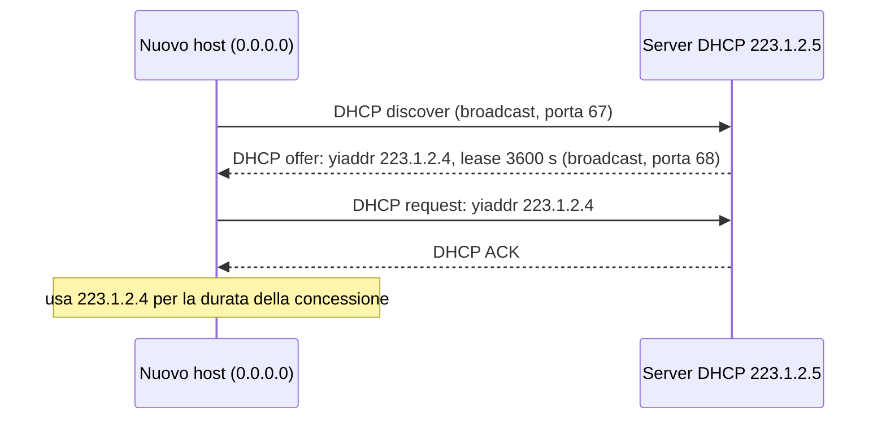

# Livello di rete: piano dei dati

> [!abstract] Di cosa parla questo capitolo
> Nel [[03 - TLC - Livello di trasporto|Capitolo 3]] il trasporto si appoggiava al servizio **host-to-host** del livello di rete senza sapere come funzionasse. Qui si apre la scatola.
> A differenza del trasporto, il livello di rete è presente in **ogni host e in ogni router**: per questo i suoi protocolli sono tra i più complessi e interessanti della pila.
> È così vasto che il libro lo divide in due capitoli:
> - **Capitolo 4, piano dei dati** (*data plane*): cosa fa **ciascun router localmente** per inoltrare un datagramma dal collegamento d'ingresso a quello d'uscita. Comprende l'architettura del router, l'inoltro basato sulla destinazione, **IPv4**, l'**indirizzamento**, DHCP, NAT, **IPv6** e l'**inoltro generalizzato** (OpenFlow/SDN);
> - **Capitolo 5, piano di controllo** (*control plane*): la logica globale che decide i percorsi end-to-end (algoritmi di instradamento, OSPF, [[BGP]], controller SDN).
>
> Mappa del corso: [[MOC - Telecomunicazioni]].

> [!info] Fonte
> Kurose, Ross, *Reti di calcolatori e Internet*, 7ª ed., Capitolo 4 (pp. 289–342). Le pagine citate sono quelle **del libro**. Per il PDF: fino a p. 326 aggiungi 27, da p. 327 aggiungi 28, perché nel PDF c'è una pagina in più.

---

## 4.1 Panoramica del livello di rete

![[TLC-p318-1.png]]

La figura mostra una rete con due host, **H1** (rete domestica) e **H2** (rete aziendale), e diversi router lungo il percorso. Le pile protocollari mettono in evidenza il livello **Rete**:
- H1 e H2 hanno la pila completa a 5 livelli;
- i router **R1**, **R2** e quelli degli ISP hanno solo **Rete, Collegamento e Fisico**, perché non eseguono protocolli di trasporto né applicativi (vedi [[Incapsulamento]]).

Cosa succede:
1. il livello di rete di **H1** prende i segmenti dal trasporto, li **incapsula in datagrammi** e li manda al router vicino R1;
2. ogni **router intermedio** inoltra il datagramma dal collegamento d'ingresso a quello d'uscita: è il ruolo del **piano dei dati**. Il **piano di controllo** coordina queste azioni locali perché i datagrammi arrivino a destinazione;
3. il livello di rete di **H2** riceve i datagrammi da R2, estrae i segmenti e li consegna al trasporto.

_(libro, p. 290)_

### Inoltro e instradamento: piano dei dati e piano di controllo

Vedi [[Inoltro e Instradamento]].

Il compito del livello di rete è semplice da dire: **trasferire pacchetti da un host a un altro**. Per farlo servono due funzioni:

| | **Inoltro** (*forwarding*) | **Instradamento** (*routing*) |
| --- | --- | --- |
| Cosa fa | quando un pacchetto arriva al router, lo trasferisce sul **collegamento d'uscita** appropriato. Può anche bloccarlo o duplicarlo | determina il **percorso** che i pacchetti seguono dalla sorgente alla destinazione, tramite gli **algoritmi di instradamento** |
| Ambito | **locale**, nel singolo router | **globale**, su tutta la rete |
| Tempi | **nanosecondi** | **secondi** |
| Realizzazione | di solito **hardware** | di solito **software** |
| Piano | **dati** | **controllo** |

> [!example] Analogia del viaggio (Paragrafo 1.3.1)
> Nel viaggio da Milano a Conegliano:
> - l'**instradamento** è la **pianificazione** dell'intero viaggio con una cartina, scegliendo tra i vari percorsi possibili;
> - l'**inoltro** è quello che succede a **ogni svincolo**: l'auto entra, prende la direzione giusta e si immette sul tratto successivo.

Nella letteratura i due termini sono spesso usati come sinonimi; il libro (e queste note) li distingue con precisione.

**La tabella di inoltro.** Per inoltrare un pacchetto, il router guarda uno o più campi dell'intestazione e li usa come indice nella **tabella di inoltro** (*forwarding table*), che gli dice su quale interfaccia d'uscita mandarlo.

![[TLC-p319-1.png]]

Nella figura un pacchetto con il valore `0110` nell'intestazione arriva al router. Nella tabella locale `0110` corrisponde al collegamento d'uscita **2**, quindi il router lo inoltra su quell'interfaccia.

In questo schema l'**algoritmo di instradamento** gira **dentro ogni router**, nel piano di controllo, e riempie la tabella di inoltro nel piano dei dati.

_(libro, pp. 290–292)_

#### Piano di controllo: l'approccio tradizionale

Come vengono configurate le tabelle di inoltro? Nell'approccio tradizionale della figura sopra **ogni router** esegue l'algoritmo di instradamento e fa sia inoltro sia instradamento. Gli algoritmi di instradamento dei diversi router **comunicano tra loro** scambiandosi i messaggi di un **protocollo di instradamento** (Paragrafi 5.2–5.4).

In teoria le tabelle si potrebbero anche configurare **a mano**, e allora non servirebbe alcun protocollo di instradamento. Ma sarebbe lento, soggetto a errori e incapace di reagire ai cambiamenti della topologia.

#### Piano di controllo: l'approccio SDN

![[TLC-p321-1.png]]

Un approccio alternativo: un **controller remoto**, fisicamente separato dai router, **calcola e distribuisce** le tabelle di inoltro a tutti i router.
- La parte del piano dei dati è **identica** a prima.
- Il router fa **solo l'inoltro**; l'instradamento è separato.
- Il controller può stare in un data center ad alta affidabilità ed essere gestito dall'ISP o da terzi.

È il cuore del **software-defined networking** (**SDN**): la rete è "definita dal software" perché il controller che calcola le tabelle è un programma. Spesso il software è **open source** e permette a ISP, ricercatori e studenti di innovare (Paragrafo 5.5).

_(libro, pp. 293–294)_

### Modelli di servizio

Il **modello di servizio della rete** definisce le caratteristiche del trasporto end-to-end dei pacchetti. Servizi possibili:
- **consegna garantita**;
- **consegna garantita con ritardo limitato** (es. entro 100 ms);
- **consegna ordinata**;
- **banda minima garantita** (es. 1 Mbps, come un collegamento dedicato);
- **servizi di sicurezza** (cifratura di tutti i datagrammi).

> [!important] Internet: best effort
> Il livello di rete di Internet offre **un solo servizio**: il **best effort**, "col massimo impegno possibile". Non garantisce né l'ordine, né la consegna, né il ritardo, né la banda. Una rete che non consegnasse nulla rientrerebbe nella definizione!
> Altre architetture offrono di più: **ATM** garantisce ordine, ritardo limitato e banda minima; **Intserv** (RFC 1633) propone garanzie sul ritardo. Ma il best effort, insieme a una banda adeguata, si è dimostrato sufficiente per Netflix, VoIP, Skype e FaceTime.

**Terminologia.** Il libro usa:
- **commutatore di pacchetto** (*packet switch*) per un dispositivo generico che trasferisce pacchetti da un'interfaccia d'ingresso a una d'uscita in base all'intestazione;
- **switch a livello di collegamento** (*link-layer switch*, Capitolo 6) se decide in base al frame di **livello 2**;
- **router** se decide in base al campo di **livello 3**.

Qui, dato che si parla del livello di rete, si dice **router**.

_(libro, pp. 294–296)_

---

## 4.2 Che cosa si trova all'interno di un router?

Vedi [[Architettura di un Router]].

![[TLC-p324-1.png]]

L'architettura di un router generico ha **quattro componenti**:

| Componente | Cosa fa |
| --- | --- |
| **Porte di ingresso** (*input port*) | terminazione fisica del collegamento in ingresso (riquadro a sinistra), funzioni del livello di collegamento (al centro) e soprattutto la **ricerca** nella tabella di inoltro (a destra) per scegliere la porta d'uscita. I pacchetti di controllo (es. dei protocolli di instradamento) vanno al processore di instradamento |
| **Struttura di commutazione** (*switching fabric*) | connette fisicamente porte di ingresso e di uscita: una "rete dentro il router" |
| **Porte di uscita** (*output port*) | memorizzano i pacchetti ricevuti dalla struttura di commutazione e li trasmettono sul collegamento, con le funzioni di collegamento e fisico. Sui collegamenti bidirezionali la porta di uscita è accoppiata a quella di ingresso sulla stessa **line card** |
| **Processore di instradamento** (*routing processor*) | funzioni del **piano di controllo**: esegue i protocolli di instradamento, gestisce le tabelle e calcola quella di inoltro. Nei router SDN comunica con il controller remoto. Fa anche gestione di rete (Paragrafo 5.7) |

> [!note] "Porta" qui ≠ porta TCP/UDP
> Qui "porta" indica le **interfacce fisiche** di input e output del router, non le porte software associate alle socket dei Capitoli 2 e 3. Un router di bordo può avere centinaia di porte a 10 Gbps: il Juniper MX2020 supporta fino a 960 porte Ethernet a 10 Gbps, con una capacità di 80 Tbps.

**Perché il piano dei dati è in hardware.** Con un collegamento a 10 Gbps e datagrammi da 64 byte, la porta ha solo **51,2 ns** per elaborare un datagramma prima che arrivi il successivo:

$$\frac{64 \times 8 \text{ bit}}{10^{10} \text{ bit/s}} = 51{,}2 \text{ ns}$$

Con $N$ porte su una line card serve un'elaborazione $N$ volte più veloce: impossibile in software. Le funzioni del **piano di controllo** invece lavorano in millisecondi o secondi e sono in **software** sul processore di instradamento, di solito una CPU tradizionale.

**Analogia della rotonda.** Lo svincolo è una **rotonda**, e prima di entrare ogni auto viene "elaborata" al casello:
- **inoltro basato sulla destinazione**: l'auto si ferma al casello e dice la **destinazione finale**. L'addetto cerca quale uscita della rotonda porta lì e lo dice al guidatore;
- **inoltro generalizzato**: l'addetto sceglie l'uscita anche in base ad altri fattori, come la targa (lo Stato di provenienza), il modello o l'anno dell'auto. Un'auto non idonea potrebbe essere bloccata. Questo tipo di inoltro è trattato in [[#4.4 Inoltro generalizzato e SDN]].

Nella rotonda la strada d'ingresso e il casello sono le **porte di ingresso**, con la ricerca dell'uscita; la **rotonda** è la **struttura di commutazione**; la strada d'uscita è la **porta di uscita**.

L'analogia fa emergere le **domande** chiave (annotazione a margine: "domande"):
- cosa succede se le auto arrivano più in fretta di quanto l'addetto le smista?
- e se l'addetto è veloce ma la rotonda è lenta?
- e se tutte le auto vogliono uscire dalla stessa uscita?
- come dare priorità ad alcune auto?

Sono esattamente i problemi che affrontano i progettisti di router.

_(libro, pp. 296–299)_

### Elaborazione alle porte di ingresso e inoltro basato sulla destinazione

![[TLC-p326-1.png]]

La porta di ingresso fa tre cose in sequenza:
1. **terminazione di linea** (livello fisico);
2. **elaborazione a livello di collegamento** (protocollo, decapsulamento);
3. **ricerca, inoltro, accodamento**: consultando la tabella di inoltro trova la porta d'uscita e manda il pacchetto alla struttura di commutazione.

La tabella è calcolata dal processore di instradamento (o ricevuta dal controller SDN) e **copiata su ogni line card** tramite un bus separato (la linea tratteggiata della figura dell'architettura). Così ogni porta di ingresso decide **localmente**, senza interpellare il processore centrale per ogni pacchetto.

#### Corrispondenza a prefisso più lungo

Vedi [[Longest Prefix Match]].

Caso più semplice: inoltro basato sull'indirizzo di destinazione a **32 bit** (IPv4). Una tabella con una riga per ogni indirizzo avrebbe più di **4 miliardi** di righe: impossibile.

Supponiamo che il router abbia 4 collegamenti (0–3) e che l'inoltro sia:

| Intervallo degli indirizzi di destinazione | Interfaccia |
| --- | --- |
| da `11001000 00010111 00010000 00000000` a `11001000 00010111 00010111 11111111` | 0 |
| da `11001000 00010111 00011000 00000000` a `11001000 00010111 00011000 11111111` | 1 |
| da `11001000 00010111 00011001 00000000` a `11001000 00010111 00011111 11111111` | 2 |
| altrimenti | 3 |

Basta una tabella con **quattro righe**, che confronta solo un **prefisso** dell'indirizzo:

| Corrispondenza di prefisso | Interfaccia |
| --- | --- |
| `11001000 00010111 00010` | 0 |
| `11001000 00010111 00011000` | 1 |
| `11001000 00010111 00011` | 2 |
| altrimenti | 3 |

(Nel tuo PDF gli intervalli e i prefissi sono evidenziati con lo stesso colore: blu, rosso, verde, giallo, annotati "in pratica".)

- Indirizzo `11001000 00010111 00010110 10100001`: i primi 21 bit corrispondono alla prima riga → **interfaccia 0**.
- Un indirizzo che non corrisponde alle prime tre righe → **interfaccia 3**.

> [!important] Regola della corrispondenza a prefisso più lungo
> Un indirizzo può corrispondere a **più righe**. Per esempio `11001000 00010111 00011000 10101010` corrisponde ai primi 24 bit della **seconda** riga e ai primi 21 bit della **terza**.
> In questi casi il router applica la **regola di corrispondenza a prefisso più lungo** (*longest prefix matching rule*): sceglie la riga con il prefisso **più lungo** che corrisponde, quindi qui la seconda → **interfaccia 1**. Il perché si capirà con l'[[#Aggregazione di indirizzi (Box 4.1)|aggregazione degli indirizzi]].

**Velocità della ricerca.** La ricerca va fatta in nanosecondi, quindi:
- in **hardware**, con algoritmi più furbi della ricerca lineare;
- con memorie veloci: DRAM integrate e **SRAM** come cache;
- con le **TCAM** (*Ternary Content Addressable Memories*): si passa l'indirizzo a 32 bit e la memoria restituisce la riga corrispondente in **tempo costante**. I router Cisco Catalyst 6500 e 7600 gestiscono tabelle con milioni di righe.

Oltre alla ricerca, la porta di ingresso deve anche:
1. fare l'elaborazione fisica e di collegamento;
2. controllare **versione, checksum e TTL** del datagramma, riscrivendo gli ultimi due;
3. aggiornare i **contatori** per la gestione di rete.

> [!tip] Il paradigma "match-action"
> Cercare l'indirizzo di destinazione (**match**) e inviare il pacchetto alla porta d'uscita (**action**) è un caso particolare di un'astrazione più generale, **match-action**, usata in molti dispositivi:
> - negli **switch** di livello 2;
> - nei **firewall**, dove un pacchetto che corrisponde a un criterio (es. IP e porte) viene scartato;
> - nei **NAT**, dove il pacchetto con una certa porta viene riscritto.
>
> È la base dell'[[#4.4 Inoltro generalizzato e SDN|inoltro generalizzato]].

_(libro, pp. 299–302)_

### Struttura di commutazione

Vedi [[Strutture di Commutazione]].

La struttura di commutazione è il **cuore del router**: è il punto in cui i pacchetti passano davvero dalla porta di ingresso a quella di uscita.

![[TLC-p329-1.png]]

La figura mostra le **tre tecniche di commutazione** (con le etichette evidenziate: "Memoria", "Bus", "Crossbar"). In ognuna un pacchetto va da A a Y.

| Tecnica | Come funziona | Limiti | Esempi |
| --- | --- | --- | --- |
| **In memoria** | i primi router erano computer normali: la porta di ingresso segnala l'arrivo con un **interrupt**, la CPU copia il pacchetto in memoria, legge l'indirizzo, consulta la tabella e lo copia nel buffer della porta d'uscita | se la memoria legge o scrive $B$ pacchetti/s, il throughput è **< B/2**; non si possono inoltrare due pacchetti insieme, perché c'è un solo bus di sistema. Oggi la ricerca e la memorizzazione sono fatte dai processori sulle line card | Cisco Catalyst 8500 |
| **Tramite bus** | la porta di ingresso trasferisce il pacchetto direttamente all'uscita su un **bus condiviso**, senza il processore. Al pacchetto si aggiunge un'**etichetta** interna con la porta di uscita: tutte le porte lo ricevono, ma solo quella indicata lo tiene | **un pacchetto alla volta** sul bus: nell'analogia, una sola auto alla volta nella rotonda. La banda è limitata da quella del bus. Basta per reti di accesso e aziendali | Cisco 6500 (bus a 32 Gbps) |
| **Rete di interconnessione** (*crossbar*) | una matrice di **2n bus** che collega n porte di ingresso a n di uscita. Il controller chiude l'**incrocio** tra il bus orizzontale di A e quello verticale di Y | due pacchetti da ingressi diversi verso la **stessa** uscita: uno deve aspettare | Cisco 12000 |

> [!important] Crossbar non-blocking
> La crossbar può inoltrare **più pacchetti in parallelo**: A→Y e B→X usano bus diversi. È **non-blocking**: un pacchetto viene bloccato solo se un altro va verso la **stessa porta d'uscita**.
> Esistono reti più sofisticate, a più stadi, in cui anche pacchetti diretti alla stessa uscita possono attraversare la struttura insieme. I router Cisco CRS usano una strategia non bloccante a tre stadi; si può anche dividere il pacchetto in **chunk** e spedirli ("spray") su $K$ strutture parallele, per poi riassemblarlo all'uscita.

_(libro, pp. 302–304)_

### Elaborazione alle porte di uscita

![[TLC-p331-1.png]]

La porta di uscita prende i pacchetti dalla struttura di commutazione, li **accoda** (gestione del buffer), fa l'**elaborazione di collegamento** (protocollo, incapsulamento) e la **terminazione di linea**, poi li trasmette sul collegamento. Comprende anche **selezionare e togliere dalla coda** i pacchetti da trasmettere.

_(libro, p. 304)_

### Dove si verifica l'accodamento?

Vedi [[Accodamento nei Router]].

Le code si formano sia alle **porte di ingresso** sia a quelle di **uscita**, come nelle rotonde le auto possono aspettare sia all'entrata sia all'uscita. Quando le code crescono la memoria si esaurisce, e si ha la **perdita di pacchetti**. È proprio **qui**, nelle code dei router, che i pacchetti "persi nella rete" vengono davvero scartati (vedi [[01 - TLC - Reti di calcolatori e Internet#Ritardi di accodamento e perdita di pacchetti|Capitolo 1]]).

Ipotesi: $N$ porte di ingresso e $N$ di uscita, tutte con velocità di linea $R_{line}$; pacchetti di uguale lunghezza che arrivano in modo sincrono. Sia $R_{switch}$ la velocità con cui la struttura trasferisce i pacchetti da ingresso a uscita.
- Se $R_{switch} = N \cdot R_{line}$, l'accodamento in ingresso è **trascurabile**: anche se tutti gli $N$ pacchetti vanno alla stessa uscita, la struttura li smaltisce tutti prima che arrivino i successivi.

#### Accodamento in ingresso

Se la struttura **non è abbastanza veloce**, i pacchetti si accodano anche in ingresso. Con una crossbar, collegamenti di pari velocità e code d'ingresso **FCFS**:
- si possono trasferire più pacchetti in parallelo solo se le **uscite sono diverse**;
- se due pacchetti in **testa** a due code vanno alla **stessa** uscita, uno resta bloccato.

![[TLC-p333-1.png]]

**Blocco in testa alla coda (HOL, *head-of-the-line blocking*).**
- *In alto*: all'istante $t$ i due pacchetti grigio scuro in testa alla prima e alla terza coda vanno entrambi all'uscita superiore, quindi ne passa **uno solo** (quello in alto).
- *In basso*: il pacchetto grigio chiaro dietro quello bloccato nella terza coda vuole andare all'uscita **centrale**, che è **libera**, ma "non può avanzare" (annotazione rossa) perché è dietro un pacchetto bloccato.

> [!important] HOL blocking
> Un pacchetto in una coda di ingresso deve aspettare anche se **la sua porta di destinazione è libera**, perché è bloccato da quello davanti. È stato dimostrato che, sotto certe ipotesi, la coda d'ingresso cresce indefinitamente (quindi ci sono forti perdite) quando il tasso di arrivo raggiunge appena il **58%** della capacità dei collegamenti (Karol 1987).

#### Accodamento in uscita

Anche con $R_{switch} = N \cdot R_{line}$ (annotazioni: "tasso di trasferimento da linee input ad output"), se tutti gli $N$ pacchetti in arrivo vanno alla **stessa uscita**, in un tempo di pacchetto all'uscita arrivano $N$ pacchetti ma ne può partire **uno solo**. Gli altri si accodano. Se continua così la coda cresce fino a **esaurire la memoria** della porta d'uscita.

![[TLC-p334-1.png]]

Con $N = 3$ linee (annotazione "N = 3 linee") e una struttura tre volte più veloce delle linee ($R_{switch} = N R_{line}$):
- all'istante $t$ arriva un pacchetto su ogni ingresso, tutti diretti all'uscita superiore;
- un'unità di tempo dopo, i tre pacchetti sono **tutti** nella coda d'uscita superiore, mentre ne arrivano due nuovi;
- un **packet scheduler** deve decidere l'ordine di trasmissione (vedi [[#Schedulazione dei pacchetti]]).

**Cosa scartare quando il buffer è pieno?**
- **drop-tail** (*eliminazione in coda*): si scarta il pacchetto in arrivo;
- oppure si rimuovono uno o più pacchetti già in coda;
- oppure si scarta o **marca** un pacchetto **prima** che il buffer sia pieno, per dare un segnale di congestione al mittente (vedi [[ECN]]). Queste politiche si chiamano **AQM** (*Active Queue Management*); la più studiata è **RED** (*Random Early Detection*).

**Quanto deve essere grande il buffer?**
- Regola empirica (RFC 3439): $B = RTT \times C$. Con un collegamento a 10 Gbps e RTT di 250 ms servirebbe $B = 0{,}25 \times 10^{10} = 2{,}5$ Gbit.
- Studi recenti: con $N$ flussi TCP, $B = \dfrac{RTT \times C}{\sqrt{N}}$. Sui router di dorsale $N$ è grande, quindi il buffer necessario si riduce molto.

> [!example] Esempio numerico (non nel libro)
> Con 10.000 flussi sullo stesso collegamento: $B = 2{,}5 \text{ Gbit} / \sqrt{10.000} = 2{,}5 / 100 = 25$ Mbit, cento volte meno.

_(libro, pp. 304–308)_

### Schedulazione dei pacchetti

Vedi [[Scheduling dei Pacchetti]].

In che ordine si trasmettono i pacchetti accodati sulla porta di uscita? Le regole sono quelle delle code della vita quotidiana.

#### Primo arrivato, primo servito (FIFO)

![[TLC-p336-1.png]]

Modello di coda **FIFO** (*first-in-first-out*, o FCFS): i pacchetti in arrivo aspettano nell'**area di attesa** se il collegamento (il "server") è occupato. Se il buffer non basta, la **politica di scarto** (*packet-discarding policy*) decide se scartare il nuovo pacchetto o un altro. Qui si ignorano le perdite, come nota l'annotazione: un pacchetto viene rimosso dalla coda solo dopo essere stato trasmesso.

![[TLC-p336-2.png]]

**FIFO in azione.** In alto gli arrivi dei pacchetti 1–5, al centro il pacchetto in trasmissione, in basso le partenze. I pacchetti partono **nello stesso ordine** in cui sono arrivati. Dopo la partenza del 4 il collegamento resta **inattivo** finché non arriva il 5.

#### Code con priorità

![[TLC-p337-1.png]]

Con l'**accodamento con priorità** (*priority queuing*) i pacchetti in arrivo vengono **classificati** in classi di priorità e messi in code separate (alta e bassa priorità).
- Esempio: un operatore dà priorità ai pacchetti di **gestione di rete**, riconoscibili dal numero di porta, o al traffico **VoIP** rispetto a SMTP e IMAP.
- Si trasmette sempre un pacchetto della **coda non vuota con priorità più alta**; dentro una classe si usa di solito FIFO.

![[TLC-p337-2.png]]

Esempio con due classi: i pacchetti **1, 3 e 4** sono ad alta priorità (evidenziati in rosso), **2 e 5** a bassa.
1. Il pacchetto 1 arriva con il collegamento libero e parte subito.
2. Intanto arrivano 2 e 3; finito l'1, parte il **3** (alta priorità), anche se è arrivato dopo il 2.
3. Poi parte il 2. Durante la sua trasmissione arriva il 4, ad alta priorità.
4. Il 4 **non interrompe** il 2: parte dopo.

> [!important] Priorità non prelazionabile
> Nell'**accodamento a priorità non prelazionabile** (*non-preemptive priority queuing*) la trasmissione di un pacchetto **non viene interrotta** una volta iniziata, anche se arriva un pacchetto a priorità più alta (annotazione: "importante"). È lo stesso concetto dello scheduling non preemptive della CPU (vedi [[09 - SO - CPU Scheduling|Sistemi Operativi — CPU Scheduling]]).

#### Round robin e accodamento equo ponderato (WFQ)

![[TLC-p338-1.png]]

Con il **round robin** i pacchetti sono divisi in classi, **senza una priorità rigida**: si servono le classi a turno, un pacchetto della classe 1, poi uno della classe 2, poi di nuovo la 1… (annotazione: "solo 2 classi di priorità").
- Nella **modalità conservativa** (*work-conserving*) il collegamento non resta mai inattivo finché ci sono pacchetti: se la coda di una classe è vuota si passa subito alla successiva.
- Nell'esempio 1, 2 e 4 sono della classe 1 e 3 e 5 della classe 2. L'ordine di partenza è **1, 3, 2, 4, 5**: dopo l'1 si serve la classe 2 (il 3), poi si torna alla classe 1 (il 2), poi di nuovo la classe 2, ma è vuota, quindi si passa al 4.

![[TLC-p339-1.png]]

L'**accodamento equo ponderato** (**WFQ**, *Weighted Fair Queuing*) generalizza il round robin ed è molto usato nei router:
- i pacchetti vengono classificati e accodati per classe, e le classi sono servite **ciclicamente** (classe 1, 2, 3, poi di nuovo 1). È conservativo;
- a ogni classe $i$ è assegnato un **peso** $w_i$. Quando la classe $i$ ha pacchetti, riceve una frazione di servizio pari a

$$\frac{w_i}{\sum_j w_j}$$

  dove la somma è sulle classi che hanno **pacchetti da trasmettere**;
- su un collegamento di capacità $R$, la classe $i$ ha quindi **almeno** $R \cdot w_i / \sum_j w_j$ di banda garantita.

È una descrizione idealizzata: non tiene conto che i pacchetti sono unità discrete e che una trasmissione non può essere interrotta.

> [!example] Esempio numerico (non nel libro)
> $R = 10$ Mbps, tre classi con pesi $w_1 = 5$, $w_2 = 3$, $w_3 = 2$.
> - Tutte e tre attive: $5 \text{ Mbps}$, $3 \text{ Mbps}$, $2 \text{ Mbps}$.
> - Se la classe 3 è vuota: $10 \cdot 5/8 = 6{,}25$ Mbps e $10 \cdot 3/8 = 3{,}75$ Mbps. Il collegamento non spreca la quota della classe inattiva, perché WFQ è conservativo.

| Disciplina | Ordine | Garanzie |
| --- | --- | --- |
| FIFO | di arrivo | nessuna |
| Priorità | sempre la classe più alta non vuota | le classi alte possono affamare quelle basse |
| Round robin | a turno tra le classi | quote uguali |
| WFQ | a turno, pesato | banda minima $R\,w_i/\sum w_j$ per classe |

_(libro, pp. 308–312)_

---

## 4.3 Il protocollo Internet (IP): IPv4, indirizzamento, IPv6

Finora il capitolo è stato generico. Ora si passa al livello di rete di Internet e al protocollo **IP**. Ci sono due versioni: **IPv4** (RFC 791), quella più usata, e **IPv6** (RFC 2460, 4291). In mezzo c'è l'**indirizzamento**, un argomento che sembra noioso ma è cruciale. Vedi anche [[Protocollo IP]] in Sistemi di Calcolo 2.

### Formato dei datagrammi IPv4

Vedi [[Datagramma IPv4]].

Il pacchetto del livello di rete si chiama **datagramma**. Il suo formato va conosciuto e padroneggiato.

![[TLC-p340-1.png]]

L'intestazione è organizzata in righe da **32 bit** (4 byte, annotazione a mano):

| Campo | Bit | Significato |
| --- | --- | --- |
| **Versione** | 4 | versione di IP (4 o 6), per interpretare il resto |
| **Lunghezza dell'intestazione** | 4 | dove iniziano i dati, perché le opzioni sono variabili. Di solito **20 byte** |
| **Tipo di servizio** (TOS) | 8 | distingue datagrammi (basso ritardo, alto throughput, affidabilità; tempo reale vs FTP). **Due bit** sono usati per l'[[ECN]] |
| **Lunghezza del datagramma** | 16 | intestazione + dati, in byte: massimo **65.535** byte, ma di solito non oltre 1500 (Ethernet) |
| **Identificatore**, **flag**, **offset di frammentazione** | 16 + 3 + 13 | per la frammentazione (vedi [[#Frammentazione dei datagrammi IPv4]]). IPv6 non la consente sui router |
| **Tempo di vita** (TTL) | 8 | decrementato di 1 da ogni router; a 0 il datagramma viene scartato. Evita che i datagrammi girino per sempre, per esempio a causa di un ciclo di instradamento. È il campo che sfrutta [[Traceroute]] |
| **Protocollo** | 8 | a quale protocollo di trasporto consegnare i dati: **6 = TCP**, **17 = UDP** |
| **Checksum dell'intestazione** | 16 | rilevamento degli errori, calcolato come [[Checksum Internet]] ma **solo sull'intestazione**. Va ricalcolato da **ogni router**, perché il TTL (e a volte le opzioni) cambia |
| **Indirizzo IP sorgente** | 32 | — |
| **Indirizzo IP destinazione** | 32 | spesso ottenuto con una ricerca DNS (vedi [[Gerarchia dei DNS Server]]) |
| **Opzioni** | variabile | estensioni usate di rado. Complicano l'elaborazione (non si sa dove iniziano i dati, i tempi variano), e infatti sono state **eliminate** dall'intestazione IPv6 |
| **Dati** (*payload*) | — | di solito un segmento TCP o UDP, ma anche altro, come i messaggi ICMP |

> [!note] Due "collanti"
> Il **numero di protocollo** lega il livello di rete a quello di trasporto, come il **numero di porta** lega il trasporto all'applicazione. Nel Capitolo 6 si vedrà che anche il frame di livello 2 ha un campo che lo lega al livello di rete.

> [!question] Perché controllare gli errori sia in IP sia in TCP/UDP?
> 1. Il checksum IP copre **solo l'intestazione**, quello TCP/UDP **tutto il segmento**.
> 2. TCP/UDP e IP non sono necessariamente nella stessa pila: TCP può girare su un altro protocollo (es. ATM), e IP può trasportare dati non TCP/UDP.

**Overhead.** Un datagramma IP ha **20 byte** di intestazione senza opzioni. Un datagramma non frammentato che porta un segmento TCP ha quindi **40 byte** di intestazioni (20 IP + 20 TCP) oltre al messaggio applicativo.

_(libro, pp. 312–315)_

### Frammentazione dei datagrammi IPv4

Vedi [[Frammentazione IP]].

Non tutti i protocolli di collegamento trasportano pacchetti della stessa dimensione: i frame Ethernet portano fino a **1500 byte** di dati, quelli di alcuni collegamenti geografici solo **576**. La quantità massima di dati in un frame è la **MTU** (*Maximum Transmission Unit*, vedi anche [[Segmento TCP]]). Il problema è che le tratte del percorso possono avere MTU **diverse**.

Se un router deve inoltrare un datagramma su un collegamento con MTU più piccola, lo **frammenta** in due o più datagrammi più piccoli, i **frammenti**.

> [!important] Il riassemblaggio è fatto dagli host
> I frammenti vanno riassemblati prima di arrivare al trasporto, perché TCP e UDP si aspettano segmenti completi. Riassemblarli nei router avrebbe complicato il nucleo della rete e ridotto le prestazioni. Per mantenerlo **semplice**, i progettisti di IPv4 hanno affidato il riassemblaggio ai **sistemi periferici**.

Per farlo si usano tre campi:
- **identificatore**: l'host di invio lo incrementa per ogni datagramma. I frammenti di uno stesso datagramma hanno lo stesso identificatore, oltre agli stessi indirizzi di sorgente e destinazione;
- **flag**: l'**ultimo** frammento ha il flag a **0**, tutti gli altri a **1**. Così il destinatario sa di averli ricevuti tutti, visto che IP non è affidabile e alcuni potrebbero non arrivare;
- **offset**: la posizione del frammento nel datagramma originale, per rimetterli in ordine e capire se ne manca uno.

![[TLC-p344-1.png]]

Esempio del libro: un datagramma da **4000 byte** (20 di intestazione + 3980 di dati) arriva a un router e deve uscire su un collegamento con **MTU = 1500 byte**. I 3980 byte di dati vanno divisi in **tre frammenti**, ognuno dei quali è a sua volta un datagramma IP, che verranno riassemblati dall'host di destinazione.

> [!example] I tre frammenti nel dettaglio (calcolo non riportato nell'edizione italiana)
> Ogni frammento ha 20 byte di intestazione, quindi al massimo $1500 - 20 = 1480$ byte di dati. L'offset si misura in unità di **8 byte**.
>
> | Frammento | Byte di dati | Identificatore | Offset | Flag |
> | --- | --- | --- | --- | --- |
> | 1 | 1480 (byte 0–1479) | uguale per tutti | 0 | 1 |
> | 2 | 1480 (byte 1480–2959) | uguale per tutti | $1480/8 = 185$ | 1 |
> | 3 | 1020 (byte 2960–3979) | uguale per tutti | $2960/8 = 370$ | 0 |
>
> Verifica: $1480 + 1480 + 1020 = 3980$ ✓

_(libro, pp. 315–317)_

### Indirizzamento IPv4

Vedi [[Indirizzamento IPv4]].

**Interfacce.**
- Un host ha di solito **un solo** collegamento con la rete. Il confine tra host e collegamento fisico si chiama **interfaccia**.
- Un router riceve da un collegamento e inoltra su un altro, quindi ha **almeno due** collegamenti e altrettante interfacce.
- IP richiede che **ogni interfaccia** abbia un indirizzo IP. L'indirizzo IP è quindi associato a un'**interfaccia**, non all'host o al router.

**Formato.** Gli indirizzi sono lunghi **32 bit** (4 byte), quindi ce ne sono $2^{32}$, circa 4 miliardi. Si scrivono in **notazione decimale puntata** (*dotted-decimal notation*): ogni byte in decimale, separato da un punto.

$$193.32.216.9 = \underbrace{11000001}_{193}\ \underbrace{00100000}_{32}\ \underbrace{11011000}_{216}\ \underbrace{00001001}_{9}$$

(nel PDF hai annotato i valori decimali sopra ogni byte). Ogni interfaccia di Internet ha un indirizzo **globalmente univoco**, tranne quelle dietro un [[#NAT (network address translation)|NAT]]. Gli indirizzi però non si scelgono a caso: una parte è determinata dalla **sottorete**.

#### Sottoreti

Vedi [[Sottorete]].

![[TLC-p345-1.png]]

Un router con **tre interfacce** connette sette host. I tre host a sinistra e l'interfaccia del router a cui sono collegati hanno indirizzi della forma **223.1.1.xxx**: i primi 24 bit sono uguali. Le quattro interfacce sono collegate da una rete **senza router**, disegnata come una nuvola. Come annotato a mano, la "nuvola può essere uno switch o un wireless (forma una sotto-rete)", per esempio una LAN Ethernet.

Per IP questa rete forma una **sottorete** (*subnet*, RFC 950), detta anche **rete IP** o semplicemente **rete**.
- IP le assegna l'indirizzo **223.1.1.0/24**. La notazione **/24** è la **maschera di sottorete** (*subnet mask*) e dice che i **24 bit più a sinistra** definiscono l'indirizzo della sottorete.
- La sottorete 223.1.1.0/24 contiene tre host (223.1.1.1, .2, .3) e un'interfaccia di router (223.1.1.4). **Ogni** altro host collegato deve avere un indirizzo 223.1.1.xxx.

![[TLC-p346-1.png]]

La figura mostra gli indirizzi delle tre sottoreti: **223.1.1.0/24**, **223.1.2.0/24** e **223.1.3.0/24**.

![[TLC-p346-2.png]]

La sottorete non è solo un segmento Ethernet. Con **tre router** collegati da collegamenti **punto a punto** (annotazione: "6 sottoreti") ci sono:
- le tre sottoreti con gli host: 223.1.1.0/24, 223.1.2.0/24, 223.1.3.0/24;
- tre sottoreti per i collegamenti tra router: **223.1.9.0/24** (R1–R2), **223.1.8.0/24** (R2–R3), **223.1.7.0/24** (R3–R1).

> [!important] Come individuare le sottoreti
> *Si sganciano le interfacce da host e router in modo da creare isole di reti isolate, delimitate dalle interfacce. Ognuna di queste reti isolate è una **sottorete**.* _(libro, p. 320)_
> Applicata alla figura sopra, la procedura dà **sei isole**, cioè sei sottoreti.

_(libro, pp. 316–320)_

#### CIDR

Vedi [[CIDR]].

La strategia di assegnazione degli indirizzi in Internet è il **CIDR** (*Classless InterDomain Routing*, RFC 4632, pronunciato come l'inglese *cider*), che generalizza l'indirizzamento di sottorete. L'indirizzo ha la forma **a.b.c.d/x**:
- gli **x bit più a sinistra** sono il **prefisso** (di rete). A un'organizzazione si assegna un blocco di indirizzi contigui con un prefisso comune;
- i router **esterni** all'organizzazione guardano **solo gli x bit del prefisso**. Una sola riga a.b.c.d/x nelle loro tabelle basta per raggiungere tutta l'organizzazione, e le tabelle restano piccole;
- i restanti **32 − x** bit distinguono i dispositivi **interni** e possono avere un'ulteriore struttura di sottorete. Per esempio con a.b.c.d/21 restano 11 bit per gli host, e l'organizzazione può usare a.b.c.d/24 per una sua sottorete interna.

**Prima di CIDR: classful addressing.** Le parti di rete potevano essere lunghe solo **8, 16 o 24 bit**: reti di classe **A**, **B** e **C**. Il sistema era troppo rigido:
- una **classe C** (/24) ospita al massimo $2^8 - 2 = 254$ host (due indirizzi sono riservati), troppo pochi per molte organizzazioni;
- una **classe B** (/16) ospita $2^{16} - 2 = 65.534$ host, spesso troppi. Un'organizzazione con 2000 host riceveva una classe B e **sprecava oltre 63.000 indirizzi**, il che ha portato a esaurire rapidamente le classi B.

> [!warning] Correzione — numero di host di classe B
> A p. 321 il libro scrive che le sottoreti di classe B "possono avere **65.634** host". Il valore corretto è $2^{16} - 2 = $ **65.534**, come il libro stesso scrive poche righe dopo ("spazio a sufficienza per 65.534 interfacce").

**Broadcast.** L'indirizzo **255.255.255.255** è l'indirizzo IP **broadcast**: un datagramma con questa destinazione viene consegnato a **tutti** gli host della stessa sottorete. I router possono inoltrarlo alle sottoreti confinanti, ma di solito non lo fanno.

_(libro, pp. 320–321)_

#### Come ottenere un blocco di indirizzi

Un'organizzazione contatta il proprio **ISP**, che le dà una parte del suo blocco. Esempio: l'ISP ha **200.23.16.0/20** e lo divide in **otto blocchi /23** uguali.

| | Blocco | Binario (parte di rete sottolineata nel libro) |
| --- | --- | --- |
| ISP | 200.23.16.0/**20** | `11001000 00010111 0001`0000 00000000 |
| Organizzazione 0 | 200.23.16.0/**23** | `11001000 00010111 0001000`0 00000000 |
| Organizzazione 1 | 200.23.18.0/23 | `11001000 00010111 0001001`0 00000000 |
| Organizzazione 2 | 200.23.20.0/23 | `11001000 00010111 0001010`0 00000000 |
| … | … | … |
| Organizzazione 7 | 200.23.30.0/23 | `11001000 00010111 0001111`0 00000000 |

Passando da /20 a /23 si usano **3 bit** in più (annotati a mano "20 bit" e "23 bit"), quindi $2^3 = 8$ blocchi, ognuno con $2^9 = 512$ indirizzi.

A monte degli ISP c'è un'autorità globale: l'**ICANN** (*Internet Corporation for Assigned Names and Numbers*), un'organizzazione no-profit che alloca i blocchi di indirizzi, gestisce i **root DNS server** e assegna i nomi di dominio. L'ICANN delega ai **registri regionali** (ARIN, **RIPE**, APNIC, LACNIC), che insieme formano l'Address Supporting Organization. In Europa l'autorità è il **RIPE**, che copre anche il Medio Oriente e parte dell'Asia centrale.

#### Aggregazione di indirizzi (Box 4.1)

Vedi [[Aggregazione di Indirizzi]].

![[TLC-p349-1.png]]

L'ISP "Scappo-Con-La-Cassa-ISP" collega le otto organizzazioni (200.23.16.0/23 … 200.23.30.0/23) e annuncia al resto di Internet un solo messaggio: **"Inviami tutto quello il cui indirizzo inizia per 200.23.16.0/20"**. Il resto del mondo non deve sapere che dentro quel blocco ci sono otto organizzazioni. L'altro ISP, "ISP-Siamo-Noi", annuncia 199.31.0.0/16 (in figura "199.31.16.0/16").

Usare un **solo prefisso per più reti** si chiama **aggregazione di indirizzi** (*address aggregation*, *route aggregation* o *route summarization*). Nel tuo PDF i "/23" sono evidenziati come "importantissimo".

**E se l'organizzazione cambia ISP?** Supponiamo che l'Organizzazione 1 passi a ISP-Siamo-Noi.
- Rinumerare tutti i suoi router e host è costoso.
- Di solito l'organizzazione **tiene** i suoi indirizzi 200.23.18.0/23.

![[TLC-p350-1.png]]

Ora:
- Scappo-Con-La-Cassa-ISP continua ad annunciare **200.23.16.0/20**;
- ISP-Siamo-Noi annuncia **199.31.0.0/16 e anche 200.23.18.0/23**.

Un router di Internet che deve inoltrare un pacchetto verso 200.23.18.x vede due righe che corrispondono: /20 (verso Scappo-Con-La-Cassa) e /23 (verso ISP-Siamo-Noi). Per la **regola del prefisso più lungo** sceglie la **/23**, quindi ISP-Siamo-Noi. Ecco perché esiste quella regola.

> [!warning] Piccola incoerenza nel testo
> Nel testo del Box il blocco di ISP-Siamo-Noi è scritto **199.31.0.0/16**, nelle figure 4.21 e 4.22 invece **199.31.16.0/16**. Con un prefisso /16 contano solo i primi 16 bit, quindi i due indicano lo stesso blocco: la forma canonica è 199.31.0.0/16.

_(libro, pp. 321–323)_

#### Come ottenere l'indirizzo di un host: DHCP

Vedi [[DHCP]].

Gli indirizzi delle interfacce dei **router** li configura a mano l'amministratore, spesso da remoto. Quelli degli **host** si possono configurare a mano, ma più spesso si usa il **DHCP** (*Dynamic Host Configuration Protocol*, RFC 2131).

DHCP fornisce all'host:
- un **indirizzo IP**, che può essere **persistente** (sempre lo stesso per quell'host) oppure **temporaneo**, diverso a ogni connessione;
- la **maschera di sottorete**;
- l'indirizzo del **router di default** (*gateway*), cioè il primo router per uscire dalla sottorete (vedi [[Gateway]]);
- l'indirizzo del **DNS server locale**.

È detto protocollo **plug-and-play** o **zero-conf**, perché configura gli host automaticamente. È fondamentale nelle reti residenziali e nelle LAN wireless, dove gli host arrivano e se ne vanno di continuo: lo studente che va dalla stanza alla biblioteca all'aula cambia sottorete ogni volta.

DHCP è un protocollo **client-server**. Il client è l'host appena connesso. Ogni sottorete ha un **server DHCP**, oppure un **agente di relay DHCP**, di solito nel router, che conosce l'indirizzo di un server.

![[TLC-p352-1.png]]

Lo scenario: il **server DHCP** (223.1.2.5) è nella sottorete 223.1.2/24 (evidenziata in rosso). Un **client DHCP** si collega alla stessa sottorete. Il router, come annotato in verde, fa da **agente di relay** per le sottoreti 223.1.1/24 e 223.1.3/24.

I **4 passi** di un client che si connette (annotazione: "4 passi di un client che si connette al DHCP"):

![[TLC-p353-1.png]]

| Passo | Messaggio | Sorgente → destinazione | Contenuto chiave |
| --- | --- | --- | --- |
| 1. **Individuazione** | **DHCP discover** | `0.0.0.0:68` → `255.255.255.255:67` | il client non conosce né il suo IP né il server, quindi usa come sorgente "questo host" (0.0.0.0) e come destinazione il **broadcast**. UDP sulla **porta 67**. `yiaddr` = 0.0.0.0, *transaction ID* 654 |
| 2. **Offerta** | **DHCP offer** | `223.1.2.5:67` → `255.255.255.255:68` | anche questo in **broadcast**, perché il client non ha ancora un IP. Contiene il transaction ID, l'IP proposto (`yiaddr` = 223.1.2.4), la maschera e il **lease time**, cioè la durata della concessione (qui 3600 s; di solito ore o giorni). Possono rispondere **più server** |
| 3. **Richiesta** | **DHCP request** | `0.0.0.0:68` → `255.255.255.255:67` | il client **sceglie** un'offerta e la ripete con i parametri di configurazione (transaction ID 655) |
| 4. **Conferma** | **DHCP ACK** | `223.1.2.5:67` → `255.255.255.255:68` | il server conferma i parametri |

(Il campo `yiaddr` sta per *your Internet address*, cioè l'indirizzo assegnato al client.)

> [!note] Perché anche l'offerta va in broadcast?
> Il libro lascia la domanda al lettore (annotazione a margine). Il client non ha ancora un indirizzo IP valido, quindi il server non può indirizzargli un datagramma unicast al livello IP. Inoltre, se ci sono più server, il broadcast della richiesta fa sapere anche ai server **non scelti** che la loro offerta è stata rifiutata.

- Il client può **rinnovare** la concessione prima che scada.
- **Limite per la mobilità**: cambiando sottorete il nodo riceve un **nuovo IP**, quindi non può mantenere una connessione TCP aperta. Ci sono estensioni (IP mobile) che permettono di conservare l'indirizzo.

_(libro, pp. 324–327)_

### NAT (network address translation)

Vedi [[NAT]].

Ogni dispositivo IP ha bisogno di un indirizzo. Con la diffusione delle reti **SOHO** (*small office, home office*), l'ISP dovrebbe dare a ogni casa un blocco di indirizzi, e allargarlo quando la rete cresce. Esiste un approccio più semplice e ormai diffusissimo: il **NAT** (RFC 2663, 3022).

![[TLC-p356-1.png]]

Un router NAT ha un'interfaccia sulla **rete domestica** (a destra) e una verso Internet.
- Le quattro interfacce della rete domestica hanno indirizzi nella sottorete **10.0.0.0/24**. Lo spazio 10.0.0.0/8 è una delle **tre parti dello spazio IP riservate alle reti private** (RFC 1918), dette anche **reami** (*realm*): indirizzi che hanno significato **solo** dentro quella rete.
- Centinaia di migliaia di reti private usano lo stesso spazio, ma nessun datagramma con questi indirizzi può circolare su Internet.
- Visto dall'esterno, il router NAT **non sembra un router**, ma **un unico dispositivo** con un unico indirizzo IP, qui **138.76.29.7**. Tutto il traffico in uscita ha questo indirizzo come sorgente, e tutto quello in entrata come destinazione: il NAT **nasconde** la rete domestica.
- Di solito gli host interni ricevono gli indirizzi da un **server DHCP** sul router, che a sua volta ottiene il proprio IP dal DHCP dell'ISP.

**Come sa il router a quale host interno consegnare un datagramma in arrivo?** Con una **tabella di traduzione NAT** (*NAT translation table*), che contiene **indirizzi IP e numeri di porta**.

Esempio della figura: l'host **10.0.0.1** chiede una pagina web al server **128.119.40.186:80**.
1. L'host invia `S = 10.0.0.1:3345, D = 128.119.40.186:80`, con la porta di origine 3345 scelta a caso.
2. Il router NAT genera una nuova porta di origine **5001**, sostituisce la sorgente con il **proprio indirizzo WAN**: `S = 138.76.29.7:5001`. Aggiunge alla tabella la riga `138.76.29.7, 5001 ↔ 10.0.0.1, 3345`.
3. Il web server, ignaro di tutto, risponde a `D = 138.76.29.7:5001`.
4. Il router consulta la tabella con IP e porta di destinazione, **riscrive** la destinazione in `10.0.0.1:3345` e inoltra nella rete domestica.

Il campo porta è di **16 bit**, quindi un NAT può gestire più di **60.000 connessioni** simultanee con un solo indirizzo IP WAN.

> [!warning] Critiche al NAT
> - I numeri di porta servono a indirizzare **processi**, non host.
> - Problemi per i **server** dietro un NAT, che attendono connessioni su porte note, e per i **peer P2P**, che devono accettare connessioni. Le soluzioni sono il **NAT traversal** (RFC 5389) e **UPnP** (*Universal Plug and Play*), che permette a un host di configurare un NAT vicino.
> - I "puristi" osservano che i router dovrebbero elaborare solo fino al livello 3, mentre il NAT modifica numeri di porta: **viola il principio end-to-end**.
>
> Il NAT è comunque diventato un componente importante di Internet, come altri **middlebox**: dispositivi di livello 3 che fanno funzioni diverse dall'inoltro (NAT, bilanciamento del carico, firewall). L'inoltro generalizzato permette di fare tutto in modo integrato.

> [!tip] Box 4.2 — Firewall e sistemi di rilevamento delle intrusioni
> Gli attaccanti, conoscendo l'intervallo di indirizzi di una rete, possono mandare datagrammi per mappare la rete, fare ping e port scan, inviare pacchetti malformati, inondare i server di ICMP o diffondere malware.
> - Un **firewall** tra la rete e Internet controlla i campi dell'intestazione di datagrammi e segmenti, e blocca quelli sospetti. Per esempio blocca le richieste ICMP *echo*, impedendo la scansione con ping; filtra per IP e porte; tiene traccia delle connessioni TCP. Vedi [[Firewall e Intrusion Detection]] e [[Firewall]].
> - Un **IDS** (*Intrusion Detection System*) ai confini della rete fa **deep packet inspection**: confronta intestazioni **e payload** con un database di **firme** di attacchi noti e genera allarmi. Un **IPS** (*Intrusion Prevention System*) blocca anche i pacchetti. Vedi [[IDS]].
> - Nessuno dei due protegge da tutto, ma sono utili contro gli attacchi **noti**. _(p. 330)_

_(libro, pp. 327–330)_

### IPv6

Vedi [[Protocollo IPv6]] e la nota [[IPv6]] di Cybersecurity.

All'inizio degli anni '90 l'IETF iniziò a sviluppare il successore di IPv4, perché lo spazio a 32 bit si stava esaurendo. Le stime prevedevano l'esaurimento nel 2008 o nel 2018; nel **febbraio 2011** IANA allocò l'**ultimo blocco** IPv4 a un registro regionale. Già a metà degli anni '90 si capì che una nuova tecnologia su così larga scala avrebbe richiesto molto tempo, e nacque **IPv6** (RFC 2460). Di IPv5 non c'è traccia: doveva essere ST-2, poi scartato.

![[TLC-p359-1.png]]

#### Cambiamenti principali

- **Indirizzamento esteso**: da 32 a **128 bit**, praticamente inesauribili ("ogni granello di sabbia del pianeta potrà avere il suo indirizzo IP"). Oltre a unicast e multicast introduce gli indirizzi **anycast**, che consegnano a un **qualsiasi** host di un gruppo, per esempio al più vicino tra i server che ospitano lo stesso documento.
- **Intestazione ottimizzata di 40 byte**, a **lunghezza fissa**: elaborazione più rapida.
- **Etichettatura dei flussi**: un **flusso** (*flow*) è un insieme di pacchetti che richiedono una gestione speciale (qualità del servizio, tempo reale, utenti che pagano un servizio migliore). La definizione è volutamente vaga.

**Campi del datagramma IPv6:**

| Campo | Bit | Significato |
| --- | --- | --- |
| **Versione** | 4 | vale 6. Mettere 4 non basta a ottenere un datagramma IPv4 valido |
| **Classe di traffico** | 8 | come il TOS di IPv4: priorità (es. VoIP rispetto a SMTP) |
| **Etichetta di flusso** | 20 | identifica un flusso |
| **Lunghezza del payload** | 16 | byte **dopo** l'intestazione fissa di 40 byte |
| **Intestazione successiva** | 8 | protocollo a cui consegnare i dati (TCP, UDP…), con gli stessi valori del campo protocollo di IPv4 |
| **Limite di hop** | 8 | come il TTL: −1 a ogni router, a 0 il datagramma viene scartato |
| **Indirizzi sorgente e destinazione** | 128 + 128 | formati descritti nell'RFC 4291 |
| **Dati** | — | payload |

**Campi eliminati rispetto a IPv4:**

| Campo eliminato | Perché |
| --- | --- |
| **Frammentazione/riassemblaggio** | i router **non** frammentano più. Se un datagramma è troppo grande, il router lo scarta e manda alla sorgente un messaggio ICMP "**Pacchetto troppo grande**" (Paragrafo 5.6); la sorgente rimanda dati più piccoli. Frammentare costava tempo, e spostare l'onere dai router agli host velocizza la rete |
| **Checksum dell'intestazione** | trasporto (TCP, UDP) e collegamento (Ethernet) hanno già i loro controlli, quindi era **ridondante**. In IPv4 andava ricalcolato a ogni router a causa del TTL: troppo oneroso |
| **Opzioni** | non fanno più parte dell'intestazione standard. Possono comparire come una delle **intestazioni successive**, come TCP o UDP. L'intestazione resta fissa a 40 byte |

| | IPv4 | IPv6 |
| --- | --- | --- |
| Indirizzi | 32 bit | 128 bit |
| Intestazione | 20 byte + opzioni, variabile | **40 byte fissi** |
| Frammentazione nei router | sì | **no** (ICMP "packet too big") |
| Checksum dell'intestazione | sì | **no** |
| TTL | Tempo di vita | Limite di hop |
| Tipo di servizio | TOS | Classe di traffico + etichetta di flusso |
| Anycast | no | sì |

#### Passaggio da IPv4 a IPv6

Il problema: i sistemi IPv6 sono **retrocompatibili** (gestiscono IPv4), ma quelli **IPv4 non gestiscono IPv6**.
- Una "**giornata campale**" in cui spegnere e aggiornare tutte le macchine? È successo una volta, con il passaggio da NCP a TCP (RFC 801, vedi [[Storia di Internet]]), quando Internet era piccola. Oggi è improponibile.
- L'approccio più usato è il **tunneling** (RFC 4213).

![[TLC-p362-1.png]]

**Tunneling.**
- **Vista logica**: i nodi IPv6 **B** ed **E** sembrano collegati direttamente da un **tunnel**, l'insieme dei router IPv4 intermedi.
- **Vista fisica**: il percorso è A → B (IPv6), B → C → D → E (IPv4), E → F (IPv6).
  1. A manda a B un datagramma IPv6 (Flusso X, Origine A, Destinazione F).
  2. **B**, all'ingresso del tunnel, mette **l'intero** datagramma IPv6 nel campo dati di un datagramma IPv4 indirizzato a **E** (Origine B, Destinazione E).
  3. I router IPv4 C e D lo inoltrano come qualsiasi altro datagramma, ignari del contenuto.
  4. **E** riceve il datagramma IPv4 e vede che il campo protocollo vale **41**, cioè payload IPv6. Estrae il datagramma IPv6 e lo inoltra a F come se l'avesse ricevuto da un vicino IPv6.

Il tunneling ha molte altre applicazioni, per esempio nelle reti cellulari all-IP (Capitolo 7).

**Adozione.** È stata lenta. Il NIST riportava che più di un terzo dei domini governativi USA di secondo livello era abilitato a IPv6, ma Google vedeva solo circa l'**8%** di client IPv6 (2015), con un'adozione in accelerazione. Il 3GPP lo ha scelto come standard per i terminali mobili.

> [!quote] Dal libro — la lezione di IPv6 (p. 335)
> Introdurre nuovi protocolli nel livello di rete è come sostituire le fondamenta di una casa: difficile senza far crollare l'edificio. Introdurne di nuovi a livello di applicazione è come dare una nuova mano di vernice: relativamente facile, e se i colori piacciono i vicini copiano. Per questo i cambiamenti nel livello di rete avvengono su scale di tempo molto più lunghe.

_(libro, pp. 329–335)_

---

## 4.4 Inoltro generalizzato e SDN

Vedi [[Inoltro Generalizzato e OpenFlow]].

L'inoltro basato sulla destinazione ha due passi: **ricerca** dell'IP di destinazione (*match*) e **invio** alla porta d'uscita (*action*). Ma ci sono molti **middlebox** che fanno altro a livello 3:
- i **NAT** riscrivono indirizzi IP e porte;
- i **firewall** bloccano il traffico in base all'intestazione;
- i dispositivi di **DPI** (*deep packet inspection*) mandano i pacchetti a elaborazioni aggiuntive;
- i **load balancer** inoltrano le richieste a uno tra più server (vedi [[Load Balancing]]).

Ognuno ha il suo hardware, software e interfaccia di gestione: un mal di testa per gli operatori. L'SDN propone un approccio **unificato**: il paradigma **match-action** generalizzato.
- **Match**: su **più campi** di intestazione di **livelli diversi** della pila.
- **Action**: inoltrare a una o più porte, bilanciare il carico, riscrivere l'intestazione (come un NAT), bloccare o scartare (come un firewall), mandare a un server speciale (come il DPI).

![[TLC-p364-1.png]]

Ogni dispositivo ha una **tabella match-action**, calcolata, installata e aggiornata da un **controller remoto**. Il pacchetto in arrivo ha ora **più valori** d'intestazione (`0100`, `1101`) e la tabella locale ha colonne **Headers / Counters / Actions**. Dato che le decisioni possono usare campi di livello 2, 3 e 4, i dispositivi si chiamano **packet switch** e non router o switch. Confrontando le figure dell'approccio tradizionale, di quello SDN e dell'inoltro generalizzato, il piano di controllo remoto è lo stesso, mentre la tabella diventa molto più ricca.

Il libro usa **OpenFlow** 1.0, uno standard pioniere del match-action e della rivoluzione SDN. Ogni riga della tabella di inoltro, detta **tabella dei flussi** (*flow table*), contiene:
- un **insieme di valori dei campi di intestazione** con cui confrontare il pacchetto. Il confronto avviene in hardware con le **TCAM**. Un pacchetto senza corrispondenze viene scartato o mandato al controller;
- un **insieme di contatori**, aggiornati a ogni corrispondenza: numero di pacchetti e ora dell'ultimo aggiornamento;
- un **insieme di azioni** da eseguire: inoltro su una porta, scarto, copie su più porte, riscrittura di campi.

La tabella dei flussi è in sostanza un'**API**: permette di programmare il comportamento di un singolo switch e, configurando tutti gli switch, quello dell'intera rete.

_(libro, pp. 335–337)_

### Match

![[TLC-p366-1.png]]

OpenFlow 1.0 può confrontare **undici campi** più la **porta di ingresso**, su **tre livelli**:

| Livello | Campi |
| --- | --- |
| — | **Ingress Port** (porta di ingresso dello switch) |
| Collegamento | Src MAC, Dst MAC, Eth Type, VLAN ID, VLAN Pri |
| Rete | IP Src, IP Dst, IP Proto, IP TOS |
| Trasporto | TCP/UDP Src Port, TCP/UDP Dst Port |

- Il match su tre livelli **viola il principio di stratificazione** del Paragrafo 1.5.
- Con i MAC un dispositivo OpenFlow può fare da **switch** (livello 2), con gli IP da **router** (livello 3).
- *Eth Type* indica il protocollo di livello superiore; i campi **VLAN** riguardano le reti locali virtuali (Capitolo 6).
- Le specifiche più recenti arrivano a **41** campi.
- Le righe possono usare **wildcard**: `128.119.*.*` corrisponde a tutti gli indirizzi che iniziano con 128.119. Ogni riga ha una **priorità**, e se un pacchetto corrisponde a più righe vince quella con priorità più alta.
- Non tutti i campi IP sono confrontabili: TTL e lunghezza del datagramma no. È un **compromesso** tra funzionalità e complessità.

> [!quote] Butler Lampson (1983), citato a p. 339
> "Fai una cosa alla volta, ma falla bene. Un'interfaccia dovrebbe catturare il minimo essenziale di un'astrazione. Non generalizzate; le generalizzazioni sono usualmente sbagliate."

_(libro, pp. 338–339)_

### Action

Ogni riga della tabella ha una **lista di azioni**, eseguite nell'ordine indicato:
- **Inoltro** (*forwarding*): su una porta d'uscita, in **broadcast** su tutte tranne quella d'ingresso, in **multicast** su un insieme di porte, oppure **al controller**, che può installare nuove righe o restituire il pacchetto;
- **Scarto** (*dropping*): una riga **senza azioni** significa scartare il pacchetto;
- **Modifica dei campi** (*modify-field*): si possono riscrivere dieci campi (quelli di livello 2, 3 e 4, tranne *IP Proto*) prima dell'inoltro.

_(libro, p. 339)_

### Esempi del paradigma match-action in OpenFlow

![[TLC-p368-1.png]]

La rete ha **6 host** (h1–h6) e **3 packet switch** (s1, s2, s3), ognuno con 4 interfacce numerate da 1 a 4, più un **controller OpenFlow**. Indirizzi: h1 10.1.0.1 e h2 10.1.0.2 (su s1); h3 10.2.0.3 e h4 10.2.0.4 (su s2); h5 10.3.0.5 e h6 10.3.0.6 (su s3).

**Esempio 1 — inoltro semplice.** I pacchetti da h5 o h6 verso h3 o h4 devono passare **s3 → s1 → s2**, evitando il collegamento diretto s3–s2.

| Switch | Match | Action |
| --- | --- | --- |
| s3 | `IP Src = 10.3.*.* ; IP Dst = 10.2.*.*` | `Forward(3)` (verso s1) |
| s1 | `Ingress Port = 1 ; IP Src = 10.3.*.* ; IP Dst = 10.2.*.*` | `Forward(4)` (verso s2) |
| s2 | `Ingress port = 2 ; IP Dst = 10.2.0.3` | `Forward(3)` (h3) |
| s2 | `Ingress port = 2 ; IP Dst = 10.2.0.4` | `Forward(4)` (h4) |

**Esempio 2 — load balancing.** I datagrammi da **h3** verso 10.1.\*.\* vanno sul collegamento diretto s2 → s1; quelli da **h4** verso 10.1.\*.\* passano per s2 → s3 → s1. Con l'inoltro basato sulla sola destinazione **non si potrebbe fare**, perché la destinazione è la stessa.

| Switch | Match | Action |
| --- | --- | --- |
| s2 | `Ingress port = 3; IP Dst = 10.1.*.*` | `Forward(2)` |
| s2 | `Ingress port = 4; IP Dst = 10.1.*.*` | `Forward(1)` |

Servono anche righe in s1 (per inoltrare a h1/h2) e in s3 (per inoltrare a s1 su interfaccia 3 ciò che arriva sulla 4 da s2): il libro le lascia come esercizio.

> [!example] Una possibile soluzione dell'esercizio (non nel libro)
> | Switch | Match | Action |
> | --- | --- | --- |
> | s3 | `Ingress port = 4; IP Dst = 10.1.*.*` | `Forward(3)` |
> | s1 | `IP Dst = 10.1.0.1` | `Forward(2)` |
> | s1 | `IP Dst = 10.1.0.2` | `Forward(3)` |
>
> (s1 riceve dalla porta 4, se arriva da s2, o dalla porta 1, se arriva da s3: in entrambi i casi basta la destinazione.)

**Esempio 3 — firewalling.** s2 vuole ricevere **solo** il traffico degli host collegati a s3:

| Switch | Match | Action |
| --- | --- | --- |
| s2 | `IP Src = 10.3.*.* IP Dst = 10.2.0.3` | `Forward(3)` |
| s2 | `IP Src = 10.3.*.* IP Dst = 10.2.0.4` | `Forward(4)` |

Senza altre righe in s2, solo il traffico da 10.3.\*.\* raggiunge gli host di s2; tutto il resto non corrisponde a nulla e non viene inoltrato.

Con le tabelle dei flussi si possono creare molti altri comportamenti, per esempio **reti virtuali** separate sullo stesso hardware. Nel Paragrafo 5.5 si vedrà come i controller SDN calcolano e distribuiscono queste tabelle.

_(libro, pp. 339–342)_

---

## 4.5 Riepilogo

> [!summary] Cosa portarsi a casa dal Capitolo 4
> - **Piano dei dati vs piano di controllo**: **inoltro** (locale, ns, hardware) vs **instradamento** (globale, s, software). Approccio tradizionale (algoritmo in ogni router) vs **SDN** (controller remoto). Il servizio di Internet è **best effort**.
> - **Router**: porte di ingresso (ricerca nella tabella copiata sulle line card), struttura di commutazione (**memoria**, **bus**, **crossbar**), porte di uscita, processore di instradamento. **Longest prefix match**, TCAM, paradigma **match-action**.
> - **Accodamento**: in ingresso (**HOL blocking**, saturazione al 58%) e in uscita (con $R_{switch} = N R_{line}$); drop-tail, **AQM/RED**; buffer $RTT \cdot C$ oppure $RTT \cdot C/\sqrt{N}$.
> - **Scheduling**: FIFO, **priorità** (non prelazionabile), **round robin**, **WFQ** con quota $R\,w_i/\sum w_j$.
> - **IPv4**: intestazione di 20 byte (versione, lunghezza, TOS, lunghezza totale, frammentazione, **TTL**, **protocollo** 6/17, checksum dell'intestazione, indirizzi, opzioni). **Frammentazione** nei router con identificatore, flag e offset; riassemblaggio **negli host**.
> - **Indirizzamento**: un indirizzo per **interfaccia**, notazione decimale puntata, **sottoreti** (isole), **CIDR** a.b.c.d/x, classful addressing (A/B/C), broadcast 255.255.255.255, blocchi dall'ISP, **aggregazione** e prefisso più lungo, ICANN e registri regionali.
> - **DHCP**: discover, offer, request, ACK (UDP 67/68, broadcast, lease). **NAT**: indirizzi privati (10.0.0.0/8), tabella di traduzione IP+porta, critiche, middlebox. Firewall e IDS.
> - **IPv6**: 128 bit, intestazione fissa di 40 byte, etichetta di flusso, niente frammentazione nei router, niente checksum, opzioni come intestazioni successive; transizione con il **tunneling** (protocollo 41).
> - **Inoltro generalizzato**: tabella dei flussi OpenFlow (match su 11+1 campi di livello 2–4, contatori, azioni forward/drop/modify), esempi di inoltro, load balancing e firewall.

Il prossimo passo è il **piano di controllo** (Capitolo 5): come vengono calcolate le tabelle di inoltro.

_(libro, p. 342)_
