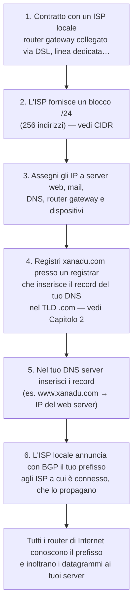

# Livello di rete: piano di controllo

> [!abstract] Di cosa parla questo capitolo
> Chiude lo studio del livello di rete iniziato nel [[04 - TLC - Livello di rete - piano dei dati|Capitolo 4]]. Lì si è visto **cosa** fa ogni router con la sua tabella di inoltro; qui si vede **come vengono calcolate** quelle tabelle. È il **piano di controllo**: la logica globale che decide i percorsi end-to-end e che configura e gestisce la rete.
> Il percorso:
> 1. i due approcci al piano di controllo: **per router** e **logicamente centralizzato** (SDN);
> 2. gli **algoritmi di instradamento** su grafi: **link-state** (Dijkstra) e **distance-vector** (Bellman-Ford);
> 3. i protocolli reali di Internet: **OSPF** dentro un sistema autonomo e **BGP** tra sistemi autonomi, "la colla che tiene insieme Internet";
> 4. il piano di controllo **SDN** (controller, OpenFlow, OpenDaylight, ONOS);
> 5. la gestione della rete: **ICMP** e **SNMP**.
>
> Gli algoritmi su grafi sono gli stessi visti in Algoritmi e Strutture Dati ([[Dijkstra Algorithm]], [[Grafo Pesato]]).
> Mappa del corso: [[MOC - Telecomunicazioni]].

> [!info] Fonte
> Kurose, Ross, *Reti di calcolatori e Internet*, 7ª ed., Capitolo 5 (pp. 353–401). Le pagine citate sono quelle **del libro**: per il PDF aggiungi **28**.

---

## 5.1 Introduzione

Le **tabelle di inoltro** (inoltro basato sulla destinazione) e le **tabelle dei flussi** (inoltro generalizzato) collegano il piano dei dati al piano di controllo. Questo capitolo spiega come vengono **calcolate, mantenute e installate**. Gli approcci sono due.

Vedi [[Inoltro e Instradamento]].

**Controllo per router (locale).**

![[TLC-p382-1.png]]

Ogni router ha una **componente di instradamento** (l'ovale "Algoritmo di instradamento") che comunica con quelle degli **altri router** (le frecce in alto, nel piano di controllo) per calcolare la **propria** tabella di inoltro, nel piano dei dati. Inoltro e instradamento stanno nello **stesso dispositivo**. È l'approccio usato in Internet per decenni, e su cui si basano **OSPF** e **BGP**.

**Controllo logicamente centralizzato.**

![[TLC-p383-1.png]]

Un **controller logicamente centralizzato** calcola e distribuisce le tabelle di inoltro di **ogni** router. Interagisce con un **agente di controllo** (CA, *control agent*) in ogni router, tramite un protocollo che configura e gestisce la tabella dei flussi. Grazie al match-action, i router possono fare anche bilanciamento del carico, firewalling e NAT.

> [!important] La differenza chiave
> Il CA ha funzionalità **minime**: comunica con il controller ed esegue i suoi ordini. Al contrario degli algoritmi di instradamento del controllo per router, **gli agenti di controllo non interagiscono tra loro** e non partecipano al calcolo della tabella di inoltro.

"Logicamente centralizzato" significa che il servizio si usa come se fosse un **unico punto centrale**, anche se in realtà è implementato su **più server** per tolleranza ai guasti e scalabilità. È l'approccio SDN, ormai molto diffuso:
- Google lo usa per **B4**, la WAN privata che collega i suoi data center (Box 5.3);
- Microsoft per **SWAN**;
- China Telecom, China Unicom e AT&T lo usano dentro e tra i data center.

_(libro, pp. 354–356)_

---

## 5.2 Algoritmi di instradamento

Vedi [[Algoritmi di Instradamento]].

Lo scopo degli **algoritmi di instradamento** (*routing algorithm*) è trovare i **percorsi**, o cammini, tra sorgenti e destinazioni attraverso la rete di router. Di solito il percorso migliore è quello a **costo minimo**, ma in pratica contano anche le **policy**: per esempio "il router x di Y non inoltra pacchetti che vengono da Z". Il libro li candida tra i **10 concetti più importanti del networking**.

**Il modello a grafo.** Un **grafo** $G = (N, E)$ è un insieme $N$ di **nodi** e un insieme $E$ di **archi**, ognuno dei quali collega una coppia di nodi.
- I **nodi** sono i **router**, i punti in cui si decide l'inoltro.
- Gli **archi** sono i **collegamenti fisici** tra router.

![[TLC-p385-1.png]]

Il grafo di esempio ha sei nodi, $u, v, w, x, y, z$, con i costi sugli archi: $c(u,v) = 2$, $c(u,x) = 1$, $c(u,w) = 5$, $c(v,x) = 2$, $c(v,w) = 3$, $c(x,w) = 3$, $c(x,y) = 1$, $c(w,y) = 1$, $c(w,z) = 5$, $c(y,z) = 2$.

- Il **costo** di un arco può riflettere la lunghezza fisica del collegamento, la velocità o il prezzo. Qui è un dato; spesso si chiama **metrica**.
- $c(x,y)$ è il costo dell'arco tra $x$ e $y$. Se l'arco non esiste, $c(x,y) = +\infty$.
- I grafi sono **non orientati**: $c(x,y) = c(y,x)$.
- $y$ è **adiacente** o **vicino** (*neighbor*) di $x$ se $(x,y) \in E$.
- Un **percorso** è una sequenza di nodi $(x_1, x_2, \dots, x_p)$ in cui ogni coppia consecutiva è un arco. Il suo costo è $c(x_1,x_2) + c(x_2,x_3) + \dots + c(x_{p-1},x_p)$.
- Il **percorso a costo minimo** (*least-cost path*) tra $u$ e $w$ è $(u, x, y, w)$, con costo $1 + 1 + 1 = 3$.
- Se tutti gli archi hanno lo stesso costo, il percorso a costo minimo è anche il **percorso più breve** (*shortest path*), quello con meno collegamenti.

> [!example] Esercizio del libro
> Trovare il percorso a costo minimo da $u$ a $z$ guardando la figura. Esistono 17 percorsi possibili, ma nessuno li prova tutti: si ragiona "a occhio" con la visione completa del grafo. Questo è proprio un algoritmo **centralizzato**: lo esegue il nostro cervello, che ha l'informazione completa sulla rete. (La risposta è $u \to x \to y \to z$, con costo $1 + 1 + 2 = 4$.)

**Tre criteri di classificazione** (nel PDF annotati "1°, 2°, 3° criterio"):

| Criterio | Tipo | Descrizione |
| --- | --- | --- |
| **1. Informazione** | **centralizzato** (globale) | conosce **tutta** la rete: nodi, collegamenti e costi. Può girare in un controller centrale o replicato in ogni router. Sono gli algoritmi **link-state** (LS) |
| | **decentralizzato** | il calcolo è **distribuito e iterativo**: ogni nodo conosce solo i costi dei propri collegamenti e scambia informazioni con i vicini. Esempio: **distance-vector** (DV) |
| **2. Dinamica** | **statico** | i percorsi cambiano raramente, spesso a mano |
| | **dinamico** | i percorsi cambiano con il traffico o la topologia. Si adatta meglio, ma è soggetto a **cicli** e **oscillazioni** |
| **3. Carico** | **sensibile al carico** (*load-sensitive*) | i costi riflettono la congestione corrente. Usato nei primi ARPAnet, con molte difficoltà |
| | **insensibile al carico** | i costi non riflettono la congestione. **RIP, OSPF e BGP** sono di questo tipo |

_(libro, pp. 356–358)_

### Instradamento link-state (LS)

Vedi [[Instradamento Link-State]].

In un algoritmo link-state la **topologia** e **tutti i costi** sono noti. Ogni nodo invia a **tutti** gli altri pacchetti sullo **stato dei suoi collegamenti** (identità e costi dei collegamenti adiacenti), con un algoritmo di **link-state broadcast**, come avviene in OSPF. Così tutti i nodi hanno una **vista identica e completa** della rete, e ognuno ottiene gli stessi risultati.

#### Algoritmo di Dijkstra

Il calcolo usato è l'**algoritmo di Dijkstra** (strettamente collegato a quello di Prim; vedi [[Dijkstra Algorithm]] e [[Prim-Jarník]] in Algoritmi e Strutture Dati, come ricorda la tua nota a margine). Calcola il percorso a costo minimo da un nodo **origine** $u$ a **tutti** gli altri. È **iterativo**: dopo la $k$-esima iterazione conosce i percorsi minimi verso $k$ destinazioni, cioè le $k$ più vicine.

Notazione:
- $D(v)$: costo del percorso minimo da $u$ a $v$ noto **all'iterazione corrente**;
- $p(v)$: **predecessore** di $v$ lungo il percorso minimo;
- $N'$: insieme dei nodi per cui il percorso minimo è **definitivamente** noto.

```text
Algoritmo Dijkstra dal nodo origine u
1  Inizializzazione:
2    N' = {u}
3    per tutti i nodi v
4      se v è adiacente a u
5        allora D(v) = c(u,v)
6      altrimenti D(v) = ∞
7
8  Ciclo
9    determina un w non in N' tale che D(w) sia minimo
10   aggiungi w a N'
11   aggiorna D(v) per ciascun nodo v adiacente a w e non in N':
12        D(v) = min(D(v), D(w) + c(w,v))
13   /* il nuovo costo verso v è il vecchio costo verso v oppure
14      il costo del percorso minimo noto verso w più il costo da w a v */
15 ripeti finché N' = N
```

**Esecuzione sulla rete della figura (Tabella 5.1):**

| Passo | $N'$ | $D(v),p(v)$ | $D(w),p(w)$ | $D(x),p(x)$ | $D(y),p(y)$ | $D(z),p(z)$ |
| --- | --- | --- | --- | --- | --- | --- |
| 0 | u | 2,u | 5,u | **1,u** | ∞ | ∞ |
| 1 | ux | 2,u | 4,x | | **2,x** | ∞ |
| 2 | uxy | **2,u** | 3,y | | | 4,y |
| 3 | uxyv | | **3,y** | | | 4,y |
| 4 | uxyvw | | | | | **4,y** |
| 5 | uxyvwz | | | | | |

- **Inizializzazione**: i vicini di $u$ ($v, w, x$) hanno costi 2, 5 e 1. $w$ vale 5, che è il costo del collegamento diretto, anche se si scoprirà che esiste un percorso migliore. $y$ e $z$ valgono ∞.
- **Passo 1**: il nodo non in $N'$ a costo minimo è $x$ (1), che entra in $N'$. Si aggiorna con la riga 12: $D(w) = \min(5,\ 1 + 3) = 4$ via $x$, e $D(y) = 1 + 1 = 2$ via $x$.
- **Passo 2**: $v$ e $y$ hanno entrambi costo 2; se ne sceglie uno arbitrariamente, $y$. Si aggiorna: $D(w) = \min(4,\ 2 + 1) = 3$ via $y$, e $D(z) = 2 + 2 = 4$ via $y$.
- **Passi 3–5**: entrano $v$, poi $w$ ($D(z) = \min(4,\ 3 + 5) = 4$, quindi non cambia) e infine $z$.

(Ho ricontrollato tutta la tabella: è corretta.)

Seguendo i predecessori a ritroso si ricostruisce ogni percorso. Nella **tabella di inoltro** di $u$ si memorizza, per ogni destinazione, il **primo hop**:

![[TLC-p389-1.png]]

L'albero dei percorsi minimi da $u$ usa gli archi u–v, u–x, x–y, y–w e y–z. La tabella di inoltro di $u$ è: $v \to (u,v)$; $w, x, y, z \to (u,x)$. Tutto tranne $v$ passa per $x$.

**Complessità.** Con $n$ nodi (esclusa l'origine), la prima iterazione cerca il minimo tra $n$ nodi, la seconda tra $n-1$, e così via, per un totale di $n(n+1)/2$ controlli, quindi **$O(n^2)$** nel caso peggiore. Con uno **heap** la ricerca del minimo (riga 9) diventa logaritmica.

#### Oscillazioni con costi sensibili al carico

![[TLC-p390-1.png]]

Caso "patologico": il costo di un collegamento è uguale al **carico** che trasporta (che riflette il ritardo), e quindi i costi **non sono simmetrici**. $z$ e $x$ inviano 1 unità di traffico verso $w$, $y$ ne invia $e$.
- **(a) Instradamento iniziale**: tutti usano percorsi che portano a costi come in figura (1 + e sul collegamento x–w).
- **(b)** Rieseguendo l'algoritmo, $y$ vede che il percorso in **senso orario** verso $w$ costa 1, mentre quello antiorario costa $1 + e$; anche $x$ passa al senso orario.
- **(c)** Con i nuovi costi, $x$, $y$ e $z$ trovano migliore il senso **antiorario**.
- **(d)** E di nuovo il senso **orario**…

L'instradamento **oscilla** all'infinito. Il problema riguarda qualsiasi algoritmo con metriche basate su congestione o ritardo. Le soluzioni sono due:
- rendere i costi **indipendenti dal traffico**: inaccettabile, perché uno scopo dell'instradamento è proprio evitare i collegamenti congestionati;
- far sì che **non tutti i router** eseguano l'algoritmo **nello stesso istante**. Curiosamente, i ricercatori hanno scoperto che i router in Internet tendono ad **auto-sincronizzarsi** (Floyd 1994): anche partendo in istanti diversi con la stessa frequenza, finiscono per eseguire l'algoritmo insieme. Per evitarlo, ogni router sceglie **a caso** l'istante di invio dell'avviso di collegamento.

_(libro, pp. 359–363)_

### Instradamento distance-vector (DV)

Vedi [[Instradamento Distance-Vector]].

L'algoritmo distance-vector è:
- **distribuito**: ogni nodo riceve informazioni dai vicini, calcola e restituisce i risultati ai vicini;
- **iterativo**: il processo si ripete finché i vicini non hanno più nulla da scambiarsi. È **auto-terminante**: non c'è un segnale di stop, semplicemente si ferma;
- **asincrono**: i nodi non devono operare al passo.

#### Formula di Bellman-Ford

Sia $d_x(y)$ il costo del percorso minimo da $x$ a $y$. Allora:

$$d_x(y) = \min_v \{\, c(x,v) + d_v(y) \,\} \qquad (5.1)$$

dove $\min_v$ è calcolato su **tutti i vicini** $v$ di $x$. È intuitiva: per andare da $x$ a $y$ bisogna prima passare per un vicino $v$, e da lì prendere il percorso minimo verso $y$. Il costo minimo è il migliore tra tutti i vicini.

> [!example] Verifica sul grafo della figura
> $d_u(z)$: i vicini di $u$ sono $v, x, w$, con $d_v(z) = 5$, $d_x(z) = 3$, $d_w(z) = 3$, e $c(u,v) = 2$, $c(u,x) = 1$, $c(u,w) = 5$.
> $$d_u(z) = \min\{2 + 5,\ 1 + 3,\ 5 + 3\} = \min\{7, 4, 8\} = 4$$
> Coincide con il risultato di Dijkstra.

> [!warning] Correzione — numero dell'equazione
> A p. 363 il libro scrive "Ponendo tali valori nell'**Equazione 4.1**" e poco dopo "qualsiasi nodo vicino che minimizza l'**Equazione 4.1**". La formula di Bellman-Ford è l'**Equazione 5.1**: è un refuso nella numerazione.

La formula ha anche un'importanza **pratica**:
- se $v^*$ è il vicino che realizza il minimo, nella **tabella di inoltro** di $x$ il prossimo hop verso $y$ è proprio $v^*$;
- suggerisce la forma della comunicazione tra vicini nell'algoritmo DV, detto appunto **algoritmo di Bellman-Ford**.

#### L'algoritmo

Ogni nodo $x$ mantiene:
- per ogni vicino $v$, il costo $c(x,v)$;
- il proprio **vettore delle distanze** $\mathbf{D}_x = [D_x(y) : y \in N]$, cioè le **stime** dei costi verso tutte le destinazioni;
- i vettori delle distanze dei vicini, $\mathbf{D}_v = [D_v(y) : y \in N]$.

Di tanto in tanto ogni nodo invia il proprio vettore ai vicini. Quando $x$ riceve un nuovo vettore da un vicino, aggiorna il proprio con Bellman-Ford:

$$D_x(y) = \min_v \{\, c(x,v) + D_v(y) \,\} \quad \text{per ciascun } y \in N$$

e, se è cambiato, lo invia ai vicini. Finché i nodi continuano ad aggiornarsi, ogni stima $D_x(y)$ **converge** al costo effettivo $d_x(y)$ (Bertsekas 1991).

```text
Algoritmo Bellman-Ford — a ciascun nodo x:
1  Inizializzazione:
2    per tutte le destinazioni y in N:
3      Dx(y) = c(x,y)   /* se y non è adiacente, c(x,y) = ∞ */
4    per ciascun vicino w
5      Dw(y) = ? per tutte le destinazioni y in N
6    per ciascun vicino w
7      invia il vettore delle distanze Dx = [Dx(y): y in N] a w
8
9  ciclo
10   attendi (finché vedi cambiare il costo di un collegamento verso
11     qualche vicino w o finché ricevi un vettore delle distanze
12     da qualche vicino w)
13   per ogni y in N:
14     Dx(y) = min_v {c(x,v) + Dv(y)}
15
16   se Dx(y) è cambiato per qualche destinazione y
17     invia il vettore delle distanze Dx = [Dx(y): y in N] a tutti i vicini
18
19 ripeti il ciclo indefinitamente
```

Per la tabella di inoltro, $x$ non ha bisogno della distanza ma del **vicino** $v^*(y)$ che realizza il minimo alla riga 14.

| | LS | DV |
| --- | --- | --- |
| Informazione | **globale**: mappa completa prima di Dijkstra | **locale**: solo i costi verso i vicini e ciò che i vicini comunicano |
| Usato in | OSPF, IS-IS | RIP, BGP, ISO IDRP, IPX di Novell, l'ARPAnet originale |

#### Esempio su tre nodi

![[TLC-p394-1.png]]

La rete ha tre nodi: $c(x,y) = 2$, $c(y,z) = 1$, $c(x,z) = 7$. Nella figura il funzionamento è mostrato in modo **sincrono**.
- **Colonna 1 (inizializzazione)**: ogni nodo conosce solo il proprio vettore. Le righe dei vicini sono a ∞ (i "•"). La tabella di $x$ ha $\mathbf{D}_x = [0, 2, 7]$.
- Ogni nodo invia il proprio vettore ai vicini (le frecce).
- **Colonna 2**: ogni nodo ricalcola. Per $x$:
  - $D_x(x) = 0$;
  - $D_x(y) = \min\{c(x,y) + D_y(y),\ c(x,z) + D_z(y)\} = \min\{2 + 0,\ 7 + 1\} = 2$;
  - $D_x(z) = \min\{c(x,y) + D_y(z),\ c(x,z) + D_z(z)\} = \min\{2 + 1,\ 7 + 0\} = 3$.

  $D_x(z)$ scende da 7 a **3**: ora $x$ passa per $y$, quindi $v^*(y) = y$ e $v^*(z) = y$.
- Solo $x$ e $z$ hanno vettori cambiati, quindi solo loro inviano aggiornamenti; $y$ no.
- **Colonna 3**: dopo la ricezione tutti i vettori sono $x = [0, 2, 3]$, $y = [2, 0, 1]$, $z = [3, 1, 0]$, e non cambiano più.

Il processo continua finché nessuno invia più aggiornamenti. A quel punto l'algoritmo è in uno **stato quiescente** (righe 10–11) finché non cambia il costo di un collegamento.

#### Modifica dei costi e guasti dei collegamenti

![[TLC-p396-1.png]]

**(a) Le buone notizie viaggiano in fretta.** Il costo di y–x scende **da 4 a 1** (si osservano solo le distanze di $y$ e $z$ verso $x$):
- $t_0$: $y$ rileva il cambiamento, aggiorna il vettore e avvisa i vicini;
- $t_1$: $z$ riceve l'aggiornamento e ricalcola $D_z(x)$ da 5 a **2**, poi invia il nuovo vettore;
- $t_2$: $y$ riceve il vettore di $z$, ma i suoi costi non cambiano, e quindi non invia nulla.

Bastano **due iterazioni** per arrivare alla quiete.

**(b) Le cattive notizie viaggiano piano.** Il costo di y–x **sale da 4 a 60**. Prima del cambiamento $D_y(x) = 4$, $D_y(z) = 1$, $D_z(y) = 1$, $D_z(x) = 5$.
1. $t_0$: $y$ ricalcola $D_y(x) = \min\{c(y,x) + D_x(x),\ c(y,z) + D_z(x)\} = \min\{60 + 0,\ 1 + 5\} = 6$. Con la visione globale si vede che è **sbagliato**: il percorso di $z$ verso $x$ passava proprio per $y$! Ma $y$ sa solo che $z$ "dice" di arrivare a $x$ con costo 5. Si crea un **instradamento ciclico**: per arrivare a $x$, $y$ passa da $z$ e $z$ passa da $y$. È come un **buco nero**: un pacchetto per $x$ rimbalza tra $y$ e $z$ per sempre, finché le tabelle non cambiano.
2. $y$ informa $z$ del nuovo $D_y(x) = 6$.
3. $z$ calcola $D_z(x) = \min\{50 + 0,\ 1 + 6\} = 7$ e informa $y$.
4. $y$ calcola 8, $z$ calcola 9, e così via…

Il ciclo continua per **44 iterazioni**, finché il costo di $z$ via $y$ non supera 50. Solo allora $z$ sceglie il collegamento diretto (50) e $y$ instrada verso $x$ via $z$ (51). E se $c(y,x)$ salisse a 10.000 e $c(z,x)$ fosse 9999? Ci vorrebbe molto di più. È il **problema del conteggio all'infinito** (*count to infinity problem*).

#### Inversione avvelenata

Vedi [[Conteggio all'Infinito]].

Il **poisoned reverse** (*inversione avvelenata*) evita questo ciclo specifico. Se $z$ instrada verso $x$ passando per $y$, allora $z$ dice a $y$ che la sua distanza verso $x$ è **infinita**: $D_z(x) = \infty$. È una "piccola bugia", che $z$ ripete per tutto il tempo in cui instrada verso $x$ via $y$. Così $y$ non proverà mai a passare per $z$ per raggiungere $x$.

Con l'inversione avvelenata, nell'esempio (b):
- $t_0$: la tabella di $y$ indica $D_z(x) = \infty$. Quando c(y,x) sale a 60, $y$ continua a instradare direttamente verso $x$ con costo 60 e informa $z$ che $D_y(x) = 60$;
- $t_1$: $z$ passa subito al collegamento diretto (50), che ora è il percorso minimo, e informa $y$ che $D_z(x) = 50$;
- $t_2$: $y$ pone $D_y(x) = 51$ via $z$;
- $t_3$: ora è $y$ a instradare verso $x$ passando per $z$, quindi è $y$ ad avvelenare il percorso inverso: dice a $z$ che $D_y(x) = \infty$, anche se in realtà sa che $D_y(x) = 51$.

> [!warning] Non è una soluzione generale
> L'inversione avvelenata **non risolve** in generale il conteggio all'infinito: i cicli che coinvolgono **tre o più nodi**, e non solo due vicini, non vengono rilevati.

#### Confronto tra LS e DV

| | **Link-state** | **Distance-vector** |
| --- | --- | --- |
| Con chi parla un nodo | con **tutti** i nodi, via broadcast | **solo** con i vicini |
| Cosa comunica | **solo** i costi dei propri collegamenti | le stime verso **tutti** i nodi |
| **Complessità dei messaggi** | $O(\lvert N\rvert \cdot \lvert E\rvert)$ messaggi; ogni cambiamento va comunicato a tutti | scambi solo tra vicini; un cambiamento si propaga solo se modifica i percorsi minimi |
| **Velocità di convergenza** | $O(\lvert N\rvert^2)$ | può convergere **lentamente**, con **cicli** e **conteggio all'infinito** |
| **Robustezza** | un router guasto può diffondere un costo sbagliato **solo per i suoi collegamenti**: i calcoli sono in qualche modo isolati | un nodo può annunciare percorsi minimi sbagliati verso **tutte** le destinazioni, e l'errore si **propaga in tutta la rete**. Nel 1997 un router di un piccolo ISP mandò informazioni errate alla dorsale americana e isolò per ore grandi porzioni di Internet |

Nessuno dei due è nettamente superiore, ed **entrambi sono usati** in Internet.

_(libro, pp. 363–370)_

---

## 5.3 Instradamento interno ai sistemi autonomi: OSPF

Finora la rete è stata vista come un insieme omogeneo di router, tutti uguali e tutti con lo stesso algoritmo. È troppo semplicistico per **due motivi** (annotazione: "2 problemi di instradamento interno"):

- **Scalabilità** ("tanti router"): con centinaia di milioni di host, memorizzare le informazioni di instradamento di tutti richiederebbe una memoria enorme, e il broadcast degli aggiornamenti non lascerebbe banda per i dati. Un DV con così tanti router non convergerebbe mai.
- **Autonomia amministrativa** ("gestione interna degli ISP"): Internet è una rete di ISP, e ognuno vuole gestire i propri router come preferisce (scegliere l'algoritmo, nascondere la struttura interna) pur restando connesso agli altri.

Vedi [[Sistema Autonomo]].

La soluzione è organizzare i router in **sistemi autonomi** (**AS**, *autonomous system*), cioè gruppi di router sotto lo **stesso controllo amministrativo**.
- I router di un ISP formano spesso un unico AS, gigantesco nel caso dei tier-1; a volte un ISP divide la rete in più AS.
- Ogni AS ha un numero univoco, l'**ASN** (RFC 1930), assegnato dall'ICANN come gli indirizzi IP (vedi la tua nota [[BGP#Autonomous System (AS)|BGP — AS]]).
- I router di un AS eseguono lo **stesso algoritmo** e hanno informazioni gli uni sugli altri. L'algoritmo interno a un AS si chiama **protocollo di instradamento interno al sistema autonomo** (*intra-AS routing protocol*).

### OSPF (Open Shortest Path First)

Vedi [[OSPF]].

**OSPF** e il suo parente stretto **IS-IS** sono usati negli ISP di livello superiore. "Open" significa che le specifiche sono **pubbliche** (a differenza di EIGRP di Cisco, aperto solo dopo 20 anni). La versione attuale, OSPFv2, è nell'RFC 2328.

**Come funziona:**
- è un protocollo **link-state**: usa il **flooding** (inondazione) delle informazioni sullo stato dei collegamenti e **Dijkstra**;
- ogni router costruisce una **mappa topologica**, cioè un grafo, dell'intero AS ed esegue **localmente** Dijkstra per ottenere l'**albero dei percorsi minimi** verso tutte le sottoreti, con se stesso come radice;
- i **costi** dei collegamenti li fissa l'**amministratore**: tutti a 1, per ottenere il minimo numero di hop, oppure inversamente proporzionali alla capacità, per scoraggiare i collegamenti lenti. OSPF non impone una politica sui pesi: dà solo i meccanismi per trovare i percorsi minimi dato un insieme di pesi;
- a ogni **cambiamento** di un collegamento (costo o disponibilità) il router invia le informazioni in **broadcast a tutti** i router dell'AS. Le invia anche **periodicamente**, almeno ogni **30 minuti**, anche se nulla è cambiato, per robustezza;
- gli annunci viaggiano in messaggi OSPF trasportati **direttamente da IP**, con **numero di protocollo 89**. OSPF deve quindi implementare da sé il trasferimento affidabile e il broadcast;
- verifica che i collegamenti siano attivi con messaggi **HELLO** inviati ai vicini, e permette di leggere il database dello stato dei collegamenti dei router vicini.

> [!tip] Box 5.1 — Come impostare i pesi OSPF
> Di solito si pensa così: i pesi sono dati e determinano i percorsi (via Dijkstra), che minimizzano il costo complessivo. In pratica la relazione si può **invertire**: un operatore che conosce il traffico tra punti di ingresso e di uscita e vuole, per esempio, minimizzare l'utilizzo massimo dei collegamenti, ha come "manopola" **solo i pesi**. Deve quindi scegliere i pesi in modo che OSPF produca l'instradamento desiderato: è un problema di **ingegneria del traffico** (Fortz 2000, 2002). _(p. 372)_

**Vantaggi di OSPF** (annotazione: "Vantaggi OSPF"):

| Vantaggio | Dettagli |
| --- | --- |
| **Sicurezza** | gli scambi tra router possono essere **autenticati**, così solo router fidati partecipano. Per default i pacchetti non sono autenticati e potrebbero essere contraffatti. Due modalità: **semplice** (password in chiaro, poco sicura) e **MD5** (hash del pacchetto con una chiave segreta condivisa, più numeri di sequenza contro gli attacchi di ripetizione) |
| **Percorsi con lo stesso costo** | se più percorsi hanno lo stesso costo, si possono usare **tutti** invece di sceglierne uno |
| **Supporto unicast e multicast** | (annotati "1–1" e "1–tanti") **MOSPF** (RFC 1584) estende OSPF al multicast usando lo stesso database e un nuovo tipo di annuncio |
| **Gerarchie in un dominio** | un AS si può dividere in **aree**, ognuna con il proprio algoritmo link-state: i router di un'area inviano lo stato solo agli altri router dell'area. I **router di confine d'area** (*area border router*) instradano verso l'esterno. L'**area di dorsale** (*backbone area*) instrada il traffico tra le aree e contiene tutti i router di confine. Il percorso è: router di confine della propria area → dorsale → router di confine dell'area di destinazione → destinazione |

_(libro, pp. 370–373)_

---

## 5.4 Instradamento tra ISP: BGP

Vedi [[Protocollo BGP]] e la tua nota [[BGP]] (che tratta anche BGP hijacking, route leak e recon).

Come annota il PDF: "OSPF si occupa di trasferimenti in sistemi autonomi come ISP, ora vediamo trasferimenti tra ISP". Per i percorsi che **attraversano più AS**, per esempio da uno smartphone a Timbuktu a un server nella Silicon Valley, serve un **protocollo di instradamento inter-AS** che coordini più AS. È il **BGP** (*Border Gateway Protocol*, RFC 4271), lo standard *de facto*.

> [!important] La colla di Internet
> BGP è forse il protocollo più importante di Internet, insieme a IP: è la colla che tiene insieme le migliaia di ISP. Il libro lo definisce un protocollo di tipo **distance-vector**, decentralizzato e asincrono (più precisamente si parla spesso di *path-vector*, perché gli annunci portano l'intero AS-PATH). È molto complesso, ma va capito almeno a grandi linee.

### Il ruolo di BGP

Le righe della tabella di inoltro verso destinazioni **interne** all'AS le determina il protocollo intra-AS. Quelle verso destinazioni **esterne** le determina **BGP**.
- BGP instrada verso **prefissi CIDR** (vedi [[CIDR]]), non verso singoli indirizzi: per esempio 138.16.68/22, che contiene 1024 indirizzi. Le righe della tabella di inoltro hanno quindi la forma $(x, I)$: prefisso $x$ e interfaccia $I$.

BGP dà a ogni router un modo per:
1. **ottenere informazioni sulla raggiungibilità dei prefissi** dagli AS confinanti. Ogni sottorete può "urlare" a tutta Internet "**Esisto, sono qui**", e BGP fa in modo che lo sappiano tutti i router. Senza BGP ogni sottorete sarebbe isolata e irraggiungibile;
2. **determinare i percorsi "ottimi"** verso i prefissi: tra più cammini possibili, il router sceglie in base alla raggiungibilità e alle **politiche**.

_(libro, p. 374)_

### Distribuzione delle informazioni dei cammini in BGP

![[TLC-p403-1.png]]

La rete ha tre AS: AS1, AS2 e AS3. AS3 contiene una **sottorete con prefisso x** (annotazione rossa). Le tue annotazioni verdi distinguono i tipi di router:
- **router gateway**: router di bordo collegato direttamente a router di **altri AS**, come 1c in AS1, 2a e 2c in AS2, 3a in AS3;
- **router interno**: collegato solo a host e router del **proprio AS**, come 1a, 1b e 1d.

**L'idea** (annotazione: "Router: 'Esisto anch'io'"):
1. AS3 invia ad AS2 un messaggio "**AS3 x**": x esiste ed è in AS3;
2. AS2 invia ad AS1 "**AS2 AS3 x**": x esiste ed è raggiungibile passando per AS2 e poi AS3.

Così ogni AS conosce non solo l'esistenza di x, ma anche un **percorso** per raggiungerlo.

**In realtà** gli annunci li inviano i **router**, non gli AS:
- coppie di router si scambiano informazioni su **connessioni TCP semi-permanenti**, sulla **porta 179**;
- ogni connessione TCP, con tutti i messaggi che vi passano, è una **sessione BGP**:
  - **eBGP** (*external*) se coinvolge due AS diversi, per esempio 2a–1c e 2c–3a;
  - **iBGP** (*internal*) se è tra router dello stesso AS.

![[TLC-p404-1.png]]

Nella figura le sessioni **eBGP** sono le linee a tratteggio lungo (in rosso), le **iBGP** quelle a tratteggio breve (in blu). Le tue annotazioni:
- "Notare connessione iBGP a maglia completa": dentro ogni AS c'è una sessione iBGP tra **ogni coppia** di router;
- "non sempre sono collegamenti fisici": le sessioni BGP **non sempre corrispondono** ai collegamenti fisici;
- a margine: "In pratica iBGP invia lo stesso messaggio a tutti, dato che eBGP avvisa il passaggio tra AS".

**Distribuzione di x:**
1. il gateway **3a** invia un messaggio **eBGP** "AS3 x" al gateway **2c**;
2. **2c** lo invia con **iBGP** a tutti i router di AS2, compreso **2a**;
3. **2a** invia un messaggio **eBGP** "AS2 AS3 x" al gateway **1c**;
4. **1c** usa **iBGP** per inviare "AS2 AS3 x" a tutti i router di AS1.

Alla fine ogni router di AS1 e AS2 conosce x e un percorso per raggiungerlo.

![[TLC-p405-1.png]]

In una rete reale ci sono **più percorsi** verso una destinazione. Aggiungendo un collegamento tra **1d** e **3d** (in rosso, annotato "Esempio reale di distribuzione informazioni di router di instradamento tra AS"), da AS1 a x ci sono due percorsi:
- "AS2 AS3 x" attraverso il router 1c;
- "**AS3 x**" attraverso il router 1d.

_(libro, pp. 375–376)_

### Selezione delle rotte migliori

Vedi [[Selezione delle Rotte BGP]].

Quando un router annuncia un prefisso in una sessione BGP, include degli **attributi BGP**. **Prefisso + attributi = rotta** (*route*). I due attributi più importanti sono:

- **AS-PATH**: la lista degli AS attraversati dall'annuncio. Quando un prefisso passa per un AS, questo aggiunge il proprio **ASN** all'AS-PATH. Nella figura le due rotte da AS1 verso x hanno AS-PATH "AS2 AS3" e "AS3". Serve anche a **evitare i cicli**: se un router vede il proprio AS nell'AS-PATH, **rifiuta** l'annuncio.
- **NEXT-HOP**: l'indirizzo IP dell'**interfaccia del router che inizia l'AS-PATH**. È il delicato collegamento tra instradamento intra-AS e inter-AS.
  - Per la rotta "AS2 AS3 x" da AS1, il NEXT-HOP è l'interfaccia più a sinistra di **2a**.
  - Per la rotta "AS3 x", il NEXT-HOP è l'interfaccia più a sinistra di **3d**.

  Il NEXT-HOP è un router che **non appartiene ad AS1**, ma a una sottorete collegata direttamente ad AS1.

Ogni router di AS1 conosce quindi due rotte per x, ognuna rappresentata dalla terna NEXT-HOP, AS-PATH, prefisso:
- IP dell'interfaccia di 2a; AS2 AS3; x
- IP dell'interfaccia di 3d; AS3; x

#### Instradamento hot potato

Vedi [[Hot Potato Routing]].

Il più semplice algoritmo BGP è l'**instradamento a patata bollente** (*hot potato routing*): tra tutti i percorsi possibili si sceglie quello con il **minor costo verso il router NEXT-HOP** che lo inizia, secondo il protocollo **intra-AS**.

Esempio: il router **1b** conosce due percorsi per x, con NEXT-HOP 2a e 3d. Consulta l'instradamento intra-AS (es. OSPF). Se il costo è il numero di hop, verso 2a costa **2** e verso 3d costa **3**, quindi sceglie **2a**. Poi cerca nella tabella di inoltro intra-AS l'interfaccia $I$ sul percorso minimo verso 2a e aggiunge $(x, I)$.

![[TLC-p406-1.png]]

I quattro passi per aggiungere una destinazione esterna alla tabella di inoltro:
1. dal protocollo **inter-AS** (BGP) il router apprende che x è raggiungibile tramite più gateway;
2. con le informazioni del protocollo **intra-AS** calcola i costi dei percorsi minimi verso ciascun gateway;
3. **hot potato**: sceglie il gateway con il costo minimo;
4. dalla tabella di inoltro ricava l'interfaccia $I$ verso quel gateway e scrive $(x, I)$.

> [!note] Perché "patata bollente"
> L'idea è che 1b **butti fuori i pacchetti dal suo AS il prima possibile**, al minor costo, senza preoccuparsi di quanto costerà il resto del percorso fuori dal suo AS. Il pacchetto è come una patata bollente che scotta in mano, e la si passa a un altro AS il più in fretta possibile. È un algoritmo **egoista**. Due router dello stesso AS possono scegliere percorsi diversi per lo stesso prefisso: 1b via AS2, 1d direttamente via AS3.

#### Algoritmo di selezione delle rotte

In realtà BGP usa un algoritmo più complesso. Se ci sono più rotte verso lo stesso prefisso, applica in sequenza queste **regole di eliminazione** finché ne resta una:

1. **Preferenza locale** più alta: un attributo impostato dal router o appreso da un altro router dello stesso AS. È una scelta lasciata all'**amministratore** dell'AS.
2. A parità, l'**AS-PATH più breve**. Se fosse l'unica regola, BGP sarebbe un Bellman-Ford con metrica il numero di hop **tra AS** invece che tra router.
3. A parità, il **NEXT-HOP più vicino**, cioè quello con il percorso intra-AS meno costoso: è l'**hot potato**.
4. Se ne resta più di una, si usano gli **identificatori BGP**.

> [!example] Esempio del libro
> Router 1b, due rotte verso x: una via AS2 (AS-PATH "AS2 AS3", NEXT-HOP 2a a costo 2) e una via AS3 (AS-PATH "AS3", NEXT-HOP 3d a costo 3).
> - L'**hot potato** da solo sceglierebbe la prima (costo 2 < 3).
> - Con l'algoritmo completo la **regola 2** viene prima della 3, quindi vince la seconda, che ha l'AS-PATH più breve.
>
> BGP **non è quindi solo egoista**: riduce anche il ritardo end-to-end.

BGP è lo standard *de facto*. Le tabelle reali degli ISP di livello 1 sono visibili su `www.routeviews.org` e contengono **più di mezzo milione di rotte**.

_(libro, pp. 376–379)_

### Anycast IP

Vedi [[Anycast IP]].

BGP si usa anche per implementare il servizio **IP anycast** (RFC 1546, 7094), molto usato nel DNS. In molte applicazioni si vuole:
1. replicare lo stesso contenuto su server in aree geografiche diverse;
2. far accedere ogni utente al server **più vicino**.

È il caso delle CDN (vedi [[Content Distribution Network]]) e dei server DNS replicati.

![[TLC-p408-1.png]]

La CDN assegna lo **stesso indirizzo IP** (**212.21.21.21**) al Server CDN A (in AS3) e al Server CDN B (in AS1), e lo annuncia con BGP da entrambi. Un router BGP che riceve più annunci per quell'indirizzo li tratta come **percorsi diversi verso lo stesso luogo**, anche se in realtà portano a luoghi diversi, e sceglie il migliore con l'algoritmo di selezione delle rotte. Il router **2b** in AS2 riceve gli annunci da AS1 e AS4 e inoltra verso il server **B**, che è più vicino.

- Quando un client chiede un video, la CDN gli restituisce sempre lo stesso indirizzo, e Internet porta la richiesta al server più vicino.
- **In pratica le CDN non lo usano**: un cambiamento dell'instradamento BGP potrebbe far arrivare pacchetti della **stessa connessione TCP** a istanze diverse del server.
- È invece molto usato dal **DNS**: ci sono **13 indirizzi IP** di root server, ma a ciascuno corrispondono più server, alcuni con oltre 100 server nel mondo. L'anycast porta ogni query al root server **più vicino** responsabile di quell'indirizzo (vedi [[Gerarchia dei DNS Server]]).

_(libro, pp. 379–380)_

### Politiche di instradamento

Quando un router sceglie una rotta, le **politiche** dell'AS possono prevalere su qualsiasi altra considerazione, come la brevità del percorso o l'hot potato.

![[TLC-p409-1.png]]

Ci sono sei AS: **A, B e C** sono **reti di provider** di dorsale, **W, X e Y** sono **reti dei clienti**.
- **W, X e Y** sono **reti stub**: tutto il traffico che entra è destinato a loro, e tutto quello che esce ha origine da loro. W e Y sono reti di accesso.
- **X** è un ISP di accesso **multi-homed**: è collegato a **due** provider (B e C), uno scenario sempre più comune (vedi [[Gerarchia degli ISP]]).
- A, B e C sono **peer** tra loro e si scambiano informazioni BGP complete sulle reti dei clienti.

**Come impedisce X di fare da transito tra B e C?** Controllando i propri **annunci**. X si comporta da rete stub se annuncia ai vicini B e C che **non ha percorsi verso altre destinazioni** oltre a sé. Anche se conoscesse un percorso XCY verso Y, non lo annuncerebbe a B. Così B non inoltrerà mai a X traffico diretto a Y.

**Lato provider.** B ha appreso da A che A ha un percorso **AW** verso W, e lo annuncia al suo cliente X come **BAW**. Ma deve annunciare BAW **anche a C**? Se lo facesse, C potrebbe instradare verso W via CBAW. Ma se A, B e C sono tutti provider di dorsale, B potrebbe giustamente pensare di non dover sopportare il costo del traffico **in transito** tra A e C: è compito di A e C collegarsi direttamente.
- Non esistono standard ufficiali. Una regola pratica degli ISP commerciali è che **tutto il traffico che attraversa la dorsale di un ISP deve avere origine o destinazione in una sua rete cliente**.
- Gli accordi di **peering** tra coppie di ISP vengono negoziati, spesso in modo confidenziale (vedi [[Gerarchia degli ISP]]).

> [!tip] Box 5.2 — Perché protocolli diversi per intra-AS e inter-AS?
> | | Inter-AS (BGP) | Intra-AS (OSPF) |
> | --- | --- | --- |
> | **Politiche** | dominanti: un AS può volere che il suo traffico non passi per un altro, o controllare il transito sulla sua rete | un solo controllo amministrativo, quindi le politiche contano poco |
> | **Scalabilità** | critica: instradare verso e tra moltissime reti | meno importante; se il dominio è troppo grande lo si divide (le **aree** OSPF) |
> | **Prestazioni** | secondarie: un percorso più lungo ma conforme alle politiche può essere preferibile. Non esiste nemmeno una nozione di costo, al di là del conteggio degli hop | importanti: ci si concentra sulle prestazioni |
> _(p. 388)_

_(libro, pp. 381–382)_

### Retrospettiva: come essere presenti in Internet

Il paragrafo mette insieme indirizzamento IP, DNS e BGP. Hai fondato un'azienda con un server web, un mail server e un server DNS e vuoi essere raggiungibile da tutto il mondo:



L'ultimo passo è quello che si dimentica più facilmente. Quando Alice conosce l'IP del web server, il suo segmento TCP SYN attraversa router di molti AS, e **ognuno** deve avere nella tabella di inoltro il prefisso /24 dell'azienda, o almeno una riga **aggregata** che lo contiene (vedi [[Aggregazione di Indirizzi]]). È BGP a diffonderlo.

_(libro, pp. 382–383)_

---

## 5.5 Il piano di controllo SDN

Vedi [[Controller SDN]].

Nella terminologia SDN i dispositivi si chiamano **packet switch**, o semplicemente switch, perché decidono in base a campi di livello 2, 3 e 4.

**Le quattro caratteristiche dell'architettura SDN:**
1. **Inoltro basato sui flussi**: lo switch inoltra in base a più campi delle intestazioni di trasporto, rete e collegamento (gli 11 campi di OpenFlow, vedi [[Inoltro Generalizzato e OpenFlow]]). È l'opposto dell'inoltro tradizionale, basato solo sull'IP di destinazione. Il compito del piano di controllo SDN è calcolare, gestire e installare le righe delle tabelle dei flussi di tutti gli switch.
2. **Separazione tra piano dei dati e piano di controllo**: il piano dei dati è fatto di switch semplici e veloci che eseguono regole match-action; il piano di controllo è fatto di server e software che determinano le tabelle dei flussi.
3. **Funzioni di controllo esterne agli switch**: il software gira su **server distinti e remoti**. Il piano di controllo ha due parti: un **controller SDN** (o sistema operativo di rete) e un insieme di **applicazioni di controllo di rete**.
4. **Rete programmabile**: le applicazioni di controllo sono il "cervello". Usano le API del controller per programmare il piano dei dati: per esempio un'applicazione di instradamento (Dijkstra sulle informazioni del controller), una di controllo d'accesso (un firewall, come nel terzo esempio OpenFlow) o una di bilanciamento del carico.

![[TLC-p412-1.png]]

L'architettura SDN su tre livelli:
- **Applicazioni di controllo di rete** (Routing, Controllo d'accesso, Bilanciamento del carico), sopra l'**API "northbound"**;
- **Controller SDN** (*network operating system*), sopra l'**API "southbound"**;
- **Switch controllati SDN**, cioè il piano dei dati.

> [!note] La rivoluzione "orizzontale"
> Prima della SDN lo switch/router, con il suo software di controllo e le implementazioni dei protocolli, era **monolitico**, integrato verticalmente e venduto da un solo fornitore. Con la SDN switch, controller e applicazioni sono entità **distinte**, che possono venire da fornitori diversi. È come il passaggio dai **mainframe** (hardware, sistema operativo e applicazioni da un unico fornitore) ai **personal computer**, con un ecosistema aperto e innovativo.

_(libro, pp. 383–385)_

### Controller SDN e applicazioni di controllo

![[TLC-p414-1.png]]

Il controller SDN ha **tre livelli**, descritti dal basso verso l'alto:

| Livello | Cosa fa | Componenti in figura |
| --- | --- | --- |
| **Comunicazione** | scambia informazioni con i dispositivi controllati: comandi da remoto ed **eventi** locali (un collegamento che cade, un dispositivo che si connette). È l'**interfaccia southbound** | OpenFlow, SNMP |
| **Gestione dello stato globale della rete** | mantiene informazioni aggiornate su host, collegamenti, switch e dispositivi, comprese copie delle tabelle dei flussi e i loro contatori | Statistics, Flow tables, Link-state info, Host info, Switch info |
| **Interfaccia verso le applicazioni** | l'**interfaccia northbound**: le applicazioni leggono e scrivono lo stato e le tabelle dei flussi e si fanno notificare gli eventi. Di solito un'**API REST** | Network graph, RESTful API, Intent |

"Logicamente centralizzato" ma **fisicamente distribuito**: dall'esterno il controller è un servizio unico, ma per tolleranza ai guasti, disponibilità e prestazioni è implementato su più server. Bisogna quindi gestire tempo logico, coerenza e consenso, come in ogni sistema distribuito (vedi [[Sistema Distribuito]]). I controller moderni, come **OpenDaylight** e **ONOS**, mettono molta enfasi su questo. L'architettura richiama quella del primo controller, **NOX** (2008).

_(libro, pp. 386–388)_

### Il protocollo OpenFlow

Vedi [[Protocollo OpenFlow]].

**OpenFlow** opera tra il controller SDN e uno switch (o un altro dispositivo con le API OpenFlow viste nel Capitolo 4). Usa **TCP sulla porta 6653**.

**Messaggi dal controller allo switch:**

| Messaggio | Funzione |
| --- | --- |
| **Configuration** | interrogare e impostare i parametri di configurazione dello switch |
| **Modify-State** | aggiungere, cancellare o modificare righe della tabella dei flussi; impostare le proprietà delle porte |
| **Read-State** | raccogliere statistiche e contatori dalle tabelle dei flussi e dalle porte |
| **Send-Packet** | inviare un pacchetto specifico da una porta dello switch; il pacchetto è nel payload del messaggio |

**Messaggi dallo switch al controller:**

| Messaggio | Funzione |
| --- | --- |
| **Flow-Removed** | una riga della tabella dei flussi è stata cancellata (timeout o modify-state) |
| **Port-status** | è cambiato lo stato di una porta |
| **Packet-in** | un pacchetto senza corrispondenze nella tabella (o con un'azione che lo richiede) viene mandato al controller |

> [!warning] Correzione — nome del messaggio
> Il libro (p. 390) scrive "**Packed-in**". Il nome corretto del messaggio OpenFlow è **Packet-in**, da *packet*, pacchetto. Lo stesso refuso compare nel Capitolo 4 ("packed switch" per *packet switch*).

> [!tip] Box 5.3 — La rete globale SDN di Google (B4)
> - **B4** è la WAN di Google che collega data center e cluster di server (negli IXP e negli ISP). Ha un piano di controllo SDN costruito su OpenFlow e riesce a usare i collegamenti a circa il **70%**, da due a tre volte l'utilizzo tipico, suddividendo i flussi su più cammini in base a priorità e richieste.
> - È adatta alla SDN perché:
>   1. Google controlla **tutti** i dispositivi;
>   2. le applicazioni a banda elevata sono duplicate e possono cedere il passo a quelle interattive;
>   3. ci sono solo **una dozzina** di data center, quindi il controllo centralizzato è fattibile.
> - Ogni switch ha un **agente OpenFlow locale** (OFA), che si connette a un **controller OpenFlow** (OFC) su una rete di controllo separata. Il controller mantiene lo stato in un **NIB** (*Network Information Base*) e si basa su ONIX. Sono implementati BGP tra data center e IS-IS (simile a OSPF) dentro i data center, con **Paxos** per replicare i componenti. _(p. 389)_

_(libro, pp. 388–390)_

### Interazione tra piano dei dati e piano di controllo: un esempio

![[TLC-p419-1.png]]

Scenario: si usa **Dijkstra** per i cammini minimi, con due differenze rispetto al controllo per router:
- Dijkstra gira come **applicazione separata**, esterna agli switch;
- gli switch inviano gli aggiornamenti sui collegamenti **solo al controller**, non tra loro.

Il collegamento tra **s1** e **s2** cade. I numeri in figura:
1. **s1** rileva la caduta e la notifica al controller con un messaggio OpenFlow **port-status**;
2. il controller riceve il messaggio e lo passa al **gestore dello stato dei collegamenti**, che aggiorna il database (Link-state info);
3. l'applicazione di controllo che implementa **Dijkstra** riceve la notifica del cambiamento (si era registrata per questi eventi);
4. l'applicazione di instradamento chiede lo stato aggiornato al gestore dei collegamenti (ed eventualmente ad altri componenti) e **ricalcola** i percorsi minimi;
5. l'applicazione interagisce con il **gestore della tabella dei flussi**, che decide quali tabelle aggiornare;
6. il gestore della tabella dei flussi usa **OpenFlow** per aggiornare gli switch coinvolti: s1 ora instrada verso s2 passando per **s4**; s2 riceve da s1 via s4; s4 inoltra i pacchetti da s1 a s2.

Il controller può scrivere le tabelle **come vuole**: un ISP abilitato alla SDN può passare dal costo minimo a un instradamento personalizzato **cambiando solo il software dell'applicazione**, invece di aggiornare il software di tutti i router, magari di fornitori diversi.

_(libro, pp. 390–392)_

### SDN: il passato e il futuro

- La separazione tra piano dei dati e di controllo è più vecchia della SDN: nel 2004 se ne parlava già (RFC 3746). Nel 1998 c'era un'architettura per reti **ATM** con più controller.
- Il progetto **Ethane** (2007) fu il pioniere: switch Ethernet basati sui flussi con match-action e un controller centralizzato, con più di 300 switch in funzione. Si è evoluto in **OpenFlow**, "e il resto è storia!".
- **NFV** (*Network Functions Virtualization*) generalizza la SDN: sostituisce i middlebox con hardware dedicato con semplici server, switch e memorie.
- Un'area di ricerca è l'estensione della SDN agli scenari **inter-AS**.

> [!tip] Box 5.4 — I controller OpenDaylight e ONOS
> All'inizio c'erano un solo protocollo (OpenFlow) e un solo controller (NOX). Oggi ci sono controller proprietari (ONIX, Juniper Contrail, quello di Google) e open source. I due più importanti, entrambi sviluppati con la Linux Foundation, sono:
>
> **OpenDaylight (ODL)**
>
> ![[TLC-p422-1.png]]
>
> - Le **applicazioni di servizio di rete** (es. *Traffic Engineering*) determinano come fare l'inoltro e servizi come firewall e bilanciamento.
> - Ha **due interfacce**: le applicazioni **esterne** comunicano tramite **REST API** su HTTP, quelle **interne** (*Network service apps*, es. *Access Control*) tramite il **SAL** (*Service Abstraction Layer*).
> - Le **Basic Network Service Functions** (Topology, Switch, Stats, Forwarding e Host manager) corrispondono alla gestione dello stato globale.
> - Il SAL è il "**nervo centrale**": permette ai componenti di invocare i servizi a vicenda e offre un'interfaccia uniforme verso i protocolli southbound (**OpenFlow 1.0, SNMP, OVSDB**). OVSDB serve a gestire gli switch dei data center.
>
> **ONOS**
>
> ![[TLC-p423-1.png]]
>
> - **Astrazioni e protocolli northbound**: unico nel suo genere, permette di chiedere un **servizio ad alto livello** (*Intent*, es. "connetti A e B" o "non far comunicare A e B") senza sapere come venga realizzato. Le informazioni di stato arrivano in modo sincrono (interrogazione) o asincrono.
> - **Core distribuito**: Hosts, Paths, Flow rules, Devices, Links, Statistics, Topology. ONOS gira su un insieme di server interconnessi con copie identiche del software, e il core gestisce replica e coordinamento, offrendo l'astrazione di un servizio logicamente centralizzato.
> - **Astrazioni e protocolli southbound**: Device, Link, Host, Flow, Packet sopra **OpenFlow, Netconf, OVSDB**. Nascondono l'eterogeneità dei dispositivi. _(pp. 394–395)_

_(libro, p. 392)_

---

## 5.6 ICMP (Internet control message protocol)

Vedi [[Protocollo ICMP]] e la nota [[ICMP]] di Ethical Hacking.

**ICMP** (RFC 792) è usato da host e router per scambiarsi **informazioni a livello di rete**, soprattutto per **notificare errori**. Per esempio il messaggio "**Destination network unreachable**" che compare durante una sessione HTTP viene da ICMP: un router non ha trovato un percorso verso l'host e ha mandato al tuo host un messaggio ICMP di **tipo 3**.

> [!important] Dove sta ICMP nella pila
> ICMP è spesso considerato parte di IP, ma dal punto di vista architetturale sta **sopra IP**: i messaggi ICMP viaggiano come **payload** dei datagrammi IP, come i segmenti TCP o UDP. Quando un host riceve un datagramma che indica ICMP come protocollo di livello superiore, fa demultiplexing verso ICMP.

I messaggi ICMP hanno un campo **tipo** e un campo **codice**, e contengono l'**intestazione e i primi 8 byte** del datagramma IP che ha causato l'errore, così il mittente può capire quale datagramma l'ha provocato.

**Tipi di messaggio ICMP (Figura 5.19):**

| Tipo | Codice | Descrizione |
| --- | --- | --- |
| 0 | 0 | risposta echo (a ping) |
| 3 | 0 | rete destinazione irraggiungibile |
| 3 | 1 | host destinazione irraggiungibile |
| 3 | 2 | protocollo destinazione irraggiungibile |
| 3 | 3 | porta destinazione irraggiungibile |
| 3 | 6 | rete destinazione sconosciuta |
| 3 | 7 | host destinazione sconosciuto |
| 4 | 0 | riduzione (controllo di congestione) |
| 8 | 0 | richiesta echo |
| 9 | 0 | annuncio di un router |
| 10 | 0 | scoperta di un router |
| 11 | 0 | TTL scaduto |
| 12 | 0 | intestazione IP errata |

**ping.** Invia un messaggio ICMP di **tipo 8, codice 0** (richiesta echo); l'host destinazione risponde con **tipo 0, codice 0** (risposta echo). Il server ping è di solito implementato **direttamente nel sistema operativo**, non come processo.

**Riduzione del tasso (tipo 4).** Lo scopo originario era permettere a un router congestionato di forzare un host a rallentare. Si usa raramente, perché TCP ha già il suo controllo di congestione a livello di trasporto (vedi [[Controllo di Congestione TCP]]).

**Traceroute con ICMP** (vedi [[01 - TLC - Reti di calcolatori e Internet#Traceroute|Capitolo 1]] e [[Traceroute]]):
1. la sorgente invia datagrammi IP con un **segmento UDP** verso un **numero di porta improbabile**: il primo con **TTL = 1**, il secondo con TTL = 2, e così via, avviando un timer per ciascuno;
2. quando l'$n$-esimo datagramma arriva all'$n$-esimo router, il TTL è appena scaduto: il router lo scarta e invia alla sorgente un messaggio ICMP **TTL scaduto** (**tipo 11, codice 0**), con il proprio nome e indirizzo IP;
3. la sorgente calcola l'RTT dal timer e ricava nome e IP dell'$n$-esimo router;
4. **quando fermarsi?** Prima o poi un datagramma arriva all'host destinazione. Poiché contiene un segmento UDP verso una porta improbabile, l'host risponde con un ICMP **porta non raggiungibile** (**tipo 3, codice 3**), e la sorgente capisce che può smettere;
5. traceroute invia blocchi di **tre pacchetti** con lo stesso TTL, e quindi dà tre risultati per ogni TTL.

Il client traceroute deve poter chiedere al sistema operativo di generare datagrammi UDP con TTL specifici e di notificargli l'arrivo dei messaggi ICMP.

**ICMPv6** (RFC 4443) ridefinisce ICMP per IPv6 e aggiunge tipi nuovi, come "**pacchetto troppo grande**" (usato perché i router IPv6 non frammentano, vedi [[Protocollo IPv6]]) e "opzioni non riconosciute".

_(libro, pp. 392–396)_

---

## 5.7 Gestione della rete e SNMP

Una rete è fatta di molti componenti hardware e software che interagiscono: collegamenti, switch, router, host e i protocolli che li controllano. L'amministratore deve far funzionare tutto, e anche prima della SDN ha bisogno di strumenti di **monitoraggio, gestione e controllo**.

> [!quote] Definizione di gestione della rete (Saydam 1996, p. 397)
> "La gestione della rete comprende il funzionamento, l'integrazione e il coordinamento di hardware, software e personale tecnico per monitorare, verificare, configurare, analizzare, valutare e controllare le risorse della rete affinché soddisfino le funzionalità in tempo reale e i requisiti di qualità del servizio a un costo accettabile."

Il libro tratta solo l'**architettura**, i **protocolli** e le **informazioni di base**, non i processi di decisione o il rilevamento di anomalie.

### Infrastruttura di gestione

Vedi [[SNMP e Gestione di Rete]].

![[TLC-p426-1.png]]

Al centro c'è il **server di gestione**, collegato con il **protocollo SNMP** (le frecce) agli **agenti** dei vari **dispositivi gestiti** (host, router, server), ognuno con la sua **MIB**.

| Componente | Ruolo |
| --- | --- |
| **Server di gestione** | applicazione controllata dall'amministratore ed eseguita nel **NOC** (*Network Operations Center*). Raccoglie, elabora, analizza e visualizza le informazioni di gestione, e da qui l'amministratore interagisce con i dispositivi |
| **Dispositivo di rete gestito** | host, router, bridge, hub, stampante, modem…; contiene molti **oggetti da gestire**: componenti hardware (es. schede di rete) e parametri di configurazione hardware e software (es. un protocollo come OSPF) |
| **MIB** (*Management Information Base*) | il database delle informazioni associate agli oggetti, che il server può leggere e spesso modificare. Contiene **contatori** (datagrammi scartati per errori nell'intestazione, collisioni Ethernet), **informazioni descrittive** (versione del software di un DNS server), **stato** (un dispositivo funziona correttamente) e informazioni **specifiche del protocollo** (un percorso di instradamento). Gli oggetti MIB sono definiti in **moduli MIB**: circa 400 negli RFC a metà 2015, più quelli proprietari |
| **SMI** (*Structure of Management Information*) | il **linguaggio di specifica** dei dati che garantisce sintassi e semantica ben definite e non ambigue (RFC 2578–2580) |
| **Agente di gestione** | processo sul dispositivo che comunica con il server ed esegue le azioni decise dal server, come l'agente di controllo della SDN |
| **Protocollo di gestione** | il mezzo con cui il server interroga i dispositivi e agisce su di essi tramite gli agenti, e con cui gli agenti segnalano anomalie. Attenzione: il protocollo **non gestisce la rete**, è solo uno **strumento** per l'amministratore |

_(libro, pp. 397–398)_

### SNMP (simple network management protocol)

**SNMPv2** (RFC 3416) è un protocollo **di livello applicativo** che trasporta informazioni tra server di gestione e agenti. Si usa in due modalità:
- **richiesta-risposta**: il server invia una richiesta a un agente, che compie azioni e risponde. Di solito si leggono o scrivono parametri di oggetti MIB;
- **trap**: un agente invia **senza richiesta** un messaggio al server per segnalare una situazione eccezionale che ha cambiato i valori MIB.

I messaggi si chiamano **PDU** (*Protocol Data Unit*).

**Tabella 5.2 — Tipi di PDU in SNMPv2:**

| PDU | Mittente → ricevente | Descrizione |
| --- | --- | --- |
| `GetRequest` | manager → agente | recupera il valore di una o più istanze di oggetti MIB |
| `GetNextRequest` | manager → agente | recupera il valore della **prossima** istanza (in una lista o tabella) |
| `GetBulkRequest` | manager → agente | recupera **grandi blocchi** di dati, come una tabella |
| `InformRequest` | manager → manager | informa un'entità di gestione remota su valori MIB (anche non locali) |
| `SetRequest` | manager → agente | imposta il valore di una o più istanze di oggetti MIB |
| `Response` | agente → manager, oppure manager → manager | risposta a `GetRequest`, `GetNextRequest`, `GetBulkRequest`, `SetRequest` o `InformRequest` |
| `SNMPv2-Trap` | agente → manager | segnala un evento inatteso |

- Le tre **Get** chiedono valori MIB, con identificatori degli oggetti nella parte variabile della PDU, e si differenziano per **granularità**: `GetRequest` per qualsiasi valore, una sequenza di `GetNextRequest` per scorrere liste e tabelle, `GetBulkRequest` per grandi gruppi senza la ridondanza di molte richieste singole. L'agente risponde con una `Response` con identificatori e valori.
- **`SetRequest`**: il server imposta valori MIB, e l'agente risponde con una `Response` con "noError".
- **`InformRequest`**: tra entità di gestione, con conferma tramite `Response` "noError".
- **Trap**: è **asincrono**, non risponde a nessuna richiesta. L'RFC 3418 definisce trap per l'avvio a **freddo** o a **caldo** di un dispositivo, la disponibilità di un collegamento, la perdita di un vicino e i fallimenti di autenticazione. Il server **non** deve dare riscontro alle trap.

![[TLC-p428-1.png]]

**Formato delle PDU SNMP:**
- **Get e Set** (tipi 0–3): un'intestazione con *Tipo PDU*, *ID della richiesta*, *Stato di errore* (0–5) e *Indice di errore*, seguita dalle **variabili** come coppie Nome/Valore;
- **Trap** (tipo 4): un'intestazione con *Azienda*, *Indirizzo Agente*, *Tipo Trap* (0–7), *Codice specifico* e *Marcatura temporale*, seguita dalle informazioni come coppie Nome/Valore.

**Trasporto.** Le PDU possono viaggiare su qualsiasi protocollo di trasporto, ma di solito su **UDP**, che l'RFC 3417 definisce "il mezzo di trasporto preferito" (vedi [[Protocollo UDP]]: SNMP serve proprio quando la rete è sotto stress).
- UDP non è affidabile, quindi richieste e risposte possono perdersi. Il **Request ID** permette di numerare le richieste e di rilevare quelle perse.
- SNMP **non** prevede procedure di ritrasmissione: lascia all'entità di gestione decidere se e quando ritrasmettere, chiedendo solo che sia "**responsabile** di frequenza e durata delle ritrasmissioni".

**Evoluzione.** SNMPv3 "può essere visto come SNMPv2 con aggiunte caratteristiche di sicurezza e amministrazione" (RFC 3410). Le versioni precedenti erano usate soprattutto per il **monitoraggio** e poco per il controllo: in SNMPv1 `SetRequest` si usava raramente. Vedi anche la nota [[SNMP]] di Ethical Hacking, sull'enumerazione SNMP.

_(libro, pp. 399–401)_

---

## 5.8 Riepilogo

> [!summary] Cosa portarsi a casa dal Capitolo 5
> - **Due approcci al piano di controllo**: **per router** (ogni router esegue l'algoritmo e parla con gli altri: OSPF, BGP) e **logicamente centralizzato** (SDN: un controller calcola e distribuisce le tabelle agli agenti di controllo, che non parlano tra loro).
> - **Algoritmi su grafo** $G = (N, E)$ con costi $c(x,y)$; classificazione centralizzato/decentralizzato, statico/dinamico, sensibile/insensibile al carico.
> - **Link-state (Dijkstra)**: broadcast dello stato dei collegamenti, $D(v)$, $p(v)$, $N'$, complessità $O(n^2)$; oscillazioni con costi legati al carico, da evitare con la randomizzazione.
> - **Distance-vector (Bellman-Ford)**: $d_x(y) = \min_v\{c(x,v) + d_v(y)\}$; distribuito, iterativo, asincrono. Le buone notizie viaggiano in fretta, le cattive piano (**conteggio all'infinito**); l'**inversione avvelenata** aiuta solo con i cicli di due nodi.
> - **LS vs DV**: messaggi, convergenza, robustezza; entrambi usati.
> - **Sistemi autonomi** (ASN) per scalabilità e autonomia amministrativa. **OSPF**: link-state, flooding, Dijkstra locale, pesi decisi dall'amministratore, IP protocollo 89, HELLO; autenticazione MD5, percorsi a costo uguale, MOSPF, **aree** e dorsale.
> - **BGP**: raggiungibilità dei **prefissi** e scelta dei percorsi; TCP porta 179; **eBGP/iBGP**; rotta = prefisso + attributi (**AS-PATH**, **NEXT-HOP**); **hot potato**; selezione: preferenza locale → AS-PATH più breve → NEXT-HOP più vicino → identificatori; **anycast** (DNS root); **politiche** (reti stub, multi-homing, niente transito tra provider).
> - **SDN**: inoltro basato sui flussi, separazione dei piani, controller esterno, rete programmabile; controller su tre livelli (comunicazione/southbound, stato, northbound/REST); **OpenFlow** su TCP 6653 (Configuration, Modify-State, Read-State, Send-Packet; Flow-Removed, Port-status, Packet-in); esempio s1–s2 in 6 passi; OpenDaylight, ONOS, Google B4.
> - **ICMP**: sopra IP, tipo e codice; ping (8/0 → 0/0), TTL scaduto (11/0), porta non raggiungibile (3/3), **traceroute**; ICMPv6.
> - **SNMP**: server di gestione, dispositivi gestiti, **MIB**, SMI, agenti; PDU Get/GetNext/GetBulk/Set/Inform/Response/Trap su UDP; SNMPv3 con la sicurezza.

Con i Capitoli 4 e 5 è completo lo studio del livello di rete. Il prossimo è il **livello di collegamento** (Capitolo 6), presente come il livello di rete in **tutti** i dispositivi, ma con il compito più localizzato di spostare i pacchetti tra nodi dello **stesso collegamento** o della stessa LAN.

_(libro, p. 401)_
