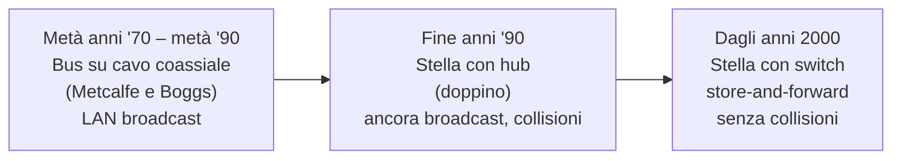
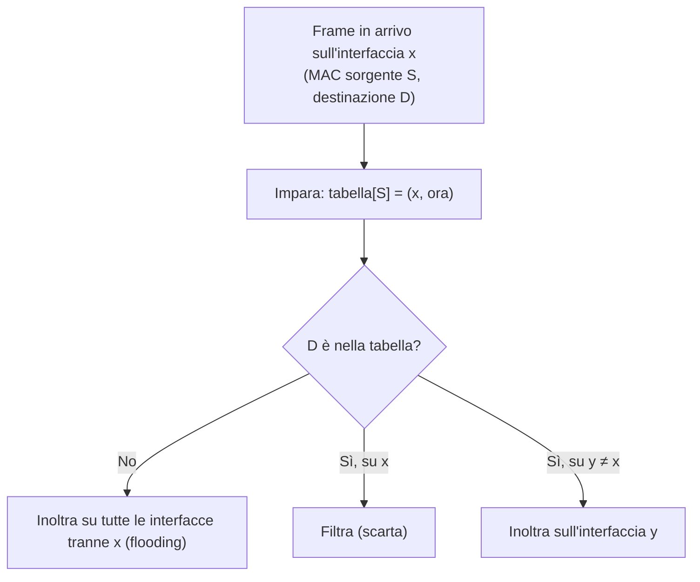
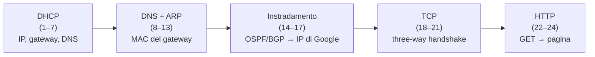

# Livello di collegamento e reti locali

> [!abstract] Di cosa parla questo capitolo
> Nei [[04 - TLC - Livello di rete - piano dei dati|Capitoli 4]] e [[05 - TLC - Livello di rete - piano di controllo|5]] il livello di rete portava un datagramma da un host all'altro attraverso una serie di collegamenti. Ora si scende di un livello e ci si chiede come il datagramma attraversa **ogni singolo collegamento**.
> Le domande del capitolo sono:
> - come si incapsula un datagramma in un **frame**;
> - come si rilevano gli **errori sui bit** (parità, checksum, **CRC**);
> - come si risolvono i conflitti sui canali **broadcast** (**protocolli di accesso multiplo**: TDM/FDM, ALOHA, CSMA/CD, polling, token, DOCSIS);
> - se esiste un indirizzamento di livello 2 (**MAC**) e come si lega all'IP (**ARP**);
> - com'è fatto **Ethernet**, come funzionano gli **switch** e qual è la differenza con un router;
> - cosa sono le **VLAN**, **MPLS** e le **reti dei data center**.
>
> Il capitolo chiude il viaggio top-down con la **cronaca di una richiesta web**, che mette insieme tutti i livelli.
> Esistono due tipi di canale: **broadcast** (LAN wireless, satellite, HFC), che richiedono un protocollo di accesso al mezzo, e **punto a punto** (es. PPP). Le reti wireless sono trattate a parte nel Capitolo 7.
> Mappa del corso: [[MOC - Telecomunicazioni]].

> [!info] Fonte
> Kurose, Ross, *Reti di calcolatori e Internet*, 7ª ed., Capitolo 6 (pp. 413–478). Le pagine citate sono quelle **del libro**: per il PDF aggiungi **28**. Da questo capitolo l'edizione italiana usa "switch" al posto di "commutatore" (nota del curatore, p. 413).

---

## 6.1 Livello di collegamento: introduzione

**Terminologia.**
- **Nodo**: qualunque dispositivo che opera al livello 2, cioè host, router, switch e access point Wi-Fi.
- **Collegamento** (*link*): il canale di comunicazione tra due nodi **adiacenti** lungo il cammino.
- Su ogni collegamento il nodo trasmittente incapsula il datagramma in un **frame del livello di collegamento** (*link-layer frame*).

![[TLC-p443-1.png]]

Nella figura un datagramma va da un **host wireless** della rete aziendale (in basso) a uno dei **server**. Attraversa **sei collegamenti**:
1. Wi-Fi da host ad access point;
2. Ethernet da access point a switch;
3. da switch a router;
4. tra i due router;
5. Ethernet da router a switch;
6. Ethernet da switch a server.

> [!example] L'analogia del viaggio
> Un'agenzia organizza il viaggio di un turista da Battipaglia a Losanna:
> - auto da Battipaglia all'aeroporto di Capodichino;
> - aereo da Napoli a Ginevra;
> - treno da Ginevra a Losanna.
>
> Ogni tratta collega due località "adiacenti", è gestita da un'azienda diversa e usa un mezzo diverso, ma fornisce lo stesso servizio di base. Il **turista** è il **datagramma**, ogni **tratta** è un **collegamento**, il **mezzo di trasporto** è il **protocollo di livello di collegamento** e l'**agenzia** è il **protocollo di instradamento**.

_(libro, pp. 414–416)_

### Servizi offerti dal livello di collegamento

Vedi [[Servizi del Livello di Collegamento]].

Il servizio di base è spostare un datagramma da un nodo a quello **adiacente** su un singolo collegamento. I dettagli però variano da protocollo a protocollo:

| Servizio | Descrizione |
| --- | --- |
| **Framing** | quasi tutti i protocolli incapsulano il datagramma in un **frame**, fatto di un campo dati e di vari campi d'intestazione. La struttura la definisce il protocollo |
| **Accesso al collegamento** | il protocollo **MAC** (*medium access control*) stabilisce le regole per immettere i frame sul collegamento. Sul punto a punto è semplice o assente; sui canali **broadcast** coordina i nodi (il problema dell'**accesso multiplo**) |
| **Consegna affidabile** | ACK e ritrasmissioni come in TCP (vedi [[Trasferimento Dati Affidabile]]). Si usa sui collegamenti con molti errori, come il **wireless**, per correggere **localmente**. Sui collegamenti con pochi errori (fibra, coassiale, doppino) spesso **non** si implementa |
| **Rilevazione e correzione degli errori** | bit di controllo nel frame; di solito implementato in **hardware** ed è più sofisticato del [[Checksum Internet]]. La **correzione** individua anche **dove** è l'errore |

_(libro, pp. 416–417)_

### Dov'è implementato il livello di collegamento?

Vedi [[Network Adapter e Driver]] (Sistemi di Calcolo 2).

Nei router il livello di collegamento è sulle **line card** (vedi [[Architettura di un Router]]). Negli host è soprattutto nell'**adattatore di rete** (*network adapter*), o **scheda di rete** (NIC, *network interface card*). Il suo cuore è il **controller a livello di collegamento**, un chip dedicato che implementa in hardware framing, accesso al collegamento e rilevazione degli errori (es. Intel 710 per Ethernet, Atheros AR5006 per il Wi-Fi). Oggi le schede sono quasi sempre integrate sulla scheda madre.

![[TLC-p446-1.png]]

La figura mostra la scheda di rete collegata al **bus dell'host** (es. PCI), dove il resto del sistema la vede come un normale dispositivo di I/O. Dentro ci sono il **controller** e la **trasmissione fisica**. A sinistra, la pila protocollare: i livelli fino a *Rete* e parte del *Collegamento* stanno sulla CPU; *Collegamento* e *Fisico* sulla scheda.

- **In trasmissione** il controller prende il datagramma dalla memoria, lo incapsula, riempie i campi del frame (compresi i bit di rilevazione degli errori) e lo trasmette secondo il protocollo di accesso.
- **In ricezione** riceve il frame, esegue il controllo degli errori ed estrae il datagramma per il livello di rete.
- Una parte del livello di collegamento è **software** sulla CPU: assembla gli indirizzi, attiva il controller, risponde agli **interrupt** di ricezione e gestisce gli errori.

Il livello di collegamento è quindi il punto della pila in cui **il software incontra l'hardware**.

_(libro, pp. 417–418)_

---

## 6.2 Tecniche di rilevazione e correzione degli errori

![[TLC-p447-1.png]]

Lo schema di riferimento:
- al trasmittente, ai dati $D$ da proteggere (il datagramma più l'intestazione del frame $H_l$) si aggiungono i bit **EDC** (*error detection and correction*);
- il ricevente riceve $D'$ ed $EDC'$, che possono essere **diversi** dagli originali, e si chiede: "i bit di $D'$ sono OK?". Se sì passa il datagramma in alto, altrimenti ha **rilevato un errore**.

> [!important] Errori non rilevati
> Le tecniche non sempre permettono di accorgersi di un errore. Possono restare **errori non rilevati**: il ricevente consegna un datagramma errato senza saperlo. Si scelgono quindi schemi che rendano questa probabilità piccola; più sono sofisticati, più costano in **ridondanza** (bit in più) e in calcolo.

Il libro vede tre tecniche: **parità** (per l'idea di base), **checksum** (usato al livello di trasporto) e **CRC** (usato dalle schede di rete).

_(libro, pp. 418–420)_

### Controllo di parità

Vedi [[Controllo di Parità]].

![[TLC-p448-1.png]]

Con **un solo bit di parità**:
- **parità pari**: il bit vale in modo che il numero totale di 1 nei $d + 1$ bit sia **pari**. Nella figura `0111000110101011` ha nove 1, quindi il bit di parità è **1**;
- **parità dispari**: il numero totale di 1 deve essere dispari.

Il ricevente conta gli 1. Se il conteggio è sbagliato sa che c'è stato un numero **dispari** di errori; con un numero **pari** di errori, invece, l'errore **non viene rilevato**.

> [!warning] Errori a raffica
> Se gli errori fossero rari e indipendenti, un bit basterebbe. Ma in pratica arrivano **a raffiche** (*burst*): con un solo bit di parità la probabilità di non rilevare un burst si avvicina al **50%**.

**Parità bidimensionale.**

![[TLC-p449-1.png]]

I $d$ bit sono disposti in $i$ righe e $j$ colonne, e si calcola un bit di parità **per ogni riga e per ogni colonna**: $i + j + 1$ bit in tutto.
- Nell'esempio **senza errori** ogni riga e colonna ha un numero pari di 1.
- Nell'esempio con **errore correggibile** il bit in posizione **(2,2)** passa da 1 a 0. Sono sbagliate la parità della **riga 2** e quella della **colonna 2**, e il loro incrocio indica il bit da **correggere**.
- Rileva e corregge anche un errore negli stessi bit di parità. Rileva, ma non corregge, qualsiasi combinazione di **due** errori.

**FEC** (*Forward Error Correction*). È la capacità del ricevente di rilevare **e correggere** gli errori senza chiedere una ritrasmissione. Si usa nei CD audio, da sola o insieme ad ARQ (Capitolo 3). Evita l'attesa di un **RTT** per NAK e ritrasmissione, il che è importante per il tempo reale e per i collegamenti con grande ritardo di propagazione, come lo spazio profondo.

_(libro, pp. 420–422)_

### Checksum

È il [[Checksum Internet]] visto nel Capitolo 3: i dati sono trattati come interi da **16 bit** e sommati, e il complemento a 1 della somma è il checksum. Il ricevente somma tutto, checksum compreso, e verifica che il risultato sia tutto 1 (RFC 1071). In TCP e UDP copre intestazione e dati; in IP solo l'intestazione.

> [!question] Perché checksum al trasporto e CRC al collegamento?
> Il **trasporto** è eseguito in **software** dal sistema operativo, quindi serve uno schema semplice e veloce: il checksum, che però protegge poco. Il **collegamento** è in **hardware** sulla scheda di rete, che può calcolare rapidamente le operazioni più complesse del CRC.

_(libro, p. 422)_

### Controllo a ridondanza ciclica (CRC)

Vedi [[CRC]].

I **codici CRC** (*cyclic redundancy check*), detti anche **codici polinomiali**, vedono la stringa di bit come un **polinomio** i cui coefficienti sono i bit.

![[TLC-p451-1.png]]

- Mittente e destinatario concordano un **generatore** $G$ di $r + 1$ bit, con il bit più significativo a 1.
- Dati i $d$ bit $D$, il mittente sceglie $r$ bit $R$ e li accoda: la stringa di $d + r$ bit è $D \cdot 2^r \text{ XOR } R$. Si sceglie $R$ in modo che questa stringa sia **esattamente divisibile** per $G$ in aritmetica modulo 2.
- Il ricevente divide i $d + r$ bit per $G$: se il **resto non è zero** c'è un errore.

**Aritmetica modulo 2.** Non ci sono riporti né prestiti, quindi somma e sottrazione sono entrambe uno **XOR**:

```text
1011 XOR 0101 = 1110        1011 - 0101 = 1110
1001 XOR 1101 = 0100        1001 - 1101 = 0100
```

Moltiplicare per $2^k$ significa spostare a sinistra di $k$ posizioni.

**Come si calcola R.** Si vuole $D \cdot 2^r \text{ XOR } R = nG$. Facendo lo XOR di $R$ su entrambi i membri:

$$D \cdot 2^r = nG \text{ XOR } R \quad\Rightarrow\quad R = \text{resto di } \frac{D \cdot 2^r}{G}$$

![[TLC-p452-1.png]]

**Esempio**: $D = 101110$, $d = 6$, $G = 1001$, $r = 3$. Si divide `101110000` per `1001` con divisioni successive in XOR. Il quoziente è `101011` e il resto è **R = `011`**. I nove bit trasmessi sono **`101110011`** (ricalcolato: il resto è giusto, e `101110011` diviso per `1001` dà resto 0).

- Esistono generatori standard da 8, 12, 16 e 32 bit. ATM usa un CRC a 8 bit per i 5 byte d'intestazione; **CRC-32**, usato in molti protocolli IEEE, ha:

$$G_{\text{CRC-32}} = 100000100110000010001110110110111$$

- **Cosa rileva il CRC**:
  - tutti gli **errori a burst** lunghi meno di $r + 1$ bit;
  - un burst più lungo con probabilità $1 - 0{,}5^r$;
  - qualsiasi numero **dispari** di errori.

_(libro, pp. 422–424)_

---

## 6.3 Collegamenti broadcast e protocolli di accesso multiplo

Vedi [[Protocolli di Accesso Multiplo]].

I collegamenti sono di due tipi:
- **punto a punto**: un trasmittente e un ricevente, come in PPP e HDLC;
- **broadcast**: più nodi trasmittenti e riceventi sullo **stesso canale condiviso**. Quando un nodo trasmette, tutti ricevono una copia. È il caso di Ethernet e delle Wireless LAN.

Il **problema dell'accesso multiplo** è coordinare l'accesso dei nodi al canale condiviso. È come una festa in cui tutti parlano nella stessa stanza, o una classe in cui docente e studenti condividono l'aria. Gli esseri umani usano "protocolli" come "concedi a ciascuno la possibilità di parlare", "alza la mano se devi porre una domanda" e "non interrompere se qualcuno sta parlando".

![[TLC-p454-1.png]]

Esempi di **canali ad accesso multiplo**:
- canale **cablato** condiviso, come HFC con la stazione di testa;
- canale **wireless** condiviso, come il Wi-Fi;
- **satellite**;
- **lezione in classe**: "Bla, bla, bla" e qualcuno che dorme ("zzZZZ").

**Collisione.** Se due o più nodi trasmettono nello stesso istante, i frame si sovrappongono e **nessuno** riesce a interpretarli. Durante la collisione i frame si perdono e il canale resta inutilizzato.

**Tre categorie** di protocolli di accesso multiplo:
1. **a suddivisione del canale** (*channel partitioning*);
2. **ad accesso casuale** (*random access*);
3. **a rotazione** (*taking-turn*).

**Il protocollo ideale** per un canale a $R$ bps dovrebbe:
1. dare throughput **$R$** a un singolo nodo attivo;
2. dare in media **$R/M$** a ciascuno quando ci sono $M$ nodi attivi;
3. essere **decentralizzato**, senza un nodo principale che, se si guasta, ferma tutto;
4. essere **semplice** ed economico.

_(libro, pp. 425–427)_

### Protocolli a suddivisione del canale

Vedi [[Multiplexing FDM e TDM]].

![[TLC-p456-1.png]]

Con $N$ nodi su un canale a $R$ bps:
- **TDM**: il tempo è diviso in **intervalli** (*time frame*), e ogni intervallo in **$N$ slot**, uno per nodo. (Il libro qui chiama **pacchetto** l'unità di livello 2 per non confonderla con il frame TDM.) Ogni nodo trasmette solo nel suo slot, come alla festa in cui ognuno parla a turno per un tempo fisso. Nella figura il nodo "2" usa lo slot 2 di ogni intervallo;
- **FDM**: il canale è diviso in $N$ **frequenze** da $R/N$ bps ciascuna (nella figura, bande da 4 kHz).

| | Pro | Contro |
| --- | --- | --- |
| TDM/FDM | **nessuna collisione**, perfettamente **equi** ($R/N$ a nodo) | anche un nodo **da solo** è limitato a $R/N$; con TDM deve anche aspettare il proprio turno. Non soddisfano la proprietà 1 |

**CDMA** (*code division multiple access*) assegna a ogni nodo un **codice** invece di slot o frequenze. Con codici scelti bene, nodi diversi trasmettono **contemporaneamente** e ogni destinatario decodifica correttamente i propri dati nonostante le interferenze. È nato in ambito militare ed è usato nella telefonia cellulare (Capitolo 7).

_(libro, pp. 427–428)_

### Protocolli ad accesso casuale

Un nodo trasmette sempre alla **velocità piena** $R$. Se c'è una collisione, ogni nodo coinvolto **ritrasmette dopo un ritardo casuale** (*random delay*), scelto indipendentemente dagli altri. Ritardi diversi possono far passare i frame senza nuove collisioni.

#### Slotted ALOHA

Vedi [[Protocolli ALOHA]].

Ipotesi:
- frame tutti di $L$ bit;
- tempo diviso in **slot** di $L/R$ secondi, cioè il tempo di trasmissione di un frame;
- i nodi trasmettono solo all'**inizio** di uno slot e sono **sincronizzati**;
- se c'è una collisione, tutti i nodi la rilevano prima della fine dello slot.

Il funzionamento, con una probabilità $p$:
- un nodo con un frame nuovo attende l'inizio dello slot successivo e lo trasmette;
- se non c'è collisione, ha finito;
- se c'è collisione, ritrasmette il frame negli slot successivi **con probabilità $p$**, fino al successo. È come lanciare una moneta truccata: testa (probabilità $p$) significa ritrasmettere, croce ($1-p$) significa saltare lo slot e rilanciare al successivo.

![[TLC-p458-1.png]]

Nella figura tre nodi collidono nel primo slot (**C**). Seguono slot inutilizzati (**I**), altre collisioni e slot riusciti (**R**). Il nodo 2 riesce nel **quarto** slot, il nodo 1 nell'**ottavo** e il nodo 3 nel **nono**.

> [!warning] Piccola incoerenza nella figura
> La legenda della Figura 6.10 indica "**V** = Slot riuscito", ma sulla linea del tempo gli slot riusciti sono marcati con **R**. È la stessa cosa: R come "riuscito" (nell'originale inglese S, *successful*).

**Pro**: un nodo da solo usa tutta la banda $R$; è molto **decentralizzato**, perché ognuno rileva le collisioni e decide da sé (servono però gli slot sincronizzati); è semplice.

**Contro**: con molti nodi attivi ci sono slot **sprecati** per collisioni e slot **vuoti** perché tutti hanno deciso di non trasmettere.

**Efficienza** = frazione di slot **riusciti** (*successful slot*, quelli in cui trasmette un solo nodo) con molti nodi che hanno sempre frame da inviare.
- $N$ nodi, ognuno trasmette in uno slot con probabilità $p$.
- Probabilità che un dato nodo trasmetta e gli altri $N-1$ no: $p(1-p)^{N-1}$.
- Probabilità che **un** nodo qualsiasi abbia successo: $Np(1-p)^{N-1}$.
- Massimizzando su $p$ e facendo il limite per $N \to \infty$:

$$\text{efficienza massima} = \frac{1}{e} \approx 0{,}37$$

Quindi solo il **37%** degli slot fa lavoro utile, il 37% resta vuoto e il **26%** subisce collisioni. Un amministratore che compra slotted ALOHA a **100 Mbps** sperando di trasmettere 80 Mbps otterrà meno di **37 Mbps**.

#### ALOHA puro

Il primo ALOHA (Abramson 1970) **non usava slot** ed era completamente decentralizzato. Appena arriva un frame, il nodo lo trasmette **subito e per intero**. Se c'è una collisione, lo ritrasmette subito con probabilità $p$, oppure aspetta il tempo di un frame.

![[TLC-p460-1.png]]

Perché il frame del nodo $i$, iniziato a $t_0$, vada a buon fine, nessun altro nodo deve iniziare a trasmettere:
- in $(t_0 - 1, t_0]$, altrimenti si sovrapporrebbe alla **parte iniziale** del frame;
- in $[t_0, t_0 + 1)$, altrimenti si sovrapporrebbe alla **parte finale**.

L'intervallo vulnerabile è quindi **doppio**:

$$P(\text{successo}) = p(1-p)^{2(N-1)} \quad\Rightarrow\quad \text{efficienza massima} = \frac{1}{2e} \approx 0{,}18$$

È la **metà** di slotted ALOHA: il prezzo della completa decentralizzazione.

> [!tip] Box 6.1 — Norm Abramson e ALOHAnet
> Nel 1969 Abramson, ingegnere e surfista, arrivò alla University of Hawaii. Le isole rendevano difficili le reti terrestri, e così progettò una rete **radio a commutazione di pacchetto**: un host centrale e nodi sparsi sulle isole, con due canali, downstream in broadcast e upstream in senso inverso. Le collisioni sull'upstream lo portarono a inventare **ALOHA puro** (1970). Nel 1970 ALOHAnet fu collegata ad ARPAnet. Il suo lavoro ispirò **Bob Metcalfe**, che modificò ALOHA dando vita a **CSMA/CD** ed Ethernet. Vedi [[Storia di Internet]]. _(p. 435)_

_(libro, pp. 429–432)_

#### CSMA: accesso multiplo con rilevamento della portante

Vedi [[CSMA-CD]].

ALOHA è come una persona maleducata che parla senza badare agli altri. Le regole della conversazione civile sono due:
- **ascoltare prima di parlare** → **rilevamento della portante** (*carrier sensing*): se il canale è occupato, il nodo aspetta che si liberi;
- **se qualcuno comincia a parlare insieme a te, smetti** → **rilevamento della collisione** (*collision detection*): il nodo continua ad ascoltare mentre trasmette e, se rileva un'interferenza, interrompe, aspetta un tempo casuale e riprova.

Da queste due regole nascono **CSMA** (*carrier sense multiple access*) e **CSMA/CD** (*with collision detection*).

**Perché ci sono collisioni anche con il carrier sensing?**

![[TLC-p462-1.png]]

Il **diagramma spazio-temporale** ha la posizione sul canale (nodi A, B, C, D) in orizzontale e il tempo verso il basso.
- A $t_0$ **B** trova il canale libero e trasmette. I suoi bit si propagano in entrambe le direzioni (la zona grigio scuro che si allarga).
- A $t_1 > t_0$ **D** ha un frame. I bit di B non sono ancora arrivati a D, quindi D ritiene il canale **libero** e trasmette.
- Le due trasmissioni si sovrappongono (zona a righe): **collisione**. Senza collision detection entrambi continuano a trasmettere frame ormai inutili.

> [!important] Il ruolo del ritardo di propagazione
> Più è grande il **ritardo di propagazione** da un estremo all'altro del canale, più è probabile che un nodo non si accorga che un altro ha già cominciato a trasmettere (vedi [[Ritardi nelle Reti a Commutazione di Pacchetto]]).

#### CSMA/CD

![[TLC-p464-1.png]]

Stesso scenario, ma ora B e D **interrompono la trasmissione** poco dopo aver rilevato la collisione (i tratti indicati con "Rilevamento della collisione / tempo di annullamento della trasmissione"). Si evita di sprecare il canale per l'intero frame danneggiato.

**Operazioni della scheda di rete:**
1. riceve un datagramma, prepara il frame e lo mette in un buffer;
2. se il canale è **libero** (non arriva energia di segnale) inizia a trasmettere; se è **occupato** aspetta che si liberi;
3. durante la trasmissione controlla se arrivano segnali da altre schede;
4. se trasmette tutto il frame senza rilevare energia altrui ha finito; altrimenti **interrompe subito**;
5. dopo l'interruzione aspetta un **tempo casuale** e torna al passo 2.

**Perché un tempo casuale, e quanto lungo?** Se due nodi aspettassero lo stesso tempo, collidirebbero per sempre. Il **tempo di backoff** ideale è:
- **piccolo** quando i nodi in collisione sono pochi, per non lasciare il canale inattivo;
- **grande** quando sono molti, per ridurre la probabilità di scegliere valori uguali.

**Binary exponential backoff** (*attesa binaria esponenziale*), usato in Ethernet e in DOCSIS. Dopo l'$n$-esima collisione dello stesso frame, si sceglie $K$ a caso in $\{0, 1, 2, \dots, 2^n - 1\}$ e si aspetta il tempo di trasmissione di $K \cdot 512$ bit. In Ethernet $n$ arriva al massimo a 10.

| Collisione | $K$ scelto in |
| --- | --- |
| 1ª | {0, 1} |
| 2ª | {0, 1, 2, 3} |
| 3ª | {0, …, 7} |
| ≥ 10ª | {0, …, 1023} |

L'insieme **raddoppia** a ogni collisione, da cui il nome "esponenziale". Per un nuovo frame la scheda **riparte da zero** e ignora le collisioni precedenti: un nuovo frame può quindi passare subito, mentre altre schede sono ancora in backoff.

> [!warning] Correzione — tempo di 512 bit a 100 Mbps
> Il libro (p. 436) scrive che con $K = 1$ si aspetta "il tempo necessario per inviare 512 bit (**0,01 microsecondi** per Ethernet a 100 Mbps)". Il valore corretto è
> $$\frac{512 \text{ bit}}{100 \cdot 10^6 \text{ bit/s}} = 5{,}12\ \mu s$$
> L'originale inglese riporta infatti 5,12 µs.

**Efficienza di CSMA/CD.** È la frazione di tempo in cui i frame passano senza collisioni, con molti nodi attivi. Detti $d_{prop}$ il tempo massimo di propagazione tra due schede e $d_{trasm}$ il tempo di trasmissione del frame più grande (circa **1,2 ms** a 10 Mbps, cioè $1500 \cdot 8 / 10^7$), si ha l'approssimazione:

$$\text{Efficienza} = \frac{1}{1 + 5\,d_{prop}/d_{trasm}}$$

- Per $d_{prop} \to 0$ l'efficienza tende a **1**: le collisioni vengono interrotte subito.
- Per $d_{trasm} \to \infty$ tende ancora a **1**: un frame che si appropria del canale lo usa a lungo.

> [!example] Esempio numerico (non nel libro)
> Con $d_{prop} = 25\ \mu s$ (qualche km di cavo) e $d_{trasm} = 1{,}2$ ms:
> $$\text{Efficienza} = \frac{1}{1 + 5 \cdot 0{,}025/1{,}2} = \frac{1}{1{,}104} \approx 0{,}91$$
> molto meglio del 37% di slotted ALOHA.

_(libro, pp. 432–437)_

### Protocolli a rotazione

Vedi [[Protocolli a Rotazione]].

ALOHA e CSMA soddisfano la proprietà 1 (un nodo da solo ottiene $R$), ma **non la 2** ($R/M$ a testa con $M$ nodi attivi). I **protocolli a rotazione** cercano di soddisfare entrambe.

| Protocollo | Come funziona | Pro | Contro |
| --- | --- | --- | --- |
| **Polling** | un **nodo principale** interpella a turno gli altri: dice al nodo 1 che può trasmettere fino a un certo numero di frame, poi al nodo 2, e così via. Capisce che un nodo ha finito dalla mancanza di segnale | niente collisioni né slot vuoti, quindi alta efficienza | **ritardo di polling**: un nodo da solo trasmette a meno di $R$; se il nodo principale si guasta, si ferma tutto il canale. Esempi: 802.15, Bluetooth |
| **Token passing** | un frame speciale, il **token** (gettone), circola tra i nodi in un ordine fisso. Chi lo riceve trasmette fino al massimo consentito, poi lo passa; se non ha nulla da inviare lo passa subito | decentralizzato ed efficiente | il guasto di un nodo, o un token che non viene inoltrato, mette fuori uso il canale e richiede procedure di recupero. Esempi: FDDI, token ring 802.5 |

_(libro, pp. 437–438)_

### DOCSIS: il livello di collegamento delle reti HFC

Vedi [[DOCSIS]].

La rete di accesso via cavo **HFC** (vedi [[Reti di Accesso]]) collega migliaia di cable modem al **CMTS** nella stazione di testa. **DOCSIS** (*Data-Over-Cable Service Interface Specification*) ne specifica l'architettura e i protocolli.

![[TLC-p467-1.png]]

- DOCSIS usa **FDM** per dividere i canali di **downstream** (dal CMTS ai modem: 6 MHz, circa 40 Mbps) da quelli di **upstream** (dai modem al CMTS: 6,4 MHz, circa 30 Mbps).
- **Downstream**: trasmette **solo** il CMTS, quindi non ci sono problemi di accesso multiplo, anche se tutti i modem ricevono tutto.
- **Upstream**: più modem condividono la stessa frequenza, quindi possono esserci collisioni. Il canale è diviso in intervalli di tempo (**TDM**), ognuno fatto di **mini-slot**.
  - Il CMTS invia sul downstream un **messaggio MAP** che dice quale modem può trasmettere in quale mini-slot nell'intervallo $[t_1, t_2]$. Gli slot sono assegnati esplicitamente, quindi non ci sono collisioni sui dati.
  - Per sapere chi ha dati da inviare, i modem mandano **richieste di mini-slot** in mini-slot dedicati. Queste richieste viaggiano in modo **casuale** e possono collidere.
  - Un modem non può rilevare direttamente le collisioni: le **deduce** se non riceve risposta nel messaggio MAP successivo, e allora usa il **binary exponential backoff**.
  - Con poco traffico i modem possono inviare dati anche nei mini-slot delle richieste.

> [!summary] Tutti i tipi di accesso multiplo in una sola rete
> In HFC convivono **FDM**, **TDM**, **accesso casuale** e **allocazione centralizzata** degli slot.

_(libro, pp. 438–440)_

---

## 6.4 Reti locali commutate

![[TLC-p468-1.png]]

Una rete istituzionale con **quattro switch**: uno centrale collegato al router verso Internet (1 Gbps), al web server e al mail server (1 Gbps), e a tre switch di dipartimento (Ingegneria elettronica, Informatica, Ingegneria informatica) in fibra a 100 Mbps. Gli host si collegano con un mix di 10 Mbps, 100 Mbps, 1 Gbps e cavo Cat 5.

Gli switch lavorano al **livello 2**: commutano **frame**, non datagrammi, quindi **non conoscono gli indirizzi IP** e non usano algoritmi di instradamento come RIP o OSPF. Usano gli **indirizzi di livello di collegamento**. Vedi [[Switch]].

_(libro, pp. 440–441)_

### Indirizzi a livello di collegamento e ARP

#### Indirizzi MAC

Vedi [[Indirizzo MAC]].

Gli indirizzi di livello 2 appartengono agli **adattatori** (schede di rete), non ai nodi: un host o un router con più interfacce ha più indirizzi. Gli **switch** invece **non hanno** indirizzi MAC sulle interfacce verso host e router: sono **trasparenti**, e chi invia un frame non ci scrive l'indirizzo dello switch.

Si chiamano **indirizzo fisico**, **indirizzo LAN** o, più spesso, **indirizzo MAC**.

![[TLC-p470-1.png]]

- In Ethernet e 802.11 l'indirizzo MAC è lungo **6 byte**, cioè $2^{48}$ indirizzi possibili.
- Si scrive in **esadecimale**, due cifre per byte, per esempio `1A-23-F9-CD-06-9B`.
- È pensato per essere permanente, anche se oggi si può cambiare via software.

**Unicità.** Due schede non hanno mai lo stesso indirizzo. A gestirli è l'**IEEE**: un produttore compra un blocco di $2^{24}$ indirizzi, cioè l'IEEE fissa i **primi 24 bit**, e il produttore assegna i 24 bit restanti.

**Struttura piatta.** L'indirizzo MAC non ha una struttura gerarchica e **non cambia** quando ci si sposta: un portatile ha sempre lo stesso MAC, ovunque sia collegato.

> [!example] Codice fiscale e indirizzo postale
> | | MAC | IP |
> | --- | --- | --- |
> | Analogia | **codice fiscale** | **indirizzo postale** |
> | Struttura | piatta | gerarchica (rete + host) |
> | Spostandosi | non cambia | cambia |

- Il trasmittente inserisce nel frame il MAC di destinazione. Ogni scheda che riceve un frame controlla se il MAC di destinazione è il suo: se sì, estrae il datagramma e genera un **interrupt**; altrimenti **scarta** il frame.
- **Indirizzo MAC broadcast**: `FF-FF-FF-FF-FF-FF`, cioè tutti i 48 bit a 1. Il frame viene elaborato da **tutte** le schede.

> [!tip] Box 6.2 — Perché due tipi di indirizzi?
> - Le LAN sono progettate per protocolli **arbitrari**, non solo IP: con indirizzi MAC "neutri" supportano anche IPX o DECNet.
> - Se le schede usassero gli indirizzi IP, andrebbero **riconfigurate** a ogni spostamento.
> - Senza indirizzi nelle schede, ogni nodo verrebbe **interrotto** da tutti i pacchetti della LAN.
>
> Per l'indipendenza dei livelli, ogni livello ha il proprio schema: **nomi** (applicazione), **IP** (rete), **MAC** (collegamento). _(p. 444)_

_(libro, pp. 441–443)_

#### Protocollo per la risoluzione degli indirizzi (ARP)

Vedi [[Protocollo ARP]] e [[ARP]] (Sistemi di Calcolo 2).

Serve tradurre gli indirizzi IP in indirizzi MAC. In Internet lo fa l'**ARP** (*Address Resolution Protocol*, RFC 826).

![[TLC-p471-1.png]]

La LAN ha i nodi **C** (222.222.222.220, `1A-23-F9-CD-06-9B`), **B** (222.222.222.223, `5C-66-AB-90-75-B1`), **A** (222.222.222.222, `49-BD-D2-C7-56-2A`) e un **router** (222.222.222.221, `88-B2-2F-54-1A-0F`), collegati da uno switch (che per ora si assume mandi tutto in broadcast).

C vuole inviare un datagramma ad A, che è nella **stessa sottorete**. Deve dare alla scheda sia il datagramma sia il **MAC di A**. Il modulo ARP di C riceve l'IP 222.222.222.222 e restituisce `49-BD-D2-C7-56-2A`.

> [!note] ARP e DNS
> Entrambi traducono indirizzi, ma il **DNS** risolve nomi di host **ovunque** in Internet, mentre l'**ARP** risolve solo indirizzi IP di nodi nella **stessa sottorete**. Se un nodo a Torino chiede l'IP di un nodo a Venezia, ARP segnala un errore.

**Tabella ARP.** Ogni nodo ha in RAM una tabella IP → MAC con un **TTL**, il tempo dopo cui la voce viene cancellata, tipicamente **20 minuti**. Per C (Figura 6.18):

| Indirizzo IP | Indirizzo MAC | TTL |
| --- | --- | --- |
| 222.222.222.221 | 88-B2-2F-54-1A-0F | 13:45:00 |
| 222.222.222.223 | 5C-66-AB-90-75-B1 | 13:52:00 |

La tabella non contiene necessariamente tutti i nodi: alcune voci sono scadute, altre non sono mai state inserite.

**Se la voce manca**, per esempio per A:
1. C costruisce un **pacchetto ARP di richiesta**, con IP e MAC di mittente e destinatario. Richiesta e risposta hanno lo stesso formato;
2. lo passa alla scheda con l'indirizzo **broadcast** `FF-FF-FF-FF-FF-FF`, e la scheda lo incapsula in un frame e lo trasmette nella sottorete. È come gridare nel corridoio di un ufficio "Qual è il codice fiscale del collega in stanza 112, Ditta Rossi, Via Verdi, Milano?";
3. tutte le schede lo ricevono e passano il pacchetto ARP al proprio nodo, che controlla se l'IP cercato è il suo;
4. solo il nodo con l'IP corrispondente (A) invia a C una **risposta ARP** con il proprio MAC;
5. C aggiorna la tabella e invia il datagramma nel frame con il MAC di A.

```mermaid
sequenceDiagram
    participant C as C (222.222.222.220)
    participant L as LAN (broadcast)
    participant A as A (222.222.222.222)
    C->>L: ARP request "chi ha 222.222.222.222?" → FF-FF-FF-FF-FF-FF
    L->>A: (tutti ricevono; solo A risponde)
    A-->>C: ARP reply "sono 49-BD-D2-C7-56-2A" (frame unicast)
    Note over C: aggiorna la tabella ARP
    C->>A: frame con il datagramma, MAC dest 49-BD-D2-C7-56-2A
```

- La **richiesta** viaggia in un frame **broadcast**, perché C non sa chi abbia l'IP cercato. La **risposta** in un frame **standard**, perché A conosce già il MAC di C dalla richiesta.
- ARP è **plug-and-play**: la tabella si costruisce da sola, e i nodi scollegati spariscono quando scade il TTL.
- **ARP è di livello 2 o 3?** Il pacchetto è incapsulato in un frame, quindi starebbe sopra il livello di collegamento, ma contiene indirizzi di entrambi i livelli. Sta **al confine** tra collegamento e rete: è un esempio della complessità dei protocolli reali.

#### Inviare un datagramma fuori dalla sottorete

![[TLC-p474-1.png]]

Ci sono due sottoreti, **111.111.111/24** e **222.222.222/24**, collegate da un router con **due interfacce**: 111.111.111.110 (`E6-E9-00-17-BB-4B`) e 222.222.222.220 (`1A-23-F9-CD-06-9B`). Il router ha due IP, due moduli ARP e due schede di rete.

L'host **111.111.111.111** vuole inviare a **222.222.222.222**:
- ✗ **non** può usare come MAC di destinazione quello di 222.222.222.222 (`49-BD-D2-C7-56-2A`): nessuna scheda della Sottorete 1 lo riconoscerebbe, e il frame andrebbe perso;
- ✓ deve inviare il frame all'**interfaccia del router** 111.111.111.110. Il MAC giusto è `E6-E9-00-17-BB-4B`, che ottiene con **ARP**;
- la scheda del router sulla Sottorete 1 riconosce il frame e passa il datagramma al livello di rete. Il router consulta la tabella di inoltro (vedi [[Inoltro e Instradamento]]) e lo inoltra sull'interfaccia 222.222.222.220;
- questa usa ARP per trovare il MAC di 222.222.222.222, incapsula il datagramma in un **nuovo frame** e lo invia nella Sottorete 2.

> [!important] Cosa cambia hop per hop
> Gli **indirizzi IP** sorgente e destinazione del datagramma restano **gli stessi** per tutto il percorso. Gli **indirizzi MAC** del frame cambiano a **ogni collegamento**.

_(libro, pp. 443–447)_

### Ethernet

Vedi [[Ethernet]].

Ethernet ha praticamente conquistato le LAN cablate, battendo token ring, FDDI e ATM. "Ethernet è stata per le reti locali quello che Internet è stata per la rete globale." Le ragioni del successo sono:
- è stata la **prima** LAN ad alta velocità a diffondersi, e gli amministratori non volevano cambiare;
- le alternative erano **più complesse e costose**;
- ha sempre proposto versioni **più veloci**, compresa l'Ethernet commutata nei primi anni '90;
- l'hardware è **economico** e diffuso.

**Evoluzione della topologia:**



- **Hub**: dispositivo di **livello fisico** che agisce sui singoli **bit**. Rigenera ogni bit in arrivo e lo trasmette su **tutte** le altre interfacce, quindi la LAN resta broadcast con collisioni. Vedi [[Hub]].
- **Switch**: oltre a essere "privo di collisioni", è un vero commutatore **store-and-forward**, ma lavora solo fino al **livello 2**.

#### Struttura del frame Ethernet

Vedi [[Frame Ethernet]].

![[TLC-p477-1.png]]

Esempio: la scheda **A** (`AA-AA-AA-AA-AA-AA`) invia un datagramma IP alla scheda **B** (`BB-BB-BB-BB-BB-BB`) sulla stessa LAN.

| Campo | Byte | Contenuto |
| --- | --- | --- |
| **Preambolo** | 8 | 7 byte `10101010` e un byte `10101011`. Servono a "**svegliare**" le schede riceventi e a **sincronizzare** i loro clock con quello del trasmittente, che può variare un po' rispetto al tasso nominale (10/100/1000 Mbps). Gli ultimi due bit `11` avvisano che "le cose importanti stanno per arrivare" |
| **Indirizzo di destinazione** | 6 | MAC di B. Se B riceve un frame con il suo MAC o con il broadcast, passa il contenuto al livello di rete; gli altri li scarta |
| **Indirizzo sorgente** | 6 | MAC di A |
| **Tipo** | 2 | il protocollo di rete del payload (IP, IPX, AppleTalk; **0806** esadecimale per **ARP**). È l'equivalente del campo protocollo di IP e delle porte del trasporto |
| **Dati** | 46–1500 | il datagramma IP. **MTU = 1500 byte**: oltre, l'host deve frammentare (vedi [[Frammentazione IP]]). Sotto i 46 byte il campo va **riempito** (*stuffed*), e il livello di rete toglie il riempimento usando il campo lunghezza di IP |
| **CRC** | 4 | rilevazione degli errori, vedi [[CRC]] |

**Il servizio offerto da Ethernet:**
- **senza connessione**: niente handshake prima di inviare, come IP e UDP;
- **non affidabile**: B fa il controllo CRC ma **non invia ACK né NAK**; se il frame è errato lo scarta e basta. A non sa se il frame è arrivato.

Ethernet resta così **semplice ed economico**, ma il flusso di datagrammi verso il livello di rete può avere **lacune**:
- con **UDP** l'applicazione vede le lacune;
- con **TCP**, B non manda ACK per i dati persi e TCP su A li ritrasmette. In un certo senso Ethernet ritrasmette, ma senza saperlo.

_(libro, pp. 447–450)_

#### Tecnologie Ethernet

Nomi come **10BASE-T**, 10BASE-2, **100BASE-T**, 1000BASE-LX e 10GBASE-T sono standardizzati dai gruppi **IEEE 802.3 CSMA/CD**:
- la prima parte è la **velocità**: 10, 100, 1000 o 10G, cioè 10 Mbps, 100 Mbps, 1 Gbps e 10 Gbps (ora fino a 40 Gbps);
- **BASE** sta per **banda base**: il mezzo trasporta solo traffico Ethernet;
- la parte finale è il **mezzo fisico**: "T" sta per doppino intrecciato in rame (twisted pair).

Ethernet è quindi una specifica sia del livello di **collegamento** sia di quello **fisico**.

- I primi standard **10BASE-2** e **10BASE-5** usavano cavo **coassiale**, con segmenti di massimo **500 m**. Per segmenti più lunghi si usa un **repeater**, un dispositivo di livello fisico che rigenera il segnale.

> [!tip] Box 6.3 — Bob Metcalfe ed Ethernet
> Da studente a Harvard Metcalfe lavorò ad ARPAnet al MIT e conobbe ALOHA. Prima di andare allo **Xerox PARC** passò tre mesi da Abramson alle Hawaii. Allo Xerox PARC, per collegare i computer **Alto** (precursori dei PC), ideò Ethernet con **David Boggs**. La prima versione andava a **2,94 Mbps** e collegava fino a 256 host entro 1,6 km. Seguì lo standard a **10 Mbps** con Xerox, Digital e Intel, ratificato dall'IEEE. Nel 1979 Metcalfe fondò **3Com**, che negli anni '80 iniziò a vendere schede Ethernet per i PC IBM. _(p. 451)_

![[TLC-p480-1.png]]

**Ethernet a 100 Mbps.** Ha in comune il **protocollo MAC e il formato del frame**, ma ha più livelli fisici: 100BASE-TX, -T2, -T4 su rame e -FX, -SX, -BX su fibra. Arriva a 100 m su doppino e a parecchi km su fibra.

**Gigabit Ethernet** (IEEE 802.3z), fino a 40 Gbps:
- usa il **formato standard del frame** ed è compatibile con 10BaseT e 100BaseT;
- consente collegamenti **punto a punto** (con switch) e canali **broadcast** condivisi (con hub, qui chiamati "distributori bufferizzati");
- usa **CSMA/CD** sui canali condivisi, ma per avere un'efficienza accettabile bisogna **limitare la distanza** tra i nodi;
- sui collegamenti punto a punto funziona in **full-duplex** a 40 Gbps in entrambe le direzioni;
- è nata per la fibra, ora funziona anche su **UTP Cat 5**.

> [!important] Serve ancora CSMA/CD?
> Con topologia a stella e **switch**, ogni collegamento è punto a punto e **full-duplex**: lo switch non inoltra mai più di un frame alla volta sulla stessa interfaccia. In una LAN Ethernet commutata **non ci sono collisioni**, e il protocollo MAC è spesso inutile. Da trent'anni l'unica cosa rimasta invariata è il **formato del frame**: forse è questa la vera chiave di volta dello standard.

_(libro, pp. 450–453)_

### Switch a livello di collegamento

Vedi [[Switch a Livello di Collegamento]] e la tua nota [[Switch]].

Lo switch riceve i frame in ingresso e li inoltra sui collegamenti in uscita. È **trasparente**: un nodo indirizza il frame a un altro nodo, non allo switch. Le interfacce d'uscita hanno dei **buffer**, come quelle dei router, perché il tasso di arrivo può superare temporaneamente la capacità del collegamento.

#### Inoltro e filtraggio

- Il **filtraggio** (*filtering*) decide se un frame va inoltrato o **scartato**.
- L'**inoltro** (*forwarding*) decide **su quale interfaccia** inviarlo.

Entrambi usano la **tabella di commutazione** (*switch table*), che per alcuni nodi della LAN contiene MAC, interfaccia e momento d'inserimento. Per lo switch in alto nella figura della rete istituzionale (Figura 6.22):

| Indirizzo | Interfaccia | Tempo |
| --- | --- | --- |
| 62-FE-F7-11-89-A3 | 1 | 9:32 |
| 7C-BA-B2-B4-91-10 | 3 | 9:36 |
| …. | …. | …. |

**Un frame per `DD-DD-DD-DD-DD-DD` arriva sull'interfaccia $x$.** I casi sono tre:
1. **nessuna voce** per DD-DD-…: lo switch inoltra copie del frame su **tutte le interfacce tranne $x$** (broadcast);
2. la voce associa DD-DD-… proprio a **$x$**: la destinazione è sullo stesso segmento da cui è arrivato il frame, quindi lo switch **filtra** (scarta);
3. la voce associa DD-DD-… a **$y \neq x$**: lo switch **inoltra** il frame nel buffer dell'interfaccia $y$.

Esempio: un frame per 62-FE-F7-11-89-A3 arriva sull'**interfaccia 1**. La destinazione è sull'interfaccia 1 (Ingegneria elettronica), quindi viene **filtrato**. Se lo stesso frame arrivasse sull'**interfaccia 2**, verrebbe **inoltrato** all'interfaccia 1. Con una tabella completa lo switch non fa mai broadcast: è "più intelligente" di un hub.

#### Autoapprendimento

Vedi [[Autoapprendimento degli Switch]].

Gli switch costruiscono la tabella **da soli**, senza amministratore né protocolli di configurazione: si **auto-apprendono**.
1. All'inizio la tabella è **vuota**.
2. Per **ogni** frame ricevuto, lo switch registra il **MAC sorgente**, l'**interfaccia di arrivo** e l'**ora**, cioè su quale segmento si trova il mittente. Quando tutti i nodi avranno trasmesso almeno una volta, la tabella sarà completa.
3. Se dopo un certo tempo, l'**aging time** (*tempo di invecchiamento*), non arrivano frame da un MAC sorgente, la voce viene **cancellata**. Così, se un computer viene sostituito, il vecchio MAC sparisce.

Esempio: alle **9:39** arriva sull'interfaccia 2 un frame da **01-12-23-34-45-56**, che non è in tabella, e lo switch lo aggiunge (Figura 6.23):

| Indirizzo | Interfaccia | Tempo |
| --- | --- | --- |
| **01-12-23-34-45-56** | **2** | **9:39** |
| 62-FE-F7-11-89-A3 | 1 | 9:32 |
| 7C-BA-B2-B4-91-10 | 3 | 9:36 |

Con un aging time di 60 minuti, se tra le 9:32 e le 10:32 non arrivano frame da 62-FE-F7-11-89-A3, alle 10:32 la voce viene rimossa.

Gli switch sono quindi **plug-and-play**: basta collegare i segmenti di LAN.



#### Proprietà della commutazione a livello di collegamento

Rispetto ai collegamenti broadcast (bus o stella con hub), gli switch offrono:
- **Eliminazione delle collisioni**: con soli switch e senza hub non si spreca banda in collisioni. Lo switch bufferizza e non trasmette mai più di un frame alla volta su un segmento. Il throughput aggregato massimo è la **somma** dei tassi di tutte le interfacce.
- **Collegamenti eterogenei**: lo switch isola i collegamenti, che possono andare a **velocità diverse** e usare **mezzi diversi** (es. 1000BASE-T, 100BASE-FX e 100BASE-T sullo stesso switch). È ideale per mescolare dispositivi vecchi e nuovi.
- **Gestione**: se una scheda impazzisce e trasmette senza sosta (*jabbering adapter*, "scheda di rete blaterante"), lo switch la **disconnette**. Un cavo tagliato isola solo il nodo che lo usava; con il coassiale si passavano ore "seguendo il cavo". Gli switch raccolgono anche **statistiche** sull'uso della banda, le collisioni e il tipo di traffico.

> [!tip] Box 6.4 — Avvelenamento dello switch
> In una LAN commutata un nodo riceve solo i frame indirizzati a lui, quindi uno **sniffer** sul nodo C non vede i frame da A a B (vedi [[Attacchi alle Reti]]). Ma:
> - lo switch manda in broadcast i frame per destinazioni **non in tabella**, e lo sniffer li vede;
> - lo sniffer vede tutti i frame inviati al broadcast `FF-FF-FF-FF-FF-FF`.
>
> L'attacco di **avvelenamento dello switch** (*switch poisoning*) invia moltissimi pacchetti con **MAC sorgente falsi e diversi**, che riempiono la tabella dello switch e non lasciano posto ai MAC legittimi. Lo switch è così costretto a mandare **in broadcast** quasi tutti i frame, che lo sniffer intercetta. È impegnativo anche per un attaccante esperto, quindi gli switch sono **molto meno vulnerabili** di hub e LAN wireless. _(p. 457)_

_(libro, pp. 453–457)_

#### Switch e router a confronto

Vedi [[Switch e Router a Confronto]].

Entrambi sono commutatori **store-and-forward**, ma:
- i **router** sono commutatori di **livello 3** e inoltrano usando gli **indirizzi di rete**;
- gli **switch** sono commutatori di **livello 2** e inoltrano usando gli **indirizzi MAC**.

Gli switch OpenFlow con match-action possono fare entrambe le cose (vedi [[Inoltro Generalizzato e OpenFlow]]).

![[TLC-p486-1.png]]

La figura mostra fin dove arriva l'elaborazione:
- negli **host** fino all'Applicazione;
- nello **switch** fino al Collegamento;
- nel **router** fino alla Rete.

| | **Switch** | **Router** |
| --- | --- | --- |
| Pro | **plug-and-play**; filtraggio e inoltro molto veloci (fino al livello 2) | nessun ciclo grazie agli indirizzi gerarchici, quindi topologia ricca con percorsi ridondanti e **instradamento ottimale**; isolano dalle **tempeste di broadcast** |
| Contro | topologia ristretta a un **albero**, per evitare i cicli dei frame broadcast; reti grandi richiedono **grandi tabelle ARP** e molto traffico ARP; **nessuna protezione dalle tempeste di broadcast**: un host che manda broadcast senza sosta fa collassare la rete | **non plug-and-play** (vanno configurati gli IP); elaborazione per pacchetto più lunga (fino al livello 3) |

Il libro aggiunge una curiosità: esistono due pronunce di router, "ruuter" e "rauter", e si perde molto tempo a stabilire quale sia giusta.

**Tabella 6.1 — Dispositivi di interconnessione:**

| | Hub | Router | Switch |
| --- | --- | --- | --- |
| Isolamento del traffico | No | Sì | Sì |
| Plug and play | Sì | No | Sì |
| Instradamento ottimale | No | Sì | No |

**Quando usare l'uno o l'altro?** Per reti piccole, fino a qualche centinaio di host e pochi segmenti, bastano gli **switch**: localizzano il traffico e aumentano il throughput senza configurare IP. Le reti grandi, con migliaia di host, includono anche **router**, che isolano meglio il traffico, evitano le tempeste di broadcast e usano percorsi migliori. Vedi le tue note [[Hub]], [[Bridge]], [[Switch]], [[Router]].

_(libro, pp. 456–459)_

### LAN virtuali (VLAN)

Vedi [[LAN Virtuali]] e la nota [[VLAN]] di Cybersecurity.

La configurazione gerarchica della rete istituzionale (uno switch per dipartimento) ha **tre inconvenienti**:
1. **Mancanza di isolamento del traffico**: il traffico broadcast (ARP, DHCP, frame verso destinazioni non ancora apprese) attraversa **tutta** la rete. Limitarlo migliorerebbe le prestazioni, la **sicurezza** e la **riservatezza**: non si vuole che il traffico del consiglio di amministrazione arrivi agli host di impiegati scontenti che usano Wireshark.
2. **Uso inefficiente degli switch**: con 10 gruppi piccoli servirebbero 10 switch, mentre basterebbe un solo switch a 96 porte, che però non isolerebbe il traffico.
3. **Gestione degli utenti**: se un dipendente cambia gruppo bisogna cambiargli il cablaggio; e chi appartiene a più gruppi?

Una **VLAN** (*virtual local area network*) risolve tutti e tre: su una **singola infrastruttura fisica** si definiscono **più LAN virtuali**. Gli host di una VLAN comunicano come se fossero soli sullo switch.

**VLAN basate sulle porte.**

![[TLC-p488-1.png]]

Lo switch ha **16 porte**: le porte **2–8** sono della VLAN di **Ingegneria elettronica**, le porte **9–15** della VLAN di **Informatica**; 1 e 16 non sono assegnate.
- Ogni gruppo di porte è un **dominio broadcast**: il broadcast di una porta raggiunge solo le porte del suo gruppo.
- I frame delle due VLAN sono **isolati**; i due switch di dipartimento sono sostituiti da **uno solo**. Se l'utente della porta 8 passa a Informatica, basta **riconfigurare via software** la porta 8.
- Lo switch mantiene una **tabella porte → VLAN** e consegna frame solo tra porte della stessa VLAN.

**Comunicare tra VLAN.** Si collega una porta dello switch (es. la porta 1) a un **router esterno**, configurata come appartenente a **entrambe** le VLAN. Logicamente è come avere due switch separati connessi da un router: un datagramma da Ingegneria a Informatica passa dalla VLAN di Ingegneria al router e da lì alla VLAN di Informatica. I produttori vendono anche dispositivi che integrano **switch e router**.

**VLAN su più switch.**

![[TLC-p489-1.png]]

I dipartimenti sono sparsi in più edifici, e un secondo switch a 8 porte ha porte di Ingegneria (2, 3, 6) e di Informatica (4, 5, 7).
- **(a)** Collegare una porta di Informatica di uno switch con una porta di Informatica dell'altro (e lo stesso per Ingegneria). **Non scala**: con $N$ VLAN servono $N$ porte per switch solo per collegarli.
- **(b) VLAN trunking**: una porta speciale per switch (16 a sinistra, 1 a destra) è una **porta di trunking**, che appartiene a **tutte** le VLAN. Tutti i frame di qualsiasi VLAN passano dal **collegamento di trunking**.

Come fa lo switch che riceve un frame dal trunk a sapere a quale VLAN appartiene? Con il **frame 802.1Q**:

![[TLC-p490-1.png]]

Il frame **802.1Q** è il frame Ethernet standard con un'**etichetta VLAN** (*tag VLAN*) di **4 byte** inserita dopo l'indirizzo sorgente, prima del campo tipo:
- **TPID** (*tag protocol identifier*), 2 byte con valore fisso **81-00** esadecimale;
- **tag control information**, 2 byte, che contiene l'**ID della VLAN** (12 bit) e un campo di **priorità** (3 bit), simile al TOS di IP.

Dato che il frame cambia, il **CRC viene ricalcolato**. L'etichetta la **aggiunge** lo switch che trasmette sul trunk e la **toglie** quello che riceve.

Le VLAN si possono definire anche in altri modi:
- **per indirizzo MAC**: alla connessione il dispositivo viene associato alla VLAN del suo MAC;
- **per protocollo di rete** (IPv4, IPv6, AppleTalk);
- estese **tramite router**, collegando isole LAN in una VLAN che può coprire il globo.

_(libro, pp. 459–462)_

---

## 6.5 Canali virtuali: una rete come un livello di collegamento

All'inizio del capitolo il collegamento era un **cavo** tra due host; con l'accesso multiplo diventa un mezzo **condiviso**; con le LAN commutate un'infrastruttura complessa. Gli host continuano però a vederlo come un **semplice canale**. Nel dial-up, per esempio, il "collegamento" è l'intera **rete telefonica**, ma per Internet è come un cavo: Internet virtualizza la rete telefonica come una tecnologia di livello 2. È lo stesso principio delle reti di **overlay** del Capitolo 2.

### Multiprotocol label switching (MPLS)

Vedi [[MPLS]].

**MPLS** nasce alla fine degli anni '90 per **velocizzare** i router IP, adottando un concetto dei **circuiti virtuali**: un'**etichetta di lunghezza fissa**. L'obiettivo non è abbandonare l'instradamento IP, ma etichettare selettivamente i datagrammi e, dove possibile, inoltrarli in base all'etichetta invece che all'indirizzo IP. L'IETF ha unificato questi sforzi in MPLS (RFC 3031, 3032).

![[TLC-p492-1.png]]

L'**intestazione MPLS** si colloca **tra** l'intestazione di livello 2 (PPP o Ethernet) e quella IP. Contiene:
- l'**Etichetta**;
- **Exp**, 3 bit sperimentali;
- **S**, che indica la fine di una pila di intestazioni MPLS;
- **TTL**.

Un frame MPLS può circolare solo tra router abilitati a MPLS, detti **router a commutazione di etichetta** (*label-switched router*). Questi inoltrano cercando l'**etichetta** nella tabella di inoltro, **senza** estrarre l'IP di destinazione né fare il longest prefix match.

![[TLC-p493-1.png]]

**Esempio di inoltro MPLS.** R1–R4 sono router MPLS, R5 e R6 router IP standard, A e D le destinazioni. Le tabelle (etichetta in, etichetta out, destinazione, interfaccia d'uscita):

| Router | Etichetta in | Etichetta out | Dest | Interfaccia |
| --- | --- | --- | --- | --- |
| R1 | 6 | – | A | 0 |
| R2 | 8 | 6 | A | 0 |
| R3 | 10 | 6 | A | 1 |
| R3 | 12 | 9 | D | 0 |
| R4 | – | 10 | A | 0 |
| R4 | – | 12 | D | 0 |
| R4 | – | 8 | A | 1 |

- R1 annuncia a R2 e R3 che può raggiungere A, e che i frame con etichetta **6** vanno verso A.
- R3 annuncia a R4 le rotte verso A (etichetta 10) e D (etichetta 12).
- R2 annuncia a R4 che può raggiungere A con etichetta 8.
- Così **R4 ha due percorsi verso A**: interfaccia 0 con etichetta 10 (via R3) e interfaccia 1 con etichetta 8 (via R2).

R5, R6, A e D sono collegati da un'infrastruttura MPLS così come una LAN o una rete ATM collega dispositivi IP: R1–R4 non guardano mai le intestazioni IP. La distribuzione delle etichette usa **RSVP-TE** (RFC 3468, 3209), e i protocolli link-state come OSPF sono stati estesi per diffondere le informazioni di MPLS.

**Il vero vantaggio non è la velocità, ma la gestione del traffico.**
- **Ingegneria del traffico** (*traffic engineering*): con IP, R4 userebbe solo il percorso più breve verso A. Con MPLS l'operatore può mandare parte del traffico su un percorso e parte sull'altro, cosa impossibile con l'instradamento IP standard.
- **Ricostruzione rapida dei percorsi**: in caso di guasto si devia il traffico su un percorso alternativo **pre-calcolato**.
- **VPN** (*virtual private network*): l'ISP usa la propria rete MPLS per connettere tra loro le reti di un cliente, isolandone risorse e indirizzamento da quelli degli altri utenti.

È il "**coltellino svizzero**" dell'ingegneria del traffico.

_(libro, pp. 462–466)_

---

## 6.6 Le reti dei data center

Vedi [[Reti dei Data Center]].

Google, Microsoft, Facebook e Amazon hanno costruito enormi **data center**, ognuno con decine o centinaia di migliaia di host per il **cloud computing** (ricerca, e-mail, social, e-commerce). Il *cloud computing* è un paradigma in cui le risorse sono allocate su richiesta in modo trasparente e fornite come servizi (nota del curatore). Ogni data center ha una propria **data center network**.

**Costi** (oltre 12 milioni di dollari al mese per 100.000 host):

| Voce | Quota |
| --- | --- |
| Host (sostituiti ogni 3–4 anni) | 45% |
| Infrastruttura (trasformatori, UPS, generatori, raffreddamento) | 25% |
| Energia | 15% |
| Rete (switch, router, bilanciatori, collegamenti, traffico) | 15% |

La rete non è il costo maggiore, ma l'**innovazione di rete** è la chiave per ridurre i costi e massimizzare le prestazioni.

**Struttura.**
- Gli host (le "api operaie") sono di solito **blade** con CPU, memoria e disco, posti in **rack** da 20–40 blade.
- In cima a ogni rack c'è lo switch **TOR** (*top of rack*), che interconnette gli host del rack tra loro e con gli altri switch. Oggi gli host hanno connessioni Ethernet da 40 Gbps verso il TOR.
- Ogni host ha un IP **interno** al data center.
- Il traffico tra client esterni e host interni passa per i **router di confine** (*border router*).

**Bilanciamento del carico.** A ogni applicazione è associato un **IP pubblico**. Le richieste esterne arrivano a un **load balancer**, uno per insieme di applicazioni, che le distribuisce agli host in base al **carico corrente**.
- Si chiama spesso "**switch di livello 4**", perché decide in base a **porta** (livello 4) e IP di destinazione.
- Fa anche da **NAT**: traduce l'IP pubblico nell'IP interno dell'host e viceversa (vedi [[NAT]]). Nasconde la struttura interna, e i client non interagiscono direttamente con gli host: anche questo dà sicurezza. Vedi [[Load Balancing]].

**Architettura gerarchica.**

![[TLC-p496-1.png]]

Dall'alto: **router di confine** → **router di accesso** → **switch di primo livello** (con il **bilanciatore di carico**) → **switch di secondo livello** → **switch TOR** → **rack** 1–8 e oltre. Tutti i collegamenti sono in Ethernet, su fibra e rame. Con questa gerarchia si arriva a centinaia di migliaia di host.
- Si mettono collegamenti e apparati **ridondanti** (non disegnati): ogni TOR collegato a due switch di livello 2, switch di livello 1 e 2 duplicati.
- Gli host sotto un router di accesso formano una **sottorete**, divisa in **VLAN** più piccole di poche centinaia di host per contenere il broadcast ARP.

**Il limite della gerarchia: capacità host-to-host.**

> [!example] Esempio dei 40 flussi
> Host collegati al TOR a **1 Gbps**, collegamenti tra switch a **10 Gbps**. Due host nello **stesso** rack comunicano sempre a 1 Gbps. Ma con **40 flussi** contemporanei tra rack diversi (10 flussi da rack 1 a rack 5, 10 da 2 a 6, 10 da 3 a 7, 10 da 4 a 8), tutti attraversano il collegamento A–B, e anche B–C, da 10 Gbps:
> $$\frac{10 \text{ Gbps}}{40} = 250 \text{ Mbps per flusso}$$
> molto meno di 1 Gbps. Più si sale nella gerarchia, peggio è. Switch e router più veloci costerebbero moltissimo.

L'alta capacità host-to-host è importante perché i servizi devono poter stare **ovunque** nel data center: un motore di ricerca su migliaia di host in molti rack, o le macchine virtuali di EC2 sparse su host fisici diversi.

**Tendenze.**
- **Topologia completamente connessa**:

![[TLC-p498-1.png]]

  Ogni switch di **primo livello** è collegato a **tutti** quelli di **secondo livello**: il traffico host-to-host non deve mai risalire oltre, e con $n$ switch di primo livello ci sono **$n$ percorsi disgiunti** tra due switch di secondo livello. Con 4 switch di primo livello, nell'esempio dei 40 flussi ci sono **4 percorsi**, cioè 40 Gbps aggregati tra i primi due switch di livello 2. Rack non sullo stesso TOR diventano logicamente equivalenti.
- **Data center modulari** (MDC, *shipping container-based*): un mini data center viene costruito dentro un **container** di 12 m e trasportato sul posto. Ogni container ha fino a qualche migliaio di host, è difficile da riparare ed è progettato per una **degradazione graduale**: quando troppi componenti si rompono, si sostituisce l'intero container. Ci sono reti **dentro** i container (completamente connesse, economiche) e reti **tra** i container (la sfida maggiore; si propongono switch ibridi elettrici/ottici).
- **Instradamento** nelle topologie molto connesse: instradamento **casuale**, oppure più schede di rete per host collegate a più switch, con gli host che instradano in modo intelligente.
- I grandi provider costruiscono o personalizzano **quasi tutto**: schede, router, switch, TOR, software e protocolli. Amazon usa le **availability zones**: data center replicati in edifici vicini, a pochi km, per la tolleranza ai guasti.

_(libro, pp. 466–471)_

---

## 6.7 Retrospettiva: cronaca di una richiesta di una pagina web

Vedi [[Cronaca di una Richiesta Web]].

Il viaggio lungo la pila è completo. Per una visione d'insieme, il libro segue tutti i protocolli coinvolti in una richiesta semplicissima: Bob collega il portatile allo switch Ethernet della scuola e scarica la home page di **www.google.com**.

![[TLC-p500-1.png]]

Lo scenario:
- **rete della scuola** 68.85.2.0/24; portatile di Bob con MAC `00:16:D3:23:68:8A`, che otterrà l'IP 68.85.2.101;
- **router della scuola** con MAC `00:22:6B:45:1F:1B` e IP 68.85.2.1. Esegue anche il **server DHCP**;
- la scuola è collegata all'ISP **Comcast** (68.80.0.0/13), che gestisce il **server DNS** 68.87.71.226;
- **rete di Google** 64.233.160.0/19, con il web server **www.google.com** a 64.233.169.105.

I numeri in figura (1–7, 8–13, 14–17, 18–24) sono i passi seguenti.

### Si comincia: DHCP, UDP, IP ed Ethernet (passi 1–7)

Senza un indirizzo IP il portatile non può fare nulla, quindi la prima azione è **DHCP** (vedi [[DHCP]]).
1. Il sistema operativo crea un **messaggio DHCP request** in un **segmento UDP** (porta di destinazione 67, sorgente 68), in un **datagramma IP** con destinazione broadcast **255.255.255.255** e sorgente **0.0.0.0**.
2. Il datagramma va in un **frame Ethernet** con MAC di destinazione `FF:FF:FF:FF:FF:FF` (broadcast) e sorgente `00:16:D3:23:68:8A`.
3. È il primo frame inviato allo **switch**, che lo manda in broadcast su tutte le porte, compresa quella verso il router.
4. Il router lo riceve sull'interfaccia `00:22:6B:45:1F:1B`, estrae il datagramma (destinazione broadcast, quindi è per lui), fa **demultiplexing** verso UDP ed estrae il messaggio DHCP.
5. Il server DHCP, che può allocare il blocco **CIDR** 68.85.2.0/24, assegna **68.85.2.101** e crea un **DHCP ACK** con l'IP assegnato, l'IP del **DNS** (68.87.71.226), il **gateway di default** (68.85.2.1) e la **maschera** (/24). Lo mette in UDP, IP ed Ethernet, con MAC sorgente quello del router e destinazione quello di Bob.
6. Il frame arriva allo switch, che grazie all'**autoapprendimento** (aveva visto il frame di Bob al passo 3) lo inoltra **solo** sulla porta di Bob.
7. Il portatile estrae il DHCP ACK, salva il proprio IP e quello del DNS e installa il **gateway di default** nella tabella di inoltro: tutti i datagrammi fuori da 68.85.2.0/24 andranno lì.

(Il libro osserva che dei quattro passi DHCP del Capitolo 4 servono davvero solo gli ultimi due.)

### Ancora all'inizio: DNS e ARP (passi 8–13)

Bob scrive www.google.com nel browser. Per creare la **socket TCP** serve l'IP di Google, quindi interviene il **DNS** (vedi [[Gerarchia dei DNS Server]]).

8. Il sistema operativo crea una **DNS query** per "www.google.com" in UDP (porta 53), in un datagramma IP con destinazione **68.87.71.226** e sorgente 68.85.2.101.
9. Il frame va inviato al **gateway** 68.85.2.1, di cui Bob conosce l'IP ma **non il MAC**. Serve **ARP** (vedi [[Protocollo ARP]]).
10. Il portatile crea una **ARP query** per 68.85.2.1 in un frame broadcast `FF:FF:FF:FF:FF:FF`; lo switch la consegna a tutti, gateway compreso.
11. Il gateway vede che l'IP richiesto è il suo e risponde con un **ARP reply** con il MAC `00:22:6B:45:1F:1B`, in un frame diretto al MAC di Bob.
12. Il portatile estrae il MAC del gateway.
13. **Finalmente** il frame con la query DNS parte con MAC di destinazione `00:22:6B:45:1F:1B` (il gateway) e IP di destinazione 68.87.71.226 (il DNS server): ancora una volta, il MAC indica il prossimo hop e l'IP la destinazione finale.

### Instradamento intra-dominio verso il server DNS (passi 14–17)

14. Il gateway estrae il datagramma, cerca 68.87.71.226 nella tabella di inoltro e lo inoltra verso il router più a sinistra della rete **Comcast**, in un nuovo frame.
15. Il router Comcast inoltra verso il server DNS secondo una tabella riempita da **RIP, OSPF o IS-IS** (intra-dominio) e da **BGP** (inter-dominio). Vedi [[OSPF]] e [[Protocollo BGP]].
16. Il server DNS trova il **record di risorsa** di www.google.com (64.233.169.105), dalla cache o dal **server autoritativo** di google.com, e invia una **DNS reply** in UDP/IP verso 68.85.2.101, attraverso Comcast, il router della scuola e lo switch.
17. Il portatile estrae l'IP di Google. "Dopo un sacco di lavoro" è pronto a contattare il server.

### Interazione client-server: TCP e HTTP (passi 18–24)

18. Il portatile crea la **socket TCP** e avvia l'**handshake a tre vie**: un segmento **TCP SYN** con porta di destinazione **80**, in un datagramma verso 64.233.169.105, in un frame verso il MAC del gateway. Vedi [[Gestione della Connessione TCP]].
19. I router della scuola, di Comcast e di Google inoltrano il SYN secondo le loro tabelle; tra Comcast e Google decide **BGP**.
20. Il SYN arriva a Google: demultiplexing verso la **socket di benvenuto** sulla porta 80, creazione della **socket di connessione**, e invio di un **SYNACK**.
21. Il SYNACK torna al portatile e arriva alla socket del passo 18, che passa allo stato di **connessione** stabilita.
22. Il browser crea l'**HTTP GET** con l'URL, lo scrive nella socket, e il GET diventa il payload di un segmento TCP. Vedi [[Messaggi HTTP]].
23. Il server legge il GET, crea la **risposta HTTP** con la pagina nel corpo e la scrive nella socket.
24. La risposta attraversa Google, Comcast e la scuola. Il browser legge l'HTML e **finalmente** visualizza la pagina!



> [!note] Cosa è stato omesso
> Anche se sembra già molto dettagliato, l'esempio tralascia il NAT sul gateway, l'accesso wireless, i protocolli di sicurezza e di cifratura, la gestione della rete, le cache web e la gerarchia DNS. Si concentra sul "**come**" più che sul "**perché**".

_(libro, pp. 471–477)_

---

## 6.8 Riepilogo

> [!summary] Cosa portarsi a casa dal Capitolo 6
> - **Servizio**: trasportare datagrammi tra nodi **adiacenti** incapsulandoli in **frame**. Servizi possibili: framing, accesso al collegamento (MAC), consegna affidabile, rilevazione e correzione degli errori. È implementato soprattutto nella **scheda di rete**, dove software e hardware si incontrano.
> - **Errori**: **parità** (un bit: errori dispari; bidimensionale: corregge un errore singolo, **FEC**), **checksum** (software, al trasporto), **CRC** ($R$ = resto di $D \cdot 2^r / G$ in modulo 2; rileva burst fino a $r$ bit).
> - **Accesso multiplo**: collisioni e protocollo ideale ($R$ con un nodo, $R/M$ con $M$, decentralizzato, semplice). **Suddivisione del canale** (TDM, FDM, CDMA), **accesso casuale** (slotted ALOHA $1/e \approx 37\%$, ALOHA $1/2e \approx 18\%$, **CSMA/CD** con binary exponential backoff ed efficienza $1/(1 + 5 d_{prop}/d_{trasm})$), **a rotazione** (polling, token passing). **DOCSIS** li usa tutti.
> - **Indirizzi MAC** (48 bit, piatti, gestiti dall'IEEE, broadcast FF-FF-…) e **ARP** (tabella con TTL, richiesta broadcast e risposta unicast, solo dentro la sottorete). Verso altre sottoreti il frame va al **MAC del router**: l'IP resta, il MAC cambia a ogni hop.
> - **Ethernet**: da bus coassiale a stella con hub a stella con switch; frame (preambolo, MAC dest/src, tipo, 46–1500 byte di dati, CRC); senza connessione e non affidabile; standard xBASE-y; con switch full-duplex non ci sono collisioni.
> - **Switch**: filtraggio e inoltro tramite la tabella di commutazione; **autoapprendimento** con aging time; plug-and-play, niente collisioni, collegamenti eterogenei, gestione; avvelenamento dello switch. Confronto con i router (topologia ad albero vs instradamento ottimale, tempeste di broadcast).
> - **VLAN** basate su porte, trunking, **802.1Q** (tag di 4 byte: TPID 81-00, VLAN ID di 12 bit, priorità di 3 bit).
> - **MPLS**: etichetta tra livello 2 e 3, router a commutazione di etichetta, **traffic engineering**, VPN.
> - **Data center**: rack, TOR, load balancer (switch di livello 4, NAT), gerarchia e suo limite (250 Mbps nell'esempio), topologia completamente connessa, container modulari.
> - **Cronaca di una richiesta web**: DHCP → DNS + ARP → OSPF/BGP → TCP → HTTP.

Il viaggio lungo la pila è concluso. Il livello fisico è lasciato ad altri corsi, ma lo si riprende per le caratteristiche dei collegamenti **wireless** nel Capitolo 7. Seguono gli "argomenti avanzati" (wireless, multimedia, sicurezza, gestione), che richiedono una conoscenza di tutta la pila.

_(libro, pp. 477–478)_
