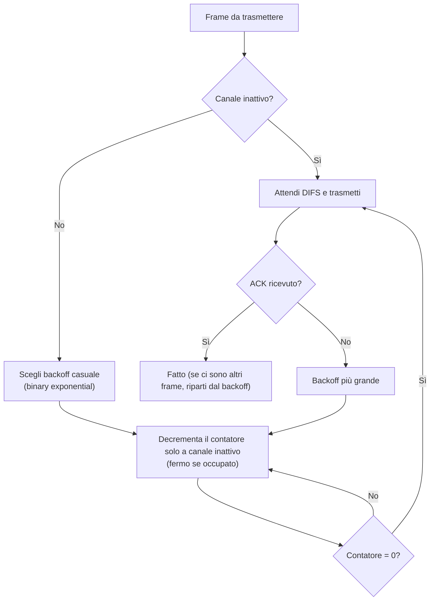
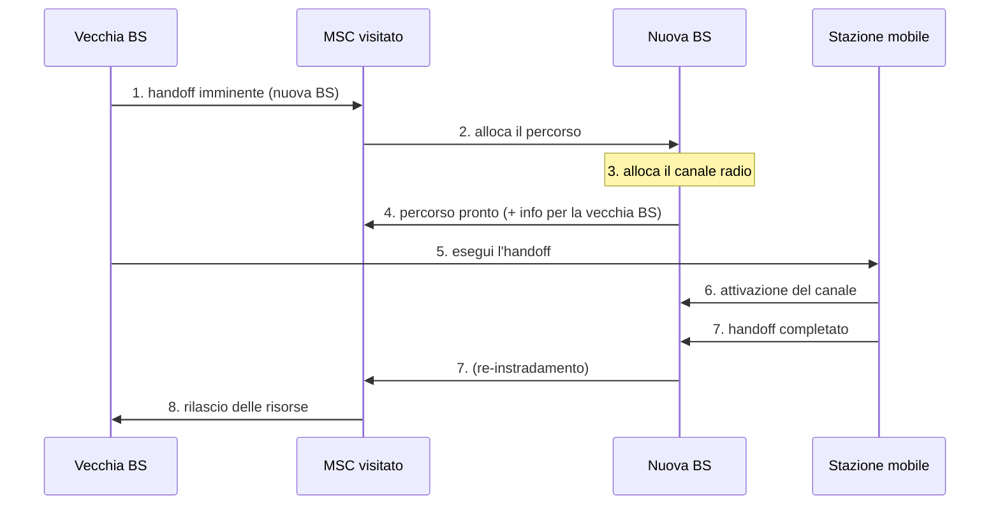

# Reti mobili e wireless

> [!abstract] Di cosa parla questo capitolo
> Gli abbonati alla telefonia cellulare sono passati da 34 milioni nel 1993 a circa 7 miliardi nel 2014, più delle linee fisse e degli abitanti del pianeta. Portatili, smartphone, console, orologi e automobili sono connessi a Internet senza fili. Le sfide di networking poste da questi dispositivi sono abbastanza diverse da meritare un capitolo a parte.
> Il capitolo distingue con cura due aspetti:
> - **wireless**: la natura del **collegamento** senza fili, cioè livello fisico e di collegamento (attenuazione, interferenze, terminale nascosto, CDMA, Wi-Fi, cellulare);
> - **mobilità**: il nodo che **cambia punto di attacco** alla rete, che riguarda il livello di rete (indirizzamento, instradamento, handoff, IP mobile, GSM).
>
> Le due cose spesso coesistono ma sono indipendenti: un PC fisso con Wi-Fi è wireless ma non mobile, mentre un portatile spostato da una presa Ethernet di casa a una dell'ufficio è mobile ma non wireless.
> Il capitolo segue il [[06 - TLC - Livello di collegamento e reti locali|Capitolo 6]] (accesso multiplo, Ethernet, switch), di cui riprende molti concetti adattandoli al mezzo radio.
> Mappa del corso: [[MOC - Telecomunicazioni]].

> [!info] Fonte
> Kurose, Ross, *Reti di calcolatori e Internet*, 7ª ed., Capitolo 7 (pp. 491–551). Le pagine citate sono quelle **del libro**: per il PDF aggiungi **28**.

---

## 7.1 Introduzione

Vedi [[Reti Wireless]].

![[TLC-p521-1.png]]

I **componenti di una rete wireless** sono:

| Elemento | Descrizione |
| --- | --- |
| **Host wireless** | sistemi periferici che eseguono applicazioni (portatili, tablet, telefoni, desktop); possono essere mobili o no |
| **Collegamenti wireless** | il canale che collega l'host alla stazione base o a un altro host. Tecnologie diverse hanno velocità e coperture diverse |
| **Stazione base** (*base station*) | non ha un equivalente nelle reti cablate. Invia e riceve i pacchetti degli host **associati**, cioè che si trovano nella sua **area di copertura** e la usano per raggiungere la rete. Esempi: **ripetitori di cella** (*cell tower*) nelle reti cellulari, **access point** nelle LAN 802.11 |
| **Infrastruttura di rete** | la rete più ampia a cui l'host vuole connettersi (Internet, la rete aziendale, la rete telefonica) |

Nella figura le aree grigie sono le **aree di copertura** di quattro access point collegati all'infrastruttura. L'host con la freccia è un **host in movimento** che passa da un'area all'altra.

- **Modalità infrastruttura**: tutti i servizi di rete (indirizzi, instradamento) sono forniti tramite la stazione base.
- **Reti ad hoc**: non c'è infrastruttura, e gli host devono provvedere da soli a instradamento, assegnazione degli indirizzi, DNS…
- **Handoff**: quando un host esce dall'area di una stazione base ed entra in quella di un'altra, cambia il proprio punto di collegamento. Ne nascono domande come: come lo si localizza? come si gestisce l'indirizzo? come si mantiene una connessione TCP aperta?

![[TLC-p521-2.png]]

Il grafico confronta gli standard per **velocità** (asse y) e **copertura** (asse x: interni 10–30 m, esterni 50–200 m, medio raggio 200 m–4 km, lungo raggio 5–20 km):

| Standard | Velocità indicativa | Copertura |
| --- | --- | --- |
| 802.15.1 (Bluetooth) | 1 Mbps | interni |
| 802.11b | 5–11 Mbps | interni |
| 802.11a,g | 54 Mbps | interni (o punto a punto fino al medio raggio) |
| 802.11n | 450 Mbps | interni |
| 802.11ac | 1300 Mbps | interni |
| 2G (IS-95, CDMA, GSM) | sotto i 384 kbps | da esterni a lungo raggio |
| 3G (UMTS/WCDMA, CDMA2000) | 384 kbps | da esterni a lungo raggio |
| 3G migliorato (HSPA) | 4 Mbps | da esterni a lungo raggio |
| 4G (LTE) | 54–450 Mbps | da esterni a lungo raggio |

Il Wi-Fi è veloce ma ha poca copertura; il cellulare copre molto di più ma va più piano. Il libro avverte che i valori servono solo a dare un'idea.

**Tassonomia delle reti wireless.** Si basa su due criteri: **un solo hop** wireless o **più hop**, e presenza o assenza di **infrastruttura** (stazione base).

| | Con infrastruttura | Senza infrastruttura |
| --- | --- | --- |
| **Hop singolo** | stazione base collegata alla rete cablata; tutte le comunicazioni passano per un solo hop wireless. Esempi: **802.11** in un bar o in biblioteca, **4G LTE** | nessuna stazione base, ma un nodo può coordinare gli altri. Esempi: **Bluetooth**, 802.11 ad hoc |
| **Hop multipli** | una stazione base cablata, ma alcuni nodi comunicano tramite altri nodi wireless. Esempi: reti di sensori, **reti mesh wireless** | nessuna stazione base, i messaggi passano per più nodi, che possono essere mobili. Esempi: **MANET** (*mobile ad hoc network*), **VANET** (*vehicular ad hoc network*), ancora oggetto di ricerca |

Il capitolo si concentra sulle reti **con infrastruttura**.

_(libro, pp. 491–495)_

---

## 7.2 Collegamenti wireless e caratteristiche di rete

Vedi [[Caratteristiche dei Collegamenti Wireless]].

Sostituendo l'Ethernet di una rete domestica con l'802.11 si sostituiscono solo la scheda di rete e lo switch (con l'access point): i livelli di rete e superiori non cambiano. Le differenze stanno quindi tutte nel **livello di collegamento** e in quello fisico. Le principali sono:

| Fenomeno | Descrizione |
| --- | --- |
| **Attenuazione del segnale** | le onde si attenuano attraversando ostacoli come le pareti, e anche nello spazio libero il segnale cala con la distanza (*path loss*) |
| **Interferenze da altre sorgenti** | sorgenti sulla stessa banda interferiscono: i telefoni cordless a 2,4 GHz e le LAN 802.11b usano la stessa banda. Anche il rumore ambientale, come motori e forni a microonde, disturba |
| **Propagazione su più cammini** (*multipath propagation*) | parte delle onde si riflette su oggetti e terreno e arriva al ricevente per cammini di lunghezza diversa, degradando il segnale. Oggetti in movimento la fanno variare nel tempo |

> [!tip] Box 7.1 — Wi-Fi nei luoghi pubblici
> Hot-spot Wi-Fi si trovano in alberghi, aeroporti, bar e campus. Molte città (Philadelphia, Toronto, Hong Kong, Minneapolis, Londra, Auckland) hanno progettato reti Wi-Fi pubbliche, viste come un servizio come l'illuminazione, per ridurre il *digital divide*. Philadelphia mise hotspot 802.11b sui lampioni per coprire l'80% della città, vendette la rete nel 2008 e la ricomprò nel 2010. L'802.11 usa uno spettro **senza licenza**, quindi costa poco, ma ha un raggio molto minore delle stazioni 4G e servono molti più apparati. Le reti cellulari usano spettro **con licenza**, pagato miliardi: sono un business, non un servizio pubblico. _(p. 496)_

Per questo gli **errori sui bit** sono molto più frequenti nel wireless, e i protocolli come 802.11 usano non solo un CRC robusto ma anche un **trasferimento affidabile a livello di collegamento**, con ritrasmissioni.

#### SNR, BER e modulazione

- Il **rapporto segnale/rumore** (**SNR**, *signal-to-noise ratio*) misura l'intensità del segnale ricevuto rispetto al rumore. Si misura in **decibel**: $20 \log_{10}$ dell'ampiezza del segnale diviso l'ampiezza del rumore. Più è alto, più è facile distinguere il segnale.
- Il **tasso di errore sul bit** (**BER**, *bit error rate*) è circa la probabilità che un bit venga ricevuto sbagliato.

![[TLC-p525-1.png]]

Il grafico (adattato da Holland 2001) mostra il BER, su scala logaritmica da $10^{-1}$ a $10^{-7}$, in funzione dell'SNR per tre modulazioni: **BPSK** (1 Mbps), **QAM16** (4 Mbps) e **QAM256** (8 Mbps). Ne seguono tre osservazioni:

1. **A parità di modulazione, più SNR significa meno BER.** Si può aumentare l'SNR alzando la potenza di trasmissione, ma oltre una certa soglia il guadagno è minimo (es. BER da $10^{-12}$ a $10^{-13}$), e si consuma più batteria e si interferisce di più con gli altri.
2. **A parità di SNR, una modulazione più veloce ha un BER più alto.**
   - Con SNR = **10 dB**: BPSK a 1 Mbps ha BER < $10^{-7}$, mentre 16-QAM a 4 Mbps ha BER ≈ $10^{-1}$, inutilizzabile.
   - Con SNR = **20 dB**: 16-QAM a 4 Mbps ha BER ≈ $10^{-7}$, e BPSK un BER così basso da uscire dalla scala. Se si accetta un BER di $10^{-7}$, conviene 16-QAM, che va 4 volte più veloce.
3. **Selezione dinamica della modulazione**: SNR e BER cambiano con la mobilità e l'ambiente, quindi si **adatta** la modulazione alle condizioni del canale per avere il tasso più alto possibile con un BER accettabile. Lo fanno 4G e 802.11 (vedi [[#Adattamento del tasso]]).

#### Terminale nascosto e fading

Vedi [[Terminale Nascosto]].

Nei canali cablati broadcast ogni nodo riceve le trasmissioni di tutti gli altri; nel wireless no.

![[TLC-p526-1.png]]

- **(a) Problema del terminale nascosto** (*hidden terminal problem*): A e C trasmettono entrambi a B, ma una **montagna** (o un palazzo) impedisce ad A e C di sentirsi. Le loro trasmissioni collidono presso B senza che nessuno dei due se ne accorga.
- **(b) Fading** (*evanescenza*): A e C sono abbastanza lontani da non sentirsi, perché il segnale di ciascuno cala con la distanza (le due curve), ma presso B, che è a metà strada, i due segnali interferiscono.

Entrambi i fenomeni rendono l'accesso multiplo wireless **molto più complicato** di quello cablato, e spiegano perché l'802.11 non usi il collision detection (vedi [[#Protocollo MAC di 802.11 (CSMA/CA)]]).

_(libro, pp. 495–499)_

### CDMA

Vedi [[CDMA]].

**CDMA** (*code division multiple access*) è un protocollo **a suddivisione del canale** (vedi [[Protocolli di Accesso Multiplo]]), il più diffuso nelle reti wireless e cellulari. Invece di dividere tempo (TDM) o frequenze (FDM), divide lo **spazio dei codici**.

**Come funziona con un solo trasmittente.**
- Ogni bit di dati $d_i$ (con il bit 0 rappresentato come $-1$) occupa uno **slot** di tempo, diviso in $M$ **mini-slot** (qui $M = 8$; in pratica molto di più).
- Il trasmittente ha un **codice** di $M$ valori $c_m \in \{1, -1\}$, che cambia a una frequenza molto più alta di quella dei dati, il **chipping rate**. Qui il codice è $1, 1, 1, -1, 1, -1, -1, -1$.
- **Codifica**: in ogni mini-slot $m$ dello slot $i$ si trasmette

$$Z_{i,m} = d_i \cdot c_m \qquad (7.1)$$

- **Decodifica** (canale ideale):

$$d_i = \frac{1}{M}\sum_{m=1}^{M} Z_{i,m} \cdot c_m \qquad (7.2)$$

![[TLC-p528-1.png]]

In alto il **trasmittente** codifica $d_1 = -1$ (slot di tempo 1) e $d_0 = 1$ (slot 0): l'uscita $Z_{i,m}$ è il codice invertito nel primo slot e il codice stesso nel secondo. In basso il **ricevente** moltiplica l'ingresso per lo stesso codice, mini-slot per mini-slot, somma e divide per $M$. Le tue annotazioni viola e rosa fanno proprio il conto:
- slot 1: ogni prodotto vale $(-1)(1) = -1$ oppure $(1)(-1) = -1$, quindi $\frac{-1-1-1-1-1-1-1-1}{8} = -1 = d_1$;
- slot 0: ogni prodotto vale $1 \cdot 1$ oppure $(-1)(-1)$, quindi $\frac{1+1+1+1+1+1+1+1}{8} = 1 = d_0$.

**Con più trasmittenti.** CDMA assume che i segnali in interferenza si **sommino**: se tre trasmittenti inviano 1 e uno invia $-1$ nello stesso mini-slot, il ricevente vede $1+1+1-1 = 2$. Con $N$ trasmittenti il segnale ricevuto è

$$Z^*_{i,m} = \sum_{s=1}^{N} Z^s_{i,m}$$

e, sorprendentemente, se i codici sono **scelti bene** il ricevente recupera i dati del trasmittente che gli interessa usando il **suo** codice:

$$d_i = \frac{1}{M}\sum_{m=1}^{M} Z^*_{i,m} \cdot c_m \qquad (7.3)$$

![[TLC-p530-1.png]]

Il trasmittente 1 ha codice $1, 1, 1, -1, 1, -1, -1, -1$ e invia $d^1_1 = -1$, $d^1_0 = 1$. Il trasmittente 2 ha codice $1, -1, 1, 1, 1, -1, 1, 1$ e invia $d^2_1 = d^2_0 = 1$. Nel canale i segnali si sommano (il "+" evidenziato in verde), quindi i valori sono $-2, 0$ o $2$. Il **ricevente 1** applica il codice del trasmittente 1 e ricostruisce $d^1_1 = -1$ e $d^1_0 = 1$. Come scrivi a margine: "**ricostruisce il primo; il 2° viene visto come interferenza** … il ricevente riesce a ricostruire il primo trasmittente con lo stesso codice".

> [!example] Verifica del conto della Figura 7.6 (slot 1)
> $Z^* = -c^1 + c^2 = (-1+1,\ -1-1,\ -1+1,\ 1+1,\ -1+1,\ 1-1,\ 1+1,\ 1+1) = (0, -2, 0, 2, 0, 0, 2, 2)$
>
> $$d^1_1 = \frac{0\cdot1 + (-2)\cdot1 + 0\cdot1 + 2\cdot(-1) + 0\cdot1 + 0\cdot(-1) + 2\cdot(-1) + 2\cdot(-1)}{8} = \frac{-8}{8} = -1 \ ✓$$
>
> Funziona perché i due codici sono **ortogonali**: $c^1 \cdot c^2 = 1-1+1-1+1+1-1-1 = 0$, quindi il contributo del trasmittente 2 si annulla nella somma. (Questa osservazione non è nel libro, ma spiega cosa vuol dire "codici scelti bene".)

Nell'analogia della festa, CDMA è un invitato che **parla più lingue**: le persone si agganciano a una conversazione nella lingua che capiscono, filtrando le altre. Nella pratica bisogna scegliere bene i codici, e il modello assume che i segnali arrivino con la **stessa intensità**, il che raramente è vero.

_(libro, pp. 499–502)_

---

## 7.3 Wi-Fi: LAN wireless 802.11

Vedi [[Wi-Fi 802.11]].

Tra gli standard wireless degli anni '90 ha "vinto" l'**IEEE 802.11 wireless LAN**, il **Wi-Fi**.

**Tabella 7.1 — Standard IEEE 802.11:**

| Standard | Gamma di frequenze (USA) | Velocità |
| --- | --- | --- |
| 802.11b | 2,4 GHz | fino a 11 Mbps |
| 802.11a | 5 GHz | fino a 54 Mbps |
| 802.11g | 2,4 GHz | fino a 54 Mbps |
| 802.11n | 2,4 GHz e 5 GHz | fino a 450 Mbps |
| 802.11ac | 5 GHz | fino a 1300 Mbps |

> [!warning] Correzione — frequenza di 802.11n
> La Tabella 7.1 del libro indica per 802.11n "**2,5 GHz** e 5 GHz". Le bande di 802.11 sono **2,4** e 5 GHz, come scrive il testo stesso poco sotto ("da 2,4 a 2,485 GHz"): è un refuso.

**Cosa hanno in comune tutti gli standard:**
- lo stesso protocollo di accesso al mezzo, **CSMA/CA**;
- la stessa **struttura del frame**;
- la possibilità di **ridurre la velocità** per raggiungere distanze maggiori;
- la **retrocompatibilità**: un dispositivo 802.11g funziona con un AP 802.11ac.

Le differenze sono nel livello fisico. La banda 2,4–2,485 GHz è condivisa con telefoni cordless e microonde; quella 5,1–5,8 GHz ha una portata più breve a parità di potenza e soffre di più la propagazione su più cammini. 802.11n e 802.11ac usano antenne **MIMO** (*multiple-input multiple-output*), cioè più antenne in trasmissione e in ricezione, e il **beamforming**. Le velocità della tabella valgono in condizioni ideali, a un metro dall'AP senza interferenze.

_(libro, pp. 502–503)_

### Architettura di 802.11

![[TLC-p532-1.png]]

Il blocco costitutivo è il **BSS** (*basic service set*): una o più stazioni wireless più una stazione base centrale, l'**access point** (**AP**). Nella figura due BSS hanno ciascuno un AP, collegati a uno **switch o router** che porta a Internet. In una rete domestica AP e router sono spesso nello stesso apparecchio.

- Le stazioni 802.11 hanno indirizzi **MAC di 6 byte** nel firmware, come in Ethernet; anche l'AP ha un MAC per la sua interfaccia wireless. Sono gestiti dall'IEEE (vedi [[Indirizzo MAC]]).
- Le reti con AP si chiamano **wireless LAN con infrastruttura**.

![[TLC-p532-2.png]]

Una **rete ad hoc 802.11** è un BSS **senza AP**: dispositivi che si trovano vicini, in una sala riunioni, in treno o in macchina, e comunicano senza controllo centrale né collegamento con l'esterno.

#### Canali e associazione

Vedi [[Associazione 802.11]].

Prima di scambiare dati una stazione deve **associarsi** a un AP.
- L'amministratore assegna all'AP un **SSID** (*service set identifier*), cioè il nome che compare in "reti disponibili", e un **numero di canale**.
- 802.11 lavora tra **2,4 e 2,4835 GHz**: in questi 85 MHz definisce **11 canali** parzialmente sovrapposti. Due canali non si sovrappongono solo se distano **almeno 4 canali**: **1, 6 e 11** sono l'unica terna senza sovrapposizioni. Con tre AP 802.11b sui canali 1, 6 e 11 collegati a uno switch si ottiene una capacità globale di **33 Mbps** ($3 \times 11$).
- **Giungla Wi-Fi** (*Wi-Fi jungle*): una posizione in cui la stazione riceve un segnale abbastanza forte da più AP, per esempio in un bar di Milano, ognuno nella propria sottorete e magari sul proprio canale.

**Associarsi** significa creare un "cavo virtuale" verso un AP: solo quell'AP invierà frame alla stazione, e la stazione raggiungerà Internet solo tramite quell'AP. Come trova gli AP?

- Gli AP inviano periodicamente **frame beacon** con il proprio **SSID** e il proprio **MAC**.
- Lo standard **non specifica** quale AP scegliere: lo decide il firmware. Di solito si sceglie il segnale più forte, che però non è l'unico criterio: un AP con segnale forte può essere sovraccarico, mentre uno scarico con segnale leggermente più debole verrebbe scartato.

![[TLC-p534-1.png]]

- **(a) Scansione passiva**: (1) gli AP inviano i beacon; (2) H1 invia una **richiesta di associazione** all'AP scelto; (3) l'AP risponde con una **risposta di associazione**.
- **(b) Scansione attiva**: (1) H1 invia in broadcast un **frame sonda** (*probe request*); (2) gli AP rispondono; (3) H1 invia la richiesta di associazione all'AP scelto; (4) l'AP risponde.

Lo scambio richiesta/risposta di associazione è **necessario** nella scansione attiva, perché un AP che ha risposto alla sonda non sa se verrà scelto, proprio come quando più server [[DHCP]] fanno un'offerta.

Dopo l'associazione l'host invia un **DHCP discover** tramite l'AP per ottenere un IP nella sottorete: da quel momento è un host come gli altri.

**Autenticazione.** Le reti 802.11 possono richiedere che la stazione si autentichi:
- in base all'**indirizzo MAC**;
- con **utente e password** (molti Internet café).

In entrambi i casi l'AP parla con un **server di autenticazione**, tramite protocolli come **RADIUS** (RFC 2865) o **DIAMETER** (RFC 3588). Separare il server di autenticazione dall'AP permette di centralizzare le decisioni per molti AP. Lo standard di sicurezza **802.11i** (Capitolo 8) usa questo approccio.

_(libro, pp. 503–507)_

### Protocollo MAC di 802.11 (CSMA/CA)

Vedi [[CSMA-CA]].

Ispirandosi a Ethernet, i progettisti hanno scelto un protocollo **ad accesso casuale**: **CSMA con prevenzione delle collisioni**, **CSMA/CA** (*collision avoidance*). Come in Ethernet ogni stazione ascolta il canale prima di trasmettere (vedi [[CSMA-CD]]), ma con due differenze:
- 802.11 **previene** le collisioni invece di rilevarle;
- per via dell'alto BER, 802.11 usa uno schema **ARQ** a livello di collegamento, cioè ACK e ritrasmissioni.

**Perché 802.11 non rileva le collisioni?**
1. Rilevare una collisione richiede di **trasmettere e ricevere contemporaneamente**. Il segnale ricevuto è molto più debole di quello trasmesso, quindi un hardware del genere costerebbe moltissimo.
2. Soprattutto, anche se si potesse, molte collisioni **non sarebbero rilevabili** a causa del **terminale nascosto** e del fading.

Senza rilevamento, una volta iniziata la trasmissione la stazione **trasmette tutto il frame**, anche se c'è una collisione. Con frame grandi e collisioni frequenti le prestazioni crollano, e per questo 802.11 punta a **evitarle**.

#### Conferma di avvenuta ricezione

![[TLC-p537-1.png]]

La sorgente aspetta un tempo **DIFS**, poi invia i **DATI**. La destinazione, se il frame supera il controllo **CRC**, attende un tempo breve, lo **SIFS** (*short inter-frame space*), e invia un **ACK**. Se la sorgente non riceve l'ACK entro un tempo stabilito, presume un errore e **ritrasmette** il frame, sempre con CSMA/CA. Dopo un certo numero di tentativi senza successo, il frame viene scartato. È il meccanismo del [[Trasferimento Dati Affidabile]] applicato al singolo collegamento.

#### Il protocollo CSMA/CA

Una stazione (o un AP) ha un frame da trasmettere:
1. se il canale è **inattivo**, trasmette dopo un breve tempo **DIFS** (*distributed inter-frame space*);
2. altrimenti sceglie un ritardo casuale con il **binary exponential backoff** e decrementa il contatore **solo quando il canale è inattivo**. Se il canale è occupato il contatore resta **fermo**;
3. quando il contatore arriva a zero, cosa che può succedere solo a canale inattivo, trasmette **l'intero** frame e aspetta l'ACK;
4. se arriva l'ACK, con un altro frame da inviare riparte dal passo 2. Se non arriva, torna al passo 2 con un intervallo di backoff **più grande**.

> [!important] Perché CSMA/CA aspetta anche quando il canale è libero
> In Ethernet (CSMA/CD) una stazione trasmette **appena** il canale si libera. In CSMA/CA la stazione **non trasmette** mentre il contatore scende, anche se il canale è inattivo.
> Esempio: due stazioni aspettano che una terza finisca.
> - **CSMA/CD**: entrambe trasmettono appena la terza ha finito e collidono. Il danno è limitato, perché interrompono subito.
> - **802.11**: la collisione sarebbe costosa, perché i frame verrebbero trasmessi per intero. Così le due stazioni entrano subito in backoff con valori casuali, probabilmente diversi: quella con il valore più basso trasmette per prima, e l'altra, se la sente, **congela** il contatore finché il canale non si libera.
>
> Le collisioni restano possibili se le stazioni sono **nascoste** l'una all'altra o scelgono valori troppo vicini (come nella [[CSMA-CD|Figura 6.12]]).

#### Terminali nascosti: RTS e CTS

Vedi [[RTS e CTS]].

![[TLC-p538-1.png]]

H1 e H2 sono entrambi nel raggio dell'**AP** (cerchio centrale), ma i loro raggi di copertura (i cerchi laterali più chiari) **non si sovrappongono abbastanza**: ognuno è nascosto all'altro, ma nessuno dei due è nascosto all'AP. Se H1 trasmette, H2 non lo sente, attende un DIFS e trasmette anche lui: c'è una collisione, e il canale è sprecato per entrambe le trasmissioni.

802.11 prevede uno schema di **prenotazione** opzionale con due frame di controllo:
- **RTS** (*request to send*): il trasmittente lo invia all'AP indicando il **tempo totale** necessario per DATI e ACK;
- **CTS** (*clear to send*): l'AP risponde in **broadcast**. Il messaggio dà al trasmittente il permesso di inviare e dice a **tutte le altre stazioni** di non trasmettere per il tempo riservato.

![[TLC-p540-1.png]]

La sequenza: DIFS → **RTS** dalla sorgente → SIFS → **CTS** dall'AP (ricevuto anche da "tutti gli altri nodi", che entrano in **accesso rimandato**) → SIFS → **DATI** → SIFS → **ACK**.

Vantaggi:
- risolve il **terminale nascosto**: i DATI partono solo a canale prenotato;
- RTS e CTS sono **piccoli**, quindi un'eventuale collisione tra di loro dura poco; dopo, DATI e ACK passano senza collisioni.

Lo svantaggio è che RTS/CTS introduce ritardo e consuma risorse del canale. Per questo si usa solo per frame **lunghi**: le stazioni hanno una **soglia RTS**, e la sequenza RTS/CTS si usa solo per frame più grandi di quella soglia. Spesso la soglia di default supera la lunghezza massima di un frame, il che significa che RTS/CTS non si usa affatto.

**802.11 come collegamento punto a punto.** Con antenne direzionali puntate l'una verso l'altra e una potenza maggiore, l'802.11 diventa un collegamento punto a punto economico su **decine di km**, come nelle reti rurali nella pianura del Gange.

_(libro, pp. 507–512)_

### Il frame IEEE 802.11

Vedi [[Frame 802.11]].

![[TLC-p541-1.png]]

Il frame 802.11 assomiglia a quello Ethernet ma ha campi specifici per il wireless. Lunghezze in byte:

| Campo | Byte | Note |
| --- | --- | --- |
| Controllo del frame | 2 | vedi sotto |
| Durata | 2 | tempo di canale riservato (DATI, RTS, CTS) |
| Indirizzo 1 | 6 | MAC del **ricevente** |
| Indirizzo 2 | 6 | MAC del **trasmittente** |
| Indirizzo 3 | 6 | MAC dell'**interfaccia del router** |
| Numero di sequenza | 2 | distingue frame nuovi e ritrasmissioni |
| Indirizzo 4 | 6 | solo nelle reti **ad hoc** |
| Payload | 0–2312 | datagramma IP o pacchetto ARP, di solito sotto i 1500 byte |
| CRC | 4 | 32 bit, ancora più utile che in Ethernet |

Il **campo di controllo** (in bit) contiene: versione del protocollo (2), **tipo** (2), **sottotipo** (4), **verso AP** (1), **da AP** (1), frammentazione, copia, alimentazione, altri dati, **WEP** (1) e un bit riservato.
- **Tipo e sottotipo** distinguono frame di associazione, RTS, CTS, ACK e dati.
- **Verso AP / da AP** definiscono il significato dei campi indirizzo, che cambia tra reti ad hoc e con infrastruttura e a seconda che trasmetta una stazione o l'AP.
- **WEP** indica se i dati sono cifrati (Capitolo 8).

#### I tre campi indirizzo

Perché quattro indirizzi invece dei due di Ethernet? Il terzo serve per l'**interconnessione** con la rete cablata.

![[TLC-p542-1.png]]

L'AP è un dispositivo di **livello 2**: non capisce l'IP. Il router R1 vede H1 come un normale host di una delle sue sottoreti e non sa che c'è un AP in mezzo.

**Da R1 a H1:**
1. R1 conosce l'IP di H1 e ricava il suo MAC con **ARP** (vedi [[Protocollo ARP]]). Crea un **frame Ethernet** con MAC sorgente = R1 e destinazione = H1.
2. L'AP converte il frame Ethernet in un frame 802.11: **indirizzo 1** = MAC di H1, **indirizzo 2** = MAC dell'AP, **indirizzo 3** = MAC di **R1**. Così H1 sa quale interfaccia del router ha inviato il datagramma.

**Da H1 a R1:**
1. H1 crea un frame 802.11: **indirizzo 1** = MAC dell'AP, **indirizzo 2** = MAC di H1, **indirizzo 3** = MAC di **R1**.
2. L'AP lo converte in un frame Ethernet con sorgente = H1 e destinazione = R1, che ricava proprio dall'**indirizzo 3**.

| Direzione | Indirizzo 1 (ricevente) | Indirizzo 2 (trasmittente) | Indirizzo 3 |
| --- | --- | --- | --- |
| AP → H1 | H1 | AP | R1 |
| H1 → AP | AP | H1 | R1 |

L'indirizzo 3 è quindi cruciale per collegare il BSS alla rete cablata.

**Numero di sequenza, durata e controllo.**
- Un ACK perso può far arrivare più copie dello stesso frame. Il **numero di sequenza** permette al ricevente di riconoscere i duplicati, esattamente come in [[Trasferimento Dati Affidabile|rdt2.1]].
- La **durata** indica il tempo di canale riservato per DATI e ACK (usata anche da RTS e CTS).

_(libro, pp. 512–515)_

### Mobilità all'interno di una sottorete IP

![[TLC-p544-1.png]]

Per estendere la copertura si mettono più BSS nella **stessa sottorete IP**: qui BSS1 e BSS2, con AP1 e AP2 collegati a uno **switch** e non a un router. H1 si sposta da BSS1 a BSS2.
- Visto che nel mezzo non c'è un router, tutte le stazioni, AP compresi, sono nella **stessa sottorete**: H1 **mantiene l'IP** e le **connessioni TCP** aperte. Con un router in mezzo dovrebbe cambiare IP o usare un protocollo come [[#7.6 IP mobile|IP mobile]].
- Allontanandosi da AP1, H1 riceve un segnale sempre più debole e cerca un AP migliore. Riceve i beacon di AP2, che spesso ha lo **stesso SSID**, si **disassocia** da AP1 e si **associa** ad AP2.

**E lo switch?** Si [[Autoapprendimento degli Switch|auto-apprende]], ma non è pensato per utenti che si spostano spesso. Nella sua tabella H1 è ancora associato alla porta di AP1, quindi i frame per H1 continuerebbero ad andare verso AP1. Un **trucco**: dopo l'associazione, **AP2 invia allo switch un frame Ethernet broadcast con il MAC sorgente di H1**, e lo switch aggiorna la tabella. Il gruppo **802.11f** si occupa di questo problema. Lo stesso vale per le [[LAN Virtuali|VLAN]] estese su un'area ampia.

_(libro, pp. 516–517)_

### Funzionalità avanzate di 802.11

Queste funzioni non sono specificate del tutto dallo standard: i produttori le implementano a modo loro, anche come vantaggio competitivo.

#### Adattamento del tasso

Un utente a 20 m dall'AP ha un SNR alto e può usare una modulazione veloce. Allontanandosi l'SNR scende, e con la stessa modulazione il BER diventerebbe inaccettabile (vedi [[#SNR, BER e modulazione]]). Alcune implementazioni **adattano il tasso**:
- **due frame consecutivi senza ACK** → il tasso scende al valore inferiore;
- **10 frame consecutivi confermati**, oppure la scadenza di un timer → il tasso sale al valore superiore.

È la stessa filosofia del "**probing**" del controllo di congestione TCP (vedi [[AIMD]]): aumentare finché va bene, ridurre al primo evento "brutto". È come il bambino che chiede sempre di più finché i genitori non dicono "Basta!".

#### Gestione dell'energia

L'energia è preziosa sui dispositivi mobili.
- Un nodo alterna gli stati **attivo** (*wake*) e **inattivo** (*sleep*). Per segnalare all'AP che si addormenta, mette a 1 il **bit di gestione energetica** nell'intestazione di un frame.
- Il nodo imposta un timer per svegliarsi subito prima del **beacon** successivo (gli AP ne inviano uno ogni **100 ms**). Il risveglio richiede solo **250 µs**.
- Intanto l'AP **memorizza** i frame destinati al nodo. Il beacon contiene la lista dei nodi con frame in attesa. Se non ce ne sono, il nodo torna a dormire; altrimenti li richiede con un messaggio di interrogazione.
- Un nodo senza traffico può restare inattivo circa il **99%** del tempo.

_(libro, pp. 517–518)_

### Personal Area Network: Bluetooth e Zigbee

Vedi [[Bluetooth e Zigbee]].

802.11 copre fino a circa 100 m. Per distanze e consumi più bassi ci sono altri due standard IEEE 802: **Bluetooth** (802.15.1) e **Zigbee** (802.15.4).

#### Bluetooth (802.15.1)

- Bassa potenza, corto raggio, bassa velocità, basso costo: "simula un cavo" tra computer o smartphone e periferiche. Queste reti si chiamano **WPAN** (*wireless personal area network*).
- Banda a **2,4 GHz** in modalità **TDM**, con slot da **625 µs**. In ogni slot si trasmette su uno di **79 canali**, scelto in modo pseudo-casuale da slot a slot: è il **FHSS** (*frequency-hopping spread spectrum*). Arriva fino a 4 Mbps.
- È una rete **ad hoc**: i dispositivi si organizzano in una **piconet** di massimo **8 elementi attivi**.

![[TLC-p547-1.png]]

Nella piconet c'è un nodo **master** (M) al centro del raggio di copertura, alcuni **slave** (S) e alcuni nodi **in sosta** (*parked*, P).
- Il master regola la piconet: il suo **clock** determina il tempo, e trasmette negli slot **dispari**.
- Uno slave può trasmettere solo **dopo** che il master ha comunicato con lui nello slot precedente, e solo al master.
- Ci possono essere fino a **255** dispositivi in sosta, che comunicano solo dopo che il master li ha resi attivi.

Bluetooth è un esempio di protocollo **polling** (vedi [[Protocolli a Rotazione]]).

#### Zigbee (802.15.4)

- Pensato per applicazioni a **energia, velocità e cicli di attività** ancora più bassi di Bluetooth: sensori di temperatura e luce, dispositivi di sicurezza, interruttori a muro. Velocità di canale di **20, 40, 100 e 250 kbps**.
- Due tipi di nodi:
  - **reduced-function**, che fanno da slave sotto un controllore;
  - **full-function**, che possono fare da master e, in più, formare una **rete mesh** instradando i frame tra loro.
- Riprende meccanismi già visti: beacon e ACK come 802.11, accesso casuale con backoff esponenziale come 802.11 ed Ethernet, slot garantiti come DOCSIS (il libro scrive "DOCSYS").

![[TLC-p548-1.png]]

Il tempo è diviso in **super frame**, ognuno aperto da un **beacon**. Ogni super frame ha un **periodo di attività**, di 16 slot divisi in **slot contesi** (accesso casuale CSMA/CA) e **slot garantiti** (allocati dal controller a dispositivi specifici), seguito da un **periodo di inattività** in cui tutti, controller compreso, dormono per risparmiare energia.

_(libro, pp. 519–521)_

---

## 7.4 Accesso cellulare a Internet

Gli hotspot Wi-Fi coprono da 10 a 100 m. Quando non c'è un hotspot si vuole estendere la rete cellulare, nata per la voce, anche ai **dati**, con velocità elevate e **mobilità continua**, mantenendo le sessioni TCP durante il viaggio. Il paragrafo descrive il **primo hop** wireless e la rete che lo collega alla rete telefonica e a Internet.

_(libro, p. 521)_

> [!tip] Box 7.2 — Rete cellulare 4G o LAN wireless?
> In Giappone e in Corea la copertura 4G LTE supera il 90%, con velocità medie nel 2015 da 10 Mbps (USA, India) a quasi 40 Mbps (Nuova Zelanda). Il 4G usa bande con licenza pagate a caro prezzo. Molti dispositivi scelgono il Wi-Fi quando possibile. Chi vincerà?
> - Le LAN wireless diventeranno onnipresenti: quasi tutto ha una scheda 802.11, e gli AP possono gestire anche telefoni con VoIP (es. Skype), aggirando gli operatori.
> - Altri credono che il 4G rivoluzionerà il modo di vivere e lavorare.
>
> Probabilmente vinceranno **entrambi**, con dispositivi che scelgono automaticamente la tecnologia migliore in ogni luogo. _(p. 522)_

### Panoramica dell'architettura di una rete cellulare

Vedi [[Rete Cellulare GSM]].

La terminologia è quella del **GSM** (*Global System for Mobile communication*, in origine *Groupe Spécial Mobile*). Negli anni '80 l'Europa sostituì i sistemi analogici nazionali, incompatibili tra loro, con uno standard digitale comune. Il GSM fu installato all'inizio degli anni '90 e oggi serve più dell'80% degli utenti mondiali.

**Generazioni:**

| Generazione | Caratteristiche |
| --- | --- |
| **1G** | analogico, FDMA, solo voce (estinto) |
| **2G** | digitale, progettato per la voce |
| **2.5G** | estensione 2G per i dati (Internet) |
| **3G** | voce e dati, con enfasi crescente sui dati e su accessi radio più veloci |
| **4G** | basato su **LTE**, con **nucleo di rete completamente basato su IP**; voce e dati integrati a decine di Mbps |

#### Architettura 2G: voce verso la rete telefonica

![[TLC-p551-1.png]]

- "**Cellulare**" vuol dire che l'area geografica è divisa in **celle** (gli esagoni). Ogni cella ha una stazione base, la **BTS** (*base transceiver station*), che scambia segnali con le stazioni mobili (*mobile subscribers*: telefoni, auto). La copertura dipende dalla potenza di BTS e telefono, dagli edifici e dall'altezza dell'antenna. Spesso la BTS si mette all'**incrocio di tre celle**, con antenne direzionali che ne servono tre.
- L'interfaccia aerea del GSM combina **FDM e TDM**: il canale è diviso in $F$ sottobande e il tempo in $T$ slot, per un totale di $F \times T$ chiamate contemporanee (come DOCSIS, vedi [[DOCSIS]]). GSM usa bande da **200 kHz**, ognuna con **8 chiamate TDM**, e codifica la voce a 13 e 12,2 kbps.
- Il **BSC** (*base station controller*) serve alcune decine di BTS. Alloca i canali radio, fa il **paging** (trova la cella in cui si trova l'utente) e gestisce l'**handoff**. **BSC + BTS = BSS** (*base station system*).
- L'**MSC** (*mobile switching center*) è centrale per l'autorizzazione e l'identificazione degli utenti, per stabilire e terminare le chiamate e per l'handoff. Un MSC ha fino a circa 5 BSC, cioè circa **200.000 utenti**.
- Il **gateway MSC** collega la rete cellulare dell'operatore alla **rete telefonica pubblica**.

> [!note] Due "BSS" diversi
> In GSM **BSS** significa *base station system* (BSC + BTS); in 802.11 significa *basic service set* (AP + stazioni). Hanno lo stesso acronimo ma indicano cose diverse.

_(libro, pp. 521–524)_

### Rete dati cellulare 3G

Vedi [[Reti Cellulari 3G e 4G]].

Per leggere e-mail, navigare e vedere video, lo smartphone deve eseguire tutta la pila TCP/IP e connettersi a Internet attraverso la rete cellulare. Gli standard sono tanti, in concorrenza e in evoluzione, e non c'è un ente unico che stabilisca i requisiti di 2.5G, 3G, 3.5G o 4G. Il libro segue **UMTS** (*Universal Mobile Telecommunications Service*), sviluppato dal **3GPP**.

![[TLC-p553-1.png]]

L'architettura 3G ha tre parti, da sinistra a destra:
- **rete di accesso radio** (UTRAN, *Universal Terrestrial Radio Access Network*), con l'interfaccia radio WCDMA/HSPA e il **RNC** (*Radio Network Controller*);
- **core network** (GPRS Core Network), con **SGSN** e **GGSN**;
- **Internet**.

In parallelo resta la parte voce del 2G: MSC, gateway MSC e rete telefonica pubblica.

**Core network 3G.** I progettisti hanno scelto di "**lasciare invariato il nucleo GSM per la voce, aggiungendo in parallelo funzionalità dati**". Integrare i dati nel nucleo voce avrebbe portato agli stessi problemi della transizione da IPv4 a IPv6 (vedi [[Protocollo IPv6]]). I nodi sono:
- **SGSN** (*Serving GPRS Support Node*): consegna i datagrammi da e verso i nodi mobili della propria rete di accesso radio. Interagisce con l'MSC per autorizzazione, handoff e posizione (cella) dei nodi, e inoltra i datagrammi tra i nodi mobili e il GGSN;
- **GGSN** (*Gateway GPRS Support Node*): fa da **gateway** tra più SGSN e Internet. È l'ultimo pezzo dell'infrastruttura 3G prima di Internet. Dall'esterno sembra un gateway qualsiasi: la mobilità dentro la rete è **nascosta**.

> [!warning] Correzione — acronimo GPRS
> A p. 525 il libro scrive che GPRS è l'acronimo di "General**ized Racket** Radio Service". Il nome corretto, riportato anche nella Figura 7.19, è **General Packet Radio Service**.

**Rete di accesso radio 3G.** È il primo e l'ultimo hop wireless visto dall'utente.
- Il **RNC** controlla alcune stazioni base, che in UMTS si chiamano "**Node B**" ("un nome non molto esplicativo"). È collegato **sia** alla rete voce a commutazione di circuito (tramite l'MSC) **sia** a Internet a commutazione di pacchetto (tramite l'SGSN). Voce e dati hanno nuclei diversi, ma condividono la rete di accesso radio.
- La novità di UMTS rispetto al 2G è l'uso di **DS-WCDMA** (*Direct Sequence Wideband CDMA*) all'interno di slot TDMA, al posto del FDM/TDM del GSM. Gli slot TDMA sono disponibili su più frequenze, quindi si usano **tutti e tre** gli approcci di condivisione del canale (simile a DOCSIS). Il servizio dati si chiama **HSPA** (*high speed packet access*), fino a **14 Mbps** in downlink.

> [!warning] Piccolo refuso nel rimando
> Il libro dice che i tre approcci di condivisione del canale sono stati identificati "nel **Capitolo 5**". In realtà sono nel **Capitolo 6** ([[Protocolli di Accesso Multiplo]]).

_(libro, pp. 524–526)_

### Verso il 4G: LTE

Nel 2015 cinquanta paesi avevano una copertura 4G oltre il 50%. Lo standard **LTE** (*Long-Term Evolution*) introduce due innovazioni: un **nucleo di rete completamente basato su IP** e una **rete di accesso migliorata**.

![[TLC-p555-1.png]]

Da sinistra a destra: **UE**, **eNodeB**, **MME**, **HSS** (in figura "HHS"), **S-GW**, **P-GW**. La linea tratteggiata separa il **piano di controllo** (sopra) dal **piano dei dati** (sotto). In basso, la rete di accesso radio **E-UTRAN** e il nucleo **EPC** (*Evolved Packet Core*), completamente basato su IP.

Tre osservazioni:
- **architettura unificata all-IP**: a differenza del 3G, che ha percorsi separati per voce e dati, in 4G **sia la voce sia i dati** viaggiano in datagrammi IP tra il dispositivo (**UE**, *User Equipment*) e il **P-GW**. "Le ultime tracce della telefonia svaniscono";
- **separazione netta tra piano dei dati e di controllo**, come nel livello di rete IP (vedi [[Inoltro e Instradamento]]);
- **separazione netta tra rete di accesso radio e nucleo all-IP**: i dati dell'utente viaggiano tra UE e P-GW su una rete IP interna, e lo stesso fanno i messaggi di controllo tra i componenti.

**Componenti:**

| Componente | Ruolo |
| --- | --- |
| **eNodeB** | erede della stazione base 2G e del RNC 3G (Node B). Nel piano dei dati inoltra i datagrammi tra UE e P-GW: li incapsula e li manda in **tunneling** al P-GW attraverso l'EPC, come il tunneling IPv6 su IPv4 (vedi [[Protocollo IPv6]]). Il tunnel può avere garanzie di **QoS**, per esempio voce con ritardo ≤ 100 ms e perdite < 1% tra UE e P-GW, e TCP con 300 ms e perdite < 0,0001%. Nel piano di controllo gestisce le segnalazioni di registrazione e mobilità |
| **P-GW** (*Packet Data Network Gateway*) | assegna gli **IP** agli UE e gestisce la QoS; incapsula e decapsula i datagrammi da e verso l'UE |
| **S-GW** (*Serving Gateway*) | punto d'appoggio della **mobilità** nel piano dei dati: tutto il traffico UE passa di qui. Si occupa anche di fatturazione e intercettazione del traffico |
| **MME** (*Mobility Management Entity*) | gestisce la connessione e la **mobilità** dell'UE nelle celle che controlla; riceve le informazioni sull'abbonamento dall'HSS |
| **HSS** (*Home Subscriber Server*) | contiene le informazioni dell'UE: possibilità di roaming, profilo QoS, dati di autenticazione |

**LTE Radio Access Network.** In downstream usa l'**OFDM** (*Orthogonal Frequency Division Multiplexing*), che combina divisione di frequenza e di tempo. "Ortogonale" perché i segnali su frequenze diverse sono costruiti in modo da interferire pochissimo anche quando le frequenze sono molto vicine.

![[TLC-p557-1.png]]

A ogni nodo mobile attivo si assegnano uno o più **slot da 0,5 ms** su una o più frequenze ($f_1 \dots f_6$), in frame da 10 ms, cioè 20 slot per frequenza. In grigio c'è un'allocazione di **8 slot**: due slot di tempo (da 1,0 a 2,0 ms) su quattro frequenze ($f_2$–$f_5$). Più slot si ricevono, sulla stessa frequenza o su frequenze diverse, più si va veloci. La riallocazione può avvenire ogni millisecondo.

- Si usano anche **modulazioni diverse** a seconda del canale (come nel Wi-Fi) e **MIMO**.
- Velocità massime: **100 Mbps** in downstream e **50 Mbps** in upstream su 20 MHz di spettro.
- Lo standard **non impone** come allocare gli slot: lo decidono gli algoritmi di **scheduling** dei produttori e degli operatori. Lo **scheduling opportunistico** adatta il livello fisico alle condizioni del canale e tiene conto delle priorità e dei livelli di servizio contrattati (argento, oro, platino).
- **LTE-Advanced** arriva a centinaia di Mbps aggregando canali.
- **WiMAX** (IEEE 802.16) è un'altra tecnologia 4G, molto meno diffusa di LTE.

_(libro, pp. 526–529)_

---

## 7.5 Gestione della mobilità

Vedi [[Gestione della Mobilità]].

Un **nodo mobile** è un nodo che **cambia nel tempo** il proprio punto di connessione alla rete. "Mobilità" ha molti significati, quindi il libro ne distingue tre aspetti.

**1. Cos'è un utente mobile dal punto di vista del livello di rete?**

![[TLC-p558-1.png]]

È uno spettro, da **nessuna mobilità** a **elevata mobilità**:
- l'utente resta nella **stessa rete di accesso wireless**: per esempio si sposta con il portatile dentro un edificio associato agli AP della stessa sottorete (vedi [[#Mobilità all'interno di una sottorete IP]]). Per il livello di rete **non è mobile**; se resta sempre sullo stesso AP non lo è nemmeno per il livello di collegamento;
- l'utente **cambia rete di accesso e chiude le connessioni** quando cambia rete: porta il portatile dall'ufficio al bar e si riconnette;
- l'utente **cambia rete di accesso senza chiudere le connessioni attive**: chi sfreccia in autostrada a 150 km/h su una BMW o una Tesla e vuole mantenere la connessione TCP. È mobile a tutti gli effetti.

**2. Quanto è importante che l'indirizzo resti invariato?**
- Con il cellulare il **numero di telefono**, cioè l'indirizzo di livello di rete del telefono, resta lo stesso anche cambiando operatore.
- Mantenere lo stesso **IP** rende la mobilità **trasparente alle applicazioni**: un'applicazione ha bisogno dell'IP e della porta del terminale remoto (vedi [[Multiplexing e Demultiplexing]]), e lo stesso codice serve sia connessioni mobili sia fisse. È quello che fa IP mobile.
- Se invece l'utente usa il portatile soprattutto come **client** (e-mail, Web), un indirizzo temporaneo assegnato con [[DHCP]] va benissimo.

**3. Che infrastruttura cablata c'è?** Finora si è assunta un'infrastruttura fissa. Senza di essa servono le **reti ad hoc** (gruppo IETF MANET), che il libro non approfondisce.

**L'analogia del ventenne.** Un ventenne lascia la casa dei genitori e si sposta di continuo tra ostelli e appartamenti. Come lo trova un amico? Chiede ai **genitori**, che il figlio tiene informati: la casa dei genitori è il suo **indirizzo permanente**. L'amico può scrivergli **indirettamente** (lettera ai genitori, che la inoltrano) o **direttamente** (chiede l'indirizzo attuale ai genitori e gli scrive lì).

**Terminologia:**

| Termine | Significato | Analogia |
| --- | --- | --- |
| **Rete di appartenenza** (*home network*) | rete in cui risiede permanentemente il nodo mobile | casa dei genitori |
| **Agente domestico** (*home agent*) | entità della rete di appartenenza che gestisce la mobilità per il nodo | i genitori |
| **Rete ospitante** (*foreign/visited network*) | rete in cui il nodo si trova al momento | l'ostello |
| **Agente ospitante** (*foreign agent*) | entità della rete ospitante che gestisce la mobilità | — |
| **Corrispondente** | chi vuole comunicare con il nodo mobile | l'amico |

![[TLC-p560-1.png]]

La rete di appartenenza è **128.119.40/24**, con indirizzo permanente del nodo **128.119.40.186** e l'**agente domestico** sul router. La rete ospitante è **79.129.13/24**, con il nodo mobile (che conserva l'indirizzo permanente 128.119.40.186), l'**agente ospitante** e il **COA 79.129.13.2**. Il **corrispondente** è altrove, collegato via WAN. Gli agenti sono spesso processi sui router, ma possono girare su qualsiasi host.

_(libro, pp. 529–532)_

### Indirizzamento

Perché il nodo conservi il proprio indirizzo, il traffico verso l'indirizzo permanente deve essere instradato verso la rete ospitante. Le opzioni sono due.

**Opzione 1: annunciare la posizione nell'instradamento.** La rete ospitante annuncia a tutte le altre, o ai propri vicini, una rotta specifica verso l'indirizzo permanente del nodo (un prefisso più lungo, vedi [[Longest Prefix Match]]), e quando il nodo se ne va la rotta viene cancellata. Non servono modifiche all'infrastruttura, ma il sistema **non scala**: i router dovrebbero gestire tabelle per milioni di nodi mobili e aggiornarle a ogni spostamento.

**Opzione 2 (quella adottata): la mobilità alla periferia.** Coerentemente con l'architettura di Internet, le funzioni di mobilità si spostano dal nucleo alla **periferia**. L'**agente domestico** tiene traccia della rete in cui si trova il nodo, e serve un protocollo tra il nodo (o l'agente ospitante) e l'agente domestico per aggiornare la posizione.

L'agente ospitante ha due compiti:
1. definire un **indirizzo di mediazione**, il **COA** (*care-of address*), per il nodo mobile, con la parte di rete uguale a quella della rete ospitante. "Care-of" è il "c/o" che si scrive su una busta quando il destinatario abita temporaneamente presso qualcun altro (nota del curatore);
2. informare l'**agente domestico** che il nodo si trova nella sua rete e qual è il COA.

Il nodo ha quindi **due indirizzi**: quello **permanente** (come l'indirizzo dei genitori) e il **COA** (come l'indirizzo attuale del ragazzo). Il nodo stesso può fare da agente ospitante, ottenendo il COA con DHCP e comunicandolo all'agente domestico.

> [!warning] Correzione — indirizzo permanente dell'esempio
> A p. 533 il libro scrive che "nell'esempio della Figura 7.23 l'indirizzo permanente del nodo mobile è **128.119.13.2**". La figura (e tutte le successive) riporta invece **128.119.40.186**, nella rete di appartenenza 128.119.40/24; 128.119.13.2 non appartiene a nessuna delle due reti dell'esempio. Il COA è correttamente **79.129.13.2**.

_(libro, pp. 532–533)_

### Instradamento verso il nodo mobile

Vedi [[Instradamento Indiretto e Diretto]].

Solo l'agente domestico conosce la posizione del nodo, quindi non basta mandare il datagramma all'indirizzo permanente. Gli approcci sono due.

#### Instradamento indiretto

![[TLC-p563-1.png]]

1. Il **corrispondente** indirizza il datagramma all'**indirizzo permanente** e lo invia normalmente, ignaro di dove sia il nodo: la mobilità gli è **trasparente**. Il datagramma arriva nella rete di appartenenza.
2. L'**agente domestico** intercetta i datagrammi per i nodi che si trovano altrove e li invia all'**agente ospitante** usando il COA.
3. L'agente ospitante li consegna al nodo mobile.
4. Il nodo mobile risponde **direttamente** al corrispondente, con l'indirizzo permanente come sorgente: non serve passare per l'agente domestico.

![[TLC-p563-2.png]]

Il passo 2 usa l'**incapsulamento**: l'agente domestico mette l'**intero datagramma originale** (`dest: 128.119.40.186`) dentro un datagramma più grande indirizzato al **COA** (`dest: 79.129.13.2`). L'agente ospitante lo **decapsula** e consegna al nodo il datagramma originale, che arriva intatto: l'applicazione non sa nulla del percorso. È lo stesso concetto del **tunneling** IPv6 (vedi [[Protocollo IPv6]]).

**Funzionalità di rete necessarie:**
- un protocollo **nodo mobile → agente ospitante**, per registrarsi all'arrivo e cancellarsi alla partenza;
- un protocollo di **registrazione agente ospitante → agente domestico** del COA. Non serve cancellarlo esplicitamente: la registrazione del COA successivo lo sostituisce;
- un protocollo di **incapsulamento** nell'agente domestico;
- un protocollo di **decapsulamento** nell'agente ospitante.

**Cambio di rete.** Se il nodo passa dalla rete A alla rete B, si registra presso il nuovo agente ospitante, che aggiorna il COA presso l'agente domestico. Per il corrispondente non cambia nulla. Nel breve intervallo tra la disconnessione da A e la registrazione in B si può perdere qualche datagramma, ma non è un problema grave: anche la congestione causa perdite, e i livelli superiori, per esempio TCP, sanno come recuperarle. **IP mobile** (RFC 5944) usa l'instradamento indiretto.

#### Instradamento diretto

Il problema dell'instradamento indiretto è l'**instradamento triangolare** (*triangle routing problem*): i datagrammi passano sempre dall'agente domestico, anche quando esistono percorsi molto più brevi. Esempio estremo: un professore in visita presso un collega di un'altra università, seduti alla stessa scrivania. I datagrammi dell'uno verso l'altro vanno all'agente domestico e rimbalzano indietro.

![[TLC-p565-1.png]]

Con l'**instradamento diretto**:
1–2. un **agente corrispondente** nella rete del corrispondente chiede il **COA** all'agente domestico (messaggi di controllo). Anche il corrispondente stesso può fare da agente corrispondente;
3–4. l'agente corrispondente manda i datagrammi in **tunnel direttamente al COA** (flusso dei dati), come faceva l'agente domestico.

Così si elimina il triangolo, ma nascono due problemi nuovi:
- serve un **protocollo di localizzazione dell'utente mobile**, con cui l'agente corrispondente ottiene il COA;
- se il nodo **cambia rete**, l'agente corrispondente ha chiesto il COA **una sola volta**, all'inizio della sessione, quindi aggiornare l'agente domestico non basta più.

**Soluzione GSM: l'agente di appoggio.**

![[TLC-p566-1.png]]

1. All'inizio della sessione i dati vanno all'agente della rete ospitante visitata per prima, l'**agente di appoggio** (*anchor foreign agent*).
2. Il nodo si sposta in una **nuova rete ospitante**.
3. Si registra presso il **nuovo agente ospitante**.
4. Il nuovo agente comunica all'agente di appoggio il **nuovo COA**.
5. L'agente di appoggio, quando riceve datagrammi per il nodo, li **re-incapsula** e li inoltra al nuovo COA.

A ogni ulteriore spostamento il nuovo agente ospitante contatta l'agente di appoggio.

| | Indiretto | Diretto |
| --- | --- | --- |
| Percorso dei dati | corrispondente → agente domestico → agente ospitante → nodo | corrispondente → agente corrispondente → (tunnel) → agente ospitante → nodo |
| Pro | trasparente, semplice; cambiare rete richiede solo di aggiornare l'agente domestico | niente instradamento triangolare |
| Contro | **instradamento triangolare** | serve un protocollo di localizzazione; i cambi di rete richiedono l'**agente di appoggio** |

_(libro, pp. 533–539)_

---

## 7.6 IP mobile

Vedi [[IP Mobile]].

**IP mobile** (RFC 5944, per IPv4) è l'architettura di Internet per la mobilità. È flessibile (con o senza agenti ospitanti, più modi di scoprire gli agenti, COA singoli o multipli, varie forme di incapsulamento) e complesso. Usa l'**instradamento indiretto** e ha **tre parti**:
1. **ricerca dell'agente** (*agent discovery*);
2. **registrazione presso l'agente domestico**;
3. **instradamento indiretto dei datagrammi** (incapsulamento, RFC 2003 e 2004).

La **sicurezza** è in primo piano: per esempio serve autenticare i nodi mobili, altrimenti un malintenzionato potrebbe registrare un COA falso e farsi recapitare tutti i datagrammi destinati a un altro. Il libro rimanda questi meccanismi al Capitolo 8.

### Ricerca dell'agente

Un nodo che arriva in una nuova rete deve scoprire l'identità dell'agente, con un nuovo indirizzo di rete, per accorgersi di essersi spostato. Ci sono due modi.

**Avviso dell'agente** (*agent advertisement*). È un'estensione del protocollo di ricerca dei router (RFC 1256): l'agente invia periodicamente in broadcast su tutti i suoi collegamenti un messaggio **ICMP di tipo 9** (ricerca router, vedi [[Protocollo ICMP]]), con il proprio IP e un'**estensione di avviso dell'agente di mobilità**.

![[TLC-p569-1.png]]

I **campi standard ICMP** sono Tipo = 9, Codice = 0, Checksum e Indirizzo del router. L'**estensione** contiene Tipo = 16, Lunghezza, Numero di sequenza, tempo di validità della registrazione, i bit `RBHFMGrT` e **0 o più COA**. I bit più importanti sono:
- **H** (agente domestico): è l'agente domestico della sua rete;
- **F** (agente ospitante): è un agente ospitante;
- **R** (richiesta di registrazione): il nodo **deve** registrarsi presso questo agente ospitante, e non può ottenere da sé un COA, per esempio con DHCP;
- **M e G** (incapsulamento): indicano se si usa un'altra forma di incapsulamento oltre a IP-in-IP;
- **campo COA**: la lista degli indirizzi offerti dall'agente ospitante, tra cui il nodo sceglie il proprio COA.

**Richiesta dell'agente** (*agent solicitation*). Il nodo non aspetta l'avviso: invia in broadcast un messaggio **ICMP di tipo 10**, e l'agente risponde in **unicast** con un avviso.

### Registrazione presso l'agente domestico

Ottenuto il COA, bisogna comunicarlo all'agente domestico, tramite l'agente ospitante o direttamente dal nodo. Nel primo caso le fasi sono quattro.

![[TLC-p570-1.png]]

Gli attori sono l'**agente domestico** (HA 128.119.40.7), l'**agente ospitante** (COA 79.129.13.2) e l'**agente mobile** (MA 128.119.40.186). La sequenza:

1. **Avviso dell'agente ICMP** (COA 79.129.13.2) → il nodo invia all'agente ospitante una **richiesta di registrazione**, in UDP sulla **porta 434**, con: COA, **HA** (indirizzo dell'agente domestico), **MA** (indirizzo permanente del nodo mobile), **tempo di vita** richiesto (9999 s) e **identificativo** di registrazione (714, 64 bit, che fa da numero di sequenza).
2. L'agente ospitante memorizza l'IP permanente del nodo (ora sa che deve decapsulare i datagrammi per quell'indirizzo) e inoltra la **richiesta di registrazione** alla porta 434 dell'agente domestico, aggiungendo il **formato di incapsulamento** richiesto.
3. L'agente domestico controlla **autenticità e correttezza**, associa l'indirizzo permanente al COA (da qui in poi incapsula verso il COA) e invia una **risposta di registrazione** con HA, MA, tempo di vita effettivo e identificativo.
4. L'agente ospitante inoltra la risposta al nodo mobile.

Ora il nodo può ricevere i datagrammi inviati al suo indirizzo permanente. Se la registrazione non viene rinnovata entro il tempo di vita, perde validità. Non serve cancellare esplicitamente il COA quando il nodo lascia la rete: succede da sé con la registrazione successiva.

> [!note] Una discrepanza tra testo e figura
> Il testo dice che l'agente domestico può specificare una scadenza **più breve** di quella richiesta, ma nella Figura 7.29 la risposta riporta lo stesso tempo di vita (9999) della richiesta. La figura mostra un caso in cui la scadenza è accettata così com'è; il testo descrive solo una possibilità.

_(libro, pp. 539–543)_

---

## 7.7 Gestione della mobilità nelle reti cellulari

Vedi [[Mobilità nelle Reti Cellulari]].

Le reti telefoniche cellulari gestiscono la mobilità da molto più tempo. Il caso di studio è il **GSM**, che contiene molti dei principi del Paragrafo 7.5. Come IP mobile, GSM usa l'**instradamento indiretto**: la chiamata va prima alla rete di appartenenza e da lì a quella visitata.

**Terminologia GSM:**
- la **home PLMN** (*public land mobile network*), qui semplicemente **rete di appartenenza**, è la rete dell'operatore con cui l'utente ha il contratto;
- la **rete visitata** è quella in cui l'utente si trova al momento. In pratica ogni operatore è rete di appartenenza per i propri clienti e rete visitata per i clienti degli altri.

| Database / nodo | Dove | Contenuto |
| --- | --- | --- |
| **HLR** (*home location register*) | rete di appartenenza | numero di telefono permanente, profilo dell'utente e la sua **posizione corrente**, cioè le informazioni per ottenere l'indirizzo nella rete visitata |
| **GMSC** / **MSC di appartenenza** | rete di appartenenza | lo switch contattato dal corrispondente per le chiamate verso gli utenti mobili |
| **VLR** (*visitor location register*) | rete visitata, di solito nell'MSC | una voce per ogni utente presente in quella parte di rete; le voci compaiono e spariscono quando l'utente entra o esce |

### Instradamento delle chiamate verso utenti mobili

![[TLC-p572-1.png]]

1. Il **corrispondente** compone il numero. La prima parte del numero identifica globalmente la rete di appartenenza: la chiamata va attraverso la **rete telefonica pubblica commutata** all'**MSC di appartenenza**.
2. L'MSC di appartenenza interroga l'**HLR**, che restituisce il **MSRN** (*mobile station roaming number*), il **numero di roaming**. È diverso dal numero permanente: è **effimero**, assegnato all'utente quando visita una rete, ha un ruolo simile al **COA** ed è invisibile al corrispondente e all'utente. Se l'HLR non ha il numero di roaming, restituisce l'indirizzo del **VLR**, a cui l'MSC lo chiederà.
3. Con il numero di roaming, l'MSC di appartenenza imposta il secondo tratto della chiamata verso l'MSC della **rete visitata**, che la completa fino alla stazione base dell'utente.

**Come fa l'HLR a sapere dove è l'utente?** Quando il telefono si accende o entra in una nuova rete visitata, si registra presso il nuovo **VLR**, che invia all'HLR una **richiesta di aggiornamento della localizzazione** con il numero di roaming o l'indirizzo del VLR. Intanto il VLR ottiene le informazioni sull'utente e decide quali servizi può dargli.

### Handoff in GSM

Vedi [[Handoff GSM]].

Un **handoff** (*passaggio di mano*) avviene quando la stazione mobile cambia stazione base **durante una chiamata**.

![[TLC-p574-1.png]]

Prima la chiamata passa per la **vecchia BS** (vecchio instradamento, tratteggiato), dopo per la **nuova BS** (nuovo instradamento). Qui le due BS condividono lo stesso **MSC** (con il VLR), che fa il re-instradamento.

**Perché avviene un handoff:**
1. il segnale con la BS attuale si deteriora al punto che la chiamata rischia di cadere;
2. una cella è sovraccarica, e si spostano alcuni utenti verso celle vicine meno congestionate.

Le stazioni mobili misurano periodicamente l'intensità del **beacon** (radiofaro) della propria BS e di quelle vicine, e lo riferiscono alla BS una o due volte al secondo. In base a queste misure e al carico la BS decide se iniziare l'handoff; lo standard GSM **non specifica** l'algoritmo.

![[TLC-p574-2.png]]

**Le 8 fasi dell'handoff:**
1. la **vecchia BS** avvisa l'MSC visitato dell'handoff e indica la nuova BS (o un gruppo di BS possibili);
2. l'MSC inizializza un percorso verso la nuova BS, allocando le risorse per re-instradare la chiamata, e la avvisa;
3. la **nuova BS** alloca e attiva un canale radio per la stazione mobile;
4. la nuova BS conferma all'MSC e alla vecchia BS che il percorso è pronto e fornisce le informazioni per associarsi;
5. la stazione mobile viene **informata** che deve fare l'handoff. Fino a questo momento **non sapeva nulla** della preparazione;
6. la stazione mobile e la nuova BS si scambiano messaggi per completare l'attivazione del canale;
7. la stazione mobile invia un messaggio di **completamento** alla nuova BS, che lo inoltra all'MSC, il quale re-instrada la chiamata;
8. si **rilasciano** le risorse del percorso verso la vecchia BS.

**Handoff tra MSC diversi: l'MSC di appoggio.**

![[TLC-p576-1.png]]

Quando la stazione si sposta verso una BS di un **altro MSC**, GSM usa l'**MSC di appoggio** (*anchor MSC*), cioè quello visitato **all'inizio della chiamata**, che non cambia per tutta la durata della chiamata.
- **(a) Prima dell'handoff**: corrispondente → rete di appartenenza → MSC di appoggio → MSC visitato → utente.
- **(b) Dopo l'handoff**: corrispondente → rete di appartenenza → **MSC di appoggio** → **nuovo MSC visitato** → utente.

In ogni momento ci sono **al massimo tre MSC** tra corrispondente e utente: quello di competenza (di appartenenza), quello di appoggio e quello visitato. In alternativa si possono **concatenare** gli MSC a ogni spostamento, come nelle reti IS-41, con un passo opzionale per eliminare i cicli.

**Tabella 7.2 — Aspetti comuni della mobilità in IP mobile e GSM:**

| Elemento GSM | Commento | Elemento IP mobile |
| --- | --- | --- |
| Home system (sistema di appartenenza) | rete a cui appartiene il numero di telefono permanente | home network (rete di appartenenza) |
| GMSC o home MSC, HLR | home MSC: fornisce l'indirizzo per instradare verso l'utente. HLR: database con numero permanente, profilo e posizione dell'utente | home agent (agente domestico) |
| Visited system (sistema visitato) | rete che ospita l'utente nella sua posizione attuale | visited network (rete visitata) |
| MSC visitato, VLR | MSC visitato: imposta le chiamate per i nodi nelle sue celle. VLR: database temporaneo con le informazioni sugli utenti in visita | foreign agent (agente ospitante) |
| MSRN (numero di roaming) | indirizzo per la chiamata tra MSC di appartenenza e MSC visitato, invisibile all'utente e al corrispondente | care-of address (COA) |

(Nella tabella del libro "GMSC" è scritto "GMCS" e l'agente ospitante è chiamato "agente remoto": sono refusi o varianti di traduzione dello stesso concetto.)

_(libro, pp. 543–549)_

---

## 7.8 Wireless e mobilità: l'impatto sui protocolli di livello superiore

Vedi [[TCP su Reti Wireless]].

Il livello di rete offre lo stesso servizio best effort sia nelle reti cablate sia in quelle wireless, quindi TCP e UDP funzionano anche sul wireless. Le **prestazioni** di TCP, però, possono essere molto diverse.

> [!important] Il problema di TCP sul wireless
> TCP ritrasmette i segmenti persi o corrotti. Con utenti mobili la perdita può essere dovuta a:
> - **congestione** (buffer dei router pieni);
> - **handoff** (ritardo nel re-instradamento);
> - **errori sui bit** del collegamento wireless.
>
> Gli ACK non dicono **perché** il segmento è andato perso, e la reazione è sempre la stessa: ritrasmettere e **ridurre la finestra di congestione** (vedi [[Controllo di Congestione TCP]]). TCP assume implicitamente che ogni perdita sia dovuta alla **congestione**. Ma nel wireless gli errori sui bit sono molto più frequenti, e se la perdita è dovuta a un errore o a un handoff non c'è alcun motivo di rallentare: magari i buffer sono vuoti.

Ci sono **tre approcci**:

| Approccio | Idea |
| --- | --- |
| **Recupero locale** (*local recovery*) | recuperare gli errori **dove e quando** si verificano, cioè sul collegamento wireless: l'ARQ di 802.11 o approcci con ARQ e FEC |
| **Consapevolezza del trasmittente TCP del collegamento wireless** | trasmittente e ricevente TCP sanno che c'è un tratto wireless e distinguono le perdite per congestione nella parte cablata da quelle sul wireless. Il controllo di congestione si invoca solo per le prime |
| **Suddivisione della connessione** | la connessione end-to-end viene spezzata in **due connessioni** di trasporto: utente mobile ↔ access point (wireless) e access point ↔ host remoto (cablata). Sul tratto wireless si può usare TCP standard o un protocollo specifico per il recupero degli errori sopra UDP. È molto usato nelle reti dati cellulari, con miglioramenti significativi (simile al TCP splitting, vedi [[Controllo di Congestione TCP]]) |

**Impatto sulle applicazioni.**
- I collegamenti wireless, soprattutto quelli cellulari, hanno spesso **poca banda** (vedi la figura degli standard), che diventa una "merce preziosa": un web server non può dare a uno smartphone 3G la stessa ricchezza di contenuti che dà a un browser su rete fissa.
- La mobilità rende possibili applicazioni **sensibili alla posizione e al contesto**, e le reti wireless avranno un ruolo centrale negli ambienti "pervasivi".

Il libro dice di aver toccato solo "la punta dell'iceberg".

_(libro, pp. 548–550)_

---

## 7.9 Riepilogo

> [!summary] Cosa portarsi a casa dal Capitolo 7
> - **Wireless ≠ mobilità**: il primo riguarda il collegamento, la seconda il cambio di punto di attacco alla rete.
> - **Componenti**: host wireless, collegamenti, **stazione base** (AP, cell tower), infrastruttura; modalità infrastruttura e **ad hoc**; **handoff**. Tassonomia: hop singolo o multipli × con o senza infrastruttura.
> - **Collegamenti wireless**: attenuazione (path loss), interferenze, multipath; **SNR** (dB) e **BER**; più SNR significa meno BER, una modulazione più veloce ha più BER, quindi la modulazione si adatta. **Terminale nascosto** e **fading**.
> - **CDMA**: $Z_{i,m} = d_i c_m$, decodifica $d_i = \frac{1}{M}\sum Z^*_{i,m} c_m$; con codici ortogonali gli altri trasmittenti sono interferenza che si annulla.
> - **802.11**: standard b/a/g/n/ac (Tabella 7.1), BSS e AP, SSID, 11 canali (1, 6, 11 non sovrapposti), beacon, scansione **passiva/attiva**, associazione + DHCP, autenticazione (RADIUS).
> - **CSMA/CA**: niente collision detection (costo e terminale nascosto), **ACK** a livello di collegamento (SIFS), DIFS e backoff con contatore fermo a canale occupato; **RTS/CTS** con soglia.
> - **Frame 802.11**: 4 indirizzi (ricevente, trasmittente, **router**, ad hoc), numero di sequenza, durata, controllo; payload fino a 2312 byte.
> - **Mobilità nella stessa sottorete** (switch e frame broadcast con il MAC dell'host); **adattamento del tasso**; **risparmio energetico** (sleep, beacon ogni 100 ms, 99% di inattività).
> - **Bluetooth** (piconet, master/slave, FHSS, polling) e **Zigbee** (super frame, slot contesi e garantiti, inattività).
> - **Cellulare**: 2G (BTS, BSC, MSC, FDM/TDM), 3G (RNC, SGSN, GGSN, WCDMA, HSPA), **4G LTE** all-IP (eNodeB, P-GW, S-GW, MME, HSS; OFDM, slot da 0,5 ms, MIMO).
> - **Mobilità**: rete di appartenenza/ospitante, agente domestico/ospitante, **COA**; instradamento **indiretto** (incapsulamento, triangolo) e **diretto** (agente corrispondente, agente di appoggio).
> - **IP mobile**: ricerca dell'agente (ICMP 9/10, bit H/F/R/M/G), registrazione su UDP 434 in 4 fasi.
> - **GSM**: HLR, VLR, MSRN; handoff in 8 fasi; **MSC di appoggio**; corrispondenze con IP mobile (Tabella 7.2).
> - **TCP sul wireless**: le perdite non dovute a congestione abbassano inutilmente la finestra. Rimedi: recupero locale, TCP consapevole del wireless, suddivisione della connessione.

_(libro, p. 551)_
