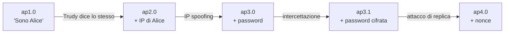
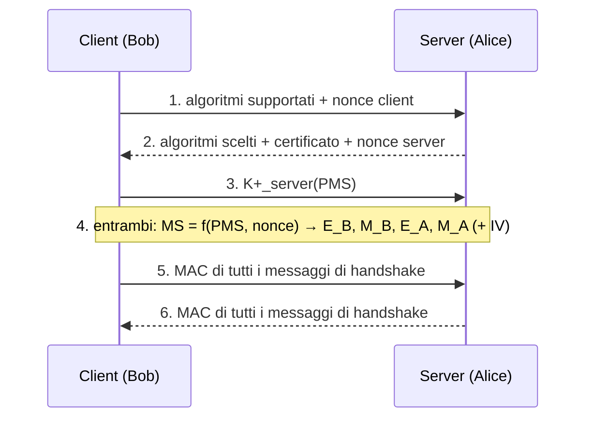

# Sicurezza nelle reti

> [!abstract] Di cosa parla questo capitolo
> Nel [[01 - TLC - Reti di calcolatori e Internet#1.6 Reti sotto attacco|Paragrafo 1.6]] erano stati elencati gli attacchi (DoS, malware, sniffing, spoofing, modifica dei messaggi). Ora, conoscendo tutta la pila, si studia come **comunicare in modo sicuro** e come **difendere** una rete.
> I protagonisti sono **Alice** e **Bob**, che vogliono comunicare in modo sicuro, e **Trudy**, l'intrusa. Alice e Bob possono essere persone, ma anche due router che si scambiano tabelle di instradamento, un client e un server, due applicazioni di posta.
> Il capitolo ha **tre parti**:
> 1. **principi**: crittografia simmetrica e a chiave pubblica (RSA), integrità dei messaggi (hash, MAC, firma digitale, certificati), autenticazione del punto terminale (protocolli *ap*, nonce);
> 2. **protocolli sicuri lungo la pila**, ancora in modo top-down: posta elettronica (**PGP**), trasporto (**SSL/TLS**), rete (**IPsec**, VPN), collegamento (**WEP**, **802.11i**);
> 3. **sicurezza operativa**: **firewall** e **IDS**.
>
> Molti argomenti sono approfonditi nel corso di Cybersecurity (vedi i link nelle sezioni).
> Mappa del corso: [[MOC - Telecomunicazioni]].

> [!info] Fonte
> Kurose, Ross, *Reti di calcolatori e Internet*, 7ª ed., Capitolo 8. Nell'edizione italiana è un capitolo **on-line**, con pagine numerate **O8-1 … O8-67**, che nel PDF corrispondono alle pagine **586 + n** (O8-1 = p. 587 del PDF).

---

## 8.1 Sicurezza di rete

Vedi [[Comunicazione Sicura]] e [[Triade CIA]].

Alice vuole che **solo Bob** capisca il messaggio, anche se il canale non è sicuro e Trudy può intercettare tutto. Bob vuole essere sicuro che il messaggio venga **davvero da Alice**, e viceversa. Entrambi vogliono che il messaggio **non venga alterato** e, soprattutto, **poter comunicare**. Ne derivano le proprietà della **comunicazione sicura**:

| Proprietà | Significato | Dove si studia |
| --- | --- | --- |
| **Riservatezza** | solo mittente e destinatario capiscono il messaggio: il messaggio va **cifrato** perché uno "spione" (*eavesdropper*) non lo capisca | §8.2 |
| **Integrità del messaggio** | il contenuto non è stato alterato, per caso o di proposito; estende le tecniche di checksum | §8.3 |
| **Autenticazione** | ognuna delle due parti conferma l'identità dell'altra, il che a distanza non è banale | §8.4 |
| **Sicurezza operativa** | proteggere le reti delle istituzioni dagli attacchi (worm, furto di segreti, mappatura della rete, DoS) con **firewall** e **IDS** | §8.9 |

![[TLC-p589-1.png]]

**Alice** (mittente sicuro) e **Bob** (ricevente sicuro) si scambiano **messaggi di controllo e dati** su un **canale**, come avviene con TCP. **Trudy** sta sul canale e può:
- **ascoltare e registrare** i messaggi di controllo e dati (*eavesdropping*);
- **rimuovere, aggiungere o modificare** i messaggi o il loro contenuto.

Così può spiare, impersonare qualcun altro, dirottare (*hijack*) una sessione, negare il servizio… Il CERT tiene un elenco degli attacchi segnalati.

Chi ha bisogno di comunicazione sicura? Non solo il consumatore che invia la carta di credito o il cliente della banca, ma anche l'**infrastruttura di rete**: il **DNS** (vedi [[Gerarchia dei DNS Server]]), i router che si scambiano **tabelle di instradamento** (vedi [[Algoritmi di Instradamento]]) e le applicazioni di **gestione della rete** (vedi [[SNMP e Gestione di Rete]]). Chi controlla il DNS o l'instradamento può fare danni enormi.

La **crittografia** è la pietra angolare: serve per la riservatezza, ma anche per l'autenticazione e l'integrità.

_(libro, pp. O8-2 – O8-4)_

---

## 8.2 Principi di crittografia

La crittografia moderna è nata negli ultimi trent'anni, anche se la si fa risalire a Giulio Cesare. Vedi anche [[1 CS  Lower Level -  Introduction|Cybersecurity — Introduzione]].

![[TLC-p591-1.png]]

I **componenti crittografici**:
- **testo in chiaro** (*plaintext*, *cleartext*): il messaggio originale, per esempio "Bob, ti amo. Alice";
- **algoritmo di cifratura**: lo trasforma in **testo cifrato** (*ciphertext*), incomprensibile a chi intercetta;
- **chiave** $K_A$ (la chiave che Alice fornisce all'algoritmo di cifratura) e $K_B$ (quella di Bob per l'algoritmo di decifratura);
- $K_A(m)$ è il testo cifrato di $m$ con la chiave $K_A$; Bob recupera $m$ calcolando $K_B(K_A(m)) = m$.

Gli algoritmi sono spesso **pubblici** e standardizzati (RFC 1321, RFC 3447, RFC 2420, NIST 2001), quindi anche Trudy li conosce: il segreto sta **solo nelle chiavi**. È il principio di Kerckhoffs (vedi [[Kerckhoffs’s principle]]).

| | **Chiave simmetrica** | **Chiave pubblica** |
| --- | --- | --- |
| Chiavi | $K_A = K_B$, identiche e **segrete** | due chiavi: una **pubblica** e una **privata** |

_(libro, p. O8-5)_

### Crittografia a chiave simmetrica

Vedi [[Crittografia a Chiave Simmetrica]] e [[Symmetric Encryption]].

**Cifrario di Cesare.** Ogni lettera viene sostituita da quella che si trova $k$ posizioni più avanti nell'alfabeto, ricominciando da "a" dopo la "z". Con $k = 3$: a→d, c→f. "bob, ti amo, alice." diventa "**ere, wl dpr. dolfh**". La chiave è $k$, che per l'alfabeto inglese ha solo **25** valori possibili, quindi è facilissimo da rompere.

**Cifrario monoalfabetico.** Ogni lettera viene sostituita da un'altra lettera **arbitraria**, sempre la stessa (Figura 8.3):

```text
Lettere in chiaro:  a b c d e f g h i j k l m n o p q r s t u v w x y z
Lettere cifrate:    m n b v c x z a s d f g h j k l p o i u y t r e w q
```

"bob, ti amo, Alice." diventa "**nkn, us mhk. Mgsbc**". Le combinazioni possibili sono $26! \approx 4 \cdot 10^{26}$ (il libro: "dell'ordine di $10^{26}$"), troppe per una forza bruta. Ma l'**analisi statistica** aiuta molto: "e" e "t" sono le lettere più frequenti in inglese (13% e 9%), e in italiano lo sono gruppi come "che", "zione" e "mente". Inoltre l'intrusa può avere informazioni sul contenuto: se Trudy, moglie di Bob, sospetta della relazione con Alice, si aspetta di trovare i nomi "bob" e "alice" e riduce le combinazioni a circa $10^9$.

**Tre scenari di attacco**, a seconda di cosa sa l'intruso:

| Attacco | L'intruso dispone di… |
| --- | --- |
| **Al testo cifrato** (*ciphertext-only*) | solo il testo cifrato; può fare analisi statistica |
| **Con testo in chiaro noto** (*known-plaintext*) | alcune coppie testo in chiaro/testo cifrato (es. sa che compaiono i nomi, quindi conosce le lettere a, b, c, e, i, l, o) |
| **Con testo in chiaro scelto** (*chosen-plaintext*) | può ottenere la cifratura di un messaggio scelto da lui. Con i cifrari semplici, un messaggio con tutte le lettere rompe tutto lo schema |

**Cifratura polialfabetica.** Inventata circa 500 anni fa, usa **più** sostituzioni monoalfabetiche, così la stessa lettera si cifra in modo diverso a seconda della posizione. Esempio con due cifrari di Cesare, $C_1$ ($k = 5$) e $C_2$ ($k = 19$), usati nella sequenza $C_1, C_2, C_2, C_1, C_2$ (Figura 8.4):

```text
Lettere in chiaro: a b c d e f g h i j k l m n o p q r s t u v w x y z
C1 (k = 5):        f g h i j k l m n o p q r s t u v w x y z a b c d e
C2 (k = 19):       t u v w x y z a b c d e f g h i j k l m n o p q r s
```

"Bob, ti amo." diventa "**ghu, mn trh**": la prima "b" di "Bob" è cifrata con $C_1$ ("g"), la seconda con $C_2$ ("u"). La chiave è data dalle due chiavi di Cesare **e** dalla sequenza.

_(libro, pp. O8-6 – O8-7)_

#### Cifrari a blocchi

Vedi [[Cifrari a Blocchi e CBC]], [[Block Cipher]] e [[3 CS  Lower Level - Block Ciphers|Cybersecurity — Block Ciphers]].

Le cifrature simmetriche moderne sono di due classi: **cifrari a flusso** (vedi [[Stream Cipher]] e il WEP, §8.8) e **cifrari a blocchi**, usati in PGP, SSL e IPsec.

Il messaggio è diviso in **blocchi di $k$ bit** (es. $k = 64$), cifrati indipendentemente con una corrispondenza **uno a uno** tra blocchi in chiaro e blocchi cifrati.

**Tabella 8.1 — Cifrario a blocchi di 3 bit:**

| Ingresso | Uscita | Ingresso | Uscita |
| --- | --- | --- | --- |
| 000 | 110 | 100 | 011 |
| 001 | 111 | 101 | 010 |
| 010 | 101 | 110 | 000 |
| 011 | 100 | 111 | 001 |

Esempio: `010 110 001 111` → `101 000 111 001` (verificato sulla tabella).

- Una corrispondenza è una **permutazione** dei $2^k$ ingressi. Con $k = 3$ ci sono $2^3 = 8$ ingressi e $8! = 40.320$ corrispondenze possibili, cioè 40.320 chiavi: una forza bruta su PC è immediata.
- Con blocchi di $k$ bit le corrispondenze sono $(2^k)!$, un numero astronomico già per $k = 64$.
- Una **tabella completa** con $2^{64}$ righe però è impossibile da gestire, e andrebbe rigenerata a ogni cambio di chiave. Per questo si usano **funzioni** che simulano in modo casuale tabelle permutate.

![[TLC-p595-1.png]]

L'esempio di funzione (adattato da Kaufman 1995) con $k = 64$:
1. il blocco di **64 bit** viene diviso in **8 parti da 8 bit**;
2. ogni parte passa per una tabella **8 × 8** ($T_1 \dots T_8$), più gestibile;
3. le 8 uscite vengono riassemblate e **mescolate** da un **permutatore a 64 bit**;
4. il risultato torna in ingresso e si ripete per **$n$ iterazioni**.

Le iterazioni fanno sì che **ogni bit d'ingresso influenzi molti, se non tutti, i bit in uscita**: con un solo giro un bit influenzerebbe solo 8 bit su 64. La **chiave** è costituita dalle 8 tabelle, se la funzione di mescolamento è fissa.

**Cifrari reali:**

| Cifrario | Blocco | Chiave |
| --- | --- | --- |
| **DES** (*data encryption standard*) | 64 bit | 56 bit |
| **3DES** | 64 bit | — |
| **AES** (*advanced encryption standard*) | 128 bit | 128, 192 o 256 bit |

Con una chiave di $n$ bit ci sono $2^n$ chiavi. Il NIST stima che una macchina capace di rompere il DES in un secondo (provando tutte le $2^{56}$ chiavi) impiegherebbe circa **149 trilioni di anni** per AES a 128 bit. Vedi [[DES]], [[3DES]] e [[AES]].

#### Cifrari a blocchi concatenati (CBC)

Vedi [[CBC]].

Il problema: due blocchi in chiaro identici (per esempio "HTTP/1.1") producono **lo stesso** blocco cifrato. Un attaccante che conosce il protocollo può indovinare il testo e, sfruttando la struttura dei protocolli, decifrare tutto il messaggio.

**Prima idea: un numero casuale per ogni blocco.** Indicando con $m(i)$ l'$i$-esimo blocco in chiaro, $c(i)$ quello cifrato, $\oplus$ l'XOR e $K_S$ il cifrario:
- il mittente genera $r(i)$ casuale e calcola $c(i) = K_S(m(i) \oplus r(i))$;
- invia $c(1), r(1), c(2), r(2), \dots$;
- il ricevente calcola $m(i) = K_S(c(i)) \oplus r(i)$. Trudy vede $r(i)$ in chiaro, ma senza $K_S$ non ottiene $m(i)$.

> [!example] Esempio con il cifrario della Tabella 8.1
> Testo: `010 010 010`.
> - **Senza casualità**: `101 101 101`. Trudy vede tre blocchi uguali e capisce che anche quelli in chiaro lo sono.
> - **Con $r(1) = 001$, $r(2) = 111$, $r(3) = 100$**:
>   - $c(1) = K_S(010 \oplus 001) = K_S(011) = 100$;
>   - $c(2) = K_S(010 \oplus 111) = K_S(101) = 010$;
>   - $c(3) = K_S(010 \oplus 100) = K_S(110) = 000$.
>
> I tre blocchi cifrati sono **diversi**. (Conti verificati.) Il problema è che si trasmettono il doppio dei bit, perché va inviato anche $r(i)$.

**Cipher block chaining (CBC).** Si invia **un solo** valore casuale all'inizio, e poi si usa come "numero casuale" il **blocco cifrato precedente**:
1. il mittente genera un **vettore di inizializzazione** (IV) $c(0)$ di $k$ bit e lo invia **in chiaro**;
2. $c(1) = K_S(m(1) \oplus c(0))$;
3. $c(i) = K_S(m(i) \oplus c(i-1))$.

Il ricevente decifra $c(i)$, ottiene $s(i) = m(i) \oplus c(i-1)$ e, conoscendo $c(i-1)$, ricava $m(i) = s(i) \oplus c(i-1)$. Blocchi in chiaro uguali producono quasi sempre blocchi cifrati diversi, e l'overhead è un solo blocco in più.

> [!example] CBC con il cifrario della Tabella 8.1
> Testo `010 010 010`, IV $c(0) = 001$:
> - $c(1) = K_S(010 \oplus 001) = K_S(011) = 100$
> - $c(2) = K_S(010 \oplus 100) = K_S(110) = 000$
> - $c(3) = K_S(010 \oplus 000) = K_S(010) = 101$
>
> (Conti verificati.) Per decifrare servono IV e $K_S$. CBC impone ai protocolli di prevedere un meccanismo per **distribuire l'IV**: lo si ritrova in SSL e IPsec.

_(libro, pp. O8-8 – O8-11)_

### Crittografia a chiave pubblica

Vedi [[Crittografia a Chiave Pubblica]], [[Asymmetric Encryption]] e [[7 CS  Lower Level - Asymmetric encryption|Cybersecurity — Asymmetric encryption]].

Per oltre 2000 anni comunicare in modo cifrato ha richiesto di condividere prima una **chiave segreta**, accordandosi di persona o su un canale sicuro: due centurioni potevano darsi appuntamento alle terme. In rete però le parti potrebbero non incontrarsi mai. Nel **1976** Diffie e Hellman proposero lo **scambio di chiave di Diffie-Hellman**, base della crittografia a chiave pubblica moderna (idee simili erano state sviluppate in segreto nei primi anni '70 dal CESG britannico). Vedi [[RSA vs Diffie-Hellman Key Exchange]].

![[TLC-p598-1.png]]

Bob ha **due chiavi**: una **pubblica** $K_B^+$, nota a tutti (Trudy compresa), e una **privata** $K_B^-$, che conosce solo lui.
- Alice cifra con la chiave pubblica di Bob: $K_B^+(m)$.
- Bob decifra con la sua chiave privata: $K_B^-(K_B^+(m)) = m$.
- Funziona anche **invertendo** l'ordine: $K_B^-(K_B^+(m)) = K_B^+(K_B^-(m)) = m$. Questa proprietà serve per la firma digitale.

Due obiezioni:
1. Trudy conosce la chiave pubblica e l'algoritmo, quindi può fare un **attacco con testo in chiaro scelto**. Le chiavi vanno scelte in modo che sia praticamente impossibile ricavare la chiave privata o decifrare.
2. Chiunque può cifrare con la chiave pubblica di Bob **fingendosi Alice**: con la chiave simmetrica condivisa, invece, conoscere la chiave era una prova implicita d'identità. Serve quindi la **firma digitale** (§8.3).

_(libro, pp. O8-12 – O8-13)_

#### RSA

Vedi [[Algoritmo RSA]] e la nota [[RSA]] di Cybersecurity.

**RSA** (Rivest, Shamir, Adleman) è praticamente sinonimo di crittografia a chiave pubblica. Si basa sull'**aritmetica modulare**: $x \bmod n$ è il resto della divisione di $x$ per $n$ (es. $19 \bmod 5 = 4$).

$$[(a \bmod n) + (b \bmod n)] \bmod n = (a + b) \bmod n$$
$$[(a \bmod n) - (b \bmod n)] \bmod n = (a - b) \bmod n$$
$$[(a \bmod n) \cdot (b \bmod n)] \bmod n = (a \cdot b) \bmod n$$

e quindi $(a \bmod n)^d \bmod n = a^d \bmod n$.

Un messaggio è una sequenza di bit, cioè un numero intero (es. `1001` = 9): cifrare un messaggio significa cifrare un numero.

**Generazione delle chiavi (Bob):**
1. sceglie due **numeri primi grandi** $p$ e $q$: gli RSA Laboratories raccomandano che $pq$ sia dell'ordine dei 1024 bit;
2. calcola $n = pq$ e $z = (p-1)(q-1)$;
3. sceglie $e$ < $n$, diverso da 1 e **relativamente primo** con $z$ (senza divisori comuni);
4. trova $d$ tale che $ed - 1$ sia divisibile per $z$, cioè $ed \bmod z = 1$;
5. la **chiave pubblica** è $K_B^+ = (n, e)$, la **privata** è $K_B^- = (n, d)$.

**Cifratura e decifratura:**

$$c = m^e \bmod n \qquad m = c^d \bmod n \qquad (m < n)$$

**Esempio.** $p = 5$, $q = 7$, quindi $n = 35$ e $z = 24$; $e = 5$ (5 e 24 non hanno divisori comuni); $d = 29$, perché $5 \cdot 29 - 1 = 144$ è divisibile per 24. Bob pubblica $(35, 5)$ e tiene segreto $d = 29$. Alice cifra le lettere "l", "o", "v", "e" come numeri da 1 a 26.

**Tabella 8.2 — Codifica di Alice** ($e = 5$, $n = 35$):

| Lettera | $m$ | $m^e$ | $c = m^e \bmod n$ |
| --- | --- | --- | --- |
| l | 12 | 248832 | 17 |
| o | 15 | 759375 | 15 |
| v | 22 | 5153632 | 22 |
| e | 5 | 3125 | 10 |

**Tabella 8.3 — Decodifica di Bob** ($d = 29$, $n = 35$):

| $c$ | $c^d$ | $m = c^d \bmod n$ | Lettera |
| --- | --- | --- | --- |
| 17 | 481968572106750915091411825223071697 | 12 | l |
| 15 | 12783403948858939111232757568359375 | 15 | o |
| 22 | 851643319086537701956194499721106030592 | 22 | v |
| 10 | 100000000000000000000000000000 | 5 | e |

(Ho ricalcolato tutte le cifrature e decifrature, e tornano, compresi i valori esatti di $c^d$.)

Nell'esempio ogni lettera è un messaggio distinto. In un caso più realistico le quattro lettere diventerebbero 32 bit ASCII cifrati come un unico intero.

> [!note] Un piccolo dettaglio dell'esempio
> 15 e 22 risultano cifrati in **se stessi** ($15^5 \bmod 35 = 15$, $22^5 \bmod 35 = 22$): con numeri così piccoli capita spesso. È un altro motivo per cui $p$ e $q$ devono essere enormi.

**Chiavi di sessione.** L'elevamento a potenza di RSA è lento: DES è almeno **100 volte** più veloce in software, e **1000–10.000 volte** in hardware. In pratica RSA si usa **insieme** alla crittografia simmetrica:
1. Alice sceglie una **chiave di sessione** $K_S$ simmetrica (per DES o AES);
2. la cifra con la chiave pubblica di Bob, $c = (K_S)^e \bmod n$, e gliela invia;
3. Bob la decifra con la sua chiave privata e poi i due usano $K_S$ per i dati.

È la **cifratura ibrida** (vedi [[Hybrid Encryption]]).

**Perché RSA funziona.** Si vuole mostrare che $(m^e \bmod n)^d \bmod n = m$. Per la proprietà modulare il primo membro vale $m^{ed} \bmod n$. Un teorema della teoria dei numeri dice che, se $p$ e $q$ sono primi, $n = pq$ e $z = (p-1)(q-1)$, allora $x^y \bmod n = x^{(y \bmod z)} \bmod n$. Quindi

$$(m^e)^d \bmod n = m^{(ed \bmod z)} \bmod n = m^1 \bmod n = m$$

perché $ed \bmod z = 1$. Lo stesso vale invertendo l'ordine: $(m^d \bmod n)^e \bmod n = m^{de} \bmod n = m$.

La **sicurezza** di RSA si basa sul fatto che non si conoscono algoritmi veloci per **fattorizzare** $n$ in $p$ e $q$ (vedi [[Problema della Fattorizzazione]]); con $p$ e $q$, dal valore pubblico $e$ si ricaverebbe subito $d$. Non è dimostrato che un algoritmo veloce non esista, quindi la sicurezza di RSA **non è garantita**. **Diffie-Hellman** è meno versatile, perché non cifra messaggi di lunghezza arbitraria, ma può stabilire una chiave simmetrica condivisa (vedi [[Ephemeral DH (DHE)]]).

_(libro, pp. O8-13 – O8-17)_

---

## 8.3 Integrità dei messaggi e firma digitale

Vedi [[4 CS  Lower Level - Data Integrity - MAC, attacks and SHA-1|Cybersecurity — Data Integrity]].

L'**integrità dei messaggi**, detta anche **autenticazione dei messaggi**, richiede che Bob verifichi due cose:
1. che il messaggio sia stato **originato da Alice**;
2. che non sia stato **alterato** lungo il percorso.

Esempio: in un instradamento **link-state** come OSPF (vedi [[OSPF]]) ogni router diffonde lo stato dei suoi collegamenti. Un attaccante potrebbe distribuire **messaggi di stato fasulli** con informazioni sbagliate. Il router B deve poter verificare che il messaggio sia stato creato proprio da A e che nessuno l'abbia modificato.

### Funzioni hash crittografiche

Vedi [[Funzioni Hash Crittografiche]] e [[Hashing]].

![[TLC-p604-1.png]]

Una **funzione hash** prende un ingresso $m$ di lunghezza qualsiasi (la lettera "MOLTO lunga" di Bob) e calcola una stringa di **lunghezza fissa**, l'hash $H(m)$. È una funzione **da molti a uno**. Il checksum Internet e il CRC sono funzioni hash, ma una **funzione hash crittografica** deve avere in più questa proprietà:

> [!important] Resistenza alle collisioni
> Deve essere **computazionalmente impossibile** trovare due messaggi diversi $x$ e $y$ con $H(x) = H(y)$.
> Data la coppia $(m, H(m))$ del mittente, l'intruso non può costruire un altro messaggio $y$ con lo stesso hash. Vedi [[Differenza strong e weak collision resistant]].

**Il checksum Internet non basta.** Esempio con blocchi di 4 caratteri sommati come byte (Figura 8.8). Bob deve ad Alice 100,99 dollari e le invia "IOU100.99BOB" ("I owe you", "Io ti devo"):

```text
Messaggio   ASCII            Messaggio   ASCII
I O U 1     49 4F 55 31      I O U 9     49 4F 55 39
0 0 . 9     30 30 2E 39      0 0 . 1     30 30 2E 31
9 B O B     39 42 4F 42      9 B O B     39 42 4F 42
            -----------                  -----------
Checksum    B2 C1 D2 AC      Checksum    B2 C1 D2 AC
```

"IOU**9**00.**1**9BOB", cioè 900,19 dollari, ha lo **stesso checksum** `B2 C1 D2 AC` (verificato: le colonne sommano a B2, C1, D2, AC). Trovare un altro messaggio con lo stesso checksum è banale.

**Funzioni hash usate:**
- **MD5** (Rivest, RFC 1321): hash di **128 bit**, in quattro fasi (padding con un 1 e poi 0, aggiunta della lunghezza a 64 bit, inizializzazione di un accumulatore, elaborazione dei blocchi da 16 parole di 32 bit in quattro cicli);
- **SHA-1** (*secure hash algorithm*, FIPS 1995): hash di **160 bit**, standard federale USA, più sicuro grazie alla maggiore lunghezza.

Vedi [[MD5]] e [[SHA-1]].

_(libro, pp. O8-17 – O8-19)_

### Codice di autenticazione dei messaggi (MAC)

Vedi [[Codice di Autenticazione del Messaggio]], [[MAC]] e [[HMAC]].

**Primo tentativo (sbagliato).** Alice calcola $h = H(m)$ e invia $(m, h)$; Bob verifica che $H(m) = h$. Ma Trudy può creare un messaggio falso $m'$, dire di essere Alice e inviare $(m', H(m'))$: Bob non si accorge di nulla.

**Soluzione: un segreto condiviso.** Alice e Bob condividono una stringa di bit $s$, la **chiave di autenticazione**:
1. Alice calcola $H(m + s)$, cioè l'hash di $m$ concatenato con $s$: è il **codice di autenticazione del messaggio** (**MAC**, *message authentication code*);
2. invia il messaggio esteso $(m, H(m + s))$;
3. Bob, conoscendo $s$, calcola $H(m + s)$ e lo confronta con il MAC ricevuto.

![[TLC-p606-1.png]]

A sinistra il mittente concatena $m$ e $s$, calcola $H(\cdot)$ e invia $m$ insieme a $H(m+s)$ su Internet. A destra il ricevente ricalcola $H(m+s)$ con il proprio $s$ e **confronta** i due valori.

- Il "MAC" qui (*Message Authentication Code*) **non è** il MAC del livello di collegamento (*Medium Access Control*, vedi [[Protocolli di Accesso Multiplo]]).
- Il MAC **non richiede cifratura**. In molte applicazioni, come l'instradamento link-state, interessa solo l'integrità, non la riservatezza.
- Lo standard più comune è **HMAC** (RFC 2104), che si usa con MD5 o SHA-1 e applica l'hash **due volte** ai dati e alla chiave (vedi [[opad e ipad]]).
- **Distribuire la chiave**: un amministratore può configurarla a mano su ogni router, oppure cifrarla con la chiave pubblica di ciascun router e inviarla via rete.

_(libro, pp. O8-19 – O8-21)_

### Firme digitali

Vedi [[Firma Digitale]] e [[9 CS Lower Level - ElGamal and Digital Signature Standard (DSS)|Cybersecurity — DSS]].

Come la firma a mano su assegni e atti, la **firma digitale** indica il titolare o il creatore di un documento, o il suo accordo con il contenuto. Deve essere:
- **verificabile**: si deve poter dimostrare che il documento è stato firmato da quella persona;
- **non falsificabile**: solo lei poteva firmarlo.

Un MAC non va bene: Bob firmerebbe con un segreto che **anche Alice** conosce, perché lei deve poterlo verificare, quindi la chiave non è unica per Bob. La **chiave privata**, invece, è unica.

![[TLC-p608-1.png]]

Bob firma il documento $m$ calcolando $K_B^-(m)$ con la propria **chiave privata**. Sembra strano usare per "firmare" un'operazione che prima serviva a decifrare, ma si tratta solo di elevamenti a potenza: l'obiettivo qui non è nascondere il contenuto, ma renderlo verificabile e non falsificabile.

**Verifica.** Alice (o un giudice) ha $m$ e $K_B^-(m)$, applica la chiave pubblica di Bob e controlla che $K_B^+(K_B^-(m)) = m$. Solo Bob può aver firmato:
- chi ha firmato ha usato $K_B^-$, visto che $K_B^+(K_B^-(m)) = m$;
- se Bob non ha ceduto né perso la chiave privata, solo lui la conosce, e la chiave pubblica non aiuta a scoprirla.

La firma vale **solo** per $m$: per un altro messaggio $m'$, $K_B^+(K_B^-(m')) \ne m'$. La firma garantisce quindi anche l'**integrità**.

**Firma dell'hash.** Cifrare tutto il messaggio con la chiave privata è costoso, quindi si firma la sua "impronta digitale" $H(m)$, che è molto più corta: $K_B^-(H(m))$.

![[TLC-p609-1.png]]

**Invio di un messaggio firmato**: il messaggio completo passa per la **funzione hash** e il risultato viene cifrato con la **chiave privata di Bob**, ottenendo l'**hash firmato**. Messaggio in chiaro e hash firmato (la **firma digitale**) vengono inviati ad Alice.

![[TLC-p610-1.png]]

**Verifica dell'integrità**: Alice applica la **chiave pubblica di Bob** all'hash firmato e ottiene la sintesi; poi calcola l'hash del messaggio in chiaro. Se le due sintesi **coincidono**, il messaggio è integro e viene da Bob.

| | **MAC** | **Firma digitale** |
| --- | --- | --- |
| Come si crea | hash di messaggio + chiave di autenticazione | hash del messaggio, cifrato con la chiave **privata** |
| Crittografia | nessuna, né simmetrica né a chiave pubblica | a chiave pubblica |
| Infrastruttura | una chiave condivisa | **PKI** (*public key infrastructure*) con autorità di certificazione |
| Usata in | OSPF, SSL, IPsec | PGP, certificati |

Vedi [[PKI]].

_(libro, pp. O8-21 – O8-24)_

#### Certificazione della chiave pubblica

Vedi [[Certificazione della Chiave Pubblica]] e [[Certification Authority (CA)]].

La **certificazione della chiave pubblica** attesta che una chiave pubblica appartiene a una certa entità. Si usa in IPsec e SSL.

**Esempio della pizza.** Alice consegna pizze e accetta ordini via Internet. Bob ordina con un messaggio in chiaro e una firma digitale; Alice verifica la firma con la chiave pubblica di Bob, presa da un server di chiavi o dalla mail.

![[TLC-p611-1.png]]

Trudy fa uno scherzo: invia "Alice, mandami una pizza. Bob", con l'indirizzo di Bob, firma l'hash con la **sua** chiave privata e allega la **sua** chiave pubblica dicendo che è quella di Bob. Alice verifica la firma con la chiave pubblica di Trudy, crede che il messaggio venga da Bob e la pizza arriva a Bob ("???"). Alice deve quindi essere **sicura** che la chiave pubblica sia davvero di Bob.

L'associazione tra chiave pubblica ed entità la stabilisce un'**autorità di certificazione** (**CA**):
1. **verifica** che l'entità (persona, router…) sia chi dice di essere. Non esistono procedure standard: ci si può fidare di una chiave certificata solo se ci si fida della CA. Se Trudy ottenesse da "Fly-By-Night" un certificato come "Alice", quella CA non varrebbe nulla;
2. emette un **certificato** che lega la chiave pubblica all'entità e contiene le informazioni d'identificazione (nome, IP…), **firmato digitalmente dalla CA**.

![[TLC-p612-1.png]]

Bob invia $(K_B^+, B)$ alla CA, che con la propria **chiave privata** $K_{CA}^-$ produce il **certificato di Bob**, che contiene $K_B^+$. Quando Alice riceve l'ordine, recupera il certificato di Bob e verifica con la chiave **pubblica** della CA che la chiave pubblica di Bob sia autentica.

> [!warning] Un refuso nella Figura 8.14
> Nella figura l'etichetta sopra la chiave della CA dice "Chiave **pubblica** della CA, $K_{CA}^-$", ma il simbolo con il "−" è la chiave **privata**: per firmare un certificato la CA usa la propria chiave privata. Vedi anche la domanda R14 del libro (il certificato è firmato, non cifrato con la chiave pubblica).

Gli standard sono **ITU X.509** (servizio di autenticazione e sintassi dei certificati) e **RFC 1422** (gestione delle chiavi basata su CA per la posta, compatibile con X.509).

**Tabella 8.4 — Campi di un certificato X.509 / RFC 1422:**

| Campo | Descrizione |
| --- | --- |
| Versione | versione della specifica X.509 |
| Numero seriale | identificatore unico del certificato, dato dalla CA |
| Firma | algoritmo usato dalla CA per firmare il certificato |
| Nome dell'emittente | identificativo della CA, in formato DN (RFC 4514) |
| Periodo di validità | inizio e fine della validità |
| Nome del soggetto | identificativo dell'entità a cui è associata la chiave (formato DN) |
| Chiave pubblica del soggetto | la chiave e l'algoritmo da usare |

_(libro, pp. O8-24 – O8-27)_

---

## 8.4 Autenticazione di un punto terminale

Vedi [[Protocolli di Autenticazione ap]] e [[10 CS Lower Level - Authentication - Introduction and Attacker Models|Cybersecurity — Authentication]].

L'**autenticazione di un punto terminale** (*end-point authentication*) è il processo con cui un'entità **prova la propria identità** a un'altra **durante** una comunicazione, come quando si riconosce un amico dalla voce o si mostra la carta d'identità. È diverso dal provare che un messaggio ricevuto è stato inviato da qualcuno, che è il compito della firma digitale.

In rete non ci sono informazioni biometriche: l'autenticazione si basa solo su **messaggi** scambiati in un **protocollo di autenticazione**, che di solito viene **prima** di qualsiasi altro protocollo. Come per [[Trasferimento Dati Affidabile|rdt]], il libro costruisce il protocollo **ap** (*authentication protocol*) per versioni successive. Alice deve autenticarsi con Bob.



### ap1.0

![[TLC-p614-1.png]]

Alice dice semplicemente "**Sono Alice**". Ovviamente anche Trudy può farlo (a destra), e Bob non può distinguere.

### ap2.0

![[TLC-p615-1.png]]

Alice invia "Sono Alice" più il suo **indirizzo IP** noto, e Bob controlla che l'IP sorgente del datagramma corrisponda. Ma creare un datagramma con un **indirizzo sorgente falso** non è difficile per chi può modificare il kernel (es. Linux): è l'**IP spoofing** (vedi [[Attacchi alle Reti]]). Si potrebbe evitare se il router del primo hop inoltrasse solo i datagrammi con l'IP sorgente corretto (RFC 2827), ma questa funzione non è né universale né obbligatoria.

### ap3.0

![[TLC-p615-2.png]]

Alice invia "Sono Alice" più la **password**, un segreto condiviso; Bob risponde "OK". È lo schema di Gmail, Facebook, Telnet e FTP. Ma Trudy può **intercettare e registrare** (il "registratore" in figura) la password e riusarla. Con Telnet la password viaggia in chiaro, e chiunque sia sulla LAN può catturarla (vedi [[12 CS Lower Level - Password Authentication|Cybersecurity — Password Authentication]]).

### ap3.1

Alice **cifra** la password con una chiave simmetrica $K_{A-B}$ condivisa con Bob. Trudy non scopre la password, ma resta l'**attacco di replica** (*playback attack*): Trudy registra il messaggio cifrato e lo **ripete** più tardi a Bob fingendosi Alice. È la stessa situazione di ap3.0.

### ap4.0: il nonce

Vedi [[Nonce]].

Il problema è che Bob non distingue un'autenticazione **attuale** da una **registrata**. È lo stesso problema del [[Gestione della Connessione TCP|three-way handshake]]: il server non accetta un SYN che sia la copia di uno vecchio, perché sceglie un numero di sequenza iniziale non usato da tempo.

Un **nonce** (*number used once*) è un numero che il protocollo usa **una sola volta**:
1. Alice invia "Sono Alice";
2. Bob sceglie un nonce $R$ e lo invia ad Alice;
3. Alice lo cifra con la chiave segreta condivisa e rimanda $K_{A-B}(R)$;
4. Bob decifra: se ottiene il suo nonce, Alice è autenticata.

![[TLC-p617-1.png]]

Bob è sicuro che sia Alice, perché conosce $K_{A-B}$, e che sia **viva** ora, perché ha cifrato il nonce che lui ha appena creato. Si potrebbe fare lo stesso con la crittografia a chiave pubblica, evitando di dover condividere prima la chiave segreta: è un problema di fine capitolo (vedi [[13 CS Lower Level - Authentication based on public keys|Cybersecurity — Authentication based on public keys]]).

_(libro, pp. O8-27 – O8-31)_

---

## 8.5 Rendere sicura la posta elettronica

Si può dare sicurezza a **ognuno** dei quattro livelli superiori:
- a livello di **applicazione**, ne beneficia l'applicazione che usa quel protocollo;
- a livello di **trasporto**, tutte le applicazioni che usano quel trasporto;
- a livello di **rete**, tutti i segmenti, e quindi tutti i dati;
- a livello di **collegamento**, tutti i frame sul collegamento.

Il libro segue il top-down: posta elettronica → SSL → IPsec → 802.11.

**Perché la sicurezza a più livelli e non solo a quello di rete?**
1. La sicurezza di rete cifra i datagrammi e autentica gli IP sorgente, ma **non a livello utente**: un sito di e-commerce non può autenticare un cliente con IPsec.
2. È più facile sviluppare nuovi servizi ai livelli alti. Finché la sicurezza di rete non sarà diffusa, le applicazioni la implementano da sé: per esempio **PGP**.

### E-mail sicure

Vedi [[Posta Elettronica Sicura e PGP]].

Il libro costruisce il progetto passo per passo. Alice vuole inviare un'e-mail a Bob, e Trudy vuole intromettersi. Le proprietà richieste sono:
- **riservatezza**: Trudy non deve leggere la mail;
- **autenticazione del mittente**: se Bob riceve "Non ti amo più. Non voglio rivederti. La tua ex, Alice", vuole essere sicuro che sia davvero Alice;
- **integrità**: il messaggio non è stato modificato;
- **autenticazione del ricevente**: Alice vuole essere sicura di scrivere davvero a Bob.

**Riservatezza.** Cifrare con una chiave simmetrica (DES o AES) è semplice, ma è difficile distribuire la chiave. La chiave pubblica di Bob (RSA) risolve la distribuzione, ma è **inefficiente** per messaggi lunghi. Si usa allora una **chiave di sessione**:

![[TLC-p619-1.png]]

Alice:
1. sceglie una chiave simmetrica $K_S$;
2. cifra il messaggio con $K_S$, ottenendo $K_S(m)$;
3. cifra $K_S$ con la chiave pubblica di Bob, ottenendo $K_B^+(K_S)$;
4. concatena le due cose in un "pacco" (il "+" cerchiato indica la concatenazione);
5. lo invia.

Bob separa le parti (il "−" cerchiato), recupera $K_S$ con la propria **chiave privata** $K_B^-$ e decifra $m$.

**Autenticazione del mittente e integrità.**

![[TLC-p620-1.png]]

Alice calcola $H(m)$ (per esempio con MD5), lo firma con la **propria chiave privata** $K_A^-(H(m))$ e lo invia insieme al messaggio in chiaro. Bob applica la **chiave pubblica di Alice** alla firma e confronta il risultato con l'hash che calcola lui sul messaggio.

**Tutto insieme.**

![[TLC-p620-2.png]]

Alice concatena $m$ e $K_A^-(H(m))$, cifra il tutto con $K_S$, aggiunge $K_B^+(K_S)$ e invia verso Internet. Bob applica prima lo schema della riservatezza e poi quello della firma. Si ottengono così **riservatezza, autenticazione del mittente e integrità**.

Alice usa la crittografia a chiave pubblica **due volte**: con la propria chiave privata per la firma e con la chiave pubblica di Bob per la chiave di sessione. Bob la usa due volte in modo speculare. Resta il problema di **distribuire le chiavi pubbliche**: Trudy potrebbe spacciarsi per Bob e dare ad Alice la propria chiave pubblica. La soluzione è la **certificazione** tramite CA.

_(libro, pp. O8-31 – O8-35)_

### PGP

Vedi [[PGP]] (Cybersecurity).

**PGP** (*pretty good privacy*), scritto da **Philip R. Zimmermann** nel 1991, è diventato lo standard *de facto* per la posta cifrata. L'architettura è quella della figura precedente. A seconda della versione usa:
- **MD5 o SHA** per la sintesi;
- **CAST, triple-DES o IDEA** per la crittografia simmetrica;
- **RSA** per la crittografia a chiave pubblica.

PGP crea una **coppia di chiavi**: la pubblica si pubblica sul sito dell'utente o su un server di chiavi, la privata è protetta da una password. L'utente può firmare, cifrare o fare entrambe le cose.

**Messaggio PGP firmato** (Figura 8.22): il testo è in chiaro e la firma è $K_A^-(H(m))$.

```text
---BEGIN PGP SIGNED MESSAGE---
Hash: SHA1
Bob:
Possiamo vederci stasera?
Appassionatamente tua, Alice
---BEGIN PGP SIGNATURE---
Version: PGP for Personal Privacy 5.0
Charset: noconv
yhHJRHhGJGhgg/12EpJ+lo8gE4vB3mqJhFEvZP9t6n7G6m5Gw2
---END PGP SIGNATURE---
```

**Messaggio PGP segreto** (Figura 8.23): non contiene testo in chiaro.

```text
---BEGIN PGP MESSAGE---
Version: PGP for Personal Privacy 5.0
u2R4d+/jKmn8Bc5+hgDsqAewsDfrGdszX68liKm5F6Gc4sDfcXyt
RfdS10juHgbcfDssWe7/K=lKhnMikLo0+1/BvcX4t==Ujk9PbcD4
Thdf2awQfgHbnmKlok8iy6gThlp
---END PGP MESSAGE---
```

Se servono sia riservatezza sia integrità, il messaggio segreto contiene un messaggio firmato.

**Rete di fiducia.** PGP certifica le chiavi pubbliche in modo diverso dalle CA: Alice può certificare qualsiasi coppia chiave/utente di cui è sicura, e può dichiarare di fidarsi di un altro utente per certificare altre chiavi. Gli utenti si scambiano e firmano a vicenda le chiavi (vedi [[Web of Trust (WoT)]]).

_(libro, pp. O8-35 – O8-36)_

---

## 8.6 Rendere sicure le connessioni TCP: SSL

Vedi [[Protocollo SSL]], [[SSL]], [[TLS]] e [[15 CS Lower Level - TLS and IPSec|Cybersecurity — TLS and IPSec]].

**SSL** (*secure sockets layer*) arricchisce TCP con **riservatezza, integrità dei dati e autenticazione** del server (e del client). Una versione leggermente modificata di SSLv3, **TLS** (*transport layer security*), è standardizzata dall'IETF (RFC 4346). È nato da Netscape ed è usato da tutti i browser, i web server e i siti di commercio elettronico (Amazon, eBay, TaoBao); quando l'URL inizia con **https** si sta usando SSL. Vedi [[HTTPS]].

**Esempio.** Bob compra profumi sul sito di Alice Incorporated e inserisce il numero della carta di credito. Senza protezioni:
- senza **riservatezza** un intruso legge la carta e fa acquisti a spese di Bob;
- senza **integrità** può modificare l'ordine, per esempio 10 volte più bottiglie;
- senza **autenticazione del server** un sito di Trudy con il logo di Alice Incorporated incassa i soldi, ruba i dati e sparisce.

![[TLC-p623-1.png]]

SSL offre un'API simile a quella delle socket TCP (vedi [[Socket UDP e TCP in Python]]). Tecnicamente **risiede nel livello applicativo** (sotto-livello SSL + socket SSL sopra la socket TCP), ma per lo sviluppatore è un **protocollo di trasporto** che offre TCP più i servizi di sicurezza.

### Quadro generale ("quasi-SSL")

Il libro descrive prima una versione semplificata, **quasi-SSL**, in tre fasi: **handshake**, **derivazione delle chiavi**, **trasferimento dati**. Bob è il client, Alice il server con chiavi e certificato.

#### Handshake

![[TLC-p624-1.png]]

Bob deve:
- **(a)** stabilire una **connessione TCP** con Alice (TCP SYN, SYNACK, ACK);
- **(b)** verificare che Alice sia davvero Alice: invia un **SSL hello**, e Alice risponde con il proprio **certificato**, che contiene la sua chiave pubblica. Il certificato è garantito da una CA;
- **(c)** inviarle una chiave segreta principale. Bob genera un **master secret** (**MS**), lo cifra con la chiave pubblica di Alice, ottenendo l'**EMS** (*encrypted master secret*) $= K_A^+(MS)$, e lo invia; Alice lo decifra con $K_A^-$.

Ora Bob ha autenticato Alice, ed entrambi, ma nessun altro, conoscono il MS.

#### Derivazione delle chiavi

Per sicurezza conviene usare chiavi **diverse** per cifratura e integrità e per le due direzioni. Dal MS si ricavano **4 chiavi**:
- $E_B$: chiave di **cifratura** per i dati da Bob ad Alice;
- $M_B$: chiave **MAC** per i dati da Bob ad Alice;
- $E_A$: chiave di cifratura per i dati da Alice a Bob;
- $M_A$: chiave MAC per i dati da Alice a Bob.

In quasi-SSL basta dividere il MS in quattro parti; in SSL reale è un po' più complicato.

#### Trasferimento dati

TCP è un **flusso di byte**: se si cifrasse "al volo", dove si metterebbe il MAC? Alla fine della sessione sarebbe troppo tardi. SSL divide il flusso in **record**:
1. al record si aggiunge un **MAC**, calcolato con l'hash dei dati del record e della chiave $M_B$;
2. record + MAC vengono cifrati con $E_B$;
3. il risultato passa a TCP.

**Attacco man-in-the-middle sui segmenti.** Trudy può inserire, cancellare o sostituire segmenti TCP, per esempio **invertire** l'ordine di due segmenti, sistemando i numeri di sequenza TCP, che non sono cifrati. Alice:
1. accetta i segmenti in TCP, perché tutto sembra a posto;
2. decifra i due record;
3. verifica il MAC di ciascuno, e va bene;
4. passa i dati all'applicazione **nell'ordine sbagliato**.

**Soluzione: numeri di sequenza SSL.** Bob tiene un contatore che parte da 0 e cresce per ogni record. Non lo scrive nel record, ma lo **include nel calcolo del MAC**: MAC = hash(dati + $M_B$ + numero di sequenza). Alice tiene traccia dei numeri di sequenza di Bob e verifica il MAC con il numero atteso, quindi riordini e sostituzioni vengono scoperti.

#### Record SSL

![[TLC-p626-1.png]]

Il record ha i campi **tipo**, **versione**, **lunghezza**, **dati** e **MAC**; solo dati e MAC sono **cifrati** con $E_B$.
- **Tipo**: messaggio di handshake, dati applicativi o chiusura della sessione.
- **Lunghezza**: serve a estrarre i record dal flusso di byte TCP.

_(libro, pp. O8-36 – O8-40)_

### Un quadro più completo

#### Handshake SSL

SSL **non impone** algoritmi specifici: client e server li **negoziano** durante l'handshake, e si scambiano dei **nonce** che entrano nella creazione delle chiavi di sessione.

1. Il client invia la **lista degli algoritmi** crittografici che supporta e il proprio **nonce**.
2. Il server sceglie dalla lista un algoritmo simmetrico (es. AES), uno a chiave pubblica (es. RSA con una certa lunghezza di chiave) e un algoritmo MAC. Restituisce le scelte, il proprio **certificato** e il proprio **nonce**.
3. Il client verifica il certificato, estrae la chiave pubblica del server, genera un **pre-master secret** (PMS), lo cifra con la chiave pubblica del server e glielo invia.
4. Con la stessa funzione di derivazione, client e server calcolano indipendentemente il **master secret** da PMS e nonce. Il MS viene diviso nelle due chiavi di cifratura e nelle due chiavi MAC; con un cifrario in CBC (3DES, AES) si ricavano dal MS anche i due **IV**. Da qui tutti i messaggi sono cifrati e autenticati.
5. Il client invia un **MAC di tutti i messaggi di handshake**.
6. Il server invia un **MAC di tutti i messaggi di handshake**.



**Perché i passi 5 e 6?** La lista degli algoritmi del passo 1 viaggia **in chiaro**. Trudy, come man-in-the-middle, potrebbe **cancellare** gli algoritmi forti e costringere il client a usarne uno debole (un *downgrade*). Con i MAC finali client e server confrontano ciò che hanno inviato e ricevuto: se c'è un'incoerenza, chiudono la connessione.

**Perché i nonce?** I numeri di sequenza non bastano contro la **ripetizione dell'intera connessione** (*connection replay attack*). Se Trudy registra tutti i messaggi tra Alice e Bob e il giorno dopo li rimanda ad Alice fingendosi Bob, senza nonce Alice risponderebbe con gli stessi messaggi: penserebbe che Bob stia facendo un secondo ordine identico. Con i nonce, ogni sessione ha **chiavi diverse**, quindi i record ripetuti da Trudy falliscono il controllo di integrità.

> [!summary] Nonce e numeri di sequenza in SSL
> - I **nonce** proteggono dalla **ripetizione delle connessioni**.
> - I **numeri di sequenza** proteggono dal rinvio o dal riordino di **singoli pacchetti** in una sessione aperta.

#### Chiusura della connessione

Chiudere la sessione con un semplice **TCP FIN** espone all'**attacco di troncamento** (*truncation*): Trudy chiude la sessione prima del tempo con un FIN falso, e Alice crede di aver ricevuto tutto. La soluzione è indicare nel **campo tipo** del record che serve a chiudere la sessione. Il tipo viaggia in chiaro, ma è **autenticato dal MAC**. Se Alice riceve un FIN prima del record di chiusura, capisce che qualcosa non va.

_(libro, pp. O8-40 – O8-42)_

---

## 8.7 Sicurezza a livello di rete: IPsec e reti private virtuali

Vedi [[IPsec ed ESP]], [[IPsec]] (Cybersecurity) e [[15 CS Lower Level - TLS and IPSec|Cybersecurity — TLS and IPSec]].

**IPsec** rende sicuri i datagrammi IP tra due entità di rete (host e router). La riservatezza a livello di rete significa che il mittente cifra il **campo dati** di tutti i datagrammi, che può essere un segmento TCP o UDP o un messaggio ICMP: e-mail, pagine web, handshake TCP, ICMP e SNMP sarebbero tutti nascosti. IPsec offre anche **autenticazione della sorgente**, **integrità dei dati** e **prevenzione degli attacchi di replica**.

### IPsec e le reti private virtuali (VPN)

Un'istituzione con sedi in più luoghi vuole una rete IP **sicura e riservata**. Potrebbe costruire una **rete privata** fisicamente separata da Internet, con router, collegamenti e DNS propri, ma costerebbe moltissimo. Oggi si crea invece una **VPN** (*virtual private network*) **sopra Internet**: il traffico tra uffici viaggia sulla Internet pubblica, ma **cifrato**.

![[TLC-p629-1.png]]

La figura mostra la **VPN** di un'istituzione: un **quartier generale**, una **filiale** e un **agente di commercio in hotel**.
- Dentro le sedi i datagrammi sono **IPv4 normali** (intestazione IP + payload).
- I **router con IPv4 e IPsec** (gateway) convertono i datagrammi in **datagrammi IPsec** (intestazione IP + intestazione IPsec + **payload sicuro**) prima che entrino in Internet.
- Il **laptop** dell'agente usa IPsec direttamente.

Il datagramma IPsec ha un'intestazione IPv4 tradizionale, quindi i router di Internet lo trattano come un datagramma qualsiasi. Il suo payload contiene un'**intestazione IPsec** ed è **cifrato**. All'arrivo il sistema operativo del laptop lo decifra, verifica l'integrità e passa i dati a TCP o UDP.

_(libro, pp. O8-42 – O8-44)_

### I protocolli AH ed ESP

IPsec è complesso: è definito in più di una dozzina di RFC, tra cui l'RFC 4301 (architettura) e l'RFC 6071 (panoramica). I due protocolli principali sono:

| Protocollo | Servizi |
| --- | --- |
| **AH** (*authentication header*) | autenticazione della sorgente + integrità dei dati |
| **ESP** (*encapsulation security payload*) | autenticazione + integrità **+ riservatezza** |

La riservatezza è essenziale per le VPN, quindi **ESP** è molto più usato, e il libro tratta solo quello.

### Associazioni di sicurezza

Vedi [[Associazione di Sicurezza]].

Prima di inviare datagrammi sicuri, sorgente e destinazione creano una connessione logica di livello rete, l'**associazione di sicurezza** (**SA**, *security association*). Le SA sono **unidirezionali**: per una comunicazione nei due sensi ne servono **due**.

**Quante SA nella VPN dell'esempio?** Con un quartier generale, una filiale e $n$ agenti di commercio, e traffico bidirezionale:
- 2 SA tra il gateway del quartier generale e quello della filiale;
- 2 SA tra ogni laptop e il gateway del quartier generale.

In tutto: $(2 + 2n)$ SA. Non tutto il traffico viene reso sicuro: un host che visita Amazon o Google emette datagrammi IPv4 normali.

![[TLC-p631-1.png]]

La SA va dal router **R1** (quartier generale, rete 172.16.1/24, interfaccia 200.168.1.100) al router **R2** (filiale, rete 172.16.2/24, interfaccia 193.68.2.23). R1 mantiene lo **stato** della SA:
- un identificatore a 32 bit, l'**SPI** (*security parameter index*);
- l'interfaccia di origine (200.168.1.100) e di destinazione (193.68.2.23);
- il tipo di cifratura (es. **3DES con CBC**) e la chiave di cifratura;
- il tipo di controllo di integrità (es. **HMAC con MD5**) e la chiave di autenticazione.

R2 mantiene le stesse informazioni per autenticare e decifrare. Un'entità IPsec tiene lo stato di molte SA (il gateway del quartier generale ne ha $2 + 2n$) nel **SAD** (*security association database*), una struttura dati nel kernel del sistema operativo.

### Il datagramma IPsec

IPsec ha due modalità: **tunnel**, più adatta alle VPN e più usata, e **trasporto**. Il libro descrive la modalità tunnel.

![[TLC-p632-1.png]]

R1 riceve dall'host 172.16.1.17 un datagramma IPv4 per l'host 172.16.2.48 e lo trasforma così:
1. aggiunge in fondo al datagramma IPv4 originale (intestazione compresa) una **coda ESP** (*terminatore ESP*: padding, lunghezza del pad, intestazione successiva) e **cifra** il tutto con l'algoritmo e la chiave della SA;
2. aggiunge davanti un'**intestazione ESP** (SPI e numero di sequenza): il risultato si chiama "**enchilada**", dal nome di un piatto messicano (nota del curatore);
3. calcola un **MAC** sull'intera enchilada con l'algoritmo e la chiave della SA e lo aggiunge in fondo (**MAC ESP**);
4. aggiunge una **nuova intestazione IPv4** di 20 byte.

Il risultato è un datagramma IPv4 "genuino":
- gli IP **originali** (172.16.1.17 → 172.16.2.48) sono **cifrati** nel payload;
- la **nuova intestazione** ha gli IP delle due estremità del tunnel: 200.168.1.100 → 193.68.2.23;
- il **numero di protocollo** non è TCP, UDP o ICMP, ma **50**, cioè ESP.

I router intermedi vedono solo un datagramma diretto a R2.

**Ingredienti dell'enchilada:**
- **padding**: i cifrari a blocchi richiedono che il messaggio sia un multiplo della lunghezza del blocco, e la **lunghezza del pad** dice al ricevente quanti byte togliere;
- **intestazione successiva**: il tipo di dati nel payload (es. UDP);
- **intestazione ESP** in chiaro: **SPI**, che indica la SA e quindi l'indice nel SAD, e **numero di sequenza**, che serve contro la **replica**;
- **MAC ESP**: hash con una chiave segreta sull'enchilada, cioè intestazione ESP + datagramma originale cifrato + coda cifrata.

**Elaborazione in R2** (che vede sé stesso come destinazione e il protocollo 50):
1. usa l'**SPI** per trovare la SA;
2. calcola il MAC dell'enchilada e lo confronta con il **MAC ESP**: se coincidono, l'enchilada viene da R1 ed è integra;
3. controlla il **numero di sequenza** per escludere una replica;
4. **decifra** con l'algoritmo e la chiave della SA;
5. toglie il **padding**, estrae il datagramma originale e lo inoltra nella rete della filiale.

"Whew, una ricetta complicata? Beh, nessuno ha mai detto che preparare e srotolare un'enchilada fosse semplice."

**Quale traffico va in IPsec?** R1 usa anche il **SPD** (*security policy database*): indica quali datagrammi, in base a IP sorgente, IP destinazione e protocollo, vanno elaborati con IPsec e con **quale SA**. L'SPD dice **cosa** fare, il SAD **come** farlo.

| Database | Contenuto |
| --- | --- |
| **SAD** | stato di ogni SA: SPI, interfacce, algoritmi e chiavi |
| **SPD** | regole: quali datagrammi proteggere e con quale SA |

#### Riepilogo dei servizi IPsec

Trudy, sul percorso tra R1 e R2 e senza le chiavi della SA:
- **non vede il datagramma originale**: dati, numero di protocollo e IP sorgente e destinazione sono nascosti. Sa solo che il traffico va da un host di 172.16.1.0/24 a uno di 172.16.2.0/24, ma non se è TCP, UDP, ICMP, HTTP o SMTP. È una riservatezza **maggiore** di quella di SSL;
- se **modifica** dei bit, il controllo MAC in R2 fallisce;
- se si **maschera** da R1 (sorgente 200.168.1.100, destinazione 193.68.2.23), il controllo di integrità fallisce;
- se **ripete** vecchi datagrammi, li bloccano i numeri di sequenza.

IPsec offre quindi **riservatezza, autenticazione della sorgente, integrità e prevenzione della replica**.

_(libro, pp. O8-44 – O8-49)_

### IKE: gestione delle chiavi in IPsec

Per pochi punti terminali le SA si possono inserire **a mano** nel SAD. Con centinaia o migliaia di router e host serve un meccanismo automatico: **IKE** (*Internet Key Exchange*, RFC 5996).

IKE somiglia all'handshake SSL: ogni entità ha un **certificato** con la propria chiave pubblica, si negoziano gli algoritmi e si scambiano in modo sicuro le informazioni per creare le chiavi di sessione. A differenza di SSL lavora in **due fasi**.

**Fase 1** (due scambi di coppie di messaggi tra R1 e R2):
- **primo scambio**: con **Diffie-Hellman** si crea una **SA IKE** bidirezionale tra i router, completamente diversa dalle SA IPsec, che offre un canale cifrato e autenticato. Si stabiliscono le chiavi della SA IKE e un **master secret** per la fase 2. Le chiavi RSA **non** si usano, e nessuno rivela ancora la propria identità;
- **secondo scambio**: i due lati si rivelano l'identità **firmando** i messaggi, ma sul canale cifrato della SA IKE, quindi l'identità resta nascosta a una spia passiva. Si negoziano gli algoritmi di cifratura e autenticazione per le SA IPsec.

**Fase 2**: si crea una SA IPsec **per ogni direzione**, con le chiavi di sessione per cifratura e autenticazione.

Il motivo delle due fasi è il **costo computazionale**: la fase 2 non usa la crittografia a chiave pubblica, quindi IKE può creare molte SA a basso costo.

_(libro, p. O8-49)_

---

## 8.8 Sicurezza nelle LAN wireless

Vedi [[Sicurezza 802.11 WEP e 802.11i]].

Nel wireless le onde radio escono dagli edifici, quindi la sicurezza è particolarmente importante (vedi [[Wi-Fi 802.11]]). La specifica 802.11 originale ha **gravi difetti**, e si trova software gratuito che li sfrutta.

### Wired equivalent privacy (WEP)

**WEP** doveva offrire una sicurezza "equivalente a quella cablata". Fornisce **autenticazione** e **cifratura** tra terminale e AP con una **chiave simmetrica condivisa**, ma **non specifica la gestione delle chiavi**, che vanno concordate "fuori banda".

**Autenticazione:**
1. il terminale chiede di autenticarsi;
2. l'AP risponde con un **nonce di 128 byte**;
3. il terminale cifra il nonce con la chiave condivisa e lo rimanda;
4. l'AP decifra: se il nonce corrisponde, l'host è autenticato.

**Cifratura dei dati.**

![[TLC-p637-1.png]]

- La chiave segreta $K_S$ è di **40 bit**. A ogni frame si aggiunge un **IV di 24 bit**, ottenendo una chiave di **64 bit** diversa per ogni frame.
- Si calcola un **CRC di 4 byte** sul payload; payload e CRC vengono cifrati con il **cifrario a flusso RC4**: il generatore produce, da $(K_S, IV)$, una sequenza di chiavi $k_1^{IV}, k_2^{IV}, \dots$, e ogni byte si cifra con un XOR:

$$c_i = d_i \oplus k_i^{IV} \qquad d_i = c_i \oplus k_i^{IV}$$

- L'**IV viaggia in chiaro** nell'intestazione del frame, così il ricevente ricostruisce la stessa chiave.

**Le falle di WEP:**
- **Riuso dell'IV.** RC4 richiede che le chiavi a 64 bit non vengano **mai** riutilizzate. Ma per una data $K_S$, che cambia raramente o mai, ci sono solo $2^{24}$ chiavi. Scegliendo l'IV a caso, la probabilità di riusarne uno è altissima dopo circa **12.000 frame**: con frame da 1 kB a 11 Mbps bastano pochi secondi. Dato che l'IV è in chiaro, l'intruso **vede** quando si ripete.

  > [!note] Verifica del conto
  > È il paradosso del compleanno: $P(\text{ripetizione}) = 1 - \prod_{i=0}^{n-1}(1 - i/2^{24})$. Con $n = 12.000$ vale circa **98,6%**, e supera il 99% intorno ai 12.500 frame. Il libro dice "supera il 99% dopo 12.000 frame": l'ordine di grandezza è giusto, il valore è leggermente arrotondato.

- **Attacco con testo in chiaro scelto.** Trudy, magari con IP spoofing, fa inviare ad Alice un file che conosce ($d_1, d_2, \dots$) e osserva $c_1, c_2, \dots$. Dato che $d_i \oplus c_i = k_i^{IV}$, ricava la sequenza di chiavi; la prossima volta che vede lo stesso IV decifra il messaggio.
- **Chiavi deboli di RC4** (Fluhrer 2001), sfruttabili in modo efficiente (Stubblefield 2002).
- **CRC non è un MAC**: un attaccante può modificare il contenuto cifrato, ricalcolare il CRC e inserirlo nel frame, che verrà accettato. Servono tecniche di **integrità** vere (§8.3).

### IEEE 802.11i

Lo sviluppo iniziò nel 1999 e lo standard fu approvato nel **2004**. Offre uno schema crittografico solido, meccanismi di autenticazione estensibili e la **distribuzione delle chiavi**. Oltre a client e AP introduce un **server di autenticazione** (AS). Separandolo dall'AP, un solo server può servire molti AP, centralizzando le decisioni e riducendo costi e complessità.

![[TLC-p638-1.png]]

**Le quattro fasi**, tra **STA** (stazione client), **AP** e **AS**:
1. **Riconoscimento**: l'AP annuncia le forme di autenticazione e crittografia che supporta; il client risponde con quelle scelte. Il client non è ancora autenticato e non ha chiavi.
2. **Mutua autenticazione e generazione della master key (MK)**: tra client e AS, mentre l'AP fa da ripetitore ("punto di passaggio"). Si usa l'**EAP** (*extensible authentication protocol*, RFC 2284), spesso **EAP-TLS** (RFC 2716), con crittografia a chiave pubblica, nonce cifrati e hash.
3. **Generazione della PMK** (*pairwise master key*): la MK è nota solo a client e AS, che la usano per generare la PMK. L'AS la invia all'AP. Ora client e AP hanno una chiave condivisa, che in WEP non veniva nemmeno distribuita, e sono reciprocamente autenticati.
4. **Generazione della chiave temporale** (**TK**, *temporal key*): da PMK, client e AP ricavano le chiavi per cifratura e integrità sul collegamento wireless.

![[TLC-p639-1.png]]

**Pila protocollare** dell'autenticazione:
- **EAP TLS** sopra **EAP**;
- tra client e AP, EAP è incapsulato in **EAPoL** (*EAP over LAN*, IEEE 802.1X) su **IEEE 802.11**;
- tra AP e AS, EAP viaggia su **RADIUS** sopra **UDP/IP** (RFC 2865). RADIUS non è imposto dallo standard, ma è lo standard *de facto*, e probabilmente verrà sostituito da **DIAMETER** (RFC 3588).

EAP è un protocollo **punto a punto** tra client e server di autenticazione. Il server può scegliere la modalità di autenticazione. 802.11i offre varie forme di crittografia, tra cui uno schema basato su **AES** e una versione rinforzata di WEP.

_(libro, pp. O8-50 – O8-54)_

---

## 8.9 Sicurezza operativa: firewall e sistemi di rilevamento delle intrusioni

Per l'amministratore di rete il mondo è diviso tra "buoni" (chi appartiene all'ente) e "cattivi" (tutti gli altri, il cui accesso va vagliato). Come i castelli medievali avevano la **guardiola sul ponte levatoio** e le sedi aziendali hanno la **reception**, una rete ha dispositivi al punto d'ingresso che registrano, scartano o inoltrano il traffico: **firewall**, **IDS** e **IPS**.

### Firewall

Vedi [[Filtri di Pacchetti e Gateway Applicativi]], [[Firewall]], [[16 CS Lower Level - Firewall|Cybersecurity — Firewall]] e [[Firewall e Intrusion Detection]].

Un **firewall** è una combinazione di hardware e software che separa una rete privata dal resto di Internet e permette all'amministratore di controllare il traffico, decidendo quali pacchetti far passare e quali bloccare. Ha **tre obiettivi**:

![[TLC-p641-1.png]]

1. **Tutto il traffico** dall'esterno verso l'interno e viceversa **passa per il firewall**, posto sul confine tra la rete amministrata e Internet. Ci possono essere più firewall o firewall distribuiti, ma un unico punto semplifica la politica di accesso.
2. **Passa solo il traffico autorizzato** dalla politica di sicurezza locale.
3. Il firewall stesso **è immune alla penetrazione**: se è mal progettato o installato e viene compromesso, dà un falso senso di sicurezza, il che è peggio di non averlo.

I fornitori principali sono Cisco e Check Point, ma si può fare un firewall con Linux e **iptables**. Le categorie sono tre: **filtri di pacchetti tradizionali**, **filtri con memoria di stato** e **gateway a livello applicativo**.

#### Filtri di pacchetti tradizionali

Vedi [[Packet Filtering]].

Il router che collega la rete all'ISP fa il **filtraggio dei pacchetti**: esamina l'intestazione di ogni datagramma e applica le regole dell'amministratore. Le decisioni si basano su:
- indirizzo IP sorgente o destinazione;
- campo protocollo IP: TCP, UDP, ICMP, OSPF…;
- porte sorgente e destinazione TCP o UDP;
- **flag TCP**: SYN, ACK…;
- tipo di messaggio ICMP;
- regole diverse per il traffico in uscita e in entrata;
- regole diverse per le diverse interfacce del router.

**Tabella 8.5 — Politiche e regole** (rete 130.27/16, web server 130.207.244.203):

| Politica | Configurazione del firewall |
| --- | --- |
| Nessun accesso web all'esterno | bloccare tutti i pacchetti uscenti con qualsiasi IP di destinazione e porta di destinazione 80 |
| Nessuna connessione TCP entrante, eccetto quelle dirette al solo web server pubblico | bloccare tutti i TCP SYN entranti, tranne quelli verso 130.207.244.203 con porta di destinazione 80 |
| Evitare che le radio web consumino tutta la banda | bloccare tutti i pacchetti UDP entranti, eccetto quelli DNS |
| Evitare che la rete venga usata per un attacco DoS | bloccare tutti i ping ICMP diretti a un indirizzo broadcast (es. 130.207.255.255) |
| Evitare che la rete venga mappata con Traceroute | bloccare tutti i messaggi ICMP uscenti per TTL scaduto |

> [!warning] Incoerenza negli indirizzi della Tabella 8.5
> La didascalia parla di una rete **130.27/16**, ma il web server (130.**207**.244.203) e il broadcast (130.**207**.255.255) appartengono a 130.207/16. Il blocco dell'organizzazione dovrebbe essere **130.207/16** (nell'edizione inglese la rete è 130.207/16).

- Si possono combinare **porte e indirizzi**: inoltrare tutti i datagrammi Telnet (porta 23) tranne quelli da alcuni IP. Ma non protegge da un IP sorgente autorizzato **contraffatto**.
- Si può filtrare sul **bit ACK**: nel primo segmento di una connessione TCP l'ACK è **0**, negli altri è 1. Bloccare i segmenti in arrivo con ACK = 0 "uccide" le connessioni nate all'esterno e lascia quelle nate all'interno. Vedi [[Gestione della Connessione TCP]].

Le regole sono implementate come **liste di controllo degli accessi** (ACL) sulle interfacce del router, applicate dall'alto verso il basso.

**Tabella 8.6 — ACL** per l'organizzazione 222.22/16, sull'interfaccia verso l'ISP:

| Azione | IP sorgente | IP destinazione | Protocollo | Porta sorgente | Porta destinazione | Flag |
| --- | --- | --- | --- | --- | --- | --- |
| consenti | 222.22/16 | fuori da 222.22/16 | TCP | >1023 | 80 | qualsiasi |
| consenti | fuori da 222.22/16 | 222.22/16 | TCP | 80 | >1023 | ACK |
| consenti | 222.22/16 | fuori da 222.22/16 | UDP | >1023 | 53 | – |
| consenti | fuori da 222.22/16 | 222.22/16 | UDP | 53 | >1023 | – |
| blocca | qualunque | qualunque | tutti | qualunque | qualunque | tutti |

- Le prime due righe permettono agli interni di **navigare sul Web**: TCP verso la porta 80 in uscita e risposte dalla porta 80 con ACK = 1 in entrata. Una sorgente esterna che volesse aprire una connessione verso l'interno verrebbe bloccata, anche con la porta 80.
- Le righe 3 e 4 permettono il **DNS**.
- L'ultima blocca **tutto il resto**.

#### Filtri di pacchetti con memoria di stato

Nel filtro tradizionale ogni pacchetto è valutato **da solo**. La Tabella 8.6 fa entrare **qualsiasi** pacchetto esterno con ACK = 1 e porta sorgente 80, che un attaccante può usare per pacchetti malformati, DoS o per mappare la rete. Bloccare anche i TCP ACK impedirebbe agli interni di navigare.

I **filtri con memoria di stato** (*stateful filter*) tengono traccia delle connessioni TCP in una **tabella di connessione**: osservano l'inizio (SYN, SYNACK, ACK) e la fine (FIN) e, in modo conservativo, considerano chiusa una connessione inattiva per, per esempio, 60 s.

**Tabella 8.7 — Tabella di connessione:**

| IP sorgente | IP destinazione | Porta sorgente | Porta destinazione |
| --- | --- | --- | --- |
| 222.22.1.7 | 37.96.87.123 | 12699 | 80 |
| 222.22.93.2 | 199.1.205.23 | 37654 | 80 |
| 222.22.65.143 | 203.77.240.43 | 48712 | 80 |

**Tabella 8.8 — ACL con memoria di stato:** è uguale alla 8.6 più una colonna **"Verifica della connessione"**, marcata con **X** sulle regole 2 (TCP in entrata dalla porta 80 con ACK) e 4 (UDP in entrata dalla porta 53).

- Un attaccante invia un datagramma con porta sorgente **80**, ACK = 1, porta 12543, da 150.23.23.155. La regola 2 chiede di verificare la tabella, dove il pacchetto non risulta parte di una connessione, quindi viene **bloccato**.
- Un utente interno visita un sito: il suo SYN registra la connessione nella tabella, e le risposte con ACK passano.

> [!warning] Un rimando sbagliato nel testo
> Nel primo esempio il libro dice che il firewall "verifica la lista di controllo degli accessi della **Tabella 8.7**", ma la lista con la colonna di verifica è la **Tabella 8.8**; la 8.7 è la tabella delle connessioni.

#### Gateway a livello applicativo

Vedi [[Application-Level Gateway]] e [[Proxy]].

I filtri guardano solo le intestazioni IP/TCP/UDP. Se si vuole che solo un **gruppo ristretto di utenti** interni, autenticati, possa usare Telnet verso l'esterno, servono informazioni che stanno nei **dati applicativi**. Serve un **gateway a livello applicativo**: un server specifico per un'applicazione, attraverso cui passano tutti i dati di quell'applicazione. Ogni gateway è un server separato con i propri processi.

![[TLC-p646-1.png]]

Il firewall è fatto di un **gateway Telnet** e di un **router con filtro**. Il filtro blocca tutte le connessioni Telnet tranne quelle con l'IP del gateway, quindi tutto il Telnet in uscita passa per il gateway:
1. l'utente apre una sessione Telnet **con il gateway** e invia identificativo e password;
2. se l'utente non è autorizzato, il gateway chiude la sessione;
3. altrimenti il gateway chiede l'host esterno, apre una sessione Telnet verso di esso e inoltra i dati nei due sensi.

Il gateway fa sia **autorizzazione** sia **server e client** Telnet. Il filtro accetta la connessione verso l'esterno perché la apre il gateway. Spesso ci sono gateway per Telnet, HTTP, FTP ed e-mail: i server di posta e i proxy web sono gateway a livello applicativo.

**Svantaggi:**
- serve un gateway **per ogni applicazione**;
- costano in **prestazioni**, perché tutti i dati passano di lì, soprattutto con molti utenti;
- il **client** deve sapere contattare il gateway e indicare l'host esterno.

> [!tip] Box 8.1 — Anonimato e privacy
> Vuoi visitare un sito controverso senza (1) rivelare il tuo IP al sito, (2) far sapere al tuo ISP che lo visiti e (3) fargli vedere i dati. Con la sola connessione diretta non ottieni nulla di tutto questo; con SSL ottieni solo il terzo punto.
>
> ![[TLC-p647-1.png]]
>
> Con un **proxy fidato più SSL**: Alice apre una connessione **SSL** con il **proxy per l'anonimizzazione**, gli invia la richiesta HTTP cifrata, e il proxy la decifra e la inoltra **in chiaro** al sito, poi rimanda la risposta su SSL. Il sito vede l'IP del proxy, e l'ISP vede solo traffico cifrato verso il proxy (es. proxify.com). Ma il proxy sa **tutto**: la soluzione vale quanto la fiducia nel proxy.
> **TOR** è più robusto: instrada il traffico attraverso una catena di **tre proxy** scelti a caso tra proxy indipendenti e non collusi. Nessun proxy conosce sia l'IP dell'utente sia il sito visitato, e l'ultimo proxy, che vede il testo in chiaro, non sa chi lo ha inviato. _(p. O8-61)_

_(libro, pp. O8-54 – O8-62)_

### Sistemi di rilevamento delle intrusioni

Vedi [[Sistemi di Rilevamento delle Intrusioni]] e [[IDS]].

Per rilevare molti attacchi serve un **controllo approfondito del pacchetto** (*deep packet inspection*): guardare anche i **dati applicativi**, non solo le intestazioni, e su tutti i pacchetti, non per una sola applicazione come i gateway.
- **IDS** (*intrusion detection system*): genera **allarmi** quando osserva traffico potenzialmente malevolo.
- **IPS** (*intrusion prevention system*): **filtra** il traffico sospetto.

Il libro li tratta insieme, perché il punto interessante è **come** rilevano il traffico sospetto. Un IDS rileva la **mappatura** della rete (es. con nmap, vedi [[Nmap scan types]]), le **scansioni** delle porte e dello stack TCP, i **DoS** con flooding di banda, worm, virus e attacchi alle vulnerabilità (vedi [[Attacchi alle Reti]]). Ci sono prodotti Cisco e Check Point e sistemi pubblici come **Snort**.

![[TLC-p649-1.png]]

L'organizzazione divide la rete in due regioni:
- una ad **alta sicurezza**, la **rete interna**, protetta da un **filtro** di pacchetti e da un **gateway applicativo** e monitorata da **sensori IDS**;
- una a **bassa sicurezza**, la **zona demilitarizzata** (**DMZ**), protetta solo dal filtro ma anch'essa monitorata. Contiene i server che devono parlare con l'esterno: web, FTP e DNS autoritativo. Vedi [[DMZ]].

**Perché più sensori?** Un IDS fa deep packet inspection confrontando ogni pacchetto con decine di migliaia di **firme**, il che costa molto, soprattutto con Gbps di traffico. Con sensori distribuiti ognuno vede solo una frazione del traffico. Oggi però esistono IDS molto veloci, e spesso basta un sensore vicino al router di accesso. I sensori inviano le informazioni a un processore IDS centrale, che le integra e avvisa gli amministratori.

**Due famiglie:**

| | **Basati sulle firme** | **Basati sulle anomalie** |
| --- | --- | --- |
| Come funzionano | database di **firme**: regole su un singolo pacchetto (porte, protocollo, stringa nel payload) o su una serie di pacchetti, create da esperti e personalizzabili | creano un **profilo del traffico normale** e cercano flussi statisticamente insoliti (es. troppi ICMP, crescita esponenziale di scansioni e ping) |
| Pro | largamente usati, precisi sugli attacchi noti | possono rilevare attacchi **nuovi e non documentati** |
| Contro | **ciechi** agli attacchi nuovi; falsi allarmi; sovraccarico, con pacchetti malevoli non rilevati | è molto difficile distinguere il traffico normale da quello insolito |

Oggi la maggior parte degli IDS è basata sulle firme, con qualche funzione di rilevamento delle anomalie.

#### Snort

**Snort** è un IDS pubblico e open source, con centinaia di migliaia di installazioni su Linux, UNIX e Windows. Cattura il traffico con **libpcap**, come Ethereal (oggi Wireshark, vedi [[sniffing packets with wireshark]]). Gestisce facilmente 100 Mbps; per traffico dell'ordine dei Gbps servono più sensori.

Esempio di firma:

```text
alert icmp $EXTERNAL_NET any -> $HOME_NET any
(msg:"ICMP PING NMAP"; dsize: 0; itype: 8;)
```

Corrisponde a qualsiasi pacchetto **ICMP** che entra nella rete (`$HOME_NET`) dall'esterno (`$EXTERNAL_NET`), di **tipo 8** (ping, vedi [[Protocollo ICMP]]) e con **payload vuoto** (`dsize: 0`). Sono le caratteristiche dei ping di **nmap**, quindi la firma rileva le scansioni. Quando un pacchetto corrisponde, Snort genera l'allarme "ICMP PING NMAP".

La forza di Snort è la **comunità**, che aggiorna il database delle firme poche ore dopo la scoperta di un nuovo attacco. Gli amministratori possono anche modificare o creare firme.

_(libro, pp. O8-62 – O8-65)_

---

## 8.10 Riepilogo

> [!summary] Cosa portarsi a casa dal Capitolo 8
> - **Comunicazione sicura**: riservatezza, integrità, autenticazione, sicurezza operativa. Trudy può spiare, modificare, inserire e cancellare messaggi.
> - **Crittografia simmetrica**: Cesare, monoalfabetico ($26!$), polialfabetico; attacchi al testo cifrato, con testo in chiaro noto o scelto; **cifrari a blocchi** ($(2^k)!$ corrispondenze, funzioni a tabelle e permutazioni, DES/3DES/AES); **CBC** con IV.
> - **Chiave pubblica**: $K^+$ e $K^-$, con $K^-(K^+(m)) = K^+(K^-(m)) = m$; **RSA** ($n = pq$, $z = (p-1)(q-1)$, $ed \bmod z = 1$, $c = m^e \bmod n$, $m = c^d \bmod n$), sicuro perché fattorizzare è difficile; chiavi di sessione; Diffie-Hellman.
> - **Integrità**: hash crittografiche (resistenti alle collisioni; MD5 a 128 bit, SHA-1 a 160 bit; il checksum non basta), **MAC** $= H(m + s)$ (HMAC), **firma digitale** $K^-(H(m))$, **certificati** firmati da una **CA** (X.509).
> - **Autenticazione**: ap1.0 → ap2.0 (spoofing) → ap3.0 (intercettazione della password) → ap3.1 (replica) → **ap4.0 con nonce**.
> - **E-mail sicura e PGP**: chiave di sessione cifrata con la chiave pubblica del destinatario + firma dell'hash con la chiave privata del mittente; rete di fiducia.
> - **SSL/TLS**: handshake (certificato, master secret), quattro chiavi ($E_B$, $M_B$, $E_A$, $M_A$), record con MAC e numeri di sequenza; handshake reale con negoziazione degli algoritmi, nonce, PMS e MAC finali; chiusura autenticata contro il troncamento.
> - **IPsec**: VPN, AH/ESP, **SA** unidirezionali ($2 + 2n$), SPI, SAD/SPD, modalità tunnel con l'"enchilada" (coda ESP, intestazione ESP, MAC, nuova intestazione IP, protocollo 50); **IKE** in due fasi.
> - **Wireless**: **WEP** (chiave a 40 bit + IV a 24 bit, RC4, falle: riuso dell'IV, testo in chiaro scelto, CRC al posto del MAC); **802.11i** con server di autenticazione, EAP/EAPoL/RADIUS, MK → PMK → TK.
> - **Firewall**: filtri di pacchetti (ACL, bit ACK), **con memoria di stato** (tabella di connessione), **gateway applicativi**; anonimato con proxy e TOR.
> - **IDS/IPS**: deep packet inspection, sensori, DMZ; basati sulle **firme** o sulle **anomalie**; **Snort**.

Il libro osserva che la crittografia simmetrica è il cuore di PGP, SSL, IPsec e della sicurezza wireless, mentre quella a chiave pubblica è cruciale per PGP e SSL. PGP usa la firma digitale per l'integrità, mentre SSL e IPsec usano il MAC. La riservatezza però è solo una piccola parte del quadro: sempre più attenzione va alle **infrastrutture** che proteggono le reti, come firewall e IDS.

_(libro, pp. O8-65 – O8-66)_
