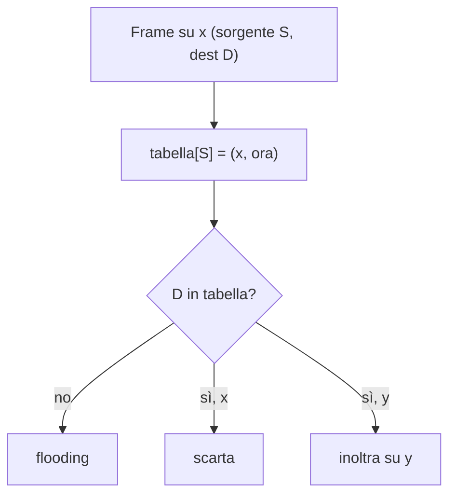

# Autoapprendimento degli Switch

> [!summary] In breve
> Lo switch costruisce la tabella da solo: per ogni frame registra **MAC sorgente → interfaccia di arrivo + ora**, e cancella le voci non rinnovate entro l'**aging time**. Per questo è plug-and-play.

- Esempio: alle 9:39 arriva da 01-12-23-34-45-56 sull'interfaccia 2 → nuova voce; con aging time di 60 min, la voce 62-FE-… (9:32) scade alle 10:32.

## Collegamenti

- **Concetti correlati**: [[Switch a Livello di Collegamento]] · [[Indirizzo MAC]]
- **Mappa**: [[MOC - Telecomunicazioni]]

> [!info] Approfondimento
> - [[06 - TLC - Livello di collegamento e reti locali#Autoapprendimento|Capitolo 6 — Autoapprendimento]]
