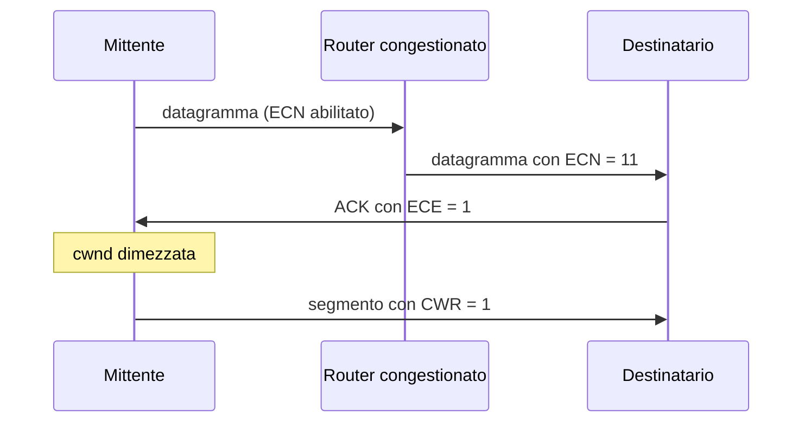

# ECN

> [!summary] In breve
> Explicit Congestion Notification (RFC 3168): un router congestionato marca **due bit** nell'intestazione IP; il destinatario lo segnala con il bit **ECE** nell'ACK; il mittente dimezza `cwnd` e risponde con il bit **CWR**.

- È una forma di controllo **assistito dalla rete** (TCP usa normalmente quello end-to-end).
- Si raccomanda di segnalare solo la congestione **persistente**.
- Lo usano anche DCCP e DCTCP (data center).

## Collegamenti

- **Concetti correlati**: [[Controllo di Congestione TCP]] · [[Costi della Congestione]] · [[Segmento TCP]]
- **Mappa**: [[MOC - Telecomunicazioni]]

> [!info] Approfondimento
> - [[03 - TLC - Livello di trasporto#Notifica esplicita di congestione (ECN)|Capitolo 3 — Notifica esplicita di congestione (ECN)]]
