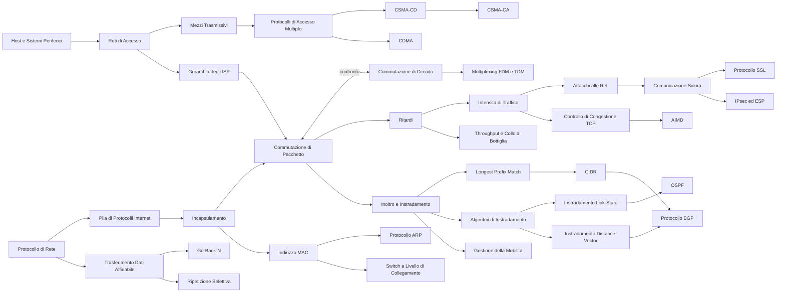

# MOC — Telecomunicazioni

> [!abstract] Come usare questa mappa
> Gli appunti seguono il libro di Kurose e Ross, *Reti di calcolatori e Internet* (7ª ed.), **un capitolo per nota**. I **capitoli** sono note complete da cui studiare; i **concetti** sono note brevi per il ripasso, e ognuna rimanda alla sezione del capitolo in cui l'argomento è spiegato nel dettaglio.
> Molti argomenti (livelli, OSI e TCP/IP, IP, TCP/UDP, socket, sicurezza) compaiono anche in [[MOC - Sistemi di Calcolo 2]].

## Capitoli

| # | Capitolo | Argomenti |
| --- | --- | --- |
| 1 | [[01 - TLC - Reti di calcolatori e Internet]] | host, protocolli, reti di accesso, mezzi fisici, commutazione di pacchetto e di circuito, ISP, ritardi, throughput, pila protocollare, incapsulamento, attacchi, storia |
| 2 | [[02 - TLC - Livello di applicazione]] | client-server e P2P, socket, servizi di trasporto, HTTP, cookie, web cache, SMTP, POP3, IMAP, DNS, BitTorrent, DASH, CDN, socket in Python |
| 3 | [[03 - TLC - Livello di trasporto]] | multiplexing, UDP, checksum, rdt, GBN, SR, segmento TCP, RTT e timeout, fast retransmit, controllo di flusso, handshake, congestione, slow start, AIMD, fairness, ECN |
| 4 | [[04 - TLC - Livello di rete - piano dei dati]] | inoltro vs instradamento, SDN, architettura del router, longest prefix match, commutazione, code e HOL, scheduling (FIFO, priorità, RR, WFQ), IPv4, frammentazione, sottoreti, CIDR, DHCP, NAT, IPv6, OpenFlow |
| 5 | [[05 - TLC - Livello di rete - piano di controllo]] | controllo per router vs SDN, grafi, Dijkstra (LS), Bellman-Ford (DV), conteggio all'infinito, AS, OSPF, BGP (eBGP/iBGP, AS-PATH, NEXT-HOP, hot potato, selezione rotte, anycast, politiche), controller SDN, OpenFlow, ICMP, SNMP |
| 6 | [[06 - TLC - Livello di collegamento e reti locali]] | servizi di livello 2, NIC, parità, CRC, accesso multiplo (TDM/FDM, ALOHA, CSMA/CD, polling, token, DOCSIS), MAC e ARP, Ethernet, switch e autoapprendimento, VLAN, MPLS, data center, cronaca di una richiesta web |
| 7 | [[07 - TLC - Reti mobili e wireless]] | componenti wireless, SNR/BER, terminale nascosto, CDMA, Wi-Fi 802.11 (associazione, CSMA/CA, RTS/CTS, frame a 4 indirizzi), Bluetooth, Zigbee, GSM/3G/4G LTE, mobilità (COA, instradamento indiretto e diretto), IP mobile, handoff GSM, TCP sul wireless |
| 8 | [[08 - TLC - Sicurezza nelle reti]] | comunicazione sicura, crittografia simmetrica (cifrari a blocchi, CBC), chiave pubblica e RSA, hash, MAC, firma digitale, CA, protocolli ap e nonce, PGP, SSL/TLS, IPsec/VPN/IKE, WEP e 802.11i, firewall, IDS e Snort |

> [!success] Tutti i capitoli del libro (1–8) hanno la loro nota.

## Concetti

### Che cos'è Internet

- [[Host e Sistemi Periferici]] · [[Protocollo di Rete]] · [[Storia di Internet]]

### La periferia della rete

- [[Reti di Accesso]] · [[Mezzi Trasmissivi]]

### Il nucleo della rete

- [[Commutazione di Pacchetto]] · [[Commutazione di Circuito]] · [[Multiplexing FDM e TDM]] · [[Gerarchia degli ISP]]

### Prestazioni

- [[Ritardi nelle Reti a Commutazione di Pacchetto]] · [[Intensità di Traffico]] · [[Throughput e Collo di Bottiglia]]

### Architettura a livelli

- [[Pila di Protocolli Internet]] · [[Incapsulamento]]

### Livello di applicazione — principi

- [[Architetture Client-Server e P2P]] · [[Servizi di Trasporto per le Applicazioni]] · [[Socket UDP e TCP in Python]]

### Web

- [[Protocollo HTTP]] · [[Messaggi HTTP]] · [[Connessioni Persistenti e Non Persistenti]] · [[Cookie HTTP]] · [[Web Caching]] · [[GET Condizionale]]

### Posta elettronica

- [[Protocollo SMTP]] · [[POP3 e IMAP]]

### DNS

- [[Gerarchia dei DNS Server]] · [[Query DNS Ricorsive e Iterative]] · [[Record DNS]]

### P2P, video e CDN

- [[Distribuzione di File P2P]] · [[BitTorrent]] · [[DASH]] · [[Content Distribution Network]]

### Livello di trasporto — UDP e multiplexing

- [[Multiplexing e Demultiplexing]] · [[Protocollo UDP]] · [[Checksum Internet]]

### Trasferimento dati affidabile

- [[Trasferimento Dati Affidabile]] · [[Protocolli con Pipeline]] · [[Go-Back-N]] · [[Ripetizione Selettiva]]

### TCP

- [[Segmento TCP]] · [[Numeri di Sequenza e ACK TCP]] · [[Stima di RTT e Timeout TCP]] · [[Ritrasmissione Rapida]] · [[Controllo di Flusso TCP]] · [[Gestione della Connessione TCP]]

### Controllo di congestione

- [[Costi della Congestione]] · [[Controllo di Congestione TCP]] · [[Slow Start e Congestion Avoidance]] · [[AIMD]] · [[Fairness TCP]] · [[ECN]]

### Livello di rete — router

- [[Inoltro e Instradamento]] · [[Architettura di un Router]] · [[Longest Prefix Match]] · [[Strutture di Commutazione]] · [[Accodamento nei Router]] · [[Scheduling dei Pacchetti]]

### IP e indirizzamento

- [[Datagramma IPv4]] · [[Frammentazione IP]] · [[Indirizzamento IPv4]] · [[Sottorete]] · [[CIDR]] · [[Aggregazione di Indirizzi]] · [[DHCP]] · [[NAT]] · [[Protocollo IPv6]]

### SDN

- [[Inoltro Generalizzato e OpenFlow]]

### Instradamento

- [[Algoritmi di Instradamento]] · [[Instradamento Link-State]] · [[Instradamento Distance-Vector]] · [[Conteggio all'Infinito]]

### Instradamento in Internet

- [[Sistema Autonomo]] · [[OSPF]] · [[Protocollo BGP]] · [[Selezione delle Rotte BGP]] · [[Hot Potato Routing]] · [[Anycast IP]]

### Piano di controllo SDN e gestione

- [[Controller SDN]] · [[Protocollo OpenFlow]] · [[Protocollo ICMP]] · [[SNMP e Gestione di Rete]]

### Livello di collegamento

- [[Servizi del Livello di Collegamento]] · [[Controllo di Parità]] · [[CRC]]

### Accesso multiplo

- [[Protocolli di Accesso Multiplo]] · [[Protocolli ALOHA]] · [[CSMA-CD]] · [[Protocolli a Rotazione]] · [[DOCSIS]]

### LAN commutate

- [[Indirizzo MAC]] · [[Protocollo ARP]] · [[Ethernet]] · [[Frame Ethernet]] · [[Switch a Livello di Collegamento]] · [[Autoapprendimento degli Switch]] · [[Switch e Router a Confronto]] · [[LAN Virtuali]]

### Oltre la LAN

- [[MPLS]] · [[Reti dei Data Center]] · [[Cronaca di una Richiesta Web]]

### Wireless

- [[Reti Wireless]] · [[Caratteristiche dei Collegamenti Wireless]] · [[Terminale Nascosto]] · [[CDMA]]

### Wi-Fi e PAN

- [[Wi-Fi 802.11]] · [[Associazione 802.11]] · [[CSMA-CA]] · [[RTS e CTS]] · [[Frame 802.11]] · [[Bluetooth e Zigbee]]

### Reti cellulari

- [[Rete Cellulare GSM]] · [[Reti Cellulari 3G e 4G]]

### Mobilità

- [[Gestione della Mobilità]] · [[Instradamento Indiretto e Diretto]] · [[IP Mobile]] · [[Mobilità nelle Reti Cellulari]] · [[Handoff GSM]] · [[TCP su Reti Wireless]]

### Sicurezza — attacchi e principi

- [[Attacchi alle Reti]] · [[Comunicazione Sicura]]

### Crittografia

- [[Crittografia a Chiave Simmetrica]] · [[Cifrari a Blocchi e CBC]] · [[Crittografia a Chiave Pubblica]] · [[Algoritmo RSA]]

### Integrità e autenticazione

- [[Funzioni Hash Crittografiche]] · [[Codice di Autenticazione del Messaggio]] · [[Firma Digitale]] · [[Certificazione della Chiave Pubblica]] · [[Protocolli di Autenticazione ap]]

### Protocolli sicuri e sicurezza operativa

- [[Posta Elettronica Sicura e PGP]] · [[Protocollo SSL]] · [[IPsec ed ESP]] · [[Associazione di Sicurezza]] · [[Sicurezza 802.11 WEP e 802.11i]] · [[Filtri di Pacchetti e Gateway Applicativi]] · [[Sistemi di Rilevamento delle Intrusioni]]

### Altre note del corso

Note scritte a parte, nella cartella del corso:
- dispositivi: [[Hub]] · [[Bridge]] · [[Switch]] · [[Router]] · [[Gateway]] · [[Proxy]] · [[Load Balancing]]
- protocolli e servizi: [[DNS]] · [[BGP]] · [[Sockets in Python]]

## Percorsi trasversali

- **Il viaggio di un pacchetto**: [[Host e Sistemi Periferici]] → [[Incapsulamento]] → [[Reti di Accesso]] → [[Commutazione di Pacchetto]] → [[Gerarchia degli ISP]] → [[Ritardi nelle Reti a Commutazione di Pacchetto]]
- **Come si misurano le prestazioni**: [[Ritardi nelle Reti a Commutazione di Pacchetto]] → [[Intensità di Traffico]] → [[Throughput e Collo di Bottiglia]] → [[Traceroute]]
- **Pacchetto o circuito**: [[Commutazione di Circuito]] → [[Multiplexing FDM e TDM]] → [[Commutazione di Pacchetto]]
- **Dai protocolli ai livelli**: [[Protocollo di Rete]] → [[Pila di Protocolli Internet]] → [[Incapsulamento]] → [[Modello OSI e TCP-IP]] (Sistemi di Calcolo 2)
- **Cosa succede quando apri una pagina web**: [[Gerarchia dei DNS Server]] → [[Query DNS Ricorsive e Iterative]] → [[Connessioni Persistenti e Non Persistenti]] → [[Messaggi HTTP]] → [[Web Caching]] → [[GET Condizionale]]
- **Il viaggio di un'e-mail**: [[Protocollo SMTP]] → [[Record DNS]] (MX) → [[POP3 e IMAP]]
- **Scalare la distribuzione dei contenuti**: [[Architetture Client-Server e P2P]] → [[Distribuzione di File P2P]] → [[BitTorrent]] · [[DASH]] → [[Content Distribution Network]] → [[Gerarchia degli ISP]]
- **Dalla teoria al codice**: [[Servizi di Trasporto per le Applicazioni]] → [[Socket UDP e TCP in Python]] → [[Sockets in Python]]
- **Costruire l'affidabilità**: [[Checksum Internet]] → [[Trasferimento Dati Affidabile]] → [[Protocolli con Pipeline]] → [[Go-Back-N]] · [[Ripetizione Selettiva]] → [[Ritrasmissione Rapida]]
- **La vita di una connessione TCP**: [[Gestione della Connessione TCP]] → [[Segmento TCP]] → [[Numeri di Sequenza e ACK TCP]] → [[Stima di RTT e Timeout TCP]] → [[Controllo di Flusso TCP]]
- **Dalla congestione all'equità**: [[Intensità di Traffico]] → [[Costi della Congestione]] → [[Controllo di Congestione TCP]] → [[Slow Start e Congestion Avoidance]] → [[AIMD]] → [[Fairness TCP]] → [[ECN]]
- **Dentro un router**: [[Inoltro e Instradamento]] → [[Architettura di un Router]] → [[Longest Prefix Match]] → [[Strutture di Commutazione]] → [[Accodamento nei Router]] → [[Scheduling dei Pacchetti]]
- **Un host entra in rete**: [[DHCP]] → [[Indirizzamento IPv4]] → [[Sottorete]] → [[NAT]] → [[Datagramma IPv4]]
- **Dagli indirizzi alle tabelle**: [[CIDR]] → [[Aggregazione di Indirizzi]] → [[Longest Prefix Match]] → [[BGP]]
- **Verso il futuro**: [[Frammentazione IP]] → [[Protocollo IPv6]] · [[Inoltro Generalizzato e OpenFlow]]
- **Calcolare i percorsi**: [[Algoritmi di Instradamento]] → [[Instradamento Link-State]] ([[Dijkstra Algorithm]]) · [[Instradamento Distance-Vector]] → [[Conteggio all'Infinito]]
- **Instradare in Internet**: [[Sistema Autonomo]] → [[OSPF]] (dentro) · [[Protocollo BGP]] (fuori) → [[Selezione delle Rotte BGP]] → [[Hot Potato Routing]] → [[Anycast IP]]
- **Piano di controllo programmabile**: [[Inoltro Generalizzato e OpenFlow]] → [[Controller SDN]] → [[Protocollo OpenFlow]]
- **Diagnostica e gestione**: [[Protocollo ICMP]] → [[Traceroute]] · [[SNMP e Gestione di Rete]]
- **Proteggere i bit**: [[Controllo di Parità]] → [[Checksum Internet]] → [[CRC]]
- **Condividere un canale**: [[Protocolli di Accesso Multiplo]] → [[Multiplexing FDM e TDM]] · [[Protocolli ALOHA]] → [[CSMA-CD]] · [[Protocolli a Rotazione]] → [[DOCSIS]]
- **Dentro una LAN**: [[Indirizzo MAC]] → [[Protocollo ARP]] → [[Frame Ethernet]] → [[Switch a Livello di Collegamento]] → [[Autoapprendimento degli Switch]] → [[LAN Virtuali]]
- **Tutta la pila in un esempio**: [[Cronaca di una Richiesta Web]] ([[DHCP]] → [[Protocollo ARP]] → [[Gerarchia dei DNS Server]] → [[Protocollo BGP]] → [[Gestione della Connessione TCP]] → [[Messaggi HTTP]])
- **Dal cavo all'aria**: [[CSMA-CD]] → [[Caratteristiche dei Collegamenti Wireless]] → [[Terminale Nascosto]] → [[CSMA-CA]] → [[RTS e CTS]]
- **Wi-Fi in pratica**: [[Associazione 802.11]] → [[DHCP]] → [[Frame 802.11]] ([[Protocollo ARP]], [[Switch a Livello di Collegamento]])
- **Muoversi senza perdere la connessione**: [[Gestione della Mobilità]] → [[Instradamento Indiretto e Diretto]] → [[IP Mobile]] · [[Mobilità nelle Reti Cellulari]] → [[Handoff GSM]] → [[TCP su Reti Wireless]]
- **Dalla crittografia ai protocolli**: [[Crittografia a Chiave Simmetrica]] · [[Algoritmo RSA]] → [[Funzioni Hash Crittografiche]] → [[Codice di Autenticazione del Messaggio]] · [[Firma Digitale]] → [[Certificazione della Chiave Pubblica]] → [[Protocollo SSL]] · [[IPsec ed ESP]] · [[Posta Elettronica Sicura e PGP]]
- **Sicurezza lungo la pila**: applicazione ([[Posta Elettronica Sicura e PGP]]) → trasporto ([[Protocollo SSL]]) → rete ([[IPsec ed ESP]]) → collegamento ([[Sicurezza 802.11 WEP e 802.11i]])
- **Difendere una rete**: [[Attacchi alle Reti]] → [[Filtri di Pacchetti e Gateway Applicativi]] → [[Sistemi di Rilevamento delle Intrusioni]] ([[Protocollo ICMP]], [[Gestione della Connessione TCP]])
- **Dove la rete diventa vulnerabile**: [[Intensità di Traffico]] (bandwidth flooding) → [[Attacchi alle Reti]] → [[Botnet e DDoS]] → [[Malware]]
