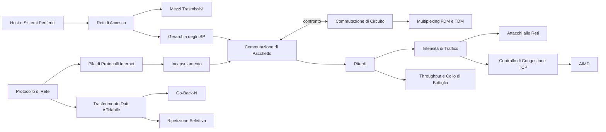

# MOC — Telecomunicazioni

> [!abstract] Come usare questa mappa
> Gli appunti seguono il libro di Kurose e Ross, *Reti di calcolatori e Internet* (7ª ed.), **un capitolo per nota**. I **capitoli** sono note complete da cui studiare; i **concetti** sono note brevi per il ripasso, e ognuna rimanda alla sezione del capitolo in cui l'argomento è spiegato nel dettaglio.
> Molti argomenti (livelli, OSI e TCP/IP, IP, TCP/UDP, socket, sicurezza) compaiono anche in [[MOC - Sistemi di Calcolo 2]].

## Capitoli

| # | Capitolo | Argomenti |
| --- | --- | --- |
| 1 | [[01 - TLC - Reti di calcolatori e Internet]] | host, protocolli, reti di accesso, mezzi fisici, commutazione di pacchetto e di circuito, ISP, ritardi, throughput, pila protocollare, incapsulamento, attacchi, storia |
| 2 | [[02 - TLC - Livello di applicazione]] | client-server e P2P, socket, servizi di trasporto, HTTP, cookie, web cache, SMTP, POP3, IMAP, DNS, BitTorrent, DASH, CDN, socket in Python |
| 3 | [[03 - TLC - Livello di trasporto]] | multiplexing, UDP, checksum, rdt, GBN, SR, segmento TCP, RTT e timeout, fast retransmit, controllo di flusso, handshake, congestione, slow start, AIMD, fairness, ECN |

> [!todo] Capitoli ancora da fare
> 4 Rete: piano dei dati · 5 Rete: piano di controllo · 6 Collegamento e reti locali · 7 Reti mobili e wireless · 8 Sicurezza

## Concetti

### Che cos'è Internet

- [[Host e Sistemi Periferici]] · [[Protocollo di Rete]] · [[Storia di Internet]]

### La periferia della rete

- [[Reti di Accesso]] · [[Mezzi Trasmissivi]]

### Il nucleo della rete

- [[Commutazione di Pacchetto]] · [[Commutazione di Circuito]] · [[Multiplexing FDM e TDM]] · [[Gerarchia degli ISP]]

### Prestazioni

- [[Ritardi nelle Reti a Commutazione di Pacchetto]] · [[Intensità di Traffico]] · [[Throughput e Collo di Bottiglia]]

### Architettura a livelli

- [[Pila di Protocolli Internet]] · [[Incapsulamento]]

### Livello di applicazione — principi

- [[Architetture Client-Server e P2P]] · [[Servizi di Trasporto per le Applicazioni]] · [[Socket UDP e TCP in Python]]

### Web

- [[Protocollo HTTP]] · [[Messaggi HTTP]] · [[Connessioni Persistenti e Non Persistenti]] · [[Cookie HTTP]] · [[Web Caching]] · [[GET Condizionale]]

### Posta elettronica

- [[Protocollo SMTP]] · [[POP3 e IMAP]]

### DNS

- [[Gerarchia dei DNS Server]] · [[Query DNS Ricorsive e Iterative]] · [[Record DNS]]

### P2P, video e CDN

- [[Distribuzione di File P2P]] · [[BitTorrent]] · [[DASH]] · [[Content Distribution Network]]

### Livello di trasporto — UDP e multiplexing

- [[Multiplexing e Demultiplexing]] · [[Protocollo UDP]] · [[Checksum Internet]]

### Trasferimento dati affidabile

- [[Trasferimento Dati Affidabile]] · [[Protocolli con Pipeline]] · [[Go-Back-N]] · [[Ripetizione Selettiva]]

### TCP

- [[Segmento TCP]] · [[Numeri di Sequenza e ACK TCP]] · [[Stima di RTT e Timeout TCP]] · [[Ritrasmissione Rapida]] · [[Controllo di Flusso TCP]] · [[Gestione della Connessione TCP]]

### Controllo di congestione

- [[Costi della Congestione]] · [[Controllo di Congestione TCP]] · [[Slow Start e Congestion Avoidance]] · [[AIMD]] · [[Fairness TCP]] · [[ECN]]

### Sicurezza

- [[Attacchi alle Reti]]

### Altre note del corso

Note scritte a parte, nella cartella del corso:
- dispositivi: [[Hub]] · [[Bridge]] · [[Switch]] · [[Router]] · [[Gateway]] · [[Proxy]] · [[Load Balancing]]
- protocolli e servizi: [[DNS]] · [[BGP]] · [[Sockets in Python]]

## Percorsi trasversali

- **Il viaggio di un pacchetto**: [[Host e Sistemi Periferici]] → [[Incapsulamento]] → [[Reti di Accesso]] → [[Commutazione di Pacchetto]] → [[Gerarchia degli ISP]] → [[Ritardi nelle Reti a Commutazione di Pacchetto]]
- **Come si misurano le prestazioni**: [[Ritardi nelle Reti a Commutazione di Pacchetto]] → [[Intensità di Traffico]] → [[Throughput e Collo di Bottiglia]] → [[Traceroute]]
- **Pacchetto o circuito**: [[Commutazione di Circuito]] → [[Multiplexing FDM e TDM]] → [[Commutazione di Pacchetto]]
- **Dai protocolli ai livelli**: [[Protocollo di Rete]] → [[Pila di Protocolli Internet]] → [[Incapsulamento]] → [[Modello OSI e TCP-IP]] (Sistemi di Calcolo 2)
- **Cosa succede quando apri una pagina web**: [[Gerarchia dei DNS Server]] → [[Query DNS Ricorsive e Iterative]] → [[Connessioni Persistenti e Non Persistenti]] → [[Messaggi HTTP]] → [[Web Caching]] → [[GET Condizionale]]
- **Il viaggio di un'e-mail**: [[Protocollo SMTP]] → [[Record DNS]] (MX) → [[POP3 e IMAP]]
- **Scalare la distribuzione dei contenuti**: [[Architetture Client-Server e P2P]] → [[Distribuzione di File P2P]] → [[BitTorrent]] · [[DASH]] → [[Content Distribution Network]] → [[Gerarchia degli ISP]]
- **Dalla teoria al codice**: [[Servizi di Trasporto per le Applicazioni]] → [[Socket UDP e TCP in Python]] → [[Sockets in Python]]
- **Costruire l'affidabilità**: [[Checksum Internet]] → [[Trasferimento Dati Affidabile]] → [[Protocolli con Pipeline]] → [[Go-Back-N]] · [[Ripetizione Selettiva]] → [[Ritrasmissione Rapida]]
- **La vita di una connessione TCP**: [[Gestione della Connessione TCP]] → [[Segmento TCP]] → [[Numeri di Sequenza e ACK TCP]] → [[Stima di RTT e Timeout TCP]] → [[Controllo di Flusso TCP]]
- **Dalla congestione all'equità**: [[Intensità di Traffico]] → [[Costi della Congestione]] → [[Controllo di Congestione TCP]] → [[Slow Start e Congestion Avoidance]] → [[AIMD]] → [[Fairness TCP]] → [[ECN]]
- **Dove la rete diventa vulnerabile**: [[Intensità di Traffico]] (bandwidth flooding) → [[Attacchi alle Reti]] → [[Botnet e DDoS]] → [[Malware]]
