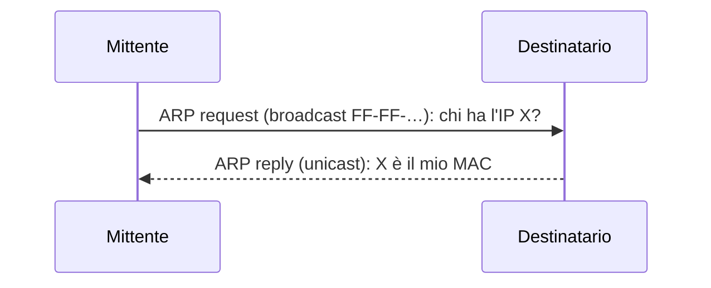

# Protocollo ARP

> [!summary] In breve
> **ARP** (RFC 826) traduce un IP della **stessa sottorete** nel MAC corrispondente: richiesta in **broadcast**, risposta **unicast** del nodo interessato, risultato salvato in una **tabella ARP** con TTL (~20 min).

- È plug-and-play: la tabella si costruisce e si svuota da sola.
- È diverso dal DNS: ARP vale solo nella sottorete locale.
- Sta al **confine** tra livello 2 e 3 (incapsulato in frame Ethernet con tipo 0806, ma contiene IP).
- Verso un'altra sottorete si usa ARP per il **MAC del router** (gateway): l'IP di destinazione resta, il MAC cambia a ogni hop.

## Collegamenti

- **Concetti correlati**: [[Indirizzo MAC]] · [[ARP]] · [[DHCP]] · [[Cronaca di una Richiesta Web]]
- **Mappa**: [[MOC - Telecomunicazioni]]

> [!info] Approfondimento
> - [[06 - TLC - Livello di collegamento e reti locali#Protocollo per la risoluzione degli indirizzi (ARP)|Capitolo 6 — Protocollo per la risoluzione degli indirizzi (ARP)]]
> - [[06 - TLC - Livello di collegamento e reti locali#Inviare un datagramma fuori dalla sottorete|Capitolo 6 — Inviare un datagramma fuori dalla sottorete]]
