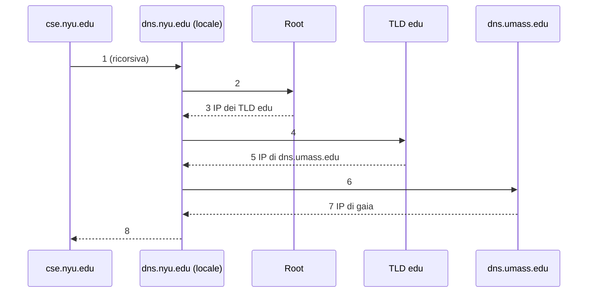

# Query DNS Ricorsive e Iterative

> [!summary] In breve
> In una query **ricorsiva** il server interrogato ottiene la risposta per conto di chi chiede. In una query **iterativa** risponde direttamente con il server da contattare dopo. Di solito host → server locale è ricorsiva e il resto è iterativo.

Esempio: `cse.nyu.edu` chiede l'IP di `gaia.cs.umass.edu`.

- **8 messaggi**; diventano 10 se c'è un server intermedio (`dns.cs.umass.edu`).
- Il caching riduce molto questi passaggi.

## Collegamenti

- **Concetti correlati**: [[Gerarchia dei DNS Server]] · [[Record DNS]]
- **Mappa**: [[MOC - Telecomunicazioni]]

> [!info] Approfondimento
> - [[02 - TLC - Livello di applicazione#Query iterative e ricorsive|Capitolo 2 — Query iterative e ricorsive]]
