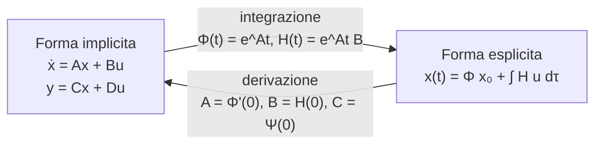

# Uscita forzata e dalla forma esplicita alla implicita

> [!abstract] Scopo della lezione
> Gli appunti partono dalla **Lezione 4**: le lezioni 1–3 (introduzione ai sistemi dinamici, modelli fisici, rappresentazione implicita $\dot x = Ax+Bu,\ y = Cx+Du$ e prima forma esplicita) non sono negli appunti; per quelle si rimanda al Capitolo 1 e al §2.1 del libro.
> Qui si chiude il discorso sulla **forma esplicita** di un sistema lineare stazionario:
> 1. si interpreta l'**uscita forzata** come una media pesata degli ingressi passati, con peso la **risposta impulsiva** $W$;
> 2. si giustifica perché nei sistemi **stazionari** si può porre $t_0=0$;
> 3. si verifica che lo **stato iniziale contiene tutta l'informazione** sul passato, e da questo si ricavano le proprietà di $\Phi$ e $H$;
> 4. derivando la forma esplicita si ritorna alla forma **implicita** $\dot x=Ax+Bu$.
>
> La lezione successiva ([[05 - TDS - Calcolo dell'esponenziale di matrice]]) mostra come calcolare concretamente $\Phi(t)=e^{At}$. Indice del corso: [[MOC - Teoria dei Sistemi]].

## Uscita forzata

Vedi [[TDS - Risposta impulsiva]].

Un sistema lineare stazionario a dimensione finita, in **forma esplicita**, esprime stato e uscita come somma di due contributi: uno dovuto allo stato iniziale (evoluzione **libera**) e uno dovuto all'ingresso (evoluzione **forzata**). La parte dell'uscita $y(t)$ che dipende **solo dall'ingresso** si chiama **uscita forzata** $y_F(t)$:

$$y_F(t)=\int_{t_0}^{t} W(t-\tau)\,u(\tau)\,d\tau$$

La matrice $W$ si chiama **matrice delle risposte impulsive in uscita** (o semplicemente **risposta impulsiva**): le sue colonne sono le risposte forzate del sistema quando in ingresso si applica un impulso su un solo canale.

> [!tip] Interpretazione: una media pesata
> L'integrale si può leggere come una "media pesata" dei valori passati dell'ingresso $u(\tau)$, con peso $W(t-\tau)$. Il peso dice quanto è "importante", all'istante $t$, l'ingresso che il sistema ha ricevuto all'istante $\tau$:
> - se $W(t-\tau)$ è grande, quell'ingresso conta ancora molto;
> - se è piccolo, il sistema lo ha ormai "dimenticato".

![[TDS-L04-01.png]]

Nel grafico (caso scalare, $p=q=1$) la curva blu è l'ingresso $u(\tau)$ tra $t_0$ e $t$, quella arancione è il peso $W(t-\tau)$ visto come funzione di $\tau$. Il peso è piccolo per $\tau$ lontani da $t$ e cresce avvicinandosi a $t$: gli **ingressi recenti pesano di più**, quelli vecchi vengono via via dimenticati. È il comportamento tipico di un sistema asintoticamente stabile, in cui $W$ è fatta di esponenziali decrescenti (lo si vedrà con i [[06 - TDS - Modi naturali|modi naturali]]).

Con più ingressi ($p>1$) non tutti contribuiscono allo stesso modo: con due ingressi, ad esempio,

$$W(t)=\begin{pmatrix}W_1(t) & W_2(t)\end{pmatrix},\qquad y_F(t)=\int_{t_0}^t \big(W_1(t-\tau)u_1(\tau)+W_2(t-\tau)u_2(\tau)\big)\,d\tau$$

dove $W_1$ è il peso del primo ingresso $u_1(t)$ e $W_2$ quello del secondo.

> [!quote] Dal libro — perché la risposta impulsiva è così importante
> Il nucleo dell'integrale di convoluzione coincide con una risposta forzata, quella all'**impulso**: in linea di principio, per conoscere il comportamento forzato di un sistema basterebbe partire dallo stato zero, applicare un impulso e misurarne la risposta. In pratica l'impulso (una "percossa") non è realizzabile esattamente, e si usano altri esperimenti ingresso-uscita (**identificazione**, modellistica "a scatola nera").
> Il libro introduce anche gli **ingressi canonici** $\delta_{-k}(t)=\frac{t^{k-1}}{(k-1)!}\delta_{-1}(t)$: gradino ($k=1$), rampa ($k=2$), rampa parabolica ($k=3$)… ciascuno è l'integrale del precedente, e la risposta a un ingresso qualsiasi si può esprimere a partire dalla risposta a uno di essi. _(libro, §2.1, pp. 43–44)_

## Sistemi stazionari e arbitrarietà dell'istante iniziale

Vedi [[TDS - Stazionarietà]].

I sistemi studiati nel corso sono **lineari, stazionari, a dimensione finita**, con forma esplicita:

$$\begin{cases}
x(t)=\Phi(t-t_0)\,x(t_0)+\displaystyle\int_{t_0}^{t}H(t-\tau)\,u(\tau)\,d\tau\\[2mm]
y(t)=\Psi(t-t_0)\,x(t_0)+\displaystyle\int_{t_0}^{t}W(t-\tau)\,u(\tau)\,d\tau
\end{cases}\tag{1}$$

| Matrice | Lega | Nome |
|---|---|---|
| $\Phi(t)$ | stato iniziale → stato | matrice di transizione dello stato |
| $H(t)$ | ingresso → stato | risposte impulsive nello stato |
| $\Psi(t)$ | stato iniziale → uscita | trasformazione stato-uscita |
| $W(t)$ | ingresso → uscita | risposte impulsive in uscita |

**Stazionario** significa che nulla dipende *direttamente* dal tempo: tutte le matrici dipendono solo dalla **differenza** $t-t_0$ (o $t-\tau$), cioè dal tempo trascorso, non dall'istante assoluto. Informalmente: se oggi l'acqua in una pentola impiega 10 minuti a bollire, domani, nelle stesse condizioni, impiegherà sempre 10 minuti. In un sistema non stazionario, invece, conta *quando* si fa l'esperimento.

Attenzione a cosa significa "nelle stesse condizioni". Se in un esperimento lo stato iniziale è $x(t_0)=\begin{pmatrix}1\\1\end{pmatrix}$, per ripeterlo partendo da un altro istante $t_0'$ bisogna partire **di nuovo** da $\begin{pmatrix}1\\1\end{pmatrix}$, non dallo stato $x(t_0')$ in cui il sistema si trova in quel momento. Per sottolinearlo si scrive lo stato iniziale come $x_0$. Anche gli **ingressi** devono essere gli stessi (traslati nel tempo).

> [!example] Il carrello
> Se faccio partire un carrello da fermo, dopo qualche secondo si sta muovendo. Se ora faccio partire "lo stesso" esperimento senza rimetterlo fermo, ottengo un risultato diverso: non perché il sistema non sia stazionario, ma perché è cambiata la condizione iniziale. L'istante iniziale è arbitrario **a parità di condizioni iniziali e di ingressi**.

Per questo nei sistemi stazionari si assume, senza perdita di generalità:

$$t_0=0$$

## Informazione nello stato iniziale

Vedi [[TDS - Matrice di transizione dello stato]].

Tutta la teoria si basa sull'ipotesi che lo **stato** a un certo istante riassuma tutto il passato: noto $x(t_0)=x_0$ e l'ingresso da $t_0$ in poi, il futuro è determinato. Verifichiamo che la forma esplicita sia coerente con questa ipotesi, e vediamo che cosa impone alle matrici.

Partiamo da $t_0$, applichiamo un ingresso $u$ e arriviamo a $t$:

![[TDS-L04-02.png]]

Lo stato finale è, come sempre,

$$x(t)=\Phi(t-t_0)x(t_0)+\int_{t_0}^{t}H(t-\tau)u(\tau)\,d\tau\tag{2}$$

Ripetiamo l'esperimento fermandoci a un istante intermedio $t_1$:

![[TDS-L04-03.png]]

Lo stato in $t_1$ si ottiene sostituendo $t_1$ a $t$:

$$x(t_1)=\Phi(t_1-t_0)x(t_0)+\int_{t_0}^{t_1}H(t_1-\tau)u(\tau)\,d\tau\tag{3}$$

L'ipotesi da verificare è che, **ripartendo da $x(t_1)$** con lo stesso ingresso, si arrivi allo stesso $x(t)$:

$$x(t)=\Phi(t-t_1)x(t_1)+\int_{t_1}^{t}H(t-\tau)u(\tau)\,d\tau\tag{4}$$

Sostituendo la (3) nella (4) ed espandendo:

$$x(t)=\Phi(t-t_1)\Phi(t_1-t_0)x(t_0)+\Phi(t-t_1)\int_{t_0}^{t_1}H(t_1-\tau)u(\tau)\,d\tau+\int_{t_1}^{t}H(t-\tau)u(\tau)\,d\tau$$

Perché questa coincida con la (2) **per ogni** $x(t_0)$ e **per ogni** ingresso, devono coincidere separatamente i termini.

**Termine nello stato iniziale.** I coefficienti di $x(t_0)$ devono essere uguali:

$$\Phi(t-t_0)=\Phi(t-t_1)\,\Phi(t_1-t_0)$$

Per la matrice $\Phi(t)=e^{At}$ trovata nelle lezioni precedenti questo è vero: $e^{A(t-t_1)}e^{A(t_1-t_0)}=e^{A(t-t_1+t_1-t_0)}=e^{A(t-t_0)}$ (le due matrici commutano perché sono funzioni della stessa $A$).

**Termine nell'ingresso.** Spezzando in $t_1$ l'integrale della (2) per linearità:

$$\int_{t_0}^{t_1}H(t-\tau)u(\tau)\,d\tau+\int_{t_1}^{t}H(t-\tau)u(\tau)\,d\tau=\Phi(t-t_1)\int_{t_0}^{t_1}H(t_1-\tau)u(\tau)\,d\tau+\int_{t_1}^{t}H(t-\tau)u(\tau)\,d\tau$$

Gli integrali su $[t_1,t]$ si semplificano; portando dentro $\Phi(t-t_1)$ (non dipende da $\tau$) restano due integrali con gli stessi estremi, che sono uguali per ogni $u$ se e solo se lo sono gli integrandi:

$$H(t-\tau)=\Phi(t-t_1)\,H(t_1-\tau)$$

Riassumendo, perché lo stato contenga davvero tutta l'informazione, la forma esplicita deve soddisfare:

$$\begin{cases}\Phi(t-t_0)=\Phi(t-t_1)\,\Phi(t_1-t_0)\\ H(t-\tau)=\Phi(t-t_1)\,H(t_1-\tau)\end{cases}\tag{5}$$

> [!quote] Dal libro — proprietà di semigruppo e di fattorizzazione
> Il libro arriva allo stesso risultato e gli dà un nome. Per ogni $t_0\le t_1\le t$:
> - **P1. Proprietà di semigruppo**: $\Phi(0)=I$, $\ \Phi(t-t_0)=\Phi(t-t_1)\Phi(t_1-t_0)$;
> - **P2. Proprietà di fattorizzazione**: $H(t-\tau)=\Phi(t-t_1)H(t_1-\tau)$, $\ \Psi(t-t_0)=\Psi(t-t_1)\Phi(t_1-t_0)$, $\ \tilde W(t-\tau)=\Psi(t-t_1)H(t_1-\tau)$.
>
> Le proprietà sull'uscita si ottengono ripetendo il ragionamento per $y(t)$. Nel libro la forma esplicita dell'uscita è scritta come $y=\Psi x_0+\int \tilde W u\,d\tau + Du(t)$, separando il legame istantaneo $D$. _(libro, §2.1.1, pp. 45–46)_

## Dalla forma esplicita alla forma implicita

Ora deriviamo rispetto al tempo la prima equazione della (1), per vedere se si ritrova la forma implicita di partenza ($\dot x(t)$ indica la derivata di $x(t)$ rispetto al tempo). Derivando un integrale con estremo superiore $t$ e integrando dipendente da $t$ (regola di Leibniz):

$$\dot x(t)=\frac{\partial\Phi(t-t_0)}{\partial t}x(t_0)+H(0)u(t)+\int_{t_0}^{t}\frac{\partial H(t-\tau)}{\partial t}u(\tau)\,d\tau$$

Usiamo la (5) per separare la dipendenza da $t$, scrivendo $\Phi(t-t_0)=\Phi(t-t_1)\Phi(t_1-t_0)$ e $H(t-\tau)=\Phi(t-t_1)H(t_1-\tau)$: solo il fattore $\Phi(t-t_1)$ dipende da $t$, e si può raccogliere:

$$\dot x(t)=\frac{\partial\Phi(t-t_1)}{\partial t}\left(\Phi(t_1-t_0)x(t_0)+\int_{t_0}^{t}H(t_1-\tau)u(\tau)\,d\tau\right)+H(0)u(t)$$

Questo vale per ogni $t_1\in[t_0,t)$. Per eliminare il terzo istante $t_1$ si passa al limite per $t_1\to t$: il termine tra parentesi tende a $x(t)$, e quindi

$$\dot x(t)=\lim_{t_1\to t}\left(\frac{\partial\Phi(t-t_1)}{\partial t}\right)x(t)+H(0)u(t)$$

> [!warning] Correzione
> Negli appunti il limite è scritto $\lim_{t_0\to t}$: deve essere $\lim_{t_1\to t}$, come dice il testo poco sopra ("andiamo a prendere il limite per $t_1\to t$"); $t_0$ è fisso.

$\Phi(t)$ è una matrice $n\times n$ di **funzioni del tempo**, e la sua derivata è la matrice delle derivate degli elementi:

$$\Phi(t)=\begin{pmatrix}\phi_{11}(t)&\cdots&\phi_{1n}(t)\\\vdots&\ddots&\vdots\\\phi_{n1}(t)&\cdots&\phi_{nn}(t)\end{pmatrix},\qquad
\frac{\partial\Phi(t)}{\partial t}=\begin{pmatrix}\dot\phi_{11}(t)&\cdots&\dot\phi_{1n}(t)\\\vdots&\ddots&\vdots\\\dot\phi_{n1}(t)&\cdots&\dot\phi_{nn}(t)\end{pmatrix}$$

Nel limite l'argomento $t-t_1$ tende a zero, e si ottiene una matrice $n\times n$ di valori **costanti**, che chiamiamo $A$; chiamiamo $B$ la matrice $H(0)$. Ecco di nuovo la **forma implicita**:

$$\dot x(t)=Ax(t)+Bu(t),\qquad A=\left.\frac{d\Phi(t)}{dt}\right|_{t=0},\quad B=H(0)$$

Se la forma esplicita era stata ottenuta da una forma implicita con matrici $A'$, $B'$ (cioè $\Phi(t)=e^{A't}$, $H(t)=e^{A't}B'$), si verifica che si torna proprio a quelle:

$$A=\lim_{t\to0}\frac{d}{dt}e^{A't}=\lim_{t\to0}A'e^{A't}=A',\qquad B=H(0)=\left[e^{A't}B'\right]_{t=0}=B'$$

Per l'uscita non serve rifare il conto. La forma "con $\Psi$ e $W$" della (1) è una scrittura introdotta per evidenziare il parallelo tra $x(t)$ e $y(t)$; in realtà la forma esplicita si può scrivere benissimo come

$$\begin{cases}x(t)=\Phi(t-t_0)x(t_0)+\displaystyle\int_{t_0}^{t}H(t-\tau)u(\tau)\,d\tau\\[2mm] y(t)=Cx(t)+Du(t)\end{cases}$$

perché la trasformazione d'uscita è istantanea (algebrica).

> [!quote] Dal libro — le condizioni di regolarità
> Il libro fa lo stesso passaggio ponendo
> $$A=\left.\frac{d\Phi(t)}{dt}\right|_{t=0},\qquad B=H(0),\qquad C=\Psi(0)$$
> sotto le ipotesi che $\Phi(t)$ sia derivabile con derivata continua e che $H(t)$ e $\Psi(t)$ siano continue (**condizioni di regolarità** della rappresentazione con lo stato). Con $C=\Psi(0)$ anche l'uscita torna alla forma $y=Cx+Du$. Il passaggio inverso, dalla risposta ingresso-uscita a una rappresentazione $(A,B,C,D)$, è il **problema della realizzazione**, che verrà trattato più avanti ([[31 - TDS - Algoritmi di realizzazione e forme canoniche]]). _(libro, §2.1–2.1.1, pp. 45–46)_

La prossima lezione affronta il calcolo vero e proprio di $e^{At}$: [[05 - TDS - Calcolo dell'esponenziale di matrice]].
