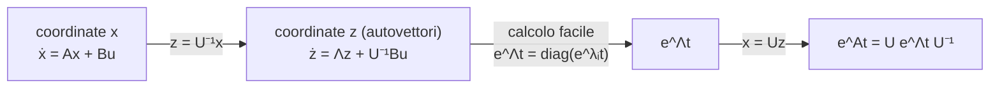

# Calcolo dell'esponenziale di matrice

> [!abstract] Scopo della lezione
> Nella [[04 - TDS - Uscita forzata e dalla forma esplicita alla implicita|lezione precedente]] abbiamo visto che la matrice di transizione è $\Phi(t)=e^{At}$, ma non come calcolarla. Qui:
> 1. si definisce $e^{At}$ come **serie di potenze**;
> 2. si osserva che per una matrice **diagonale** il calcolo è immediato;
> 3. si usa la **diagonalizzazione** (forma spettrale $A=U\Lambda U^{-1}$) per ricondurre il caso generale a quello diagonale, e si legge tutto come un **cambio di coordinate**;
> 4. si scrive l'**evoluzione libera** nelle coordinate degli autovettori e si tratta il caso di autovalori ripetuti ma con matrice ancora diagonalizzabile (**operatore regolare**).
>
> Prosegue in [[06 - TDS - Modi naturali]]. Indice: [[MOC - Teoria dei Sistemi]].

## Calcolo di $e^{At}$

Vedi [[TDS - Esponenziale di matrice]].

Una matrice all'esponente, di per sé, non ha senso. La si definisce imitando lo sviluppo in serie dell'esponenziale scalare (vedi [[Serie di Taylor]] e [[Funzione esponenziale]]):

$$e^{x}=\sum_{k=0}^{\infty}\frac{x^k}{k!}\qquad\Longrightarrow\qquad e^{At}:=\sum_{k=0}^{\infty}\frac{A^k t^k}{k!}=I+At+\frac{A^2t^2}{2!}+\dots\tag{1}$$

La serie converge per ogni matrice quadrata $A$ e ogni $t$. $e^{At}$ è quindi un'espressione formale; il calcolo reale è la somma della serie a destra, e con una matrice qualunque come $e^{\begin{psmallmatrix}1&2\\2&1\end{psmallmatrix}(t-\tau)}$ calcolare tutte le potenze $A^k$ è proibitivo.

C'è però un caso facile: per una matrice **diagonale** $D$ la potenza $k$-esima è la matrice delle potenze degli elementi (gli zeri omessi):

$$D^k=\begin{pmatrix}d_1&&\\&\ddots&\\&&d_n\end{pmatrix}^k=\begin{pmatrix}d_1^k&&\\&\ddots&\\&&d_n^k\end{pmatrix}$$

Quindi, se $A$ fosse diagonale con elementi $\lambda_1,\dots,\lambda_n$, ogni elemento della serie si sommerebbe per conto suo:

$$e^{At}=\sum_{k=0}^{\infty}\begin{pmatrix}\frac{\lambda_1^k t^k}{k!}&&\\&\ddots&\\&&\frac{\lambda_n^k t^k}{k!}\end{pmatrix}=\begin{pmatrix}\sum_k\frac{\lambda_1^kt^k}{k!}&&\\&\ddots&\\&&\sum_k\frac{\lambda_n^kt^k}{k!}\end{pmatrix}=\begin{pmatrix}e^{\lambda_1t}&&\\&\ddots&\\&&e^{\lambda_nt}\end{pmatrix}$$

In pratica: **per una matrice diagonale, $e^{At}$ ha $e^{\lambda_it}$ al posto di ogni $\lambda_i$**. Se $A$ non è diagonale, si cerca di diagonalizzarla.

> [!warning] Correzione
> Gli appunti dicono "la matrice $A$ nella sua *forma di Jordan* (ovvero la matrice $A$ diagonalizzata)". La forma di Jordan coincide con la forma diagonale **solo se $A$ è diagonalizzabile**; in generale è diagonale a blocchi, con degli $1$ sopra la diagonale nei blocchi degli autovalori con molteplicità geometrica minore di quella algebrica. Il caso non diagonalizzabile si vedrà più avanti nel corso, con le catene di autovettori.

> [!quote] Dal libro — matrici diagonali a blocchi
> Lo stesso vale a blocchi: se $A=\mathrm{diag}(A_1,\dots,A_m)$ allora $e^{At}=\mathrm{diag}(e^{A_1t},\dots,e^{A_mt})$, perché ogni potenza di una matrice diagonale a blocchi è la diagonale delle potenze dei blocchi. Siccome con un cambio di coordinate $TAT^{-1}=J=\mathrm{diag}(J_1,\dots,J_m)$ si arriva sempre alla forma di Jordan, si ha
> $$e^{At}=T^{-1}\,\mathrm{diag}\!\left(e^{J_1t},\dots,e^{J_mt}\right)T$$
> e il calcolo della matrice di transizione si riduce a calcolare l'esponenziale di ogni blocco di Jordan e la trasformazione $T$. _(libro, §2.2, pp. 48–49)_

### Il criterio di diagonalizzabilità

Gli appunti richiamano il criterio studiato in Geometria (vedi [[GEO - Criterio di diagonalizzabilità]] e [[32 - GEO - Diagonalizzazione]]):

![[TDS-L05-01.png]]

Sia $A$ una matrice $n\times n$ su $\mathbb R^n$. $A$ è **diagonalizzabile** se e solo se vale una delle seguenti condizioni, che sono equivalenti:
- esiste una base di $\mathbb R^n$ formata da autovettori di $A$;
- la somma delle molteplicità algebriche degli autovalori è $n$ e, per ogni autovalore, la molteplicità geometrica è uguale a quella algebrica;
- la somma delle molteplicità geometriche è proprio $n$.

La **molteplicità geometrica** di $\lambda$ è $\dim\ker(A-\lambda I)$, cioè la dimensione dello spazio delle soluzioni di $(A-\lambda I)u=0$ (l'autospazio di $\lambda$). Vedi [[GEO - Molteplicità algebrica e geometrica]].

> [!note]
> In Geometria il criterio è enunciato per gli **endomorfismi**; per le matrici è la stessa cosa, perché c'è una corrispondenza biunivoca tra endomorfismi di uno spazio di dimensione finita (fissata una base) e matrici quadrate. A noi interessa $\mathbb R^n$ o, al limite, $\mathbb C^n$.

## Caso in cui $A$ abbia $n$ autovalori distinti

Vedi [[TDS - Forma spettrale]].

Supponiamo che $A$ non sia diagonale ma abbia $n$ autovalori **tutti distinti**. Allora ciascuno ha molteplicità algebrica $\mu=1$, e quindi anche geometrica $1$ (la geometrica è sempre $\le$ dell'algebrica e $\ge1$). Gli autovettori $u_1,\dots,u_n$ relativi a $\lambda_1,\dots,\lambda_n$ sono linearmente indipendenti, quindi formano una base, e $A$ si può scrivere in **forma spettrale semplice**:

$$A=\sum_{i=1}^{n}\lambda_i\,u_iv_i'\tag{2}$$

dove gli apici indicano la trasposizione ($v'=v^T$) e i vettori riga $v_i'$ sono tali che

$$v_i'u_j=\begin{cases}0&i\neq j\\1&i=j\end{cases}\qquad\text{cioè}\qquad U^{-1}=\begin{pmatrix}u_1&u_2&\cdots&u_n\end{pmatrix}^{-1}=\begin{pmatrix}v_1'\\v_2'\\\vdots\\v_n'\end{pmatrix}$$

Le colonne di $U$ sono gli autovettori (destri) e le righe di $U^{-1}$ sono i vettori $v_i'$ (detti anche autovettori sinistri, perché $v_i'A=\lambda_iv_i'$): la condizione $U^{-1}U=I$ dice proprio che la riga $i$ di $U^{-1}$ per la colonna $j$ di $U$ vale $1$ se $i=j$ e $0$ altrimenti. Con queste matrici la (2) diventa

$$A=U\Lambda U^{-1},\qquad \Lambda=\begin{pmatrix}\lambda_1&&\\&\ddots&\\&&\lambda_n\end{pmatrix}$$

Il vantaggio è che le potenze diventano semplici, perché i fattori $U^{-1}U$ interni si cancellano:

$$A^2=U\Lambda U^{-1}U\Lambda U^{-1}=U\Lambda^2U^{-1}$$

oppure, con le sommatorie (rispettando l'ordine dei prodotti tra vettori: gli scalari si spostano, i vettori no),

$$A^2=\Big(\sum_i\lambda_iu_iv_i'\Big)\Big(\sum_j\lambda_ju_jv_j'\Big)=\sum_i\sum_j\lambda_i\lambda_j\,u_i\underbrace{v_i'u_j}_{0\text{ se }i\ne j}v_j'=\sum_{i=1}^n\lambda_i^2u_iv_i'$$

In generale $A^k=U\Lambda^kU^{-1}$: elevare $A$ a potenza significa elevare a potenza gli autovalori. Allora

$$e^{At}=\sum_{k=0}^{\infty}\frac{U\Lambda^kU^{-1}t^k}{k!}=U\left(\sum_{k=0}^\infty\frac{\Lambda^kt^k}{k!}\right)U^{-1}=Ue^{\Lambda t}U^{-1}=U\begin{pmatrix}e^{\lambda_1t}&&\\&\ddots&\\&&e^{\lambda_nt}\end{pmatrix}U^{-1}$$

> [!important] Ordine dei fattori
> $U$ e $U^{-1}$ si possono portare fuori dalla sommatoria perché non dipendono da $k$, ma **rispettando l'ordine**: $U$ a sinistra, $U^{-1}$ a destra. Il prodotto tra matrici non è commutativo.

Equivalentemente, in forma spettrale: $e^{At}=\sum_{i=1}^n e^{\lambda_it}\,u_iv_i'$.

> [!example] Verifica su un caso $2\times2$
> $A=\begin{pmatrix}1&2\\2&1\end{pmatrix}$ ha polinomio caratteristico $(1-\lambda)^2-4$, autovalori $\lambda_1=3$, $\lambda_2=-1$, autovettori $u_1=\begin{pmatrix}1\\1\end{pmatrix}$, $u_2=\begin{pmatrix}1\\-1\end{pmatrix}$. Allora $U^{-1}=\frac12\begin{pmatrix}1&1\\1&-1\end{pmatrix}$, cioè $v_1'=\frac12(1\ \ 1)$, $v_2'=\frac12(1\ \ -1)$, e
> $$e^{At}=e^{3t}\cdot\frac12\begin{pmatrix}1&1\\1&1\end{pmatrix}+e^{-t}\cdot\frac12\begin{pmatrix}1&-1\\-1&1\end{pmatrix}=\frac12\begin{pmatrix}e^{3t}+e^{-t}&e^{3t}-e^{-t}\\e^{3t}-e^{-t}&e^{3t}+e^{-t}\end{pmatrix}$$
> Controllo: per $t=0$ si ottiene $I$, e la derivata in $0$ è $\frac12\begin{pmatrix}3-1&3+1\\3+1&3-1\end{pmatrix}=A$.

## Considerazioni sul cambio di coordinate in un sistema

Vedi [[TDS - Cambio di coordinate nello spazio di stato]].

Nelle lezioni precedenti si era visto che nella forma implicita

$$\begin{cases}\dot x=Ax+Bu\\y=Cx+Du\end{cases}$$

si può cambiare coordinate ponendo $z=Tx$, con $T$ matrice invertibile:

$$\begin{cases}\dot z=TAT^{-1}z+TBu\\y=CT^{-1}z+Du\end{cases}$$

$A$ e $\tilde A=TAT^{-1}$ sono **simili** ([[GEO - Cambiamento di base e similitudine]]) e quindi hanno gli stessi autovalori. Confrontando con la forma spettrale $A=U\Lambda U^{-1}$, cioè $\Lambda=U^{-1}AU$, si vede che la diagonalizzazione è un **particolare cambio di coordinate**, quello con $T=U^{-1}$:

$$z=U^{-1}x\iff x=Uz\qquad\Longrightarrow\qquad\begin{cases}\dot z=\Lambda z+U^{-1}Bu\\y=CUz+Du\end{cases}$$

Le nuove coordinate $z$ sono le componenti di $x$ **lungo gli autovettori**. In queste coordinate la matrice dinamica è diagonale, il calcolo di $e^{\Lambda t}$ è immediato, e si torna alle coordinate di partenza con la trasformazione inversa: $e^{At}=Ue^{\Lambda t}U^{-1}$.

> [!quote] Dal libro — rappresentazioni equivalenti
> Le rappresentazioni che differiscono solo per la scelta delle coordinate nello spazio di stato si dicono **equivalenti**: nelle coordinate $z=Tx$ la forma implicita è $(TAT^{-1},\,TB,\,CT^{-1},\,D)$ e quella esplicita $(T\Phi(t)T^{-1},\,TH(t),\,\Psi(t)T^{-1},\,W(t))$. La risposta impulsiva in uscita $W$ **non cambia**: il comportamento ingresso-uscita non dipende da come si sceglie lo stato. Il libro arriva a definire il sistema dinamico come "l'ente astratto che definisce la classe dei modelli equivalenti". _(libro, §2.1.2, pp. 46–47)_

## Evoluzione libera dello stato

Vedi [[TDS - Evoluzione libera e forzata]].

L'**evoluzione libera** dello stato (quella con ingresso nullo) è

$$x_L(t)=\Phi(t)x_0=e^{At}x_0=\sum_{i=1}^{n}e^{\lambda_it}\,u_iv_i'x_0$$

$u_i$ è $n\times1$, $v_i'$ è $1\times n$, $x_0$ è $n\times1$: il prodotto $v_i'x_0$ è uno **scalare**, che chiamiamo $c_i$. Quindi

$$x_L(t)=\sum_{i=1}^{n}c_i\,e^{\lambda_it}\,u_i,\qquad c_i=v_i'x_0$$

I $c_i$ sono le **coordinate di $x_0$ nella base degli autovettori**: $x_0=UU^{-1}x_0=\sum_ic_iu_i$. Ogni componente lungo $u_i$ evolve indipendentemente dalle altre, secondo il semplice esponenziale $e^{\lambda_it}$.

![[TDS-L05-02.png]]

Il grafico mostra un caso in $\mathbb R^2$. A sinistra la traiettoria (arancione) che parte da $x_0$ vista nelle coordinate $x_1,x_2$: ogni componente è una combinazione di esponenziali e la curva sembra complicata. A destra la stessa traiettoria con gli autovettori $u_1$, $u_2$ e le rette che generano: nella base $(u_1,u_2)$ la traiettoria è la somma di $c_1e^{\lambda_1t}u_1$ e $c_2e^{\lambda_2t}u_2$. Per $t$ grande la componente lungo $u_1$ diventa trascurabile e la traiettoria si allinea alla direzione di $u_2$.

Quindi la nuova base non dà solo lo strumento di calcolo per $e^{At}$: rende anche **leggibile** il comportamento del sistema, che è il tema della prossima lezione ([[06 - TDS - Modi naturali]]).

## Caso in cui $A$ non abbia $n$ autovalori distinti

Ora gli autovalori distinti sono $r<n$, $\lambda_1,\dots,\lambda_r$, con molteplicità algebriche $\mu_1,\dots,\mu_r$ ($\sum\mu_i=n$). Per cambiare base servono comunque $n$ autovettori indipendenti: se ne trovassimo uno solo per autovalore ne avremmo $r<n$, che non bastano. Per ogni $\lambda_i$ ne servono $\mu_i$, e questo succede se e solo se

$$\dim\ker(A-\lambda_iI)=\mu_i\quad\forall i$$

cioè se ogni autovalore ha molteplicità geometrica uguale all'algebrica (criterio di diagonalizzabilità). Indicando con $u_{ij}$ il $j$-esimo autovettore di $\lambda_i$:

$$U=\begin{pmatrix}u_{11}&\cdots&u_{1\mu_1}&u_{21}&\cdots&u_{2\mu_2}&\cdots&u_{r1}&\cdots&u_{r\mu_r}\end{pmatrix}$$

e la matrice diagonale ripete ogni autovalore tante volte quanto la sua molteplicità:

$$\Lambda=\mathrm{diag}(\underbrace{\lambda_1,\dots,\lambda_1}_{\mu_1},\underbrace{\lambda_2,\dots,\lambda_2}_{\mu_2},\dots,\underbrace{\lambda_r,\dots,\lambda_r}_{\mu_r})$$

Finché siamo nel campo reale e riusciamo a diagonalizzare $A$ così, la matrice dinamica si dice **regolare** e si indica con $\Lambda_R$. L'evoluzione libera si scrive

$$x_L(t)=e^{At}x_0=\sum_{i=1}^{r}\sum_{j=1}^{\mu_i}e^{\lambda_it}\,u_{ij}v_{ij}'\,x_0=\sum_{i=1}^{r}\sum_{j=1}^{\mu_i}c_{ij}\,e^{\lambda_it}\,u_{ij}$$

È la stessa formula del caso distinto, con una notazione che evidenzia gli autovalori ripetuti.

> [!quote] Dal libro — operatore regolare
> Il libro chiama **operatore regolare** una matrice i cui autovalori hanno molteplicità algebrica uguale a quella geometrica, includendo anche gli autovalori **complessi coniugati** $\alpha_k\pm j\omega_k$: per questi, invece di diagonalizzare in $\mathbb C$, si usa un blocco reale $2\times2$ $\begin{psmallmatrix}\alpha_k&\omega_k\\-\omega_k&\alpha_k\end{psmallmatrix}$, il cui esponenziale è $e^{\alpha_kt}\begin{psmallmatrix}\cos\omega_kt&\sin\omega_kt\\-\sin\omega_kt&\cos\omega_kt\end{psmallmatrix}$. È il caso trattato in [[07 - TDS - Autovalori complessi coniugati]]. Raccogliendo i termini dello stesso autovalore nelle **matrici residue** $R_i=\sum_{l}u_{il}v_{il}'$ (di rango $\mu_i$), la forma spettrale della matrice di transizione diventa $\Phi(t)=\sum_i e^{\lambda_it}R_i+\dots$ _(libro, §2.2.1, pp. 49–51)_

> [!example] Autovalore doppio con due autovettori in $\mathbb R^2$
> Un solo autovalore $\lambda$ con $\mu=2$ e $\dim\ker(A-\lambda I)=2$: dall'equazione $(A-\lambda I)u=0$ si trovano due vettori indipendenti $u_1,u_2$, che formano una base dello spazio delle soluzioni. Allora
> $$e^{At}=\sum_{j=1}^2e^{\lambda t}u_jv_j',\qquad x_L(t)=\sum_{j=1}^2e^{\lambda t}u_jv_j'x_0=\sum_{j=1}^2c_j\,e^{\lambda t}u_j=e^{\lambda t}x_0$$

L'unica differenza rispetto al caso con molteplicità 1 è che **entrambe le componenti evolvono con la stessa legge e della stessa quantità**: il vettore $x_0$ viene solo riscalato di $e^{\lambda t}$, quindi la traiettoria è una **retta** passante per l'origine:

![[TDS-L05-03.png]]

Il disegno mostra $u_1$, $u_2$ e la traiettoria (arancione) da $x_0$ lungo la retta che lo congiunge all'origine (tratteggiata); qui si allontana dall'origine, quindi $\lambda>0$.

> [!note] Perché proprio una retta
> In $\mathbb R^2$, se $\dim\ker(A-\lambda I)=2$ allora $A-\lambda I=0$, cioè $A=\lambda I$: **ogni** vettore è autovettore, e $e^{At}=e^{\lambda t}I$. Per questo la traiettoria è sempre radiale, qualunque sia $x_0$: si allontana dall'origine se $\lambda>0$, ci si avvicina se $\lambda<0$.

> [!summary] In sintesi
> - $e^{At}:=\sum_k A^kt^k/k!$; per $A$ diagonale è $\mathrm{diag}(e^{\lambda_it})$.
> - Se $A$ è diagonalizzabile: $A=U\Lambda U^{-1}=\sum_i\lambda_iu_iv_i'$ e $e^{At}=Ue^{\Lambda t}U^{-1}=\sum_ie^{\lambda_it}u_iv_i'$, dove le $v_i'$ sono le righe di $U^{-1}$.
> - Diagonalizzare significa cambiare coordinate con $z=U^{-1}x$, cioè passare alle coordinate lungo gli autovettori.
> - Evoluzione libera: $x_L(t)=\sum_ic_ie^{\lambda_it}u_i$ con $c_i=v_i'x_0$; ogni componente lungo $u_i$ evolve per conto suo.
> - Con autovalori multipli serve molteplicità geometrica = algebrica (caso **regolare**); altrimenti servono i blocchi di Jordan.
