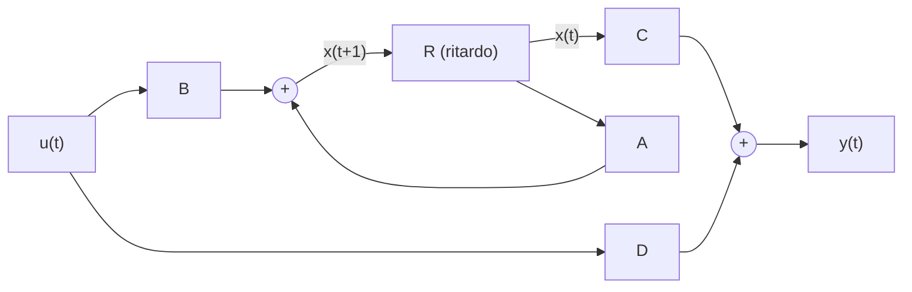

# Esempio massa-molla e sistemi a tempo discreto

> [!abstract] Scopo della lezione
> Due parti:
> 1. un **esempio fisico** (massa, molla e smorzatore) per vedere quando i modi naturali sono aperiodici e quando pseudoperiodici, in funzione dei parametri fisici; è l'applicazione diretta di [[08 - TDS - Modi aperiodici e pseudoperiodici]];
> 2. si passa ai **sistemi a tempo discreto** $x(t+1)=Ax(t)+Bu(t)$: forma esplicita, matrice di transizione $A^t$, modi naturali (che ora sono **potenze** $\lambda^t$ invece di esponenziali $e^{\lambda t}$), osservabilità ed eccitabilità, autovalori complessi in forma polare e i limiti della frequenza nel tempo discreto.
>
> Prosegue in [[10 - TDS - Esempio a tempo discreto e campionamento]]. Indice: [[MOC - Teoria dei Sistemi]].

## Esempio fisico di applicazione

Consideriamo una massa $M$ sostenuta da una molla di costante elastica $k$ e da uno smorzatore di costante $a$; sulla massa agisce una forza $F$ verso l'alto.

![[TDS-L09-01.png]]

L'altezza $h$ è misurata dalla posizione di equilibrio ($h=0$). Le forze sulla massa sono la forza elastica $-kh$ (richiama verso l'equilibrio), quella dello smorzatore $-a\dot h$ (si oppone alla velocità) e la forza esterna $F$. Dalla seconda legge di Newton:

$$M\ddot h(t)=-kh(t)-a\dot h(t)+F(t)$$

È **lineare** (tutti i termini sono di grado 1 in $h$ e nelle sue derivate) e **stazionaria** (nessun coefficiente dipende direttamente dal tempo). Come di consueto si scelgono come stato posizione e velocità:

$$x=\begin{pmatrix}x_1(t)\\x_2(t)\end{pmatrix}=\begin{pmatrix}h(t)\\\dot h(t)\end{pmatrix},\qquad u=F$$

$$\begin{cases}\dot x_1=x_2\\\dot x_2=-\dfrac kM x_1-\dfrac aM x_2+\dfrac1Mu\end{cases}
\qquad\Longrightarrow\qquad
\dot x=\begin{pmatrix}0&1\\-k/M&-a/M\end{pmatrix}x+\begin{pmatrix}0\\1/M\end{pmatrix}u$$

Se $A$ ha autovalori reali il moto è esponenziale (aperiodico); se ha una coppia complessa coniugata, il modo è pseudoperiodico. Posto $M=1$ per semplicità, il polinomio caratteristico è

$$\det(A-\lambda I)=\det\begin{pmatrix}-\lambda&1\\-k&-a-\lambda\end{pmatrix}=\lambda^2+a\lambda+k\stackrel{\text{set}}{=}0$$

(negli appunti $\stackrel{\text{set}}{=}$ vuol dire "deve essere imposto uguale a"), da cui

$$\lambda_{1,2}=\frac{-a\pm\sqrt{a^2-4k}}{2}$$

Tutto dipende dal discriminante:

| Condizione | Autovalori | Moto |
|---|---|---|
| $a^2-4k>0$ | reali distinti, entrambi negativi | esponenziale decrescente (aperiodico) |
| $a^2-4k<0$ | $\alpha\pm j\omega$ con $\alpha=-\frac a2$, $\omega=\frac12\sqrt{4k-a^2}$ | pseudoperiodico decrescente |
| $a^2-4k=0$ | $\lambda=-\frac a2$ doppio | caso non regolare (vedi sotto) |

Nel caso reale entrambi gli autovalori sono negativi: $\sqrt{a^2-4k}<a$ (con $k>0$), quindi anche $-a+\sqrt{a^2-4k}<0$, e il moto $e^{\lambda_it}$ è necessariamente decrescente. Nel caso complesso l'ampiezza delle oscillazioni è regolata da $e^{\alpha t}$ con $\alpha=-a/2<0$: di nuovo decrescente. Fisicamente: uno smorzatore con $a>0$ dissipa energia, quindi il moto libero si spegne sempre.

> [!warning] Correzione
> Gli appunti scrivono $\omega=\frac12\sqrt{a^2-4k}$: con $a^2-4k<0$ la radice è immaginaria. La pulsazione reale è $\omega=\frac12\sqrt{4k-a^2}$, cioè la parte immaginaria di $\frac{-a\pm j\sqrt{4k-a^2}}{2}$.

> [!example] L'automobile
> Si può pensare al sistema come alla sospensione di un'automobile. Ammortizzatori di qualità hanno $k$ e $a$ tali da garantire un moto **esponenziale** decrescente, senza oscillazioni dopo una buca: cioè $a^2-4k>0$. Con ammortizzatori scarichi ($a$ piccolo) si ha $a^2-4k<0$ e la macchina "ondeggia".

Se $a^2-4k=0$ l'autovalore è doppio e tutto dipenderebbe dalla molteplicità geometrica: se fosse 2 la matrice sarebbe diagonalizzabile, altrimenti il caso non è regolare e non abbiamo ancora gli strumenti per trattarlo.

> [!note] Precisazione
> In questo esempio la molteplicità geometrica è **sempre 1**: $A-\lambda I=\begin{psmallmatrix}-\lambda&1\\-k&-a-\lambda\end{psmallmatrix}$ ha sempre rango almeno 1 grazie all'elemento $1$ in alto a destra, quindi $\dim\ker(A-\lambda I)=1$. Con $a^2=4k$ la matrice non è mai diagonalizzabile (è lo **smorzamento critico**), e il caso si tratterà con le catene di autovettori.

Infine, al variare di $k$ e $a$ cambia "quanto velocemente si va a zero": il moto è del tipo $e^{\lambda_it}$, e più l'autovalore è negativo più è rapido. Per le radici complesse la velocità di convergenza è determinata solo da $\alpha$, perché la legge di moto è del tipo $e^{\alpha t}\sin(\omega t+\varphi)$.

> [!quote] Dal libro — l'esempio massa-molla-smorzatore
> Il libro calcola anche $e^{At}$ per questo sistema (Esempio 2.2.1). Posto $\Delta=b^2-4kM$ (con $b$ coefficiente di attrito, la nostra $a$): gli autovalori sono $\lambda_{1,2}=\frac{-b\pm\sqrt\Delta}{2M}$ con autovettori $u_1=\begin{psmallmatrix}-b-\sqrt\Delta\\2k\end{psmallmatrix}$, $u_2=\begin{psmallmatrix}-b+\sqrt\Delta\\2k\end{psmallmatrix}$ se $\Delta>0$; se $\Delta<0$ si usa la base reale $u_a=\begin{psmallmatrix}-b\\2k\end{psmallmatrix}$, $u_b=\begin{psmallmatrix}-\sqrt{|\Delta|}\\0\end{psmallmatrix}$ e
> $$e^{At}=e^{-\frac{b}{2M}t}\Big(\cos\tfrac{\sqrt{|\Delta|}}{2M}t\,(u_av_a'+u_bv_b')+\sin\tfrac{\sqrt{|\Delta|}}{2M}t\,(u_av_b'-u_bv_a')\Big).$$
> "Il caso $\Delta=0$ viene trattato nel seguito poiché corrisponde ad una matrice non regolare." _(libro, §2.2.1, pp. 51–52)_

## Sistemi a tempo discreto

Vedi [[TDS - Sistemi a tempo discreto]].

> [!note] Annotazioni di Simone
> Sul PDF, prima di questa sezione, è scritto a mano in rosso: **"TEMPO DISCRETO"**.

Finora abbiamo visto sistemi a tempo **continuo**. Nel tempo discreto il ruolo che nel continuo ha la derivata $\dot x$ (la variazione istantanea) lo ha lo **stato all'istante successivo** $x(t+1)$. La forma implicita a tempo discreto è

$$\begin{cases}x(t+1)=Ax(t)+Bu(t)\\y(t)=Cx(t)+Du(t)\end{cases}\qquad t\in\mathbb Z$$

Il caso discreto è del tutto analogo a quello continuo: $y(t)$ è l'uscita al tempo $t$, mentre dello stato non conosciamo una legge "istantanea", ma solo come sarà al passo $t+1$ dato lo stato al passo $t$. Per passare alla forma esplicita si scrive l'equazione "passo per passo", partendo da $t_0$ e $x(t_0)$:

$$\begin{aligned}
x(t_0+1)&=Ax(t_0)+Bu(t_0)\\
x(t_0+2)&=Ax(t_0+1)+Bu(t_0+1)=A\big[Ax(t_0)+Bu(t_0)\big]+Bu(t_0+1)=A^2x(t_0)+ABu(t_0)+Bu(t_0+1)\\
x(t_0+3)&=Ax(t_0+2)+Bu(t_0+2)=A^3x(t_0)+A^2Bu(t_0)+ABu(t_0+1)+Bu(t_0+2)
\end{aligned}$$

Si vede un **pattern**, che si generalizza a un passo $k$ qualsiasi:

$$x(t_0+k)=A^kx(t_0)+A^{k-1}Bu(t_0)+A^{k-2}Bu(t_0+1)+\dots+Bu(t_0+k-1)=A^kx(t_0)+\sum_{\tau=t_0}^{t_0+k-1}A^{t_0+k-1-\tau}Bu(\tau)$$

Continuando ad aggiungere 1 si arriva al tempo $t$ cercato; ponendo $t_0+k=t$, cioè $k=t-t_0$:

$$x(t)=\underbrace{A^{t-t_0}x(t_0)}_{\text{evoluzione libera}}+\underbrace{\sum_{\tau=t_0}^{t-1}A^{t-1-\tau}Bu(\tau)}_{\text{evoluzione forzata}}$$

La prima parte non dipende dall'ingresso ed è l'**evoluzione libera**; la sommatoria dipende dall'ingresso ed è l'**evoluzione forzata**. Nel discreto si vede bene che l'istante $t$ **non è incluso**: il limite superiore è $t-1$ (l'ingresso al tempo $t$ influenza lo stato solo da $t+1$ in poi). Coerentemente con il continuo si definiscono

$$\Phi(t)=A^t,\qquad H(t)=A^{t-1}B\quad(t\ge1)\qquad\Longrightarrow\qquad x(t)=\Phi(t-t_0)x(t_0)+\sum_{\tau=t_0}^{t-1}H(t-\tau)u(\tau)$$

La struttura è la stessa del continuo, con le ovvie differenze (**somme invece di integrali**). Anche qui $H$ dà il peso dell'ingresso, e si chiama **matrice delle risposte impulsive**, dove l'**impulso discreto** è

$$\delta(t)=\begin{cases}1&t=0\\0&t\neq0\end{cases}$$

Per l'uscita si sostituisce $x(t)$ in $y(t)=Cx(t)+Du(t)$:

$$y(t)=C\Phi(t-t_0)x(t_0)+\sum_{\tau=t_0}^{t-1}CH(t-\tau)u(\tau)+Du(t)$$

Chiamando $\Psi(t):=C\Phi(t)=CA^t$ e

$$W(t):=\begin{cases}CH(t)=CA^{t-1}B&t\ge1\\D&t=0\end{cases}$$

il termine $Du(t)$ si può inglobare nella sommatoria come termine $\tau=t$:

$$y(t)=\Psi(t-t_0)x(t_0)+\sum_{\tau=t_0}^{t}W(t-\tau)u(\tau)$$

> [!note] Annotazioni di Simone
> Sul PDF, accanto ai riquadri: **"Forma Esplicita Compatta dell'ingresso"** (per $x(t)$), **"Forma Esplicita Compatta dell'uscita"** (per $y(t)$) e **"impulso discreto"** accanto a $\delta(t)$; sotto la formula di $x(t)$: "ev. Libera" e "ev. forzata".

**Ritorno alla forma implicita.** Come nel continuo, verifichiamo che le espressioni trovate siano valide tornando alla forma implicita: prendiamo $x(t)$ e calcoliamo $x(t+1)$ ponendo $t_0=t$ e $t+1$ al posto di $t$:

$$x(t+1)=\Phi(1)x(t)+\sum_{\tau=t}^{t}H(t+1-\tau)u(\tau)=\Phi(1)x(t)+H(1)u(t)$$

e poiché $\Phi(1)=A^t\big|_{t=1}=A$ e $H(1)=A^{t-1}B\big|_{t=1}=B$, si ritrovano le stesse matrici: le due scritture (implicita ed esplicita) sono equivalenti.

> [!warning] Correzione
> Negli appunti si legge "come fatto nel caso **discreto**, torniamo indietro e troviamo la forma implicita": il confronto è con il caso **continuo** ([[04 - TDS - Uscita forzata e dalla forma esplicita alla implicita#Dalla forma esplicita alla forma implicita|lezione 4]]).

> [!quote] Dal libro
> Il libro presenta lo **schema di simulazione** del sistema discreto: l'ingresso passa per $B$, si somma ad $Ax(t)$ e il risultato $x(t+1)$ entra in un blocco **ritardo** $R$ che restituisce $x(t)$; l'uscita è $Cx(t)+Du(t)$. Mette così in luce "la struttura del legame ingresso-uscita: vi è una parte dinamica, che prevede dei ritardi, ed una parte istantanea". Nel caso $D=0$ la risposta forzata in uscita al tempo $t$ dipende solo dai valori dell'ingresso fino a $t-1$: il legame è **strettamente causale**. _(libro, §2.5, pp. 81–82)_

### Calcolo di $A^t$ e modi naturali

Se $A$ è diagonale, $A^t$ è immediata; se è diagonalizzabile si usa la forma spettrale come nel continuo:

$$A=\begin{pmatrix}\lambda_1&&\\&\ddots&\\&&\lambda_n\end{pmatrix}\Rightarrow A^t=\begin{pmatrix}\lambda_1^t&&\\&\ddots&\\&&\lambda_n^t\end{pmatrix},\qquad A=U\Lambda U^{-1}=\sum_{i=1}^n\lambda_iu_iv_i'\Rightarrow A^t=U\Lambda^tU^{-1}=\sum_{i=1}^n\lambda_i^tu_iv_i'$$

Con autovalori reali l'evoluzione libera e i modi naturali sono

$$x_L(t)=A^tx_0=\sum_{i=1}^n\lambda_i^t\,u_i\,v_i'x_0=\sum_{i=1}^nc_i\,\lambda_i^t\,u_i$$

È l'equivalente del modo aperiodico del continuo. L'andamento è sempre "esponenziale", ma l'autovalore non sta più all'**esponente** ($e^{\lambda t}$), sta alla **base** ($\lambda^t$). Quindi:

![[TDS-L09-02.png]]

| $\lambda$ | Andamento di $\lambda^t$ |
|---|---|
| $\lambda>1$ | diverge |
| $0<\lambda<1$ | converge a zero |
| $-1<\lambda<0$ | converge a zero **alternando il segno** |
| $\lambda<-1$ | diverge **alternando il segno** |

L'andamento per $\lambda<0$ (alternante) **non si può avere nel tempo continuo**: $e^{\lambda t}$ è sempre positivo. Nel discreto la soglia tra convergenza e divergenza non è più $\lambda=0$ ma $|\lambda|=1$.

> [!note] Annotazioni di Simone
> Sul PDF, accanto ai quattro grafici: **"diverge"** ($\lambda>1$), **"Converge"** ($0<\lambda<1$), **"Converge in modo Alternato"** ($-1<\lambda<0$), **"Diverge in modo alternato"** ($\lambda<-1$).

> [!quote] Dal libro — modi aperiodici e alternanti
> Il libro distingue tre tipi di modi nel tempo discreto: **aperiodici** (autovalori reali positivi), **alternanti** (autovalori reali negativi) e **pseudoperiodici** (coppie complesse). Nel modo alternante con molteplicità 1 il moto avviene lungo una retta, "alternandosi da una parte e dall'altra dello zero". La Figura 2.8 del libro riassume gli andamenti al variare della posizione dell'autovalore rispetto alla circonferenza di raggio 1. _(libro, §2.5.2, pp. 87–88)_

### Osservabilità ed eccitabilità nel tempo discreto

Vedi [[TDS - Eccitabilità e osservabilità dei modi]].

Dalla forma spettrale di $A^t$:

$$\Psi(t)=CA^t=\sum_{i=1}^n\lambda_i^t\,Cu_iv_i',\qquad H(t)=A^{t-1}B=\sum_{i=1}^n\lambda_i^{t-1}u_iv_i'B,\qquad W(t)=CA^{t-1}B=\sum_{i=1}^n\lambda_i^{t-1}Cu_iv_i'B\ \ (t\ge1)$$

Compaiono sempre i prodotti $Cu_i$ e $v_i'B$, che possono essere nulli o meno proprio come nel continuo. È una condizione **puramente geometrica**, che non dipende dal fatto che il sistema sia a tempo continuo o discreto: le nozioni di osservabilità ed eccitabilità restano **invariate**.

> [!warning] Correzione
> Negli appunti si scrive $H(t)=A^tB$ e $W(t)=CA^tB=A^t=\sum\lambda_i^tCu_iv_i'B$. Coerentemente con la definizione data poco sopra, nel discreto $H(t)=A^{t-1}B$ e $W(t)=CA^{t-1}B$ per $t\ge1$ (con $W(0)=D$); il "$=A^t$" è un refuso. Le conclusioni su osservabilità ed eccitabilità non cambiano, perché dipendono solo da $Cu_i$ e $v_i'B$.

**Notazione.** Con un abuso di notazione (usare un simbolo per qualcosa che formalmente è un'altra cosa, per comodità), il professore indica con $\Lambda$ l'*insieme* degli autovalori, con $\Lambda_o$ quelli osservabili, con $\Lambda_e$ quelli eccitabili e con $\Lambda_{e,o}$ quelli sia eccitabili sia osservabili. Per esempio:

$$\Lambda=\{\lambda_1,\dots,\lambda_n\},\quad\Lambda_o=\{\lambda_2,\lambda_4\},\quad\Lambda_e=\{\lambda_1,\lambda_3,\lambda_4\}\quad\Longrightarrow\quad\Lambda_{e,o}=\Lambda_o\cap\Lambda_e=\{\lambda_4\}$$

> [!example] Dal libro — Esempio 2.5.1
> $x(t+1)=\begin{psmallmatrix}\frac12&0&0\\1&0&1\\1&-1&-\frac52\end{psmallmatrix}x+\begin{psmallmatrix}0\\0\\1\end{psmallmatrix}u$, $y=(1\ 1\ 2)x$. Autovalori $\frac12$, $-\frac12$, $-2$: un modo aperiodico convergente, uno **alternante convergente** e uno **alternante divergente**. Con $u_1=(5,8,-1)'$, $u_2=(0,2,-1)'$, $u_3=(0,1,-2)'$:
> - $\lambda_1=\frac12$: $v_1'B=0$, $Cu_1=11\neq0$ → non eccitabile, osservabile;
> - $\lambda_2=-\frac12$: $v_2'B=\frac13$, $Cu_2=0$ → eccitabile, non osservabile;
> - $\lambda_3=-2$: $v_3'B=-\frac23$, $Cu_3=0$ → eccitabile, non osservabile.
>
> Quindi $\Lambda_{e,o}=\emptyset$: la risposta impulsiva in uscita è nulla per $t\ge1$, anche se il sistema ha un modo divergente. _(libro, §2.5.2, pp. 88–90)_

### Autovalori complessi nel tempo discreto

Supponiamo per semplicità che il sistema abbia solo una coppia complessa $\lambda,\lambda^*$, con autovettori $u,u^*$. Come nel continuo si cerca un'espressione con soli termini reali:

$$A=U\Lambda U^{-1}=(u\ \ u^*)\begin{pmatrix}\lambda&0\\0&\lambda^*\end{pmatrix}(u\ \ u^*)^{-1}=(u_a\ \ u_b)\begin{pmatrix}1&1\\j&-j\end{pmatrix}\begin{pmatrix}\lambda&0\\0&\lambda^*\end{pmatrix}\begin{pmatrix}\frac12&\frac1{2j}\\\frac12&-\frac1{2j}\end{pmatrix}(u_a\ \ u_b)^{-1}$$

e sappiamo che la parte centrale è $\begin{psmallmatrix}\alpha&\omega\\-\omega&\alpha\end{psmallmatrix}$.

> [!note] Annotazione di Simone
> Accanto a $\begin{psmallmatrix}\alpha&\omega\\-\omega&\alpha\end{psmallmatrix}$, a mano: **"Scrittura NON conveniente nel caso Discreto"**.

Questa scrittura infatti **non è comoda per calcolare le potenze**: nel continuo si doveva calcolare $e^{\begin{psmallmatrix}\alpha&\omega\\-\omega&\alpha\end{psmallmatrix}t}$, qui serve $\begin{psmallmatrix}\alpha&\omega\\-\omega&\alpha\end{psmallmatrix}^t$. Rifacciamo il calcolo partendo dalla forma diagonale:

$$A^t=U\Lambda^tU^{-1}=(u_a\ \ u_b)\begin{pmatrix}1&1\\j&-j\end{pmatrix}\begin{pmatrix}\lambda^t&0\\0&\lambda^{*t}\end{pmatrix}\begin{pmatrix}\frac12&\frac1{2j}\\\frac12&-\frac1{2j}\end{pmatrix}(u_a\ \ u_b)^{-1}$$

Nel continuo scrivere $\lambda=\alpha+j\omega$ era comodo perché $e^{(\alpha+j\omega)t}=e^{\alpha t}e^{j\omega t}$; qui servirebbe $(\alpha+j\omega)^t$, per niente comodo. Conviene scrivere il numero complesso in **coordinate polari**, cioè con **modulo** e **fase**:

$$\alpha+j\omega\iff\rho e^{j\theta}$$

![[TDS-L09-03.png]]

A sinistra il numero $\alpha+j\omega$ nel piano complesso con parte reale $\alpha$ e parte immaginaria $\omega$; a destra lo stesso punto individuato dalla distanza $\rho$ dall'origine e dall'angolo $\theta$ con l'asse reale. Sono due scritture equivalenti:

$$\rho=\sqrt{\alpha^2+\omega^2},\qquad\theta=\arctan(\omega/\alpha),\qquad\alpha=\rho\cos\theta,\quad\omega=\rho\sin\theta$$

> [!note]
> La formula $\theta=\arctan(\omega/\alpha)$ vale così com'è solo per $\alpha>0$; se $\alpha<0$ bisogna aggiungere $\pi$ (il punto è nel II o III quadrante). In generale $\theta$ è l'argomento del numero complesso (vedi [[11 - AN1 - Numeri Complessi]] e [[Numeri complessi]]).

Con questa notazione $\lambda^t=(\rho e^{j\theta})^t=\rho^te^{j\theta t}$, molto più semplice da trattare; inoltre $\lambda^*=\rho e^{-j\theta}$. Calcoliamo la parte centrale:

$$\begin{pmatrix}1&1\\j&-j\end{pmatrix}\begin{pmatrix}\rho^te^{j\theta t}&0\\0&\rho^te^{-j\theta t}\end{pmatrix}\begin{pmatrix}\frac12&\frac1{2j}\\\frac12&-\frac1{2j}\end{pmatrix}=\begin{pmatrix}\rho^te^{j\theta t}&\rho^te^{-j\theta t}\\j\rho^te^{j\theta t}&-j\rho^te^{-j\theta t}\end{pmatrix}\begin{pmatrix}\frac12&\frac1{2j}\\\frac12&-\frac1{2j}\end{pmatrix}=\begin{pmatrix}\rho^t\cos\theta t&\rho^t\sin\theta t\\-\rho^t\sin\theta t&\rho^t\cos\theta t\end{pmatrix}$$

usando le formule di Eulero ($e^{jz}=\cos z+j\sin z$). Quindi:

$$\boxed{\Lambda^t=\begin{pmatrix}\alpha&\omega\\-\omega&\alpha\end{pmatrix}^t=\begin{pmatrix}\rho\cos\theta&\rho\sin\theta\\-\rho\sin\theta&\rho\cos\theta\end{pmatrix}^t=\begin{pmatrix}\rho^t\cos\theta t&\rho^t\sin\theta t\\-\rho^t\sin\theta t&\rho^t\cos\theta t\end{pmatrix}}$$

Il blocco è una rotazione di angolo $\theta$ moltiplicata per $\rho$: elevarlo alla $t$ significa ruotare di $\theta t$ e scalare di $\rho^t$. Anche qui $\Lambda$ è diagonale "a blocchi": diagonale per gli autovalori reali, con un blocco seno/coseno per ogni coppia complessa.

> [!note] Annotazioni di Simone
> In fondo alla pagina, a mano: **"Unica differenza ρᵗ al posto di e"** e, in un riquadro con la scritta "Evoluzione Libera", la formula dell'evoluzione libera (trascrizione dalla scrittura a mano):
> $$x_L(t)=\lambda_1^tu_1v_1'x_0+\rho^t\big[\cos(\theta t)(u_av_a'+u_bv_b')+\sin(\theta t)(u_av_b'-u_bv_a')\big]x_0$$

> [!quote] Dal libro — forma spettrale della potenza
> Il libro arriva allo stesso blocco $\Lambda^t=\sigma^t\begin{psmallmatrix}\cos\theta t&\sin\theta t\\-\sin\theta t&\cos\theta t\end{psmallmatrix}$ (indica il modulo con $\sigma$) e chiama
> $$A^t=\sum_i\lambda_i^tu_iv_i'+\sum_j\sigma_j^t\big(\cos\theta_jt\,(u_{ja}v_{ja}'+u_{jb}v_{jb}')+\sin\theta_jt\,(u_{ja}v_{jb}'-u_{jb}v_{ja}')\big)$$
> **forma spettrale della potenza di matrice**. Il modo pseudoperiodico discreto è $m\,|\lambda|^t\big(\sin(\theta t+\varphi)u_a+\cos(\theta t+\varphi)u_b\big)$ con $0<\theta<\pi$. _(libro, §2.5.1–2.5.2, pp. 86–87)_

### Alcune osservazioni sul moto pseudoperiodico

La differenza fondamentale tra il moto pseudoperiodico continuo e quello discreto riguarda la frequenza. Nel continuo la pulsazione $\omega$ può assumere qualsiasi valore reale, e a valori diversi corrispondono frequenze diverse. Nel discreto no: $\theta$ è la **fase** di un numero complesso, quindi è definita a meno di multipli di $2\pi$. Può assumere qualsiasi valore reale, ma $\theta=\theta_0+2k\pi$ con $\theta_0\in[0,2\pi)$ dà gli **stessi** campioni, perché $e^{j(\theta_0+2k\pi)t}=e^{j\theta_0t}$ per $t$ intero. La frequenza si può far variare solo nell'intervallo $[0,2\pi)$: per valori di $\theta$ maggiori le frequenze si ripetono.

![[TDS-L09-04.png]]

A sinistra $\sin\big(\frac\pi4t\big)$, a destra $\sin\big(\frac{9\pi}4t\big)$. Nel tempo continuo (linea tratteggiata) la seconda oscilla molto più velocemente, ma nel tempo discreto (punti rossi, valori agli istanti interi) le due sono **identiche**: $\frac{9\pi}{4}=\frac\pi4+2\pi$. La curva rossa continua a destra evidenzia proprio la sinusoide lenta "vista" dai campioni.

> [!note] Annotazione di Simone
> Accanto ai grafici, a mano: **"Si vede che alla fine che la frequenza nel tempo discreto ha un valore massimo"**.

> [!tip] Collegamento
> È lo stesso fenomeno dell'**aliasing** nel campionamento: campionando un segnale troppo veloce, lo si confonde con uno più lento. Si ritroverà nel passaggio da tempo continuo a tempo discreto ([[10 - TDS - Esempio a tempo discreto e campionamento]]).

Un'altra osservazione: il modulo $\rho$ è sempre positivo, quindi, come nel continuo, si hanno "esponenziali" con base positiva (nel continuo la base era $e$); la convergenza dipende da $\rho<1$ o $\rho>1$. Eccitabilità e osservabilità non cambiano e sono identiche al tempo continuo.
