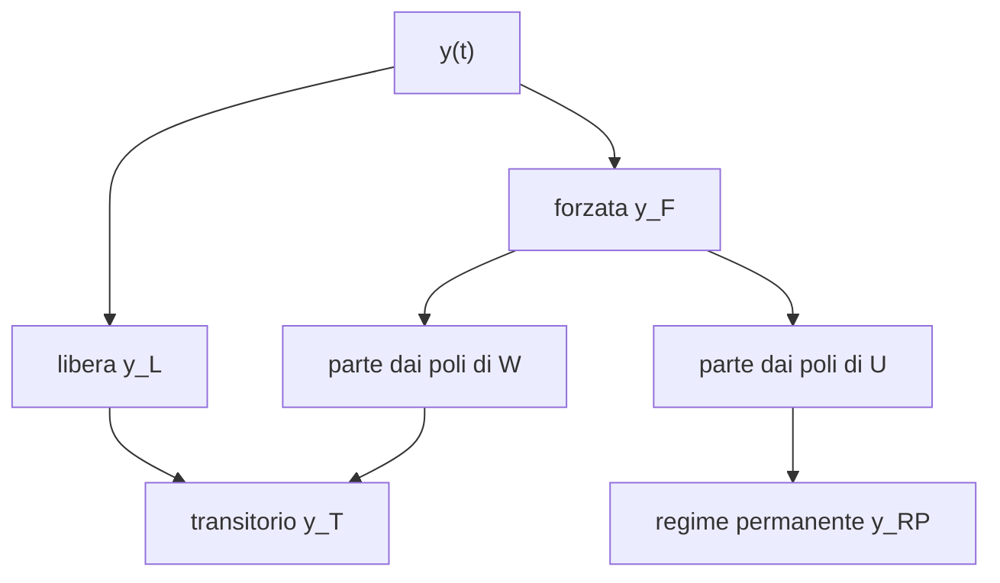

# Risposta a regime permanente

> [!abstract] Scopo della lezione
> 1. **Trasformate nel tempo discreto campionato**: data la $W(s)$ di un sistema continuo, come si trova la $W(z)$ del sistema campionato con tenuta di ordine zero ([[10 - TDS - Esempio a tempo discreto e campionamento#Tempo discreto campionato|lezione 10]]), usando la risposta al gradino.
> 2. **Risposta a regime permanente**: dalla [[20 - TDS - Risposta forzata nel tempo discreto|lezione precedente]] la risposta forzata si divide in una parte dovuta ai poli del sistema e una dovuta all'ingresso. Se la prima si spegne, resta la seconda: è il **regime permanente**, definito come limite per $t_0\to-\infty$. Si scompone l'uscita in **transitorio + regime**, e si ricavano formule immediate per ingressi a **gradino**, **rampa** e **polinomiali** (i **momenti** di $W$).
>
> Segue [[22 - TDS - Risposta armonica e forma di Bode]]. Indice: [[MOC - Teoria dei Sistemi]].

## Trasformate nel tempo discreto campionato

Vedi [[TDS - Campionamento]].

> [!note] Annotazione di Simone
> In testa alla lezione, a mano in rosso: **"TRASFORMATE CAMPIONATO"**.

I sistemi a tempo continuo si esprimono nel dominio trasformato (visto) e lo stesso i sistemi a tempo discreto con la trasformata Z (appena visto):

$$\begin{cases}X(s)=\Phi(s)x_0+H(s)U(s)\\Y(s)=\Psi(s)x_0+W(s)U(s)\end{cases}\qquad\qquad\begin{cases}X(z)=\Phi(z)x_0+H(z)U(z)\\Y(z)=\Psi(z)x_0+W(z)U(z)\end{cases}$$

Ci sono poi i sistemi a tempo discreto che non sono altro che sistemi continui "osservati" a intervalli regolari: come si esprimono nel dominio trasformato? Si considera un sistema continuo $\mathcal S_{tc}$ con ingresso discreto $u_d(t)$, reso continuo da una tenuta di ordine zero $H_0$ (ZOH); l'uscita continua $y_c(t)$ viene campionata ogni $T_c$ e diventa l'uscita discreta $y_d(k)$:

![[TDS-L21-01.png]]

Se interessa solo il legame ingresso-uscita, il sistema continuo si rappresenta con la sua funzione di trasferimento $W(s)$, e si vuole $W(z)$ in termini di $W(s)$. Bisogna: prendere un ingresso $u_d(t)$, tenerlo con lo ZOH per avere $u_c(t)$, farlo passare nel sistema continuo producendo $y_c(t)$, e campionarlo per avere $y_d(k)=y_c(kT_c)$.

Per semplicità $p=q=1$ (ingresso e uscita scalari), e si sceglie un ingresso facile da campionare e da calcolare: quello **costante**, $u_d(t)=\delta_{-1}(t)$, il gradino discreto. Tenendolo con lo ZOH si ottiene un ingresso continuo sempre costante, $u_c(t)=\delta_{-1}(t)$ (il gradino continuo). Allora

$$Y_F(s)=W(s)U(s)=W(s)\mathcal L[\delta_{-1}(t)]=W(s)\frac1s\quad\Longrightarrow\quad y_F(t)=\mathcal L^{-1}\left[W(s)\frac1s\right]$$

dove $y_F$ è la parte forzata dell'uscita continua; con $y_{dF}$ si indica quella dell'uscita discreta.

> [!note] Annotazioni di Simone
> A mano: "Funzione gradino discreta" accanto a $\delta_{-1}(t)$; "$u_d(t)=\delta_{-1}(t)=u_c(t)$ discreto e continuo"; "Siamo nel caso continuo".

Ora va **trovato** $y_d(k)$, che non è altro che l'uscita continua calcolata negli istanti multipli di $T_c$ (considerando solo la parte forzata):

$$y_{dF}(k)=y_F(kT_c)=\mathcal L^{-1}\left[W(s)\frac1s\right]_{t=kT_c}$$

> [!note] Annotazione di Simone
> Simone ha barrato "campionare" e scritto sopra **"TROVARE"**, e accanto **"Campionando $y_c(t)$"**.

Per la $W(z)$ cercata: $Y_{dF}(z)=W(z)U(z)$, dove (considerandola in $z$)

$$Y_{dF}(z)=\mathcal Z[y_{dF}(k)]=\mathcal Z\left[\mathcal L^{-1}\left[W(s)\frac1s\right]_{t=kT_c}\right]$$

e con l'ingresso costante $U(z)=\mathcal Z[\delta_{-1}(t)]=\frac{z}{z-1}$, da cui

$$\mathcal Z\left[\mathcal L^{-1}\left[W(s)\frac1s\right]_{t=kT_c}\right]=W(z)\frac{z}{z-1}\quad\Longrightarrow\quad\boxed{W(z)=\frac{z-1}{z}\ \mathcal Z\left[\mathcal L^{-1}\left[W(s)\frac1s\right]_{t=kT_c}\right]}$$

> [!note] Annotazioni di Simone
> A mano: "Considero in z", "Inserisco qui", "Trasformata dell'ingresso".

> [!tip] Perché si può usare un solo ingresso
> $W(z)$ è una proprietà del sistema campionato, che è lineare e stazionario: basta conoscerne la risposta a un ingresso qualsiasi (con trasformata non nulla) e dividere. Il gradino è comodo perché lo ZOH lo lascia invariato: il gradino discreto tenuto è esattamente il gradino continuo.

### Esempio pratico

Con $u_d(t)=\delta_{-1}(t)$ e

$$W(s)=\frac1{s+10}$$

prima si trova $y_F(t)$ (antitrasformando):

$$y_F(t)=\mathcal L^{-1}\left[W(s)\frac1s\right]=\mathcal L^{-1}\left[\frac1{s(s+10)}\right]=\mathcal L^{-1}\left[\frac{R_1}{s}+\frac{R_2}{s+10}\right]=R_1+R_2e^{-10t}$$

con $R_1=\frac1{10}$ e $R_2=-\frac1{10}$ (calcolati come sempre). Ora si campiona ($t=T_ck$):

$$y_{dF}(k)=\big[R_1+R_2e^{-10t}\big]_{t=kT_c}=R_1+R_2e^{-10T_ck}$$

Si trasforma in $z$ l'uscita ottenuta:

$$\mathcal Z[y_F(kT_c)]=\mathcal Z\big[R_1+R_2(e^{-10T_c})^k\big]=\frac{z}{z-1}R_1+\frac{z}{z-e^{-10T_c}}R_2$$

e infine si moltiplica per $\frac{z-1}{z}$ (perché $W(z)=\frac{Y_F(z)}{U(z)}$):

$$W(z)=\left(\frac{z}{z-1}R_1+\frac{z}{z-e^{-10T_c}}R_2\right)\frac{z-1}{z}=R_1+\frac{z-1}{z-e^{-10T_c}}R_2$$

> [!note] Annotazioni di Simone
> A mano: "antitrasformo", "Calcolati come sempre", "Converto t = Tc·k", "Trasformo in z", "Infine ricavo $W(z)=\frac{Y_F(z)}{U(z)}$".

Studiando i sistemi campionati si era visto che gli autovalori del tempo discreto sono

$$\lambda_d=e^{\lambda_cT_c}$$

e in effetti si è partiti da $\lambda_c=-10$ ($W(s)=\frac1{s+10}=\frac1{s-\lambda_c}$) e si è trovato proprio $\lambda_d=e^{-10T_c}$:

$$W(z)=R_1+\frac{z-1}{z-e^{-10T_c}}R_2=R_1+\frac{z-1}{z-\lambda_d}R_2$$

> [!tip] Verifica
> Sviluppando: $W(z)=\frac1{10}\cdot\frac{(z-\lambda_d)-(z-1)}{z-\lambda_d}=\frac{1}{10}\cdot\frac{1-e^{-10T_c}}{z-e^{-10T_c}}$. È strettamente propria (lo ZOH introduce un passo di ritardo) e $W(1)=\frac1{10}=W(s)\big|_{s=0}$: il **guadagno statico** si conserva, perché a regime un ingresso costante resta costante in entrambi i mondi.

> [!quote] Dal libro — la stessa cosa nello spazio di stato
> Nel §2.6 il libro discretizza la rappresentazione con lo stato: $A_T=e^{AT}$, $B_T=\int_0^Te^{A\vartheta}d\vartheta\,B$, $C_T=C$, $D_T=D$ (vedi [[10 - TDS - Esempio a tempo discreto e campionamento#Il modello matematico del sistema campionato|lezione 10]]). Per l'esempio, $A=-10$, $B=1$, $C=1$: $A_T=e^{-10T}$, $B_T=\frac{1-e^{-10T}}{10}$ e quindi $W(z)=\frac{B_T}{z-A_T}$, lo stesso risultato. _(libro, §2.6, pp. 91–94)_

## Risposta a regime permanente

Vedi [[TDS - Regime permanente]].

> [!note] Annotazione di Simone
> Accanto al titolo, a mano in rosso: **"REGIME PERMANENTE"**.

Già dalla scorsa lezione si è notato che la risposta forzata è la somma di due contributi: una parte che "nasce" dai poli di $W$ e una che "nasce" dai poli introdotti dall'ingresso. Con

$$W(s)=\frac{1}{(s+1)(s+2)}$$

e un certo $u(t)$ (o $U(s)$):

$$y_F(t)=\mathcal L^{-1}\left[\frac{1}{(s+1)(s+2)}U(s)\right]=\mathcal L^{-1}\Bigg[\frac{R_1}{s+1}+\frac{R_2}{s+2}+\overbrace{\cdots}^{\text{parte dipendente da }U(s)}\Bigg]=R_1e^{-t}+R_2e^{-2t}+\cdots$$

L'antitrasformata della parte dipendente da $U(s)$ è un'espressione "simile" all'ingresso. In particolare, più i termini dipendenti da $W$ tendono a zero, più l'uscita tende a somigliare all'ingresso. Per l'uscita libera vale lo stesso: se i modi naturali presenti in essa tendono a zero per $t\to+\infty$, questa tende a sparire. Considerando l'uscita

$$y(t)=\underbrace{\Psi(t-t_0)x(t_0)}_{\text{uscita libera}}+\underbrace{\int_{t_0}^{t}W(t-\tau)u(\tau)\,d\tau}_{\text{uscita forzata}}$$

se $\Psi$ (che è molto simile a $W$, a meno di modi naturali che potrebbero comparire in più) **tende a zero**, per $t\to+\infty$ l'uscita **non dipende** da $x(t_0)$; e se va a zero anche la parte di uscita dovuta a $W$, l'uscita assomiglia sempre di più all'ingresso. In questo caso il sistema, per $t\to+\infty$, non dipende dalla condizione iniziale.

> [!note] Annotazione di Simone
> Accanto a "Se Ψ": **"Solo se tutti i λ < 0"**.

Il vantaggio di un sistema che non dipende da $x(t_0)$ è che il limite dell'uscita per $t\to+\infty$ corrisponde praticamente al limite dell'ingresso. Il problema è che, fisicamente e ingegneristicamente, un'uscita che vale solo "per $t$ tendente all'infinito" non si può usare. Per una definizione formale si sfrutta la **stazionarietà**: fare lo stesso esperimento in un altro momento non cambia il risultato. Allora, invece di far aumentare $t$, si fa diminuire $t_0$: invece del limite per $t\to+\infty$ si fa il limite per $t_0\to-\infty$, e si ottiene una grandezza che vale **in $t$**, utilizzabile fisicamente:

$$\lim_{t_0\to-\infty}y(t)=\lim_{t_0\to-\infty}\left(\Psi(t-t_0)x(t_0)+\int_{t_0}^{t}W(t-\tau)u(\tau)\,d\tau\right)=\lim_{t_0\to-\infty}\int_{t_0}^{t}W(t-\tau)u(\tau)\,d\tau$$

> [!note] Annotazioni di Simone
> A mano: "★ differenza formale" (sotto $t_0\to-\infty$); sotto il termine libero: **"va a zero poiché consideriamo il caso in cui il sistema non dipende da $x(t_0)$"**; sotto l'integrale: **"i valori legati a $W(t-\tau)$ vanno a zero"**.

> [!important] Definizione
> Questo vale sempre e solo quando le leggi temporali in $\Psi$ e in $W$ tendono a zero (ed è anche il motivo per cui $\Psi(t-t_0)x(t_0)$ sparisce nel limite). Se il limite esiste, la quantità si chiama **uscita a regime permanente**:
> $$y_{RP}(t)=\int_{-\infty}^{t}W(t-\tau)u(\tau)\,d\tau$$

> [!note] Annotazioni di Simone
> **"Parte importante"** in testa alla pagina; accanto all'integrale: **"L'integrale inoltre deve essere SOMMABILE"**.

Per avere $y_{RP}$ deve valere $\lim_{t_0\to-\infty}\Psi(t-t_0)x(t_0)=0$ e deve esistere l'integrale. La prima condizione è soddisfatta quando gli autovalori **osservabili** hanno tutti parte reale negativa:

$$\lim_{t_0\to-\infty}\Psi(t-t_0)x(t_0)=0\iff\mathrm{Re}(\Lambda_o)<0$$

> [!warning] Correzione
> Negli appunti il limite in questa formula è scritto $\lim_{t\to-\infty}$: è il limite per $t_0\to-\infty$, come nella definizione sopra.

Inoltre l'integrale deve essere **sommabile**: l'ingresso $u$ deve essere tale che, moltiplicato per $W$ (fatta di esponenziali), vada a zero; il più delle volte è così. Ricapitolando, se il prodotto $W(t-\tau)u(\tau)$ non diverge, $\mathrm{Re}(\Lambda_o)<0$ è condizione **necessaria e sufficiente** perché esista $y_{RP}(t)$. Matematicamente basta, ma in generale si preferisce che valga

$$\mathrm{Re}(\Lambda)<0$$

che è solo sufficiente (non necessaria), ma garantisce molti meno problemi di stabilità del sistema.

> [!note] Annotazioni di Simone
> A mano: "parte reale degli autovalori OSSERVABILI"; "Λ, non Λₒ, perciò consideriamo TUTTI GLI AUTOVALORI per la motivazione qui sotto"; e in rosso: **"Ricorda che se ∃ un modo naturale con λ>0 ⇒ ∄ risposta Permanente"**.

> [!quote] Dal libro — Definizione 5.1.1
> "La risposta a regime permanente ad un assegnato ingresso è quella funzione del tempo intorno alla quale, indipendentemente dallo stato iniziale, tende ad assestarsi la risposta in uscita al crescere del tempo." L'indipendenza dallo stato iniziale richiede che i modi osservabili siano a parte reale negativa; ma "per un sistema fisico l'esistenza del regime permanente non può prescindere da un'ulteriore proprietà […]: si tratta della limitatezza di tutte le evoluzioni interne", cioè la stabilità interna. Il libro introduce anche il **tempo di assestamento** $T_a$: $\forall\varepsilon\ \exists T_a$ tale che $\|y(t)-y_r(t)\|<\varepsilon$ per $t\ge T_a$, e $T_a$ dipende dagli autovalori di $A$. _(libro, §5.1, pp. 219–221)_

### Espressione dell'uscita come regime permanente e transitoria

La risposta ha una parte libera e una forzata:

$$y(t)=y_L(t)+y_F(t)\tag{1}$$

Supponendo $y_{RP}(t)$ calcolabile, dove si colloca? Non è $y_L(t)$, che tende a zero; non coincide con $y_F(t)$, che contiene parti che tendono a zero; è **una parte** della risposta forzata, quella che dipende dall'ingresso. Tutto il resto si chiama **uscita transitoria** $y_T(t)$:

$$y(t)=y_T(t)+y_{RP}(t)\tag{2}$$

Dentro $y_T(t)$ c'è tutta la risposta libera $y_L(t)$ più la parte di risposta forzata dovuta a $W$. Le (1) e (2) sono due modi equivalenti di scrivere l'uscita.

> [!quote] Dal libro — esempio della risposta indiciale
> $W^1(s)=\frac1{1+s}$ e $W^2(s)=\frac1{1+0{,}1s}$ (costanti di tempo $\tau_1=1$ e $\tau_2=0{,}1$) hanno la stessa risposta a regime al gradino, $y_r=1$, ma transitori diversi, $y_t^i(t)=-e^{-t/\tau_i}$: il sistema con costante di tempo minore (polo più negativo) raggiunge il regime più velocemente (Figura 5.2 del libro). _(libro, §5.1, p. 225)_

## Studio dell'uscita a regime permanente con vari ingressi

> [!note] Annotazione di Simone
> Accanto al titolo: **"IMPORTANTE Per i calcoli"**.

### Ingresso a gradino

Con $u(t)=\delta_{-1}(t)$ e $W(s)$ con modi naturali tendenti a zero:

$$y_{RP}(t)=\int_{\tau=-\infty}^{\tau=t}W(t-\tau)\cdot1\,d\tau=\int_{\theta=0}^{\theta=+\infty}W(\theta)\,d\theta$$

con il cambio di variabile $\theta=t-\tau$ (per $\tau=-\infty$, $\theta=+\infty$; per $\tau=t$, $\theta=0$; $d\theta=-d\tau$, e il segno meno si annulla scambiando gli estremi).

L'integrale somiglia alla trasformata di Laplace di $W$; manca però il termine $e^{-s\theta}$ (al posto di $t$ c'è $\theta$, ma non cambia nulla). Il termine $e^{-s\theta}$ vale 1 per $s=0$: si può allora moltiplicare dentro l'integrale per $e^{-s\theta}$ e calcolare tutto in $s=0$:

$$\int_0^{+\infty}W(\theta)\,d\theta=\int_0^{+\infty}W(\theta)e^{-s\theta}\,d\theta\Big|_{s=0}$$

Le due forme sono equivalenti, ma la seconda si sa calcolare: vale esattamente $W(s)|_{s=0}$, una **costante**.

> [!note] Annotazioni di Simone
> A mano: "Ingresso $\delta_{-1}(t)$ oppure $k\delta_{-1}(t)$"; "Faccio questo procedimento per poter avere una forma simile alla trasformata di Laplace"; "Risolto con Laplace".

Per esempio, con

$$W(s)=\frac{3}{(s+2)^2}$$

e ingresso a gradino, l'uscita a regime è subito

$$y_{RP}(t)=W(s)\big|_{s=0}=\frac{3}{(s+2)^2}\Big|_{s=0}=\frac34$$

> [!example] Il treno
> Se il sistema fosse un treno e si volesse regolarne la velocità a 30 km/h costanti, basterebbe usare l'ingresso $u(t)=k\delta_{-1}(t)$, con uscita a regime $y_{RP}(t)=kW(s)|_{s=0}=k\cdot\frac34$, e porre $k=40$ perché valga 30. Poter "prevedere" cosa mettere in ingresso per ottenere una certa uscita è molto utile.

$W(0)$ si chiama **guadagno** (statico) del sistema.

### Ingresso a rampa

Con $u(t)=t$, per $t\ge0$:

$$y_{RP}(t)=\int_{-\infty}^{t}W(t-\tau)\,\tau\,d\tau=\int_0^{+\infty}W(\theta)(t-\theta)\,d\theta=\int_0^{+\infty}W(\theta)\,t\,d\theta+\int_0^{+\infty}W(\theta)(-\theta)\,d\theta$$

(cambio di variabile e spezzamento dell'integrale; $t$ è una costante rispetto a $\theta$).

> [!note] Annotazioni di Simone
> A mano: "Ingresso $u(t)=t$, $t\ge0$"; "t è una costante per il motivo visto a pag 114"; "cambio variabile e spezzo".

> [!note] Precisazione
> Per $u(t)=t$ con $\tau\in(-\infty,t]$ si intende la rampa definita su tutto l'asse (altrimenti, con $u=t\,\delta_{-1}(t)$, il limite per $t_0\to-\infty$ non avrebbe senso). È questo che permette di usare $u(\tau)=\tau$ per ogni $\tau$.

Nel primo integrale si porta fuori $t$ e si calcola come per il gradino. Per il secondo si considera ancora la trasformata, e per far comparire un $\theta$ che moltiplica tutto si **deriva** rispetto a $s$:

$$W(s)=\int_0^{+\infty}W(\theta)e^{-s\theta}\,d\theta\quad\Longrightarrow\quad\frac{d}{ds}W(s)=\int_0^{+\infty}W(\theta)(-\theta)e^{-s\theta}\,d\theta$$

e si calcola in $s=0$ per togliere $e^{-s\theta}$. In definitiva:

$$y_{RP}(t)=\int_0^{+\infty}W(\theta)\,t\,d\theta+\int_0^{+\infty}W(\theta)(-\theta)\,d\theta=t\,W(s)\big|_{s=0}+\left[\frac{d}{ds}W(s)\right]_{s=0}$$

> [!example] Con il $W(s)$ di prima
> $W(s)=\frac{3}{(s+2)^2}$: $W(0)=\frac34$ e $W'(s)=-\frac{6}{(s+2)^3}$, $W'(0)=-\frac34$. Quindi alla rampa $u=t$ il sistema risponde a regime con $y_{RP}(t)=\frac34t-\frac34=\frac34(t-1)$: una rampa con la stessa pendenza riscalata del guadagno, e "in ritardo" di 1.

### Ingresso polinomiale

Infine $u(t)=\frac{t^k}{k!}$. Il ragionamento è simile:

$$y_{RP}(t)=\int_{-\infty}^{t}W(t-\tau)\frac{\tau^k}{k!}\,d\tau=\int_0^{+\infty}W(\theta)\frac{(t-\theta)^k}{k!}\,d\theta$$

Con il binomio di Newton $(a+b)^k=\sum_{i=0}^k\binom kia^ib^{k-i}$:

$$\begin{aligned}y_{RP}(t)&=\int_0^{+\infty}W(\theta)\frac1{k!}\sum_{i=0}^k\binom ki(-\theta)^it^{k-i}\,d\theta=\sum_{i=0}^k\frac1{k!}\binom kit^{k-i}\int_0^{+\infty}W(\theta)(-\theta)^i\,d\theta\\&=\sum_{i=0}^k\frac{t^{k-i}(-1)^i}{i!\,(k-i)!}\int_0^{+\infty}W(\theta)\,\theta^i\,d\theta\end{aligned}$$

> [!note] Annotazioni di Simone
> A mano: "Ingresso $u(t)=\frac{t^k}{k!}$", "Sost.", "Trovato questo risultato", "Ora sviluppo questo".

Sembra complicata, ma sono solo calcoli numerici: la quantità

$$M_i=\int_0^{+\infty}W(\theta)\,\theta^i\,d\theta$$

si chiama **momento di ordine $i$** ed è un **numero**. Se $i=1$ corrisponde alla quantità fisica chiamata momento d'inerzia (per analogia con la meccanica). Per calcolarlo si deriva più volte la trasformata:

$$\frac{d}{ds}W(s)=\int_0^{+\infty}W(\theta)(-\theta)e^{-s\theta}\,d\theta,\qquad\frac{d^2}{ds^2}W(s)=\int_0^{+\infty}W(\theta)(-\theta)^2e^{-s\theta}\,d\theta,\qquad\dots,\qquad\frac{d^i}{ds^i}W(s)=\int_0^{+\infty}W(\theta)(-\theta)^ie^{-s\theta}\,d\theta$$

e calcolando in $s=0$ si ottengono le quantità $(-1)^iM_i$:

$$(-1)^iM_i=\left[\frac{d^i}{ds^i}W(s)\right]_{s=0}=(-1)^i\int_0^{+\infty}W(\theta)\,\theta^i\,d\theta$$

> [!important] Regime permanente con ingresso polinomiale
> $$u(t)=\frac{t^k}{k!}\quad\Longrightarrow\quad y_{RP}(t)=\sum_{i=0}^k\frac{t^{k-i}}{i!\,(k-i)!}\left[\frac{d^i}{ds^i}W(s)\right]_{s=0}$$
> Per $k=0$ (gradino) si ritrova $W(0)$, per $k=1$ (rampa) $tW(0)+W'(0)$.

> [!note] Annotazioni di Simone
> Accanto a $\frac{t^k}{k!}$: "INGRESSO POLINOMIALE". In fondo: **"Quest'ultime 3 pagine mostrano 3 formule che rendono immediato il calcolo della Risposta a Regime Permanente"** e in rosso **"ALTRI ESEMPI DI CASI Particolari nella Prossima Lezione"**.

> [!tip] Lettura in serie di Taylor
> La formula equivale a sviluppare $W(s)$ in serie di Taylor attorno a $s=0$: $W(s)=\sum_i\frac{W^{(i)}(0)}{i!}s^i$, e moltiplicare per $U(s)=\frac{1}{s^{k+1}}$ tenendo solo i termini con potenze negative di $s$ (quelli che non si spengono). I coefficienti $W^{(i)}(0)$ (cioè i momenti) sono tutto ciò che serve del sistema per conoscerne il regime a ingressi polinomiali.
