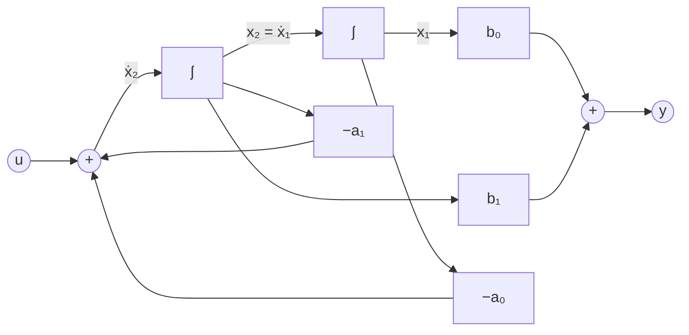

# Algoritmi di realizzazione e forme canoniche

> [!abstract] Scopo della lezione
> Finora si è andati dallo stato al legame ingresso-uscita: data $(A,B,C,D)$, si calcola $W(s)$. Qui si fa il percorso **inverso**: dato il legame ingresso-uscita (il **nucleo** $K(s)$), si cerca una rappresentazione con lo stato che lo riproduca. È il **problema della realizzazione**:
> 1. condizione di realizzabilità ($K(s)$ razionale propria) e come si ottiene $D$;
> 2. la **forma canonica raggiungibile** $(A_R,B_R,C_R)$, la verifica che realizza $K(s)$ e il perché è tutta raggiungibile;
> 3. la **forma canonica osservabile** $(A_O,B_O,C_O)$, tutta osservabile;
> 4. il caso con più ingressi e uscite, e un esempio in cui le due forme hanno dimensioni diverse.
>
> Il problema di trovare la realizzazione **più piccola** è l'argomento di [[32 - TDS - Realizzazioni minime e realizzazione di Gilbert]]. Indice: [[MOC - Teoria dei Sistemi]].

## Problema della realizzazione

Vedi [[TDS - Realizzazione]].

Finora si è visto il legame ingresso-uscita tramite lo stato; ora, noto il legame ingresso-uscita, si vuole caratterizzare lo stato. Nel tempo, l'uscita ha un legame (non istantaneo) con l'ingresso, che viene pesato e modificato:

$$y(t)=\int_0^tk(t-\tau)u(\tau)\,d\tau\iff Y(s)=K(s)U(s)$$

dove $k(t)$ (o $K(s)$) si chiama **nucleo**. Dato un sistema in questa forma, si vuole trovare una rappresentazione con lo stato con lo stesso comportamento ingresso-uscita.

> [!note] Da $-\infty$ o da 0
> L'integrale potrebbe partire da $-\infty$, perché non si sa "da quando inizia" l'ingresso; ma qui interessa la parte forzata dell'uscita e si considera solo l'intervallo da $t_0=0$ a $t$.

Questo è sicuramente possibile se $k(t)$ è una matrice delle risposte impulsive $W(t)$ (equivalentemente, se $K(s)$ è una funzione di trasferimento $W(s)$); altrimenti non c'è alcuna rappresentazione con lo stato equivalente. Se $K(s)$ è una funzione di trasferimento, è **razionale propria** (o strettamente propria), perché

$$K(s)=W(s)=\underbrace{\underbrace{C(sI-A)^{-1}B}_{\text{strett. propria}}+D}_{\text{propria}}$$

Se $K(s)=W(s)$, si vuole ottenere proprio $W(s)$ come $C(sI-A)^{-1}B+D$ per opportune matrici. Data $K(s)$, se si trovano le quattro matrici

$$\underset{n\times n}{A},\qquad\underset{n\times p}{B},\qquad\underset{q\times n}{C},\qquad\underset{q\times p}{D}$$

si dice che si ha una **realizzazione**. È il **problema della realizzazione**, la cui soluzione è la quaterna (con la dimensione) $(n,A,B,C,D)$.

> [!quote] Dal libro — Teorema 7.1.1
> "**Problema della realizzazione.** Assegnato $K(t)$ trovare $(n,A,B,C,D)$ tali che $Ce^{At}B+D\delta(t)=K(t)$. Equivalentemente, assegnato $K(s)$ trovare $(n,A,B,C,D)$ tali che $C(sI-A)^{-1}B+D=K(s)$." E il **Teorema 7.1.1**: "Il problema della realizzazione di un assegnato nucleo di variabile complessa $K(s)$ è risolvibile se e solo se le sue componenti sono funzioni razionali proprie." La necessità è stata vista sopra; la sufficienza segue dalle costruzioni di questa lezione. Il libro motiva il problema così: una rappresentazione con lo stato è associata a uno **schema di realizzazione/simulazione** che permette di "far funzionare in tempo reale un dispositivo che riproduca tale legame". _(libro, §7.1, pp. 290–291)_

**Quante realizzazioni ci sono?** Con un cambio di coordinate si ottengono matrici diverse (vedi [[05 - TDS - Calcolo dell'esponenziale di matrice#Considerazioni sul cambio di coordinate in un sistema|lezione 5]]): ci sono **infinite** realizzazioni. Il problema è che non sempre le matrici trovate hanno un significato fisico. Nemmeno $n$ è unico, come si capisce dalla [[28 - TDS - Raggiungibilità nel tempo continuo e scomposizione di Kalman#Scomposizione di Kalman|scomposizione di Kalman]]: $W$ resta uguale anche aggiungendo parti del sistema non raggiungibili e inosservabili, quindi la dimensione può aumentare senza che $W$ cambi. Aggiungere informazioni a quelle che si hanno è una scelta **del tutto arbitraria**: partendo solo da $W$ non si può dire nulla sulle parti non raggiungibili e inosservabili.

### Trovare $D$

$D$ c'è se e solo se $W(s)$ è **propria non strettamente**: basta riscriverla come somma di una funzione razionale strettamente propria e della matrice $D$. Per esempio, con

$$W(s)=\frac{s+1}{s-1}$$

si fa la divisione tra polinomi ($s+1=1\cdot(s-1)+2$) e si scrive $W(s)$ con quoziente e resto:

$$W(s)=\frac{s+1}{s-1}=\frac{2}{s-1}+\underbrace{1}_{D}$$

In generale $D=\lim_{s\to\infty}W(s)$. Il **vero** problema è trovare le tre matrici $A$, $B$, $C$ di dimensione $n$.

> [!example] Dal libro — il caso di grado uno
> Il nucleo $K(s)=\frac{h}{s+a}$ ha (almeno) due realizzazioni immediate: $\dot x=-ax+hu$, $y=x$ oppure $\dot x=-ax+u$, $y=hx$. Con $a=0$ e $h=1$ si ritrova l'integratore. _(libro, §7.1, p. 292)_

## Algoritmi di realizzazione

Ci sono infinite matrici possibili, quindi non c'è **un** procedimento algebrico; ci sono però degli **algoritmi di realizzazione** che permettono di trovarne alcune. Con $p=q=1$ (un ingresso e un'uscita), una $W(s)$ strettamente propria si scrive

$$K(s)=W(s)=\frac{b_{n-1}s^{n-1}+\dots+b_1s+b_0}{s^n+a_{n-1}s^{n-1}+\dots+a_1s+a_0}$$

Con questa struttura, una possibile matrice $A$ si costruisce partendo dalla matrice tutta di zeri, tranne la diagonale **a destra** di quella principale, che ha degli 1:

$$\begin{pmatrix}0&1&&&\\&0&1&&\\&&\ddots&\ddots&\\&&&0&1\\&&&&0\end{pmatrix}$$

Poi, nell'**ultima riga**, al posto degli zeri si scrivono i coefficienti del denominatore **cambiati di segno**, partendo dal termine noto $a_0$:

$$A=\begin{pmatrix}0&1&&&\\&0&1&&\\&&\ddots&\ddots&\\&&&0&1\\-a_0&-a_1&-a_2&\cdots&-a_{n-1}\end{pmatrix}$$

$B$ è tutta di zeri tranne l'ultimo elemento, che vale 1; $C$ contiene tutti i coefficienti del **numeratore**, non cambiati di segno, da $b_0$ a $b_{n-1}$:

$$B=\begin{pmatrix}0\\0\\\vdots\\0\\1\end{pmatrix},\qquad C=\begin{pmatrix}b_0&b_1&b_2&\cdots&b_{n-1}\end{pmatrix}$$

Se manca un termine $a_i$ o $b_i$ si mette uno zero (per $C$ si deve arrivare comunque a $n$ elementi).

> [!example] Esempio
> $$W(s)=\frac{s-1}{s^2+3s+2}$$
> Per $A$ si parte dalla matrice $2\times2$ di zeri ($n=2$, il grado del denominatore), si scrivono gli 1 nella diagonale a destra della principale, e si sostituisce l'ultima riga con i coefficienti da $a_0=2$ ad $a_1=3$ cambiati di segno:
> $$\begin{pmatrix}0&0\\0&0\end{pmatrix}\to\begin{pmatrix}0&1\\0&0\end{pmatrix}\to\begin{pmatrix}0&1\\-2&-3\end{pmatrix}=A,\qquad B=\begin{pmatrix}0\\1\end{pmatrix},\qquad C=\begin{pmatrix}-1&1\end{pmatrix}$$
> ($C$ con i coefficienti del numeratore da $b_0=-1$ a $b_1=1$.) Verifica: $(sI-A)^{-1}B=\frac{1}{s^2+3s+2}\begin{psmallmatrix}1\\s\end{psmallmatrix}$, quindi $C(sI-A)^{-1}B=\frac{s-1}{s^2+3s+2}$ ✔.

> [!important] Se il denominatore non è monico
> Se c'è un coefficiente $a_n$ davanti a $s^n$, prima di tutto si dividono numeratore e denominatore per $a_n$.

## Verifica della scelta delle matrici

Non si dimostra perché queste scelte siano "quelle giuste", ma si può **verificare** che funzionano: si calcola $C(sI-A)^{-1}B$ e si vede se si ottiene $W(s)$.

$$sI-A=\begin{pmatrix}s&-1&&&\\&s&-1&&\\&&\ddots&\ddots&\\&&&s&-1\\a_0&a_1&a_2&\cdots&s+a_{n-1}\end{pmatrix}$$

**Determinante.** Lo si calcola sviluppando lungo l'ultima riga (metodo dei minori). Il termine $a_0$ ha segno $(-1)^{n+1}$ e va moltiplicato per il determinante della matrice ottenuta togliendo la sua riga e la sua colonna: è triangolare, con diagonale di $-1$, quindi il determinante è $(-1)^{n-1}$. Per $a_1$, segno $(-1)^{n+2}$, e il minore (togliendo riga e colonna di $a_1$) è triangolare con un $s$ e poi $-1$: determinante $s(-1)^{n-2}$. Per $a_2$, segno $(-1)^{n+3}$ e minore $s^2(-1)^{n-3}$. Continuando fino all'ultimo elemento dell'ultima riga, che è $s+a_{n-1}$ invece di $a_i$:

$$\begin{aligned}\Delta=\det(sI-A)&=a_0(-1)^{n+1}(-1)^{n-1}+a_1s(-1)^{n+2}(-1)^{n-2}+a_2s^2(-1)^{n+3}(-1)^{n-3}+\dots\\&\quad+a_{n-2}s^{n-2}(-1)^{2n-1}(-1)+(s+a_{n-1})s^{n-1}(-1)^{2n}\end{aligned}$$

Per ogni riga $(-1)^{n+i}(-1)^{n-i}=(-1)^{2n}=1$, quindi

$$\Delta=\det(sI-A)=a_0+a_1s+a_2s^2+\dots+a_{n-1}s^{n-1}+s^n$$

È proprio il denominatore di $W(s)$: **il polinomio caratteristico di questa $A$ ha come coefficienti quelli dell'ultima riga** (cambiati di segno). Una matrice così si chiama **matrice compagna** del polinomio.

**Aggiunta.** Serve la matrice aggiunta trasposta $M_a$, perché $(sI-A)^{-1}=\frac{1}{\Delta}M_a$. Poi va pre-moltiplicata per $C$ e post-moltiplicata per $B$; ma $B$ è tutta di zeri tranne l'ultima riga, quindi $M_aB$ è la sola **ultima colonna** di $M_a$, e tutte le altre si possono ignorare. Ogni elemento $m_{ij}$ di $M_a$ è (con segno $(-1)^{i+j}$) il determinante della matrice ottenuta togliendo la riga $j$ e la colonna $i$ di $sI-A$; per l'ultima colonna ($i$ qualsiasi, colonna $n$ dell'aggiunta) si ritrovano proprio i minori calcolati sopra:

$$(sI-A)^{-1}=\frac1\Delta\begin{pmatrix}\cdots&(-1)^{n+1}(-1)^{n-1}\\\cdots&(-1)^{n+2}s(-1)^{n-2}\\&\vdots\\\cdots&(-1)^{2n}s^{n-1}\end{pmatrix}=\frac1\Delta\begin{pmatrix}\cdots&1\\\cdots&s\\&\vdots\\\cdots&s^{n-1}\end{pmatrix}\quad\Longrightarrow\quad(sI-A)^{-1}B=\frac1\Delta\begin{pmatrix}1\\s\\\vdots\\s^{n-1}\end{pmatrix}$$

> [!warning] Correzione
> Gli appunti dicono che $m_{ij}$ è il determinante della matrice ottenuta togliendo "la riga $i$ e la colonna $j$ da $A$": l'aggiunta **trasposta** usa il cofattore dell'elemento $(j,i)$, e la matrice di cui si prendono i minori è $sI-A$, non $A$. Il risultato dell'ultima colonna, $(1,s,\dots,s^{n-1})'$, è comunque quello giusto (si verifica anche direttamente: $(sI-A)\,(1,s,\dots,s^{n-1})'=(0,\dots,0,\Delta)'$).

Moltiplicando per $C$:

$$C(sI-A)^{-1}B=\frac1\Delta\begin{pmatrix}b_0&b_1&\cdots&b_{n-1}\end{pmatrix}\begin{pmatrix}1\\s\\\vdots\\s^{n-1}\end{pmatrix}=\frac{b_0+b_1s+\dots+b_{n-1}s^{n-1}}{a_0+a_1s+\dots+a_{n-1}s^{n-1}+s^n}=W(s)\qquad\blacksquare$$

## Forma canonica raggiungibile

Vedi [[TDS - Forme canoniche]].

Questa realizzazione ha un'interessante proprietà strutturale. Calcolando le matrici di raggiungibilità e di osservabilità: sull'osservabilità non si può dire molto, ma la raggiungibilità si deduce dalla struttura di $A$ (praticamente data) e di $B$ (nota a priori). Con

$$A=\begin{pmatrix}0&1&0&0&\cdots&0\\0&0&1&0&\cdots&0\\\vdots&&&\ddots&&\vdots\\0&0&0&\cdots&0&1\\-a_0&-a_1&-a_2&-a_3&\cdots&-a_{n-1}\end{pmatrix},\qquad B=\begin{pmatrix}0\\0\\\vdots\\0\\1\end{pmatrix}$$

si ha

$$R=\begin{pmatrix}B&AB&A^2B&\cdots&A^{n-1}B\end{pmatrix}=\begin{pmatrix}0&0&\cdots&0&1\\0&0&\cdots&1&\star\\\vdots&&\ots&&\vdots\\0&1&\cdots&\star&\star\\1&\star&\cdots&\star&\star\end{pmatrix}$$

(ogni moltiplicazione per $A$ "fa salire" l'1 di una posizione). $R$ è **triangolare secondaria** (triangolare rispetto all'antidiagonale) con 1 sull'antidiagonale, quindi è non singolare: $R$ ha rango pieno e la rappresentazione scritta in questa forma è **completamente raggiungibile**. Per questo la realizzazione si chiama **forma canonica raggiungibile**, e le matrici si indicano con $A_R$, $B_R$, $C_R$.

> [!warning] Correzione
> Gli appunti scrivono $\det(R)=(-1)^n$. Per una matrice con 1 sull'antidiagonale e zeri sopra di essa il determinante è il segno della permutazione "inversa", $(-1)^{n(n-1)/2}$ (per esempio $-1$ per $n=2$ e $n=3$, $+1$ per $n=4$). Quello che conta, che sia diverso da zero, resta vero.

> [!quote] Dal libro — schema di simulazione
> Per $n=2$ la forma raggiungibile corrisponde a $\dot x_1=x_2$, $\dot x_2=-a_0x_1-a_1x_2+u$, $y=b_0x_1+b_1x_2$: una catena di **due integratori** in cui l'ingresso entra nell'ultimo, con le retroazioni $-a_0$, $-a_1$, e l'uscita è una combinazione delle uscite degli integratori (Figura 7.1). "La realizzazione ottenuta con la procedura indicata è tutta raggiungibile, ma non necessariamente osservabile; per ottenerne una che sia simultaneamente raggiungibile ed osservabile si può applicare la tecnica di scomposizione rispetto all'osservabilità." _(libro, §7.2.1, pp. 294–295)_

## Forma canonica osservabile

Una realizzazione alternativa usa una matrice $A$ della forma

$$A=\begin{pmatrix}0&0&\cdots&0&-a_0\\1&0&&&-a_1\\&1&\ddots&&-a_2\\&&\ddots&0&\vdots\\&&&1&-a_{n-1}\end{pmatrix}_{n\times n}$$

che sembra la trasposta di $A_R$ (e lo è per $p=q=1$; con più ingressi o uscite non è più vero). Di conseguenza $B$ e $C$ assumono le forme

$$C=\begin{pmatrix}0&0&\cdots&0&1\end{pmatrix}_{1\times n},\qquad B=\begin{pmatrix}b_0\\b_1\\b_2\\\vdots\\b_{n-1}\end{pmatrix}_{n\times1}$$

La verifica è identica a quella dell'altra realizzazione: il determinante di $sI-A$ è lo stesso (è la trasposta), e nel prodotto $C(sI-A)^{-1}$ si scartano tutte le righe della matrice aggiunta tranne l'ultima, che corrisponde all'ultima colonna del caso precedente.

Stavolta la proprietà dello spazio di stato associata è l'**osservabilità**:

$$\mathcal O=\begin{pmatrix}C\\CA\\CA^2\\\vdots\\CA^{n-1}\end{pmatrix}=\begin{pmatrix}0&\cdots&0&0&1\\0&\cdots&0&1&\star\\0&\cdots&1&\star&\star\\&\ots&&&\\1&\star&\cdots&\star&\star\end{pmatrix}$$

Il determinante è diverso da zero, quindi $\mathcal O$ ha rango pieno e il sistema è **tutto osservabile**: la **forma canonica osservabile**, con matrici $A_O$, $B_O$, $C_O$.

> [!tip] Dualità
> Per $p=q=1$: $A_O=A_R'$, $B_O=C_R'$, $C_O=B_R'$. È la [[27 - TDS - Scomposizione rispetto all'osservabilità e raggiungibilità#Partizione del sistema secondo la raggiungibilità|dualità]] tra raggiungibilità e osservabilità: trasporre scambia i due ruoli, e $W(s)$ (scalare) non cambia perché $W'=W$.

> [!quote] Dal libro — Figura 7.2
> Per $n=2$: $\dot x_1=-a_0x_2+b_0u$, $\dot x_2=x_1-a_1x_2+b_1u$, $y=x_2$. Qui l'ingresso entra in **ogni** integratore (pesato da $b_0$, $b_1$) e l'uscita è presa solo dall'ultimo. Anche questa realizzazione è tutta osservabile ma non necessariamente raggiungibile: per renderla minima si può applicare la scomposizione rispetto alla raggiungibilità. _(libro, §7.2.2, pp. 296–298)_

## Caso di ingressi e uscite non unidimensionali

Se $p\neq1$ e/o $q\neq1$, $W(s)$ ha la forma

$$W(s)=\frac{B_{n-1}s^{n-1}+\dots+B_1s+B_0}{s^n+a_{n-1}s^{n-1}+\dots+a_1s+a_0},\qquad B_i\ \ (q\times p)$$

dove il denominatore è (il minimo comune multiplo dei denominatori) monico. Se $A_O$ è $N\times N$, $B_O$ è $N\times p$ e $C_O$ è $q\times N$. $C_O$, che con $p=q=1$ era $(0\ 0\ \cdots\ 0\ 1)$, con $q\neq1$ diventa

$$C_O=\begin{pmatrix}O_q&O_q&\cdots&O_q&I_q\end{pmatrix}$$

dove $O_q$ è la matrice $q\times q$ di zeri e $I_q$ l'identità di ordine $q$. Per esempio, con $q=2$:

$$C_O=\begin{pmatrix}0&0&0&0&\cdots&0&0&1&0\\0&0&0&0&\cdots&0&0&0&1\end{pmatrix}$$

Allo stesso modo, ogni elemento di $A$ diventa un blocco: gli 1 diventano identità $I$ e gli zeri matrici nulle $O$, tutte di dimensione $q$:

$$A_O=\underbrace{\begin{pmatrix}0&\cdots&0&-a_0\\1&\ddots&&-a_1\\&\ddots&0&\vdots\\&&1&-a_{n-1}\end{pmatrix}}_{\text{se }p=q=1}\longrightarrow\begin{pmatrix}O&\cdots&O&-a_0I\\I&\ddots&&-a_1I\\&\ddots&O&\vdots\\&&I&-a_{n-1}I\end{pmatrix}$$

quindi $A_O$ è $N\times N$ con $N=nq$. $B_O$, che contiene i coefficienti del numeratore, è

$$B_O=\begin{pmatrix}B_0\\B_1\\\vdots\\B_{n-1}\end{pmatrix},\qquad B_i\ \ (q\times p)$$

Per la forma raggiungibile il discorso è del tutto analogo, con blocchi di dimensione $p$: $N=np$, $B_R=\begin{psmallmatrix}O\\\vdots\\O\\I_p\end{psmallmatrix}$, $C_R=(B_0\ B_1\ \cdots\ B_{n-1})$.

> [!warning] Correzione
> Negli appunti l'ultimo blocco di $B_O$ è scritto in modo coerente ($B_{n-1}$), mentre il libro stampa $B_n$: i coefficienti del numeratore vanno da $B_0$ a $B_{n-1}$ (la funzione è strettamente propria).

## Esempio pratico e considerazioni

$$K(s)=\frac{\begin{pmatrix}s&0&1\\1&s+1&0\end{pmatrix}}{s^2+1}$$

È una funzione razionale **strettamente propria** (in ogni termine il grado del numeratore è minore di quello del denominatore), quindi può essere la funzione di trasferimento di un sistema. Si scrive il numeratore in forma polinomiale, esplicitando i coefficienti di ogni potenza di $s$:

$$K(s)=\frac{\overbrace{\begin{pmatrix}0&0&1\\1&1&0\end{pmatrix}}^{B_0}+\overbrace{\begin{pmatrix}1&0&0\\0&1&0\end{pmatrix}}^{B_1}s}{s^2+1}$$

con $a_0=1$, $a_1=0$.

### Forma canonica raggiungibile

I coefficienti $B_i$ sono $q\times p=2\times3$: 2 uscite e 3 ingressi. $A_R$ ha dimensione $N=np=2\cdot3=6$, a blocchi $3\times3$:

$$A_R=\begin{pmatrix}0&I\\-a_0I&-a_1I\end{pmatrix}=\left(\begin{array}{ccc|ccc}0&0&0&1&0&0\\0&0&0&0&1&0\\0&0&0&0&0&1\\\hline-1&0&0&0&0&0\\0&-1&0&0&0&0\\0&0&-1&0&0&0\end{array}\right)$$

$$B_R=\begin{pmatrix}O\\I\end{pmatrix}=\begin{pmatrix}0&0&0\\0&0&0\\0&0&0\\1&0&0\\0&1&0\\0&0&1\end{pmatrix},\qquad C_R=\begin{pmatrix}B_0&B_1\end{pmatrix}=\left(\begin{array}{ccc|ccc}0&0&1&1&0&0\\1&1&0&0&1&0\end{array}\right)$$

($C$ contiene tutti i coefficienti del numeratore "in fila", da $B_0$ a $B_{n-1}$.) La soluzione del problema della realizzazione è $(A_R,B_R,C_R)$ con $N=6$.

### Forma canonica osservabile

$$A_O=\begin{pmatrix}O&-a_0I\\I&-a_1I\end{pmatrix}=\left(\begin{array}{cc|cc}0&0&-1&0\\0&0&0&-1\\\hline1&0&0&0\\0&1&0&0\end{array}\right),\qquad B_O=\begin{pmatrix}B_0\\B_1\end{pmatrix}=\left(\begin{array}{ccc}0&0&1\\1&1&0\\\hline1&0&0\\0&1&0\end{array}\right),\qquad C_O=\begin{pmatrix}O&I\end{pmatrix}=\left(\begin{array}{cc|cc}0&0&1&0\\0&0&0&1\end{array}\right)$$

La dimensione cambia: $N=nq=2\cdot2=4$. Confrontando le due realizzazioni, nella forma canonica raggiungibile si aggiungevano informazioni superflue, che non erano date dal sistema; ma entrambe le rappresentazioni sono perfettamente valide.

> [!important] Quale scegliere
> A seconda dell'algoritmo di realizzazione si ottengono sistemi di dimensioni diverse: conviene scegliere quello di dimensione **minore**. Se $q>p$ (più uscite che ingressi) conviene la forma raggiungibile ($N=np$), altrimenti quella osservabile ($N=nq$). Nessuna delle due, in generale, è la più piccola possibile: per quella serve la [[32 - TDS - Realizzazioni minime e realizzazione di Gilbert|realizzazione minima]].

> [!quote] Dal libro — Esempi 7.2.2 e 7.2.3
> $K(s)=\frac{\begin{psmallmatrix}1&0\\-1&1\end{psmallmatrix}+\begin{psmallmatrix}1&0\\1&2\end{psmallmatrix}s}{1+3s+s^2}$ ($p=q=2$) ha realizzazione raggiungibile di dimensione 4: $A_r=\begin{psmallmatrix}0&I\\-I&-3I\end{psmallmatrix}$, $B_r=\begin{psmallmatrix}0\\I\end{psmallmatrix}$, $C_r=(B_0\ B_1)$. Analogamente $K(s)=\frac{\begin{psmallmatrix}1&-1\\0&1\end{psmallmatrix}+\begin{psmallmatrix}2&0\\1&0\end{psmallmatrix}s}{3+2s+s^2}$ ha realizzazione osservabile $A_o=\begin{psmallmatrix}0&-3I\\I&-2I\end{psmallmatrix}$, $B_o=\begin{psmallmatrix}B_0\\B_1\end{psmallmatrix}$, $C_o=(0\ \ I)$. "Le due tecniche propongono realizzazioni di dimensioni diverse se $p\neq q$." _(libro, §7.2, pp. 293–298)_
