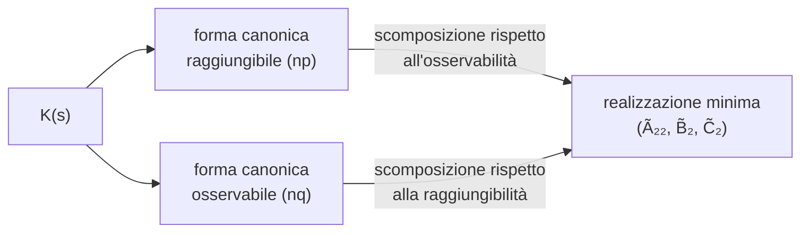

# Realizzazioni minime e realizzazione di Gilbert

> [!abstract] Scopo della lezione
> Le [[31 - TDS - Algoritmi di realizzazione e forme canoniche|forme canoniche]] danno realizzazioni di dimensione $np$ o $nq$, ma non necessariamente la più piccola. Qui:
> 1. si capisce **dove** stanno le informazioni superflue (nella [[28 - TDS - Raggiungibilità nel tempo continuo e scomposizione di Kalman#Scomposizione di Kalman|scomposizione di Kalman]]) e come toglierle: una forma canonica è tutta raggiungibile (o tutta osservabile), quindi basta ridurla rispetto all'altra proprietà;
> 2. la **partizione per righe o per colonne** della $K(s)$, che a volte porta subito alla dimensione minima;
> 3. l'**algoritmo di Gilbert**, che dà direttamente una realizzazione minima (diagonale) quando i poli di $K(s)$ sono semplici, usando i **ranghi dei residui**.
>
> Segue [[33 - TDS - Esercizio di realizzazione e matrice di Hankel]]. Indice: [[MOC - Teoria dei Sistemi]].

## Realizzazione minima

Vedi [[TDS - Realizzazione minima]].

Il legame ingresso-uscita non è istantaneo ed è descritto (nel tempo continuo) da un integrale di convoluzione:

$$y(t)=\int_0^tk(t-\tau)u(\tau)\,d\tau\iff Y(s)=K(s)U(s)$$

Data una $K(s)$ (il **nucleo**), la **realizzazione** consiste nel trovare la dimensione dello spazio di stato e le quattro matrici del sistema; è possibile solo se $K(s)$ è razionale propria, così che $K(s)=W(s)=C(sI-A)^{-1}B+D$. Si sono viste due realizzazioni, la forma canonica raggiungibile e quella osservabile.

Con la stessa $W(s)$ si trovano sistemi di **dimensioni diverse**: conviene la forma canonica raggiungibile se ci sono più uscite che ingressi ($N=np$), quella osservabile se ci sono più ingressi che uscite ($N=nq$). Non si sa però se queste forme diano il sistema più piccolo possibile. Se $p=1$ o $q=1$ e si sceglie la forma canonica opportuna, si sa per certo che è la più piccola in assoluto (non ci possono essere meno di un ingresso o un'uscita).

> [!note] Precisazione
> Con $p=1$ (o $q=1$) la forma opportuna ha dimensione $n$, il grado del denominatore comune. È minima a patto che $K(s)$ sia **irriducibile** (nessun fattore comune tra numeratore e denominatore che si possa cancellare): altrimenti $n$ non è il grado "vero". Il libro: "se $p$ o $q$ è uguale ad uno, impiegando la tecnica opportuna, si ottiene una realizzazione di dimensione $n$. Tale realizzazione è minima". _(libro, §7.3, p. 299)_

Con $p>1$ e $q>1$: quante **informazioni superflue** si stanno aggiungendo? Si prenda la forma canonica osservabile: è completamente osservabile, quindi non ci sono parti inosservabili; nella scomposizione di Kalman non ci sono $\chi_1$ e $\chi_3$. $\chi_2$ è la parte raggiungibile e osservabile: lì c'è sicuramente tutto ciò che si è ricavato da $W(s)$. Le informazioni superflue, se ci sono, stanno sicuramente in $\chi_4$, la parte osservabile (quindi inclusa nella forma canonica osservabile) **ma non raggiungibile**, che non compare in $W(s)$. Per capire se $N=nq$ è la dimensione minima, o se ci sono aggiunte non necessarie, si studia la **raggiungibilità**, l'altra proprietà strutturale, non garantita dalla forma canonica.

Analogamente per la forma canonica raggiungibile: tutto il sistema è raggiungibile, quindi non ci sono $\chi_3$ e $\chi_4$ (non raggiungibili), e la parte non presente in $W(s)$, potenzialmente superflua, sta nella parte inosservabile ($\chi_1$). Si studia l'**osservabilità** e, se c'è una parte non osservabile, si fa il [[27 - TDS - Scomposizione rispetto all'osservabilità e raggiungibilità#Partizione del sistema secondo l'osservabilità|cambio di base rispetto all'inosservabilità]]:

$$\tilde A=\begin{pmatrix}\tilde A_{11}&\tilde A_{12}\\0&\tilde A_{22}\end{pmatrix},\qquad\tilde B=\begin{pmatrix}\tilde B_1\\\tilde B_2\end{pmatrix},\qquad\tilde C=\begin{pmatrix}0&\tilde C_2\end{pmatrix}$$

La parte che riguarda solo $\chi_2$ (raggiungibile e osservabile) ha come matrice dinamica solo $\tilde A_{22}$ e vede solo $\tilde B_2$ e $\tilde C_2$: tutto il resto è superfluo, e $(\tilde A_{22},\tilde B_2,\tilde C_2)$ è una realizzazione minima. Lo stesso si fa partendo dalla forma canonica osservabile, studiando la raggiungibilità e facendo il cambio di base rispetto alla raggiungibilità.

Il problema può essere posto anche dall'inizio: trovare la **realizzazione minima**, cioè la soluzione con $n$ più piccolo possibile. Se $p>1$ e $q>1$, si sceglie una forma canonica (possibilmente quella con dimensione minore) e se ne studia l'altra proprietà strutturale per capire quanto si può ridurre. Questa operazione di "scartare le parti superflue" si può fare solo perché è dato solo il comportamento **esterno** del sistema (cioè $W$), e partendo da quello si risale a un possibile sistema; se invece è dato un sistema dall'inizio, non si può scartare nulla.

> [!important] Proprietà delle realizzazioni minime
> - Una realizzazione è **minima** se e solo se è **tutta raggiungibile e tutta osservabile**.
> - La realizzazione minima contiene tutti e soli i modi naturali che sono insieme eccitabili e osservabili, cioè i **poli** di $K(s)$.
> - Due realizzazioni minime dello stesso nucleo hanno la stessa dimensione e differiscono solo per un cambio di coordinate.

> [!quote] Dal libro — §7.3 Le realizzazioni minime
> "La realizzazione che contempla tutti e soli i modi naturali comuni è quella che ha dimensione inferiore rispetto a tutte le altre e diremo che è una **realizzazione minima**"; "una realizzazione minima è anche tutta raggiungibile ed osservabile"; "nel caso particolare di $p=q=1$ ciascuna delle due realizzazioni in forma canonica è minima". Esempio 7.3.3: $K(s)=\begin{psmallmatrix}\frac1{s+1}&\frac1{s+2}\\0&\frac1{(s+1)(s+2)}\end{psmallmatrix}$, con $p=q=2$, $n=2$, ha forma canonica raggiungibile di dimensione 4, che però ha uno stato inosservabile ($\mathcal I=\mathrm{gen}\{(1,0,-2,0)'\}$); togliendolo si ottiene una realizzazione minima di dimensione 3. _(libro, §7.3, pp. 298–301)_

## Partizione del sistema lineare

Un problema di realizzazione con nucleo

$$K(s)=\begin{pmatrix}\frac1s&\frac2s\\0&\frac1{s+1}\end{pmatrix}$$

Si riscrive esplicitando i coefficienti al numeratore:

$$K(s)=\frac{\begin{pmatrix}s+1&2(s+1)\\0&s\end{pmatrix}}{s(s+1)}=\frac{\begin{pmatrix}1&2\\0&1\end{pmatrix}s+\begin{pmatrix}1&2\\0&0\end{pmatrix}}{s^2+s}$$

$n=2$ (grado massimo del denominatore) e $p=q=2$ (i coefficienti del numeratore sono $q\times p=2\times2$): la scelta della forma canonica è indifferente. Si potrebbe scegliere la rappresentazione raggiungibile

$$A_R=\begin{pmatrix}O&I\\-a_0I&-a_1I\end{pmatrix}=\begin{pmatrix}0&0&1&0\\0&0&0&1\\-a_0&0&-a_1&0\\0&-a_0&0&-a_1\end{pmatrix}$$

e studiarne l'osservabilità per poi scegliere la dimensione minore.

Qui però si può semplificare: **ogni riga** di $K(s)$ ha un solo polo. La prima riga ha al denominatore solo $s$, la seconda solo $s+1$ ($0=\frac0{s+1}$). Si può allora scomporre:

$$K(s)=\begin{pmatrix}\frac1s&\frac2s\\0&\frac1{s+1}\end{pmatrix}=\begin{pmatrix}K_1(s)\\K_2(s)\end{pmatrix},\qquad K_1(s)=\begin{pmatrix}\frac1s&\frac2s\end{pmatrix},\quad K_2(s)=\begin{pmatrix}0&\frac1{s+1}\end{pmatrix}$$

Poiché $q=2$, ci sono due uscite, $y=\begin{psmallmatrix}y_1\\y_2\end{psmallmatrix}$, con $Y_1(s)=K_1(s)U(s)$ e $Y_2(s)=K_2(s)U(s)$: due sistemi separati

$$\begin{cases}\dot x_1=A_1x_1+B_1u\\y_1=C_1x_1\end{cases}\qquad\text{e}\qquad\begin{cases}\dot x_2=A_2x_2+B_2u\\y_2=C_2x_2\end{cases}$$

Ognuno ha **una sola uscita** ($q=1$), quindi la forma canonica osservabile è minima, e ha dimensione 1 (un solo polo). Alla fine si "ricompone" tutto in un sistema unico di dimensione $1+1=2$, che è necessariamente la minima:

$$\dot x=\begin{pmatrix}\dot x_1\\\dot x_2\end{pmatrix}=\underbrace{\begin{pmatrix}A_1&0\\0&A_2\end{pmatrix}}_{A}x+\underbrace{\begin{pmatrix}B_1\\B_2\end{pmatrix}}_{B}u,\qquad y=\begin{pmatrix}y_1\\y_2\end{pmatrix}=\underbrace{\begin{pmatrix}C_1&0\\0&C_2\end{pmatrix}}_{C}x$$

> [!example] Le matrici (non presenti negli appunti)
> $K_1=\frac{(1\ \ 2)}{s}$: $A_1=0$, $B_1=(1\ \ 2)$, $C_1=1$. $K_2=\frac{(0\ \ 1)}{s+1}$: $A_2=-1$, $B_2=(0\ \ 1)$, $C_2=1$. Quindi
> $$A=\begin{pmatrix}0&0\\0&-1\end{pmatrix},\quad B=\begin{pmatrix}1&2\\0&1\end{pmatrix},\quad C=I$$
> e infatti $C(sI-A)^{-1}B=\begin{psmallmatrix}1/s&0\\0&1/(s+1)\end{psmallmatrix}\begin{psmallmatrix}1&2\\0&1\end{psmallmatrix}=K(s)$ ✔.

**Per colonne.** Il ragionamento si può fare anche per colonne, $K(s)=(H_1(s)\ \ H_2(s))$: non si divide l'uscita ma l'ingresso. Con $p=2$, $u=\begin{psmallmatrix}u_1\\u_2\end{psmallmatrix}$:

$$Y(s)=K(s)U(s)=\begin{pmatrix}H_1(s)&H_2(s)\end{pmatrix}\begin{pmatrix}U_1(s)\\U_2(s)\end{pmatrix}=H_1(s)U_1(s)+H_2(s)U_2(s)=Y_a(s)+Y_b(s)$$

e i sistemi corrispondenti sono

$$\begin{cases}\dot x_a=A_ax_a+B_au_1\\y_a=C_ax_a\end{cases}\qquad\text{e}\qquad\begin{cases}\dot x_b=A_bx_b+B_bu_2\\y_b=C_bx_b\end{cases}$$

da ricomporre con $x=\begin{psmallmatrix}x_a\\x_b\end{psmallmatrix}$ (stavolta le uscite si **sommano**: $C=(C_a\ \ C_b)$, $B=\begin{psmallmatrix}B_a&0\\0&B_b\end{psmallmatrix}$). Ma in $H_2(s)=\begin{psmallmatrix}2/s\\1/(s+1)\end{psmallmatrix}$ ci sono **due** poli, quindi il sistema relativo a $H_2$ ha dimensione 2, e l'unione dei due sistemi ha dimensione $1+2=3$: **non è minima** (per righe era venuta dimensione 2).

> [!warning] Correzione
> Negli appunti il secondo sistema è scritto $\dot x_b=A_bx_b+B_bu$: l'ingresso è $u_2$, come per il primo è $u_1$.

> [!important] Quando la partizione è minima
> Se la dimensione di ogni sistema nella scomposizione non è 1, non si può essere certi che la somma dia la dimensione minima: conviene controllare a priori, cioè vedere se ogni riga (o ogni colonna) contiene un solo polo.

> [!quote] Dal libro — Esempio 7.3.4
> $K(s)=\begin{psmallmatrix}\frac1{s+1}&0\\\frac2{s(s+2)}&\frac1{s+2}\end{psmallmatrix}$: le forme canoniche hanno dimensione 6 ($p=q=2$, $n=3$). **Per righe**: $K_1=\frac{(1\ 0)}{s+1}$ (dimensione 1) e $K_2=\frac{(2\ 0)+(0\ 1)s}{s^2+2s}$ (dimensione 2), in tutto 3. **Per colonne**: la prima colonna ha tre poli ($n_1=3$), la seconda uno ($n_2=1$), in tutto 4. "Nel caso specifico la tecnica di realizzazione per righe risulta essere più conveniente di quella per colonne; ma questo dipende dalle funzioni coinvolte." _(libro, §7.3, pp. 302–303)_

## Algoritmo di Gilbert

Vedi [[TDS - Algoritmo di Gilbert]].

Gli algoritmi visti producono le forme canoniche; quello che segue porta **direttamente** alla realizzazione minima. Purtroppo non è sempre utilizzabile: serve che il denominatore di $K(s)$ sia composto **solo da termini con molteplicità 1**:

$$K(s)=\frac{n_K(s)}{(s-s_1)^1\cdots(s-s_n)^1},\qquad s_1\neq s_2\neq\dots\neq s_n$$

> [!warning] Attenzione
> Avere termini con molteplicità 1 nel dominio di Laplace **non** vuol dire che gli autovalori abbiano molteplicità 1, ma che la matrice $A$ (probabilmente) è **diagonalizzabile**, cioè non ci sono blocchi di Jordan (vedi [[17 - TDS - Matrici non diagonalizzabili e catene di autovettori#Studio di $\Phi(s)$ nel caso regolare|lezione 17]]). "Probabilmente" perché si sta guardando $W(s)$ e non $\Phi(s)$: qualche termine che avrebbe creato blocchi di Jordan potrebbe essersi semplificato. Ma per la realizzazione minima, come si vede ora, si può scegliere una $A$ diagonale.

Ci sono $n$ radici distinte. Una realizzazione minima non deve contenere altri autovalori oltre a quelli in $K(s)$, quindi i suoi autovalori corrispondono ai poli di $K(s)$. In particolare, se $K(s)$ deve corrispondere a una $W(s)$, non ci sarà nulla di inosservabile e tutto sarà raggiungibile: nel calcolo di $C(sI-A)^{-1}B$ **non si semplifica nulla**. La matrice $A$ della realizzazione minima avrà quindi tutti i poli come autovalori e sarà **diagonalizzabile**: anzi, la si prende direttamente diagonale, visto che si può scegliere.

Per ogni autovalore $\lambda_i$ si trovano tanti autovettori quanta è la sua molteplicità:

$$A=\dots+\lambda_iu_{i1}v_{i1}'+\lambda_iu_{i2}v_{i2}'+\lambda_iu_{i3}v_{i3}'+\dots=\dots+\lambda_i\begin{pmatrix}u_{i1}&u_{i2}&u_{i3}&\cdots\end{pmatrix}\begin{pmatrix}v_{i1}'\\v_{i2}'\\v_{i3}'\\\vdots\end{pmatrix}=\dots+\lambda_iU_iV_i'$$

$U_iV_i'$ è una matrice con **rango pari alla molteplicità** di $\lambda_i$ (è la matrice residua di [[06 - TDS - Modi naturali#Considerazioni sulla matrice $A$|lezione 6]]). In $\Phi(t)=e^{At}$ compare $\dots+e^{\lambda_it}U_iV_i'$, e quindi $W(t)=Ce^{At}B=\dots+e^{\lambda_it}CU_iV_i'B$. Nel dominio di Laplace c'è proprio un termine $\frac{R_i}{s-\lambda_i}$ con

$$R_i=CU_iV_i'B$$

e poiché (in una realizzazione minima) $U_iV_i'$ ha rango pari alla molteplicità di $\lambda_i$, **anche $R_i$ ha lo stesso rango**.

Si può quindi costruire $A$ come la matrice diagonale con i diversi poli ripetuti tante volte quanto il **rango del residuo** corrispondente nella scomposizione di $W(s)$ in poli e residui:

$$A=\begin{pmatrix}s_1&&&&\\&s_2&&&\\&&s_2&&\\&&&s_3&\\&&&&\ddots\end{pmatrix}$$

(qui $s_2$ ha molteplicità 2: nella scomposizione di $W(s)$ il residuo di $s_2$ ha rango 2).

**Autovettori.** Con $A$ diagonale, gli autovettori di $s_i$ sono le soluzioni di $(A-s_iI)u=0$. Per $s_1$:

$$A-s_1I=\begin{pmatrix}0&&&&\\&s_2-s_1&&&\\&&s_2-s_1&&\\&&&s_3-s_1&\\&&&&\ddots\end{pmatrix}$$

basta prendere la prima colonna con coefficiente 1 e le altre con coefficiente 0: $u_1=(1,0,\dots,0)'=e_1$ (non si può prendere il vettore nullo, che non è un autovettore). Per $s_2$:

$$A-s_2I=\begin{pmatrix}s_1-s_2&&&&\\&0&&&\\&&0&&\\&&&s_3-s_2&\\&&&&\ddots\end{pmatrix}$$

si scelgono **due** autovettori (molteplicità 2): la seconda colonna e la terza, $u_{21}=e_2$ e $u_{22}=e_3$. E così via: gli autovettori sono proprio i vettori canonici $e_i$, qualsiasi sia la molteplicità, quindi $U=I$. Anche gli autovettori sinistri sono $e_1',e_2',\dots$, perché $U^{-1}=I^{-1}=I$.

Il prodotto $U_iV_i'$ è una matrice con un **blocco identità** di dimensione pari alla molteplicità dell'$i$-esimo autovalore, e zeri altrove. Per esempio:

$$U_2=\begin{pmatrix}u_{21}&u_{22}\end{pmatrix}=\begin{pmatrix}e_2&e_3\end{pmatrix},\qquad V_2'=\begin{pmatrix}e_2'\\e_3'\end{pmatrix}\qquad\Longrightarrow\qquad U_2V_2'=\begin{pmatrix}0&&&&\\&1&0&&\\&0&1&&\\&&&0&\\&&&&\ddots\end{pmatrix}$$

Moltiplicando a sinistra per $C$ e a destra per $B$, il blocco identità "seleziona" un blocco di colonne di $C$ e un blocco di righe di $B$:

$$CU_2V_2'B=\begin{pmatrix}\star&\boxed{C_2}&\star&\cdots\end{pmatrix}\begin{pmatrix}0&&&\\&I&&\\&&0&\\&&&\ddots\end{pmatrix}\begin{pmatrix}\star\\\boxed{B_2}\\\star\\\vdots\end{pmatrix}=C_2B_2$$

dove $C_2$ è $q\times2$ (larga quanto il blocco identità) e $B_2$ è $2\times p$. $C_2B_2$ ha dimensione $q\times p$ e rango uguale a quello del residuo $R_2$. Questo algoritmo di realizzazione si chiama **algoritmo di Gilbert**.

> [!important] Algoritmo di Gilbert
> Se $K(s)$ ha poli **semplici** $p_1,\dots,p_r$:
> 1. si scompone $K(s)=\sum_{i=1}^r\frac{K_i}{s-p_i}$ e si calcolano i residui $K_i$ ($q\times p$) e i loro ranghi $\rho_i$;
> 2. si **fattorizza** ogni residuo come $K_i=C_iB_i$, con $C_i$ di dimensione $q\times\rho_i$ e $B_i$ di dimensione $\rho_i\times p$;
> 3. $A=\mathrm{diag}(p_1I_{\rho_1},\dots,p_rI_{\rho_r})$, $B=\begin{psmallmatrix}B_1\\\vdots\\B_r\end{psmallmatrix}$, $C=(C_1\ \cdots\ C_r)$.
>
> La realizzazione ha dimensione $N=\sum_i\rho_i$ ed è **minima**.

> [!quote] Dal libro — §7.3.1 Realizzazione di Gilbert
> La tecnica, proposta da Gilbert nel 1963, è una versione semplificata della tecnica di Smith-McMillan; si applica quando il minimo comune multiplo dei denominatori ha radici semplici, "ciò che corrisponde al fatto che il sistema dinamico sia caratterizzato da un operatore semplice (autovalori con molteplicità algebrica uguale a quella geometrica)". La minimalità si dimostra con il **criterio di Hautus**: il sistema è tutto raggiungibile se e solo se $(A-\lambda I\ \ B)$ ha rango pieno per ogni autovalore $\lambda$, e tutto osservabile se e solo se $\begin{psmallmatrix}A-\lambda I\\C\end{psmallmatrix}$ ha rango pieno; per la struttura diagonale di $A$ questo si riduce al rango pieno delle $B_i$ e $C_i$. Perché ciò sia possibile, il sistema deve avere almeno tanti ingressi e uscite quante sono le catene ($\rho_i\le\min(p,q)$). Con poli complessi coniugati la realizzazione è a coefficienti complessi, e si passa a quella reale con blocchi $\frac12\begin{psmallmatrix}1&j\\j&1\end{psmallmatrix}$. _(libro, §7.3.1, pp. 304–306)_

## Esempio pratico

$$K(s)=\frac{\begin{pmatrix}s+1&0&s-1\\0&s+1&s+1\end{pmatrix}}{(s+1)(s-1)}$$

Due uscite e tre ingressi: $q=2$, $p=3$. Residui:

$$K(s)=\frac{R_1}{s+1}+\frac{R_2}{s-1}$$

$$R_1=\lim_{s\to-1}\frac{\begin{pmatrix}s+1&0&s-1\\0&s+1&s+1\end{pmatrix}}{s-1}=\frac{\begin{pmatrix}0&0&-2\\0&0&0\end{pmatrix}}{-2}=\begin{pmatrix}0&0&1\\0&0&0\end{pmatrix},\qquad R_2=\lim_{s\to1}\frac{\begin{pmatrix}s+1&0&s-1\\0&s+1&s+1\end{pmatrix}}{s+1}=\begin{pmatrix}1&0&0\\0&1&1\end{pmatrix}$$

Se $K(s)$ è una funzione di trasferimento $W(s)$, il sistema ha due autovalori, $1$ e $-1$, i poli di $K(s)$. L'autovalore $-1$ ha molteplicità 1 (il rango di $R_1$ è 1); l'autovalore $1$ ha molteplicità 2 (il rango di $R_2$ è 2). Si può già scrivere $A$ diagonale:

$$A=\begin{pmatrix}-1&&\\&1&0\\&0&1\end{pmatrix}$$

Ci sono due blocchi (uno per ogni autovalore), e $B$ e $C$ seguono la stessa suddivisione:

$$B=\begin{pmatrix}B_1\\B_2\end{pmatrix},\qquad C=\begin{pmatrix}C_1&C_2\end{pmatrix}$$

con $B_2$ alto 2 e $C_2$ largo 2. Si possono scegliere qualsiasi $C_1,C_2,B_1,B_2$ tali che $C_1B_1=R_1$ e $C_2B_2=R_2$. Poiché $C_1B_1$ ha rango 1, $C_1$ è $q\times1$ e $B_1$ è $1\times p$; poiché $C_2B_2$ ha rango 2, $C_2$ è $q\times2$ e $B_2$ è $2\times p$.

> [!example] Completamento (non presente negli appunti)
> Una scelta semplice: $R_1=\begin{psmallmatrix}1\\0\end{psmallmatrix}(0\ \ 0\ \ 1)$, cioè $C_1=\begin{psmallmatrix}1\\0\end{psmallmatrix}$, $B_1=(0\ 0\ 1)$; e $R_2=I_2\cdot R_2$, cioè $C_2=I_2$, $B_2=\begin{psmallmatrix}1&0&0\\0&1&1\end{psmallmatrix}$. La realizzazione minima, di dimensione $N=1+2=3$, è
> $$A=\begin{pmatrix}-1&0&0\\0&1&0\\0&0&1\end{pmatrix},\qquad B=\begin{pmatrix}0&0&1\\1&0&0\\0&1&1\end{pmatrix},\qquad C=\begin{pmatrix}1&1&0\\0&0&1\end{pmatrix}$$
> Verifica: $C(sI-A)^{-1}B=\frac{1}{s+1}C_1B_1+\frac1{s-1}C_2B_2=\frac{R_1}{s+1}+\frac{R_2}{s-1}=K(s)$ ✔. Le forme canoniche avrebbero avuto dimensione $np=6$ o $nq=4$.

> [!quote] Dal libro — Esempio 7.3.5
> $K(s)=\begin{psmallmatrix}\frac1{s+1}&0\\\frac2{s(s+2)}&\frac1{s+2}\end{psmallmatrix}=\frac{\begin{psmallmatrix}0&0\\1&0\end{psmallmatrix}}{s}+\frac{\begin{psmallmatrix}1&0\\0&0\end{psmallmatrix}}{s+1}+\frac{\begin{psmallmatrix}0&0\\-1&1\end{psmallmatrix}}{s+2}$: tre residui di rango 1, fattorizzati come $\begin{psmallmatrix}0\\1\end{psmallmatrix}(1\ 0)$, $\begin{psmallmatrix}1\\0\end{psmallmatrix}(1\ 0)$, $\begin{psmallmatrix}0\\1\end{psmallmatrix}(-1\ 1)$. Quindi $A=\mathrm{diag}(0,-1,-2)$, $B=\begin{psmallmatrix}1&0\\1&0\\-1&1\end{psmallmatrix}$, $C=\begin{psmallmatrix}0&1&0\\1&0&1\end{psmallmatrix}$: dimensione 3, la stessa ottenuta per righe nell'Esempio 7.3.4. _(libro, §7.3.1, p. 305)_
