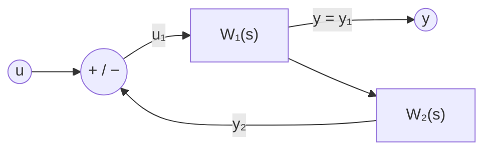

# Sistemi interconnessi

> [!abstract] Scopo della lezione
> Come si comporta un sistema fatto di più sottosistemi collegati tra loro? Si studiano le tre **interconnessioni elementari**, ognuna in due modi: nello **spazio di stato** (si mettono insieme gli stati) e con il **legame ingresso-uscita** (si combinano le funzioni di trasferimento):
> 1. **serie**: $W=W_2W_1$, autovalori = unione di quelli dei sottosistemi, ma possono **sparire** in $W$ per cancellazioni;
> 2. **parallelo**: $W=W_1+W_2$, stesso discorso;
> 3. **retroazione** (feedback): $W=(I-W_1W_2)^{-1}W_1$, e qui **la dinamica cambia**: gli autovalori del sistema complessivo non sono quelli dei sottosistemi. Il caso della **controreazione** statica.
>
> Segue [[35 - TDS - Criterio di Nyquist]]. Indice: [[MOC - Teoria dei Sistemi]].

## Connessione di sistemi: introduzione

Vedi [[TDS - Sistemi interconnessi]].

Si pensi a un treno formato da diversi vagoni. Studiare il sistema *treno* può essere molto difficile, perché ogni vagone si muove con certe leggi (che possono essere diverse da vagone a vagone). Si vuole capire se si può studiare ogni vagone separatamente, per poi mettere tutto insieme e vedere il comportamento complessivo. In termini più generali: cosa succede a un sistema quando gli si connette un altro sistema? Come interagiscono, qual è il contributo di uno sull'altro, e quale è il sistema complessivo?

> [!quote] Dal libro
> "Lo studio di un sistema interconnesso, ovvero di un sistema composto da più sottosistemi che interagiscono tra loro, è di grande importanza in quanto questo modo di procedere è alla base della modellistica di sistemi complessi, che possono essere visti come il risultato dell'interconnessione di più sottosistemi elementari." Il libro dà per ogni connessione i **vincoli topologici** (le uguaglianze tra ingressi e uscite), che si possono imporre solo se le dimensioni sono compatibili. _(libro, §8.1)_

## Connessione in serie (spazio di stato)

Due sistemi si possono connettere in vari modi. Nella **connessione in serie** (o "connessione serie") l'uscita del primo sistema $\mathcal S_1$ è l'ingresso del secondo $\mathcal S_2$:

![[TDS-L34-01.png]]

Per studiare il sistema servono i sottosistemi in una delle due forme: nello spazio di stato (il classico sistema con $\dot x$ e $y$) o con il legame ingresso-uscita (le $W(s)$). Nel primo caso:

$$\mathcal S_1:\begin{cases}\dot x_1=A_1x_1+B_1u_1\\y_1=C_1x_1+D_1u_1\end{cases},\qquad\mathcal S_2:\begin{cases}\dot x_2=A_2x_2+B_2u_2\\y_2=C_2x_2+D_2u_2\end{cases}$$

Lo stato del sistema complessivo è l'aggregato degli stati, $x=\begin{psmallmatrix}x_1\\x_2\end{psmallmatrix}$. Il sistema complessivo $\mathcal S_{tot}$ ha come ingresso quello del primo sistema ($u=u_1$) e come uscita quella del secondo ($y=y_2$); inoltre l'ingresso del secondo è l'uscita del primo ($u_2=y_1$):

$$\dot x=\begin{pmatrix}A_1x_1+B_1u_1\\A_2x_2+B_2u_2\end{pmatrix}=\begin{pmatrix}A_1x_1+B_1u\\A_2x_2+B_2\underbrace{(C_1x_1+D_1u)}_{y_1}\end{pmatrix}=\begin{pmatrix}A_1&0\\B_2C_1&A_2\end{pmatrix}x+\begin{pmatrix}B_1\\B_2D_1\end{pmatrix}u$$

$$y=y_2=C_2x_2+D_2u_2=C_2x_2+D_2\underbrace{(C_1x_1+D_1u)}_{y_1}=\begin{pmatrix}D_2C_1&C_2\end{pmatrix}x+D_2D_1u$$

> [!important] Serie nello spazio di stato
> $$A=\begin{pmatrix}A_1&0\\B_2C_1&A_2\end{pmatrix},\qquad B=\begin{pmatrix}B_1\\B_2D_1\end{pmatrix},\qquad C=\begin{pmatrix}D_2C_1&C_2\end{pmatrix},\qquad D=D_2D_1$$

(Si sottintende che le matrici dei due sistemi siano compatibili per somme e prodotti.) La dimensione del sistema finale è la **somma** delle dimensioni dei sottosistemi. $A$ è **triangolare a blocchi**, e gli autovalori di una matrice triangolare a blocchi sono quelli dei blocchi diagonali:

$$\sigma(A)=\sigma(A_1)\cup\sigma(A_2)$$

dove $\sigma(A)$ è lo **spettro** di $A$, l'insieme dei suoi autovalori. Il sistema complessivo ha come autovalori l'unione di quelli dei due sistemi. Quindi, per la stabilità, **un sistema connesso in serie è (internamente) stabile quando sono (internamente) stabili i sottosistemi che lo formano**.

> [!note] Molteplicità
> La molteplicità di ogni autovalore si **somma**: se entrambi i sistemi hanno un autovalore $\lambda$ semplice, il sistema complessivo ha $\lambda$ con molteplicità algebrica 2, ma la molteplicità geometrica **non è garantita** (potrebbe comparire un blocco di Jordan, critico se $\mathrm{Re}(\lambda)=0$).

## Connessione in serie (legame ingresso-uscita)

Con le funzioni di trasferimento, $\mathcal S_1:Y_1=W_1U_1$ e $\mathcal S_2:Y_2=W_2U_2$:

$$\mathcal S_{tot}:\ Y(s)=Y_2(s)=W_2(s)U_2(s)=W_2(s)Y_1(s)=W_2(s)W_1(s)U(s)\quad\Longrightarrow\quad W(s)=W_2(s)W_1(s)$$

(con matrici l'ordine conta: prima $W_1$, poi $W_2$, quindi $W_2$ a sinistra.)

> [!example] Esempio
> $$\mathcal S_1:\ W_1(s)=\frac{s-1}{s(s+10)},\qquad\mathcal S_2:\ W_2(s)=\frac{s+2}{s-1}$$
> $$\mathcal S_{tot}:\ W(s)=W_2(s)W_1(s)=\frac{s+2}{s-1}\cdot\frac{s-1}{s(s+10)}=\frac{s+2}{s(s+10)}$$

> [!warning] Correzione
> Negli appunti $W_1$ e $W_2$ sono prima scritte come $\frac{s+1}{s(s+10)}$ e $\frac{s+2}{s+1}$, ma nel prodotto e nel commento ("scompare l'autovalore 1") diventano $\frac{s-1}{s(s+10)}$ e $\frac{s+2}{s-1}$. L'esempio ha senso con il polo in $+1$ (instabile), cioè con la seconda versione, riportata qui sopra.

Il primo sistema ha due poli (autovalori $0$ e $-10$), il secondo un polo, $1$. Facendo il prodotto, in $W(s)$ **scompare** l'autovalore 1 e restano solo $0$ e $-10$. Quando si interconnettono dei sistemi, **le proprietà strutturali possono cambiare**: si sta vedendo solo la parte esterna del sistema, e l'autovalore 1, che prima era eccitabile e osservabile, nel sistema complessivo perde una o entrambe le proprietà e non si vede più in uscita. L'autovalore 1 però si trova comunque **all'interno** del sistema $\mathcal S_{tot}$. In particolare, il sistema con $W_2(s)$ è **instabile esternamente** (per via dell'autovalore $+1$), mentre il sistema complessivo, guardando solo $W(s)$, **sembra** non avere modi divergenti: l'autovalore a parte reale positiva scompare dall'esterno.

> [!warning] Precisazione
> Gli appunti dicono che il sistema complessivo "è stabile esternamente": $W(s)=\frac{s+2}{s(s+10)}$ ha comunque un polo in $s=0$, quindi non è BIBO stabile (un ingresso a gradino dà un'uscita a rampa). Il punto dell'esempio è un altro: il polo instabile $+1$ **sparisce** da $W$, ma resta dentro il sistema ed è internamente instabile (vedi la [[35 - TDS - Criterio di Nyquist|prossima lezione]]).

Per studiare "dove va a finire" l'autovalore 1, cioè in quale sottospazio di Kalman del sistema complessivo, bisogna prima trovare una realizzazione $(A,B,C,D)$. Ma attenzione: **non** bisogna trovare la realizzazione minima partendo dalla $W(s)$ di $\mathcal S_{tot}$, perché alcuni autovalori scompaiono (come $+1$). Bisogna trovare le realizzazioni minime di $\mathcal S_1$ e $\mathcal S_2$ separatamente, e **poi** metterle insieme con il metodo dello spazio di stato: così il sistema contiene l'autovalore 1 e lo si può studiare.

> [!example] Dove finisce il polo cancellato (non presente negli appunti)
> Realizzazioni minime: $\mathcal S_2$ con $A_2=1$, $B_2=1$, $C_2=3$, $D_2=1$ (perché $\frac{s+2}{s-1}=1+\frac{3}{s-1}$). Il modo $e^{t}$ del sistema serie: in $\mathcal S_2$ è eccitabile e osservabile; nella serie l'ingresso di $\mathcal S_2$ è $y_1$, che ha lo zero in $s=1$ ($W_1(1)=0$): il segnale che arriva a $\mathcal S_2$ "non contiene" la frequenza $s=1$, e il modo $e^t$ diventa **non raggiungibile** dall'ingresso $u$. Una cancellazione "zero del primo – polo del secondo" rende il polo non raggiungibile; una cancellazione "polo del primo – zero del secondo" lo rende non osservabile.

## Connessione in parallelo (spazio di stato)

Un altro modo di connettere due sistemi è farli **lavorare insieme**. Gli ingressi sono identici e pari all'ingresso $u$ del sistema complessivo; l'uscita totale è la **somma** delle uscite (ha senso perché i sistemi sono lineari):

$$\begin{cases}u=u_1=u_2\\y=y_1+y_2\end{cases}$$

![[TDS-L34-02.png]]

Nello spazio di stato, con lo stato sempre aggregato $x=\begin{psmallmatrix}x_1\\x_2\end{psmallmatrix}$:

$$\dot x=\begin{pmatrix}A_1x_1+B_1u\\A_2x_2+B_2u\end{pmatrix}=\begin{pmatrix}A_1&0\\0&A_2\end{pmatrix}x+\begin{pmatrix}B_1\\B_2\end{pmatrix}u,\qquad y=y_1+y_2=\begin{pmatrix}C_1&C_2\end{pmatrix}x+(D_1+D_2)u$$

> [!important] Parallelo nello spazio di stato
> $$A=\begin{pmatrix}A_1&0\\0&A_2\end{pmatrix},\qquad B=\begin{pmatrix}B_1\\B_2\end{pmatrix},\qquad C=\begin{pmatrix}C_1&C_2\end{pmatrix},\qquad D=D_1+D_2$$

Ancora una volta la dimensione dello spazio di stato è la somma delle dimensioni; a differenza della serie, **l'ordine dei due sistemi è irrilevante**.

## Connessione in parallelo (legame ingresso-uscita)

$$\mathcal S_{tot}:\ Y(s)=Y_1(s)+Y_2(s)=W_1(s)U(s)+W_2(s)U(s)=\big(W_1(s)+W_2(s)\big)U(s)\quad\Longrightarrow\quad W(s)=W_1(s)+W_2(s)$$

Facendo la somma si prende il **minimo comune multiplo** dei denominatori: si mantengono tutti i poli, ma se un polo è in comune tra i due sistemi se ne prende **uno solo**.

> [!example] Esempio
> $$W_1(s)=\frac1{s(s+1)},\qquad W_2(s)=\frac{10}{s}\qquad\Longrightarrow\qquad W(s)=\frac1{s(s+1)}+\frac{10}s=\frac{10s+11}{s(s+1)}$$
> I sistemi iniziali hanno entrambi un autovalore in zero: il sistema complessivo ha **due** autovalori in zero (cioè 0 con molteplicità due), ma esternamente se ne vede **uno solo**. Anche qui bisogna studiare raggiungibilità e osservabilità.

Mentre internamente i due sistemi possono essere stabili semplicemente, non si può essere certi che il sistema complessivo sia internamente stabile: se la molteplicità geometrica di uno degli zeri (degli autovalori nulli) fosse minore dell'algebrica, l'indice geometrico non sarebbe più 1 e ci sarebbe instabilità.

> [!note] Studiare il sistema complessivo
> Come per la serie, si fanno prima le realizzazioni minime dei sottosistemi $\mathcal S_1$ e $\mathcal S_2$, e poi si uniscono i loro spazi di stato. Attenzione: qualunque sia l'algoritmo di realizzazione, quando si uniscono i due sistemi **non è più garantita alcuna proprietà strutturale**. Anche unendo due realizzazioni in forma canonica osservabile, è quasi certo che il risultato non sarà osservabile: vanno studiate daccapo raggiungibilità e inosservabilità.

> [!tip] Nel parallelo $A$ è diagonale a blocchi
> Qui $A=\mathrm{diag}(A_1,A_2)$: nell'esempio $A_1$ e $A_2$ hanno entrambe l'autovalore 0 semplice, e la $A$ complessiva ha $0$ con molteplicità algebrica **e** geometrica 2 (due blocchi separati, nessun blocco di Jordan). Il sistema resta semplicemente stabile; quello che si perde è l'osservabilità/raggiungibilità: $\mathrm{rank}\,R<n$ perché i due modi in zero sono "pilotati" dallo stesso ingresso scalare (vedi la [[07 - TDS - Autovalori complessi coniugati#Completa osservabilità e completa eccitabilità|condizione necessaria]] sul numero di ingressi). Nella serie, invece, $A$ è solo triangolare, e lì sì che possono nascere blocchi di Jordan.

## Connessione in retroazione (spazio di stato)

Vedi [[TDS - Retroazione]].

Il terzo tipo di connessione: l'uscita $y_1$ di $\mathcal S_1$ è anche l'ingresso di $\mathcal S_2$, e l'uscita di $\mathcal S_2$ si **somma** all'ingresso di $\mathcal S_1$:

![[TDS-L34-03.png]]

È la **connessione in retroazione** (o **feedback**). Lo stato è $x=\begin{psmallmatrix}x_1\\x_2\end{psmallmatrix}$; $u$ è l'ingresso esterno di $\mathcal S_{tot}$, l'ingresso $u_1$ è la somma di $u$ e $y_2$, e l'uscita di $\mathcal S_{tot}$ è $y=y_1$, che è anche uguale a $u_2$:

$$\dot x=\begin{pmatrix}A_1x_1+B_1u_1\\A_2x_2+B_2u_2\end{pmatrix}=\begin{pmatrix}A_1x_1+B_1(y_2+u)\\A_2x_2+B_2y_1\end{pmatrix}=\begin{pmatrix}A_1x_1+B_1(C_2x_2+D_2u_2)+B_1u\\A_2x_2+B_2y_1\end{pmatrix}=\begin{pmatrix}A_1x_1+B_1\big(C_2x_2+D_2(C_1x_1+D_1u_1)\big)+B_1u\\A_2x_2+B_2y_1\end{pmatrix}=\cdots$$

Compaiono continuamente $u_1$ e $u_2$, e ci si trova a sostituire senza fermarsi mai: è impossibile studiare il sistema così. Un modo per "fermare" la ricorsione è porre a zero uno dei due collegamenti diretti ingresso-uscita, cioè una delle matrici $D_1$, $D_2$. Ponendo $D_1=0$:

$$\dot x=\begin{pmatrix}A_1x_1+B_1(C_2x_2+D_2u_2)+B_1u\\A_2x_2+B_2y_1\end{pmatrix}=\begin{pmatrix}A_1x_1+B_1C_2x_2+B_1D_2C_1x_1+B_1u\\A_2x_2+B_2C_1x_1\end{pmatrix}=\begin{pmatrix}A_1+B_1D_2C_1&B_1C_2\\B_2C_1&A_2\end{pmatrix}x+\begin{pmatrix}B_1\\0\end{pmatrix}u$$

L'uscita è, banalmente, $y=y_1=C_1x_1=(C_1\ \ 0)x$.

> [!important] Retroazione nello spazio di stato ($D_1=0$)
> $$A=\begin{pmatrix}A_1+B_1D_2C_1&B_1C_2\\B_2C_1&A_2\end{pmatrix},\qquad B=\begin{pmatrix}B_1\\0\end{pmatrix},\qquad C=\begin{pmatrix}C_1&0\end{pmatrix},\qquad D=0$$

> [!note] Perché serve $D_1=0$ (o $D_2=0$)
> In generale si arriva a un'equazione algebrica del tipo $u_1=u+D_2D_1u_1+\dots$, cioè $(I-D_2D_1)u_1=\dots$: il sistema è ben definito se $I-D_2D_1$ è **invertibile** (la retroazione è "ben posta"). Con $D_1=0$ (o $D_2=0$) lo è sempre. Senza questa condizione ci sarebbe un anello algebrico istantaneo, privo di senso fisico.

Gli autovalori del sistema complessivo **non** si vedono facilmente dalla struttura di $A$ (non è più triangolare): vanno calcolati normalmente. Cambia la **dinamica** del sistema: anche conoscendo, per esempio, la stabilità dei sistemi di partenza, **non si può concludere nulla** sul sistema complessivo.

> [!quote] Dal libro — l'archetipo dei sistemi di controllo
> Il libro scrive la retroazione con il segno meno nel sommatore, $u_1=u-y_2$ (Figura 8.3), e con $D_1=D_2=0$ ottiene $A=\begin{psmallmatrix}A_1&-B_1C_2\\B_2C_1&A_2\end{psmallmatrix}$. "Il segno meno nel sommatore mette in evidenza una caratteristica saliente di questo tipo di collegamento […] Se infatti si immagina che la $u(t)$ rappresenti un andamento che si desidererebbe far assumere all'uscita di un assegnato sistema, $u(t)-y(t)$ misura l'errore che si commette e costituisce l'informazione fondamentale per decidere come intervenire. Tale collegamento che è l'archetipo degli schemi dei sistemi di controllo, rappresenta la logica secondo la quale funzionano tutti i processi che operano in tempo reale interagendo con l'ambiente: tutti gli esseri viventi in ogni attività." _(libro, §8.1.3, pp. 314–315)_

## Connessione in retroazione (legame ingresso-uscita)

$$\mathcal S_{tot}:\ Y(s)=Y_1(s)=W_1(s)U_1(s)=W_1(s)\big(U(s)+Y_2(s)\big)=W_1(s)\big(U(s)+W_2(s)Y(s)\big)=W_1(s)U(s)+W_1(s)W_2(s)Y(s)$$

$$\Longrightarrow\ \big(I-W_1(s)W_2(s)\big)Y(s)=W_1(s)U(s)\ \Longrightarrow\ Y(s)=\big(I-W_1(s)W_2(s)\big)^{-1}W_1(s)U(s)$$

$$W(s)=\big(I-W_1(s)W_2(s)\big)^{-1}W_1(s)$$

## Connessione in controreazione e semplificazioni

Nella maggior parte dei casi si avranno sistemi interconnessi così con $\mathcal S_1$ e $\mathcal S_2$ a un ingresso e un'uscita (o riconducibili a tali). Allora:

$$W(s)=\frac{W_1(s)}{1-W_1(s)W_2(s)},\qquad p=q=1$$

Inoltre raramente si trovano sistemi connessi in questo modo; molto più spesso $\mathcal S_2$ non è un sistema completo, ma c'è **solo un legame diretto ingresso-uscita**: è come se $\mathcal S_2$ fosse formato solo da $D_2$ (in genere $D_2=1$).

Spesso l'uscita di $\mathcal S_2$ viene **sottratta** all'ingresso di $\mathcal S_1$: si parla di **connessione in controreazione** (retroazione negativa).

Con $\mathcal S_2:\ \begin{cases}\dot x_2=0\\y_2=D_2u_2\end{cases}$ e la connessione in controreazione, $x=x_1$ (perché $x_2$ non c'è) e

$$\dot x=\dot x_1=A_1x_1+B_1u_1=A_1x_1+B_1(u-D_2y_1)=A_1x_1+B_1u-B_1D_2C_1x_1=(A_1-B_1D_2C_1)x+B_1u$$

mentre $y=y_1=C_1x$. Quindi

$$A=A_1-B_1D_2C_1,\qquad B=B_1,\qquad C=C_1,\qquad D=0$$

Il sistema ottenuto è quasi uguale a quello di partenza (stessa $B$, stessa $C$), ma **cambiano la matrice dinamica $A$ e i suoi autovalori**. Nel dominio di Laplace è molto semplice:

$$Y(s)=Y_1(s)=W_1(s)U_1(s)=W_1(s)\big(U(s)-D_2Y(s)\big)=W_1(s)U(s)-W_1(s)D_2Y(s)\quad\Longrightarrow\quad Y(s)=\frac{W_1(s)U(s)}{1+W_1(s)D_2}$$

> [!tip] Perché la controreazione è così usata
> Con $D_2=k$ (un guadagno) gli autovalori diventano quelli di $A_1-kB_1C_1$: scegliendo $k$ si **spostano gli autovalori**, e si può rendere stabile un sistema instabile. È l'idea alla base della [[37 - TDS - Assegnazione degli autovalori con retroazione dallo stato|retroazione dallo stato]] e dell'[[TDS - Osservatore asintotico|osservatore]]. Con $W_1=\frac{N(s)}{D(s)}$ si ha $W=\frac{N}{D+kN}$: i poli in anello chiuso sono le radici di $D(s)+kN(s)$, mentre gli **zeri non cambiano**.

> [!quote] Dal libro — grafi di flusso
> Per interconnessioni più complicate il libro introduce i **grafi di flusso**: le variabili sono nodi, i sistemi sono archi pesati con la loro funzione di trasferimento (Figura 8.4: serie = due archi in fila, parallelo = due archi tra gli stessi nodi, controreazione = un arco $S_1$ e uno di ritorno $-S_2$). La funzione di trasferimento complessiva si calcola poi con la **formula di Mason**, a partire da percorsi e cicli del grafo. La formula a un anello si legge così: "la funzione di trasferimento del sistema a retroazione ad un anello è data dal rapporto tra la funzione di trasferimento della catena diretta diviso uno meno la funzione di trasferimento d'anello". _(libro, §8.1.3–8.2, pp. 315–318)_
