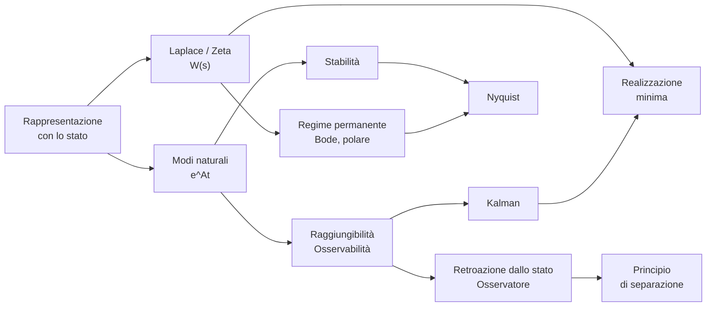

# MOC - Teoria dei Sistemi

> [!abstract] Mappa del corso
> Teoria dei sistemi lineari stazionari a dimensione finita. Le note delle lezioni seguono gli appunti presi in classe (lezioni 4–41, a.a. 2021/22) integrati con il libro di S. Monaco, C. Califano, P. Di Giamberardino, M. Mattioni, *Teoria dei Sistemi (lineari stazionari a dimensione finita)*, Esculapio 2021. Le lezioni 1–3 (introduzione e modellistica, capitolo 1 del libro) non sono negli appunti.
> Le note `TDS - …` in questa cartella sono riassunti per il ripasso.

## Lezioni

| N. | Lezione | Argomenti |
|---|---|---|
| 4 | [[04 - TDS - Uscita forzata e dalla forma esplicita alla implicita]] | risposta impulsiva, stazionarietà, proprietà di $\Phi$ |
| 5 | [[05 - TDS - Calcolo dell'esponenziale di matrice]] | $e^{At}$, forma spettrale, cambio di coordinate |
| 6 | [[06 - TDS - Modi naturali]] | modi, matrici residue, osservabilità ed eccitabilità |
| 7 | [[07 - TDS - Autovalori complessi coniugati]] | completa osservabilità, base reale, $e^{At}$ complesso |
| 8 | [[08 - TDS - Modi aperiodici e pseudoperiodici]] | spirali, evoluzione libera generale |
| 9 | [[09 - TDS - Esempio massa-molla e sistemi a tempo discreto]] | massa-molla, tempo discreto, forma polare |
| 10 | [[10 - TDS - Esempio a tempo discreto e campionamento]] | esempio modale, ZOH, sistema campionato |
| 11 | [[11 - TDS - Punti di equilibrio e stabilità]] | equilibri, stabilità interna ed esterna |
| 12 | [[12 - TDS - Criterio di Routh e linearizzazione]] | Routh, linearizzazione, modello SIR |
| 13 | [[13 - TDS - Criterio di Lyapunov e stabilità nel tempo discreto]] | Lyapunov, stabilità discreta |
| 14 | [[14 - TDS - Stabilità nel tempo discreto ed esempi]] | Jury, bilineare, modelli economici e biologici |
| 15 | [[15 - TDS - Trasformata di Laplace]] | trasformata, $W(s)$, tabella |
| 16 | [[16 - TDS - Antitrasformate e residui]] | fratti semplici, residui, $e^{At}$ con Laplace |
| 17 | [[17 - TDS - Matrici non diagonalizzabili e catene di autovettori]] | Jordan, catene, indice geometrico |
| 18 | [[18 - TDS - Trasformata Zeta]] | esercizio Jordan, trasformata Z |
| 19 | [[19 - TDS - Antitrasformata Zeta]] | tabella Z, antitrasformazione |
| 20 | [[20 - TDS - Risposta forzata nel tempo discreto]] | esempi, ritardi, ingressi composti |
| 21 | [[21 - TDS - Risposta a regime permanente]] | $W(z)$ campionato, regime permanente |
| 22 | [[22 - TDS - Risposta armonica e forma di Bode]] | ingressi polinomiali e sinusoidali, Bode |
| 23 | [[23 - TDS - Diagrammi di Bode]] | binomio, esempi, trinomio |
| 24 | [[24 - TDS - Termine trinomio e risonanza]] | risonanza, smorzamento |
| 25 | [[25 - TDS - Risposta indiciale e diagramma polare]] | $t_s$, $\hat s$, $B_3$, $M_r$, polare |
| 26 | [[26 - TDS - Stati inosservabili]] | stati indistinguibili, $\mathcal O$, Cayley-Hamilton |
| 27 | [[27 - TDS - Scomposizione rispetto all'osservabilità e raggiungibilità]] | partizioni, raggiungibilità |
| 28 | [[28 - TDS - Raggiungibilità nel tempo continuo e scomposizione di Kalman]] | gramiano, Kalman |
| 29 | [[29 - TDS - Esercizi sulla scomposizione di Kalman]] | esercizi Kalman |
| 30 | [[30 - TDS - Esercizi di riepilogo]] | esercizi su $W(s)$, Bode, polare |
| 31 | [[31 - TDS - Algoritmi di realizzazione e forme canoniche]] | realizzazione, forme canoniche |
| 32 | [[32 - TDS - Realizzazioni minime e realizzazione di Gilbert]] | minimalità, partizioni, Gilbert |
| 33 | [[33 - TDS - Esercizio di realizzazione e matrice di Hankel]] | confronto metodi, Hankel |
| 34 | [[34 - TDS - Sistemi interconnessi]] | serie, parallelo, retroazione |
| 35 | [[35 - TDS - Criterio di Nyquist]] | Nyquist, guadagno $K$ |
| 36 | [[36 - TDS - Nyquist con poli sull'asse immaginario]] | poli in zero, margini |
| 37 | [[37 - TDS - Assegnazione degli autovalori con retroazione dallo stato]] | retroazione dallo stato |
| 38 | [[38 - TDS - Formula di Ackermann]] | Ackermann, esempio |
| 39 | [[39 - TDS - Osservatore asintotico dello stato]] | osservatore, rilevabilità |
| 40 | [[40 - TDS - Principio di separazione]] | esempio osservatore, separazione |
| 41 | [[41 - TDS - Esercizi di riepilogo finale]] | esercizi finali ed esercizi svolti |

## Concetti per tema

### Rappresentazione con lo stato
[[TDS - Matrice di transizione dello stato]] · [[TDS - Risposta impulsiva]] · [[TDS - Stazionarietà]] · [[TDS - Evoluzione libera e forzata]] · [[TDS - Cambio di coordinate nello spazio di stato]]

### Analisi modale
[[TDS - Esponenziale di matrice]] · [[TDS - Forma spettrale]] · [[TDS - Modi naturali]] · [[TDS - Modi aperiodici e pseudoperiodici]] · [[TDS - Eccitabilità e osservabilità dei modi]] · [[TDS - Forma di Jordan]] · [[TDS - Catene di autovettori]]

### Tempo discreto
[[TDS - Sistemi a tempo discreto]] · [[TDS - Campionamento]] · [[TDS - Trasformata Zeta]]

### Stabilità
[[TDS - Punti di equilibrio]] · [[TDS - Stabilità]] · [[TDS - Stabilità esterna]] · [[TDS - Criterio di Routh]] · [[TDS - Criterio di Jury]] · [[TDS - Linearizzazione]] · [[TDS - Criterio di Lyapunov]]

### Dominio complesso e frequenza
[[TDS - Trasformata di Laplace]] · [[TDS - Antitrasformata e residui]] · [[TDS - Funzione di trasferimento]] · [[TDS - Regime permanente]] · [[TDS - Risposta indiciale]] · [[TDS - Risposta armonica]] · [[TDS - Diagrammi di Bode]] · [[TDS - Diagramma polare]]

### Struttura dello spazio di stato
[[TDS - Osservabilità]] · [[TDS - Raggiungibilità]] · [[TDS - Scomposizione di Kalman]]

### Realizzazione
[[TDS - Realizzazione]] · [[TDS - Forme canoniche]] · [[TDS - Realizzazione minima]] · [[TDS - Algoritmo di Gilbert]] · [[TDS - Matrice di Hankel]]

### Sistemi interconnessi e controllo
[[TDS - Sistemi interconnessi]] · [[TDS - Retroazione]] · [[TDS - Criterio di Nyquist]] · [[TDS - Margini di stabilità]] · [[TDS - Retroazione dallo stato]] · [[TDS - Formula di Ackermann]] · [[TDS - Osservatore asintotico]] · [[TDS - Principio di separazione]]

## Percorsi trasversali

- **Dagli autovalori alla stabilità**: [[TDS - Forma spettrale]] → [[TDS - Modi naturali]] → [[TDS - Stabilità]] → [[TDS - Criterio di Routh]] / [[TDS - Criterio di Jury]].
- **Nascondere un modo**: [[TDS - Eccitabilità e osservabilità dei modi]] → [[TDS - Scomposizione di Kalman]] → [[TDS - Funzione di trasferimento]] → [[TDS - Stabilità esterna]].
- **Dal tempo alla frequenza**: [[TDS - Trasformata di Laplace]] → [[TDS - Antitrasformata e residui]] → [[TDS - Regime permanente]] → [[TDS - Risposta armonica]] → [[TDS - Diagrammi di Bode]].
- **Dall'ingresso-uscita allo stato**: [[TDS - Funzione di trasferimento]] → [[TDS - Realizzazione]] → [[TDS - Forme canoniche]] → [[TDS - Realizzazione minima]].
- **Chiudere l'anello**: [[TDS - Retroazione]] → [[TDS - Diagramma polare]] → [[TDS - Criterio di Nyquist]] → [[TDS - Margini di stabilità]].
- **Progettare un controllore**: [[TDS - Raggiungibilità]] → [[TDS - Retroazione dallo stato]] → [[TDS - Formula di Ackermann]]; [[TDS - Osservabilità]] → [[TDS - Osservatore asintotico]] → [[TDS - Principio di separazione]].
- **Collegamenti con Geometria**: [[GEO - Polinomio caratteristico]] · [[GEO - Criterio di diagonalizzabilità]] · [[GEO - Cambiamento di base e similitudine]] · [[GEO - Somma diretta]].
